# 0. Abrir o Recorte

Também em inglês: [English](en/00-open-recorte.md)

> Revisto em 07/10/2026, pela versão **v36.5**. O capítulo de 15/09 falava
> de sete menus, de um interruptor Montagem | Animando e de onze ferramentas.
> Nada disso vale mais: hoje são **doze menus**, **doze ferramentas**, e quem
> diz onde você está é **o rodapé**.

## O que você vai conseguir fazer no fim

1. Abrir o editor e reconhecer cada pedaço da tela.
2. Achar qualquer função do programa, mesmo sem saber o nome dela.
3. Saber sempre se você está mexendo na **base** ou numa **animação** — e por que isso importa.

---

## O que é o Recorte

O Recorte anima desenhos 2D por ossos.

Você traz as peças do personagem em PNG. Cria ossos por baixo. Gira os ossos ao
longo do tempo. O desenho se move junto.

O trabalho é gravado num arquivo `.bone`. Esse arquivo é **aberto**: qualquer
programa pode ler, e ninguém precisa comprar nada para usá-lo no jogo.

O Recorte é o programa. O `.bone` é o padrão. **O padrão é o arquivo.**

---

## Do que você precisa

| Item | Versão | Como conferir |
|:---|:---|:---|
| Node.js | 22.18 ou mais novo | `node --version` |
| Um navegador | Chrome, Edge ou Firefox atual | — |

Nada mais. Não há programa para instalar no sistema.

---

## Instalar e abrir

Uma vez só, na pasta do projeto:

```
npm install
```

Depois, sempre que quiser trabalhar:

```
npm run editor
```

O terminal mostra o endereço. Abra no navegador:

```
http://localhost:5173
```

Para parar o editor, volte ao terminal e aperte `Ctrl+C`.

Há também o editor **montado**, que não precisa do terminal: dois cliques em
`programa\Abrir o editor.bat` (porta 5180).

### O que aparece ao abrir

O editor abre **vazio**, com a ferramenta **Transformar** na mão. No meio da
cena, quatro botões grandes:

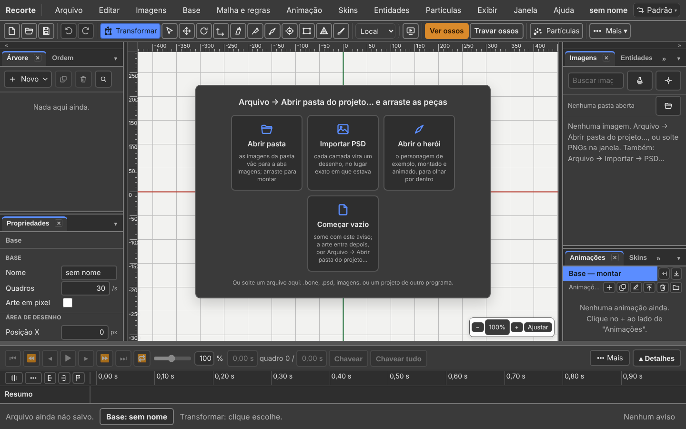

| Botão | O que faz |
|:---|:---|
| **Abrir pasta** | as imagens da pasta vão para a aba **Imagens**; você arrasta para montar |
| **Importar PSD** | cada camada vira um desenho, no lugar exato em que estava |
| **Abrir o herói** | o personagem de exemplo, montado e animado |
| **Abrir a oficina** | tudo junto: a motosserra, o mecha com o herói dentro, três bonecos com as mesmas animações, duas roupas |
| **Começar vazio** | some com os botões; a arte entra depois |

Os botões somem sozinhos no primeiro osso ou na primeira imagem.

Se a aba anterior fechou sem salvar, o editor **pergunta** se quer o trabalho de
volta. Nada abre por conta própria.

---

## A tela, de cima para baixo

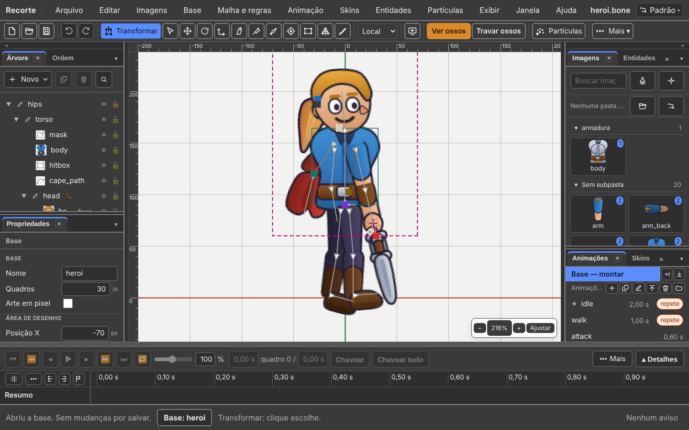

*Foto de 05/11/2026, com a base do herói aberta.*

| Faixa | O que é |
|:---|:---|
| 1 | **A barra de cima**: o nome Recorte, os **doze menus**, o nome do arquivo, e no canto direito o **botão dos contextos** |
| 2 | **A barra de ações**: arquivo, editar, as ferramentas, os eixos, ver e travar, partículas |
| 3 | **As duas colunas e a cena**: painéis à esquerda, o desenho no meio, painéis à direita |
| 4 | **A linha do tempo**, embaixo, atravessando a janela inteira |
| 5 | **O rodapé**: o que acabou de acontecer, **onde você está** (base ou animação), e os avisos |

O título da aba do navegador ganha um **•** quando há mudança não salva:
`heroi.bone • — Recorte`.

**O rodapé nunca mente.** Quando você não souber o que o programa vai fazer com
o próximo clique, é ele que responde. Frase comprida demais? Pare o mouse em
cima: a frase inteira aparece na dica.

---

## A barra de ações

Fica logo abaixo do menu e é **uma linha só**.

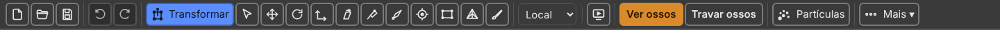

*Foto de 05/11/2026, em 1440 de largura: **Ver desenhos** e **Travar
desenhos** já foram para **Mais ▾**.*

| Grupo | O que tem |
|:---|:---|
| **Arquivo** | Novo (`Ctrl+N`) · Abrir (`Ctrl+O`) · Salvar (`Ctrl+S`) |
| **Editar** | Desfazer (`Ctrl+Z`) · Refazer (`Ctrl+Y`) · Recortar chaves (`Ctrl+X`) · Copiar (`Ctrl+C`) · Colar (`Ctrl+V`) · Apagar (`Delete`) |
| **Ferramentas** | as doze, na ordem do gesto |
| **Eixos** | uma lista de três palavras: Local · Pai · Mundo |
| **Exibir** | Imagem de referência · Prévia |
| **Ver e travar** | Ver ossos · Travar ossos · Ver desenhos · Travar desenhos |
| **Partículas** | um botão com nome: o emissor vazio e os quatro prontos |
| **Mais ▾** | só aparece quando falta largura |

**A barra nunca rola de lado.** Numa janela estreita, o que não cabe vai para
**Mais ▾**, no fim. Saem primeiro: Imagem de referência, Recortar, Colar,
Copiar e Apagar. Nunca saem: a ferramenta na mão, os Eixos e Partículas.

### As doze ferramentas

O botão mostra só o ícone. **A dica diz o nome, a tecla e o gesto** — passe o
mouse por cima e leia.

| Ferramenta | Tecla | O que faz |
|:---|:---:|:---|
| **Transformar** | `T` | move, gira e escala sem trocar de ferramenta. **É a que abre o programa** |
| **Selecionar** | `Q` | escolhe; arrastar no vazio faz um retângulo de seleção |
| **Mover** | `W` | anda com o escolhido. `Ctrl` + arrastar leva uma cópia |
| **Girar** | `E` | gira em volta do pivô. `Shift`: de 15 em 15° |
| **Escalar** | `R` | muda de tamanho. `Shift`: os dois eixos juntos |
| **Inclinar** | `Z` | o topo anda, a base fica. **Só com osso escolhido** |
| **Posar** | `Y` | arrasta a ponta de uma cadeia e ela dobra junto, sem criar regra |
| **Criar osso** | `B` | arrastar cria um osso |
| **Ponto** | `O` | `Alt` + arrastar: uma posição com nome e direção, que o jogo lê |
| **Caixa** | `X` | `Alt` + arrastar: uma caixa de colisão |
| **Malha** | `M` | move os pontos da malha |
| **Pesos** | `G` | pinta quanto cada osso puxa cada ponto. `[` e `]`: o raio do pincel |

**Mudou desde 15/09:**

| Antes | Hoje |
|:---|:---|
| Criar osso era `N` | é `B`, de *bone*. O `N` ficou livre |
| Posar era `B` | é `Y` |
| cinco ferramentas sumiam em Animando | **nenhuma some**. Todas valem sempre |

Prefere ler a palavra em vez de decorar o desenho? **Exibir → Mostrar nome das
ferramentas.** A palavra aparece ao lado do ícone.

As teclas podem ser trocadas: **Ajuda → Atalhos do teclado** tem um lápis em
cada linha.

### Os quatro de ver e travar

Estes quatro são **em palavra**, e não em ícone. Ficam **laranja** enquanto
estão ligados.

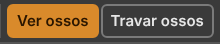

*Em 1440 de largura, só os dois dos ossos cabem na barra. Os dois dos
desenhos estão em **Mais ▾**.*

| Botão | Tecla | O que faz |
|:---|:---:|:---|
| **Ver ossos** | `7` | desenha os ossos por cima do personagem |
| **Travar ossos** | `8` | o clique passa por eles, mas eles continuam à vista |
| **Ver desenhos** | `9` | mostra as imagens do personagem |
| **Travar desenhos** | `0` | o clique passa por elas, mas elas continuam à vista |

Ver e travar são **estados**: ficam ligados por meia hora enquanto se trabalha.
Um estado ligado se lê melhor numa palavra acesa. É assim no Spriter.

---

## Base ou animação: onde você está

**O interruptor Montagem | Animando saiu** (18/09/2026). O `Ctrl+Tab` saiu com
ele. Não há modo: há **o que está aberto**.

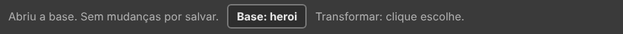

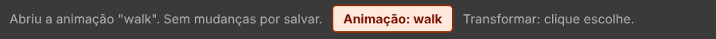

*Em cima, a base aberta. Embaixo, a `walk` aberta. É a caixa do meio do
rodapé que diz onde você está.*

| O rodapé diz | Mexer num osso |
|:---|:---|
| **Base: heroi** | muda a **base**: vale em **todas** as animações |
| **Animação: walk** | **grava uma chave** nesta animação. A base não muda |

A **base** é a animação de um quadro só onde se monta o personagem. Toda
animação nasce dela.

| Quero | Faça |
|:---|:---|
| Abrir a base | aba **Animações**, clique na linha **Base — montar** · ou **Base → Abrir a base** |
| Abrir uma animação | aba **Animações**, clique no nome dela |
| Criar uma animação | **Animação → Nova animação** |

**Mexer numa animação sempre grava.** O antigo **Gravar sozinho** (`A`) saiu.
**Chavear** (`K`) e **Chavear tudo** (`Ctrl+K`) ficaram, para **proteger a
pose**: gravar o que você não mexeu.

O que é estrutura vai para a base, mesmo com uma animação aberta: um osso
novo, por exemplo. O rodapé avisa: *"(foi para a base)"*.

O capítulo [2. Corpos e animações](02-corpos-e-animacoes.md) e o
[4. Animar](04-animar.md) tratam disso por inteiro.

---

## Os doze menus

Na ordem do trabalho, como no Spriter: trazer as imagens, montar, malha e
regras, animar, vestir, encaixar, efeito — e então olhar.

| Menu | O que mora nele |
|:---:|:---|
| **Arquivo** | novo projeto, abrir, pasta do projeto, importar, salvar, exportar, configurações |
| **Editar** | desfazer, copiar, colar, a pose, duplicar, escolher, renomear, preferências |
| **Imagens** | recarregar a pasta, pôr imagem na cena, o pivô |
| **Base** | abrir a base, criar osso e peça, quem é pai de quem, a ordem de desenho, as pastas, o repouso |
| **Malha e regras** | malha, pesos, regras, parâmetros, física |
| **Animação** | nova, tocar, ir para, chavear, curvas, marcas, eventos, efeitos, chaves |
| **Skins** | criar, clonar, editar, trocar imagem, ignorar, esconder |
| **Entidades** | trazer, pôr na cena, testar, Este boneco, promover |
| **Partículas** | o emissor vazio, fogo, fumaça, faísca, poeira |
| **Exibir** | tema, o que aparece na tela, esconder, travar, zoom |
| **Janela** | arranjos, arrumar, e os dezesseis painéis |
| **Ajuda** | manual, atalhos, problemas, paleta de comandos, sobre |

**Mudou de nome desde 15/09:**

| Era | Hoje |
|:---|:---|
| menu **Esqueleto** | menu **Base** |
| **Peles** | **Skins** |
| corpo | base |

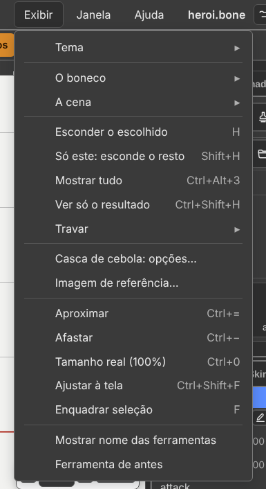

*O menu Exibir tem os submenus **O boneco ▸**, **A cena ▸**
e **Travar ▸**. As três colunas: a **marca** do que está ligado, o
**nome**, e a **tecla**.*

**O menu não esconde botão nenhum.** O botão continua onde sempre esteve, e o
menu chama a mesma função. Ele serve para você *achar* uma função e *aprender a
tecla* dela.

**Nenhum item fica cinza para sempre.** Ou ele funciona, ou ele não está no
menu. Um item cinza **diz por quê**:

| Por que está cinza | Como saber |
|:---|:---|
| ela existe e não cabe agora | a dica diz o que falta — *"Abra uma animação primeiro"* |
| ela existe e ainda não tem o que mostrar | *"Os arquivos que você abrir ou salvar aparecem aqui"* |

Clicar num item cinza com motivo **não roda nada**: o motivo vai para o rodapé.

Para ver todas as teclas de uma vez: **Ajuda → Atalhos do teclado**, ou
`Shift+F1`. A tabela é montada a partir dos próprios menus, então ela nunca
fica desatualizada.

Este manual abre em **Ajuda → Manual**, ou `F1`, numa **aba nova** do
navegador. Se o navegador barrar a aba, o editor avisa.

---

## Os doze menus, item por item

**Use como consulta**, e não como leitura. O `▸` quer dizer submenu.

### Arquivo

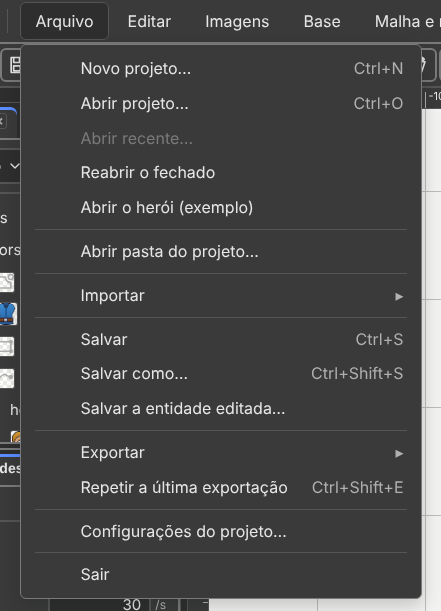

| Item | Tecla | O que faz |
|:---|:---:|:---|
| **Novo projeto…** | `Ctrl+N` | pede a pasta do projeto e começa nela, com uma base vazia |
| **Abrir projeto…** | `Ctrl+O` | abre um `.bone`, `.boneb` ou `.bonez` |
| **Abrir recente…** | — | os cinco últimos, numa janela com busca |
| **Reabrir o fechado** | — | traz de volta o trabalho que a aba tinha ao fechar |
| **Abrir o herói (exemplo)** | — | o personagem de exemplo. Com mudança não salva, pergunta antes |
| **Abrir a oficina (exemplo)** | — | a pasta `exemplo/oficina`, com cinco bases: herói com motosserra, mecha com o herói na cabine, cavaleiro, goblin e robô com as mesmas animações |
| **Abrir pasta do projeto…** | — | as imagens vão para a aba Imagens, por subpasta. Nada entra na cena sozinho |
| **Importar ▸ De outro programa…** | — | pede a pasta do projeto do Spriter, do Spine ou do DragonBones |
| **Importar ▸ PSD…** | — | cada camada vira um desenho, no lugar |
| **Importar ▸ PSD com ossos…** | — | o mesmo, e a camada `ossos` vira o esqueleto |
| **Importar ▸ Animações, de outra base…** | — | traz animações de um `.bone` |
| **Importar ▸ Skin, de outro boneco…** | — | traz uma skin de um `.bone` |
| **Salvar** | `Ctrl+S` | grava a pasta: o `.bone`, o atlas e as imagens em uso |
| **Salvar como…** | `Ctrl+Shift+S` | uma cópia, noutra pasta |
| **Salvar a entidade editada…** | — | Novo, ou Por cima do arquivo de origem |
| **Exportar ▸ GIF, PNG, folha, vídeo…** | — | a animação como imagem ou vídeo |
| **Exportar ▸ Uma imagem por skin…** | — | a mesma exportação, uma vez por skin |
| **Exportar ▸ glTF, para programa 3D…** | — | um `.glb` com ossos e animações |
| **Exportar ▸ Salvar como binário…** | — | um `.boneb`, cerca de um terço menor |
| **Exportar ▸ Salvar como pacote…** | — | um `.bonez` só, com tudo dentro |
| **Exportar ▸ Entregar uma base…** | — | uma base sozinha, só com as imagens que ela usa |
| **Exportar ▸ Animações, para outra base…** | — | grava as animações marcadas num `.bone` |
| **Exportar ▸ Skin, para outro boneco…** | — | grava a skin do lápis num `.bone` |
| **Repetir a última exportação** | `Ctrl+Shift+E` | exporta de novo, sem abrir a janela |
| **Configurações do projeto…** | — | quadros por segundo, cor de fundo, grade, o que fazer ao trocar de animação tocando, tempo de mistura |
| **Sair** | — | fecha. O não salvo volta pelo Reabrir o fechado |

**Saíram do Arquivo:** **Importar → Imagens…** (as imagens chegam pela pasta,
ou soltas na janela) e **Reempacotar atlas** (o Salvar faz o atlas).

### Editar

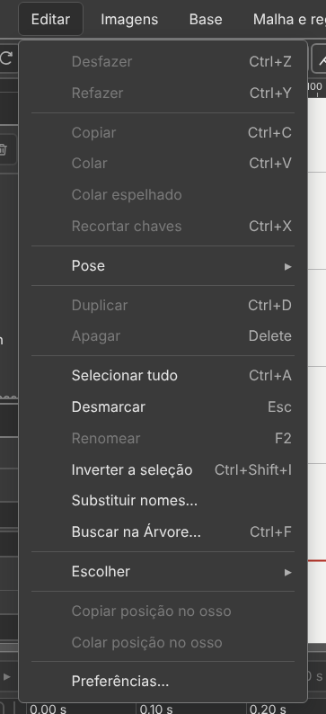

| Item | Tecla | O que faz |
|:---|:---:|:---|
| **Desfazer** | `Ctrl+Z` | volta um passo; o nome do passo vem no item |
| **Refazer** | `Ctrl+Y` | refaz. `Ctrl+Shift+Z` também |
| **Copiar** | `Ctrl+C` | copia o que está escolhido |
| **Colar** | `Ctrl+V` | cola o que foi copiado |
| **Colar espelhado** | — | cola trocando esquerda e direita pelo nome |
| **Recortar chaves** | `Ctrl+X` | copia e apaga as chaves |
| **Pose ▸ Copiar a pose inteira** | `Ctrl+Shift+C` | como o personagem **está**, mesmo entre duas chaves |
| **Pose ▸ Copiar a pose do escolhido** | — | o mesmo, só do escolhido |
| **Pose ▸ Colar em todas as chaves** | `Ctrl+Shift+V` | o valor copiado em toda chave da linha |
| **Pose ▸ Meio-termo** (e → anterior, → seguinte) | — | uma chave no meio do caminho entre a de antes e a de depois |
| **Duplicar** | `Ctrl+D` | o osso vem com os filhos e os desenhos, 20 px à direita |
| **Apagar** | `Delete` | apaga o escolhido |
| **Selecionar tudo** | `Ctrl+A` | todos os ossos e todos os desenhos |
| **Desmarcar** | `Esc` | tira a escolha de tudo |
| **Renomear** | `F2` | como o duplo clique no nome |
| **Inverter a seleção** | `Ctrl+Shift+I` | escolhe o que **não** estava escolhido |
| **Substituir nomes…** | — | troca um pedaço do nome em vários, com prévia |
| **Buscar na Árvore…** | `Ctrl+F` | filtra a Árvore pelo nome |
| **Escolher ▸ Os filhos** | `]` | o osso, os descendentes e os desenhos deles |
| **Escolher ▸ Os pais** | `[` | o osso e a corrente de pais até a raiz |
| **Copiar posição no osso** | — | `x`, `y`, giro e as duas escalas de um desenho |
| **Colar posição no osso** | — | os mesmos cinco números nos desenhos escolhidos |
| **Preferências…** | — | o que o programa faz sozinho, e como ele avisa |

### Imagens

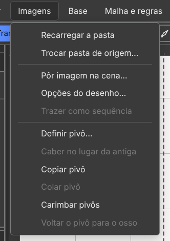

| Item | O que faz |
|:---|:---|
| **Recarregar a pasta** | relê a pasta do disco: imagem nova entra, apagada sai |
| **Trocar pasta de origem…** | as imagens passam a vir de outra pasta, pelos mesmos nomes |
| **Pôr imagem na cena…** | escolhe uma imagem numa lista, em vez de arrastar |
| **Opções do desenho…** | o mesmo que o botão direito num desenho: a grade para trocar a imagem |
| **Trazer como sequência** | uma subpasta numerada vira um desenho só, que troca de quadro |
| **Definir pivô…** | a janela do pivô, para a imagem do desenho escolhido |
| **Caber no lugar da antiga** | a imagem trocada fica do tamanho da que saiu |
| **Copiar pivô** · **Colar pivô** | o pivô de uma imagem em outra, na mesma proporção |
| **Carimbar pivôs** | grava no atlas onde cada imagem encaixa no osso |
| **Voltar o pivô para o osso** | o pivô mexido à mão volta para onde o osso está |

### Base

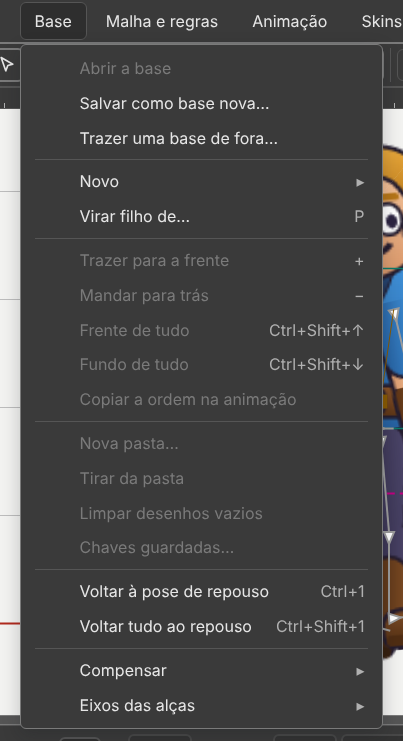

*Era o menu Esqueleto. Hoje se chama **Base**.*

| Item | Tecla | O que faz |
|:---|:---:|:---|
| **Abrir a base** | — | sai da animação e abre a base |
| **Salvar como base nova…** | — | o quadro de agora vira uma base nova |
| **Trazer uma base de fora…** | — | um `.bone` de fora entra na lista Bases |
| **Novo ▸ Osso** | — | um osso, filho do escolhido |
| **Novo ▸ Ponto** | `O` | uma posição com nome e direção |
| **Novo ▸ Caixa de colisão** | `X` | um contorno para o jogo medir |
| **Novo ▸ Ponto neste desenho** · **Caixa neste desenho** | — | entra no desenho escolhido, sem criar outro |
| **Novo ▸ Máscara** | — | um contorno que recorta sem apagar |
| **Virar filho de…** | `P` | com um osso escolhido: clique em quem vira filho dele, até o `Esc` |
| **Trazer para a frente** | `+` | sobe uma posição na ordem de desenho |
| **Mandar para trás** | `−` | desce uma posição |
| **Frente de tudo** | `Ctrl+Shift+↑` | vai para o topo |
| **Fundo de tudo** | `Ctrl+Shift+↓` | vai para o fim |
| **Copiar a ordem na animação** | — | a ordem de agora vale na animação inteira |
| **Nova pasta…** · **Tirar da pasta** | — | junta peças numa pasta, ou tira |
| **Limpar desenhos vazios** | — | apaga os desenhos que não mostram nada em skin nenhuma |
| **Chaves guardadas…** | — | as chaves das peças tiradas da base |
| **Voltar à pose de repouso** | `Ctrl+1` | devolve o osso escolhido à base |
| **Voltar tudo ao repouso** | `Ctrl+Shift+1` | devolve todos |
| **Compensar ▸** | — | não mexer nos filhos · nos desenhos · nas caixas |
| **Eixos das alças ▸** | — | Local · Pai · Mundo |

**Saíram do antigo Esqueleto:** Novo → Slot, Reempacotar atlas, os quatro de
travar (foram para **Exibir → Travar**), as peles (foram para **Skins**), as
regras (foram para **Malha e regras**).

### Malha e regras

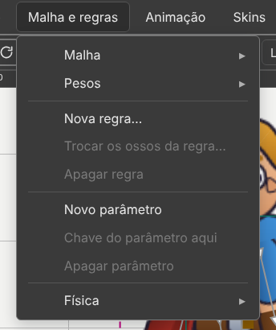

| Item | O que faz |
|:---|:---|
| **Malha ▸** | Virar malha · Gerar automática · Traçar contorno · Criar vértice · Criar ou apagar aresta · Apagar vértice · Usar a forma de outra malha |
| **Pesos ▸** | Ligar ossos · Pesos automáticos · Suavizar tudo · Podar · Chavear pesos · Tirar pesos |
| **Nova regra…** | a janela que pergunta que ossos dobram e o que eles perseguem |
| **Trocar os ossos da regra…** · **Apagar regra** | mexe na regra escolhida |
| **Novo parâmetro** · **Chave do parâmetro aqui** · **Apagar parâmetro** | o número que o jogo manda de fora |
| **Física ▸** | Simular a física · Reiniciar esta física · Reiniciar todas · Assar a física em chaves… |

Veja os capítulos [6](06-malha-e-pesos.md) e [7](07-as-cinco-regras.md).

### Animação

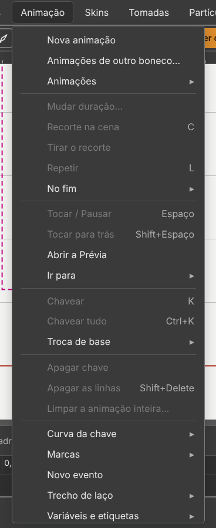

| Item | Tecla | O que faz |
|:---|:---:|:---|
| **Nova animação** | — | cria e abre |
| **Animações ▸** | — | Duplicar · Renomear · Apagar · Mandar para o topo · Biblioteca de animações… |
| **Mudar duração…** | — | pergunta se as chaves esticam junto |
| **Repetir** | `L` | volta ao começo no fim. Fica gravado no arquivo |
| **No fim ▸** | — | o que o tocador faz no fim: Como o arquivo diz · Parar · Repetir · Vai e volta · Voltar ao início |
| **Tocar / Pausar** | `Espaço` | toca e pausa |
| **Tocar para trás** | `Shift+Espaço` | do fim para o começo |
| **Abrir a Prévia** | — | a aba Prévia, com a animação tocando |
| **Ir para ▸** | `Home` `End` `←` `→` `↑` `↓` | Início · Fim · Quadro anterior · Quadro seguinte · Chave anterior · Chave seguinte |
| **Ir para ▸** | `Shift+↑` `Shift+↓` | Chave anterior do escolhido · Chave seguinte do escolhido |
| **Chavear** | `K` | protege a pose: grava a chave do escolhido |
| **Chavear tudo** | `Ctrl+K` | grava a chave de todas as linhas |
| **Troca de base ▸** | — | Colar outra base aqui · Tirar a troca daqui |
| **Recorte na cena** | `C` | o retângulo que a exportação de imagem usa, só desta animação. Veja o [capítulo 8](08-exportar-e-usar-no-jogo.md) |
| **Tirar o recorte** | — | apaga o retângulo; a exportação volta a cortar a borda sozinha |
| **Apagar chave** | — | apaga a chave do tempo atual |
| **Apagar as linhas** | `Shift+Delete` | tira a propriedade inteira da animação |
| **Limpar a animação inteira…** | — | pergunta antes |
| **Curva da chave ▸** | — | Linear · Suave · Entrada suave · Saída suave · Parada · Curva à mão… |
| **Marcas ▸** | `M` · `Ctrl+↑` · `Ctrl+↓` | Pôr ou tirar marca aqui · Marca anterior · Marca seguinte |
| **Novo evento** | — | um aviso que a animação manda ao jogo |
| **Trecho de laço ▸** | — | Começo do trecho aqui · Fim do trecho aqui · Tirar o trecho |
| **Variáveis e etiquetas ▸** | — | Nova variável · Apagar a variável · Nova etiqueta · Renomear etiqueta · Apagar etiqueta · Mostrar na aba Regras |
| **Efeitos de chave ▸** | — | Flash… · Pulso… · Tremor… |
| **Chaves ▸** | — | Selecionar todas · Esticar · Espelhar no tempo · Fechar ciclo · Espelhar esquerda e direita · Empurrar · Deslocar em laço · Limpar repetidas |

**Saíram da Animação:** Montagem ⇄ Animando (`Ctrl+Tab`) e Gravar sozinho (`A`).

### Skins

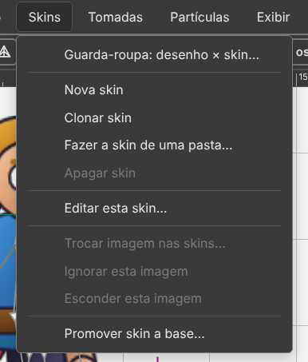

| Item | O que faz |
|:---|:---|
| **Nova skin** | uma skin vazia, que passa a ser a do lápis |
| **Clonar skin** | uma cópia, com os mesmos ossos |
| **Fazer a skin de uma pasta…** | cada desenho procura, na pasta, a imagem de mesmo nome |
| **Apagar skin** | pergunta antes. `Ctrl+Z` devolve |
| **Editar esta skin…** | o lápis: o que se cria daqui em diante é desta skin |
| **Trocar imagem nas skins…** | troca a imagem em toda skin que usa a mesma |
| **Ignorar esta imagem** · **Esconder esta imagem** | a skin deixa a peça em paz, ou não a desenha |
| **Promover skin a base…** | a skin ligada vira uma base nova |

Importar e exportar skin ficam no **Arquivo**. Veja o [capítulo 3](03-peles.md).

### Entidades

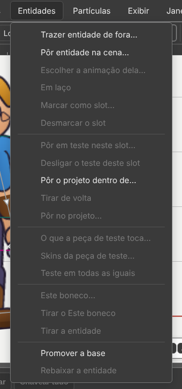

| Item | O que faz |
|:---|:---|
| **Trazer entidade de fora…** | um `.bone` de fora entra na lista Entidades |
| **Pôr entidade na cena…** | presa ao osso escolhido |
| **Escolher a animação dela…** · **Em laço** | o que ela toca, e se repete |
| **Marcar como slot…** · **Desmarcar o slot** | a imagem vira uma base, com nome e animações |
| **Pôr em teste neste slot…** e os outros de teste | testar sem mexer no arquivo |
| **Este boneco…** · **Tirar o Este boneco** | a tomada ao contrário |
| **Tirar a entidade** | a imagem de antes volta |
| **Promover a base** · **Rebaixar a entidade** | troca entre base e entidade |

Veja o [capítulo 5](05-entidades.md).

### Partículas

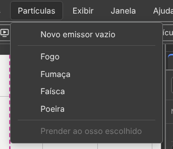

| Item | O que faz |
|:---|:---|
| **Novo emissor vazio** | um emissor preso ao osso escolhido |
| **Fogo** · **Fumaça** · **Faísca** · **Poeira** | um emissor já pronto |
| **Prender ao osso escolhido** | o emissor vira filho do osso, sem sair do lugar |

O mesmo está no botão **Partículas** da barra de ações.

### Exibir

| Item | Tecla | O que faz |
|:---|:---:|:---|
| **Tema ▸ Escuro · Claro** | — | as cores do programa. Escuro é o padrão |
| **O boneco ▸ Ossos** | `7` | desenha os ossos |
| **O boneco ▸ Desenhos** | `9` | mostra as imagens |
| **O boneco ▸** Nomes dos ossos · Pontos · Caixas · Máscaras · Malhas · Arestas · Pesos | — | o que aparece por cima do personagem |
| **A cena ▸** Grade · Réguas · Eixos · Casca de cebola · Nome ao passar o mouse | — | o que é da cena, e não do personagem |
| **A cena ▸** Guias · Travar guias · Limpar guias | — | as linhas que se puxam da régua |
| **Esconder o escolhido** | `H` | some com o escolhido |
| **Só este: esconde o resto** | `Shift+H` | some com todo o resto |
| **Mostrar tudo** | `Ctrl+Alt+3` | traz tudo de volta |
| **Ver só o resultado** | `Ctrl+Shift+H` | desliga toda ajuda de tela, de uma vez |
| **Travar ▸ Travar ossos** | `8` | o clique passa pelos ossos |
| **Travar ▸ Travar desenhos** | `0` | o clique passa pelos desenhos |
| **Travar ▸ Travar o escolhido** | `Ctrl+2` | trava só o escolhido |
| **Travar ▸ Travar o resto** | `Ctrl+Shift+2` | trava todo o resto |
| **Travar ▸ Destravar tudo** | `Ctrl+Alt+2` | destrava |
| **Casca de cebola: opções…** | — | quantos quadros, o passo, as cores |
| **Imagem de referência…** | — | um desenho atrás da cena, para copiar por cima |
| **Aproximar** | `Ctrl+=` | um passo de zoom para dentro |
| **Afastar** | `Ctrl+−` | um passo para fora |
| **Tamanho real (100%)** | `Ctrl+0` | volta a 100% |
| **Ajustar à tela** | `Ctrl+Shift+F` | o personagem inteiro cabe |
| **Enquadrar seleção** | `F` | só o escolhido enche a cena |
| **Mostrar nome das ferramentas** | — | a palavra ao lado do ícone |
| **Ferramenta de antes** | — | o mesmo que o botão direito na cena |

### Janela

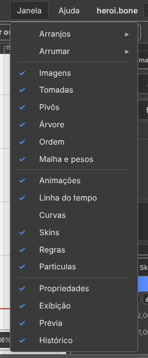

*São dezesseis painéis. O menu tem Arranjos e Arrumar no alto.*

| Item | Tecla | O que faz |
|:---|:---:|:---|
| **Arranjos ▸** | — | Montar · Animar · Pesos · Pivô · Visualização · os seus · Guardar este arranjo… · Apagar um arranjo… · Voltar ao padrão |
| **Arrumar ▸ Esconder painéis** | `Tab` | somem as colunas e a linha do tempo |
| **Arrumar ▸ Esconder só as colunas** | `Shift+Tab` | somem as colunas; a linha do tempo fica |
| **Arrumar ▸ Soltar o painel da parede** | — | o painel em uso flutua sobre a cena |
| **Arrumar ▸ Recolher em ícone** · **Expandir** | — | as colunas viram faixas de ícones, e voltam |
| **Arrumar ▸ Mover para a outra coluna** | — | pergunta qual painel |
| **Arrumar ▸ Fechar o grupo** | — | fecha o grupo de abas em uso |
| **Arrumar ▸ Detalhes da linha do tempo** | — | abre e fecha a faixa de baixo |

Embaixo, os **dezesseis painéis**, em três blocos, cada um com a marca de quem
está na coluna. Clicar abre; clicar no que já está à frente fecha.

| Bloco | Painéis |
|:---|:---|
| montar | **Imagens · Entidades · Pivôs · Árvore · Ordem · Malha e pesos** |
| animar | **Animações · Linha do tempo · Curvas · Skins · Regras · Partículas** |
| olhar | **Propriedades · Exibição · Prévia · Histórico** |

### Ajuda

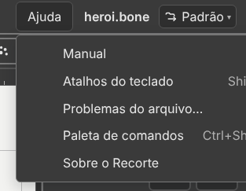

| Item | Tecla | O que faz |
|:---|:---:|:---|
| **Manual** | `F1` | este manual |
| **Atalhos do teclado** | `Shift+F1` | todas as teclas, com o lápis para trocar uma |
| **Problemas do arquivo…** | — | o que o programa não entendeu no arquivo, e onde |
| **Paleta de comandos** | `Ctrl+Shift+P` | digite um pedaço do nome e ache o comando |
| **Sobre o Recorte** | — | a versão, a licença e o endereço do formato |

---

## Não sabe como fazer? **Quero fazer…**

Você sabe o que quer, mas não sabe o nome do comando. Comece aqui.

1. Clique em **Quero fazer…**, no rodapé, à direita. Ou **Ajuda → Quero fazer…**.
2. Digite a coisa: `arma`, `roupa`, `gif`, `psd`. Sem acento serve.
3. Clique na tarefa. Os passos aparecem embaixo.
4. Clique em **Mostrar onde**. O menu abre, e o item fica **aceso em laranja**.
5. Clique você no item aceso.

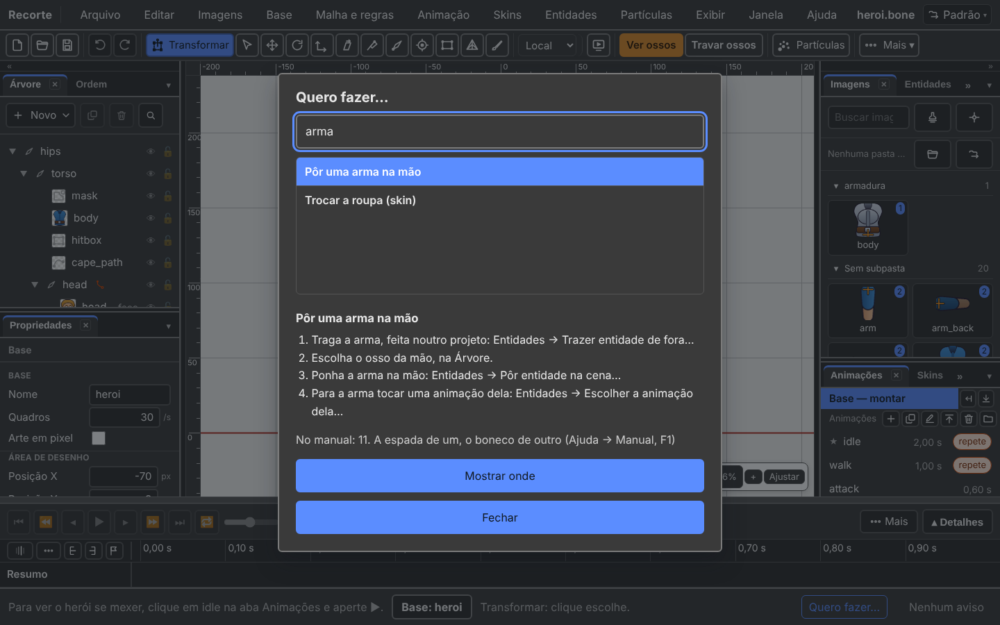

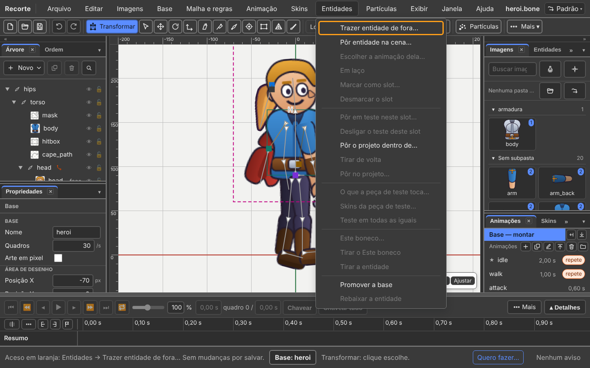

O caminho escrito em cada passo vem dos menus do programa. Se um item mudar
de nome, o passo muda junto.

---

## Item cinza: ele diz por quê

Um item **cinza** não está quebrado. Falta alguma coisa antes.

1. Pare o mouse em cima do item cinza.
2. **O rodapé diz por quê, e o que fazer.**
3. A dica do item diz o mesmo.

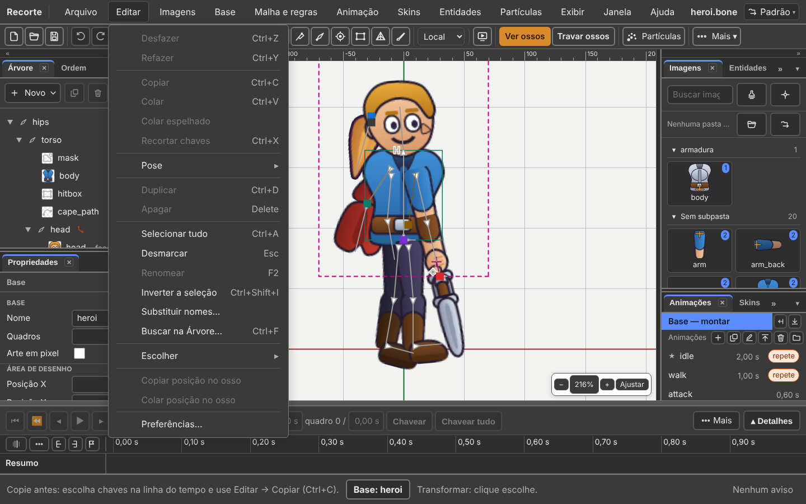

| Item cinza | O rodapé diz |
|:---|:---|
| **Editar → Colar** | copie antes: escolha chaves e use Editar → Copiar |
| **Animação → Chavear** | abra uma animação primeiro: clique numa, na aba Animações |
| **Base → Trazer para a frente** | escolha um desenho primeiro |
| **Editar → Desfazer** | não há passo para desfazer ainda |

Clicar no item cinza não faz nada de errado: ele só repete o motivo no rodapé.

---

## Não acha um comando? `Ctrl+Shift+P`

São doze menus e mais de duzentas entradas. A pergunta mais comum não é
"isso existe?" — é **"em qual menu está?"**.

Aperte `Ctrl+Shift+P`, digite três letras, aperte `Enter`.

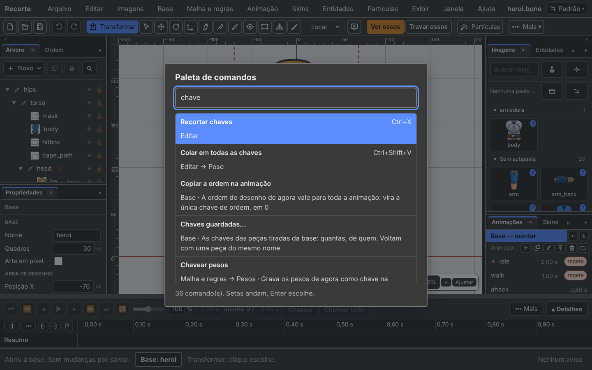

- Não precisa de acento nem de maiúscula: `cebola` acha **Casca de cebola**.
- As setas andam na lista, `Enter` escolhe, `Esc` fecha.
- **A tecla aparece ao lado do nome.**
- O nome antigo também acha: a dica de cada item guarda como ele se chamava.

Também está em **Ajuda → Paleta de comandos**, e no botão **Procurar um
comando…** da janela de Atalhos.

---

## As duas colunas, e o `Tab`

A cena fica no meio, com uma coluna de cada lado. Cada coluna são **dois grupos
de abas**, um em cima do outro. Num grupo, uma aba aparece por vez.

De fábrica:

| Coluna | Grupo de cima | Grupo de baixo |
|:---|:---|:---|
| **Esquerda** | Árvore · Ordem | Propriedades |
| **Direita** | Imagens · Entidades · Pivôs · Malha e pesos · Partículas · Exibição · Prévia | Animações · Skins · Regras · Histórico |

A **Linha do tempo** e as **Curvas** ficam embaixo, na faixa larga.

À esquerda fica o que responde *"o que é esta coisa que eu estou olhando?"*. À
direita, o que responde *"o que eu quero fazer agora?"*.

| Você quer | Como se faz |
|:---|:---|
| levar uma aba para outro grupo | **arraste a aba**. Uma linha azul mostra onde ela entra. `Esc` cancela |
| soltar um painel da parede | arraste a aba **para fora**, sobre a cena. Ele flutua, com barra, `×` e canto de mudar o tamanho |
| colar de volta | arraste a barra do painel solto até uma fila de abas |
| soltar o grupo inteiro | arraste o vão vazio da fila de abas |
| recolher um grupo | o `▾` no fim da fila, ou **dois cliques na aba**. O espaço vai para o outro grupo |
| fechar um painel | o `×` da aba em uso. Ele volta pelo menu **Janela**, no mesmo lugar |
| fechar o grupo inteiro | botão direito na fila de abas, ou **Janela → Arrumar → Fechar o grupo** |
| um painel do outro lado | **Janela → Arrumar → Mover para a outra coluna** |
| as colunas em ícones | a setinha dupla `«»` no topo da coluna, ou **Janela → Arrumar → Recolher em ícone** |
| mais altura para um grupo | arraste a **alça entre os dois grupos**. Dois cliques nela devolvem o automático |
| mais largura para uma coluna | arraste a **alça entre a coluna e a cena**. De 180 a 480 pixels |
| a janela toda para o desenho | `Tab`. `Tab` de novo traz tudo de volta |
| só as colunas somem | `Shift+Tab` |

O último painel aberto de uma coluna não se fecha: a coluna nunca fica muda.

### Os contextos

No **canto de cima, à direita**, o botão dos contextos. É a "área de trabalho"
do Photoshop: a tela arrumada para uma tarefa.

| Contexto | Para quê |
|:---|:---|
| **Montar** | Árvore, Ordem, Propriedades, Imagens. A linha do tempo fechada |
| **Animar** | Animações e a linha do tempo aberta |
| **Pesos** | Malha e pesos com quase toda a altura |

Bagunçou? **Janela → Arranjos → Voltar ao padrão.**

**A arrumação mora na sua máquina, e não no `.bone`.** Abrir o boneco de outra
pessoa não mexe na sua tela. *(Mudou desde 15/09: antes ia dentro do arquivo.)*

---

## A cena: réguas, grade e zoom

As **réguas** ficam em cima e à esquerda do desenho, com os números do mundo.
**Régua e grade são a mesma escala**, sempre. Uma linha fina acompanha o
ponteiro nas duas.

**Exibir → A cena → Réguas** desliga e liga.

O **zoom** fica no canto da cena: `−` · `100%` · `+` · `Ajustar`. O `100%` é um
campo: digite um número e aperte `Enter`.

| Tecla | Faz |
|:---:|:---|
| `Ctrl+=` | aproxima um passo |
| `Ctrl+−` | afasta um passo |
| `Ctrl+0` | **Tamanho real (100%)** |
| `Ctrl+Shift+F` | **Ajustar à tela**: o personagem inteiro cabe |
| `F` | **Enquadrar seleção**: só o escolhido |
| roda do mouse | aproxima e afasta onde o ponteiro está |
| botão do meio, ou `Espaço` segurado | arrasta a vista |

`Espaço` apertado e solto, sem arrastar, toca a animação.

Não há barras de rolagem, e isso é de propósito: a cena não tem borda.

---

## O tema

O editor abre **escuro**: painel cinza escuro, texto claro, e a cena em cinza
claro — as cores da tela do Spriter.

**Exibir → Tema → Claro** volta ao branco, na hora. A escolha fica lembrada.

A **cena continua clara** nos dois temas, de propósito: linha escura sobre fundo
escuro não se vê. Outra cor de fundo: aba **Exibição → A cena → Cor do fundo**.
Ela é só do editor: não vai para o arquivo exportado.

---

## Botão direito na cena

| Onde | O que faz |
|:---|:---|
| no vazio | volta para a **ferramenta anterior** |
| em cima de um desenho | abre a grade: trocar a imagem, ordem, duplicar, apagar |

Você está em **Girar**, aperta `W` e vai para **Mover**. Botão direito no
vazio, e volta para **Girar**. De novo, e volta para **Mover**.

As duas portas também estão no menu: **Exibir → Ferramenta de antes** e
**Imagens → Opções do desenho…**.

---

## Salvar, e não perder trabalho

`Ctrl+S` salva.

| O rodapé diz | Quer dizer |
|:---|:---|
| **Arquivo não salvo.** | há mudança. O título ganha o **•** |
| **Sem mudanças por salvar.** | o que está na tela é o que está no disco |
| **Arquivo ainda não salvo.** | o trabalho nunca foi gravado |

| Item | O que grava |
|:---|:---|
| **Arquivo → Salvar** | a pasta do projeto: o `.bone`, o atlas e as imagens em uso. Com mais de uma base, um `.bone` para cada e o `manifest.json` |
| **Arquivo → Exportar → Salvar como binário…** | um `.boneb`, menor |
| **Arquivo → Exportar → Salvar como pacote…** | um `.bonez`, com tudo junto |

Guarde o `.bone`, o atlas e as imagens **na mesma pasta**. Sempre.

O editor guarda sozinho o que está na tela, a cada poucos segundos. Fechou a
aba sem querer, o computador desligou: **Arquivo → Reabrir o fechado**. Ele diz
a hora do que guardou e **pergunta antes**.

**As imagens não vêm no guardado.** O rodapé diz o remédio: *Arquivo → Abrir
pasta do projeto…*.

Abrir outra coisa com mudança não salva também pergunta: **Salvar e
continuar** · **Descartar as mudanças** · **Cancelar**.

---

## O Histórico: onde isto ainda estava certo?

Aba **Histórico**, na coluna da direita, grupo de baixo.

Uma linha por passo, com o nome do que foi feito. A linha de cima é sempre
**Arquivo aberto**.

| O que você vê | O que quer dizer |
|:---|:---|
| linha com **●** | é onde o documento está agora |
| linhas com **○** | os outros passos |
| linhas **cinza** | passos desfeitos; somem quando você faz algo novo |

**Clicar numa linha vai até ela** — para trás ou para a frente, quantos passos
forem precisos.

É a resposta para a pergunta que `Ctrl+Z` não responde: *em que ponto isto
ainda estava certo?*

---

## Ver o exemplo pronto

O `heroi.bone` tem tudo: hierarquia, malha, pesos, três skins, as cinco regras e
três animações (`idle`, `walk`, `attack`). Ele fica em
`formato/exemplos/heroi.bone`.

O editor **não** abre nele sozinho. Abra por **Arquivo → Abrir o herói
(exemplo)**, ou pelo botão **Abrir o herói** da tela vazia.

A animação `walk`, em três instantes:

| `walk` em 0 s | `walk` em 0,25 s | `walk` em 0,5 s |
|:---:|:---:|:---:|
| 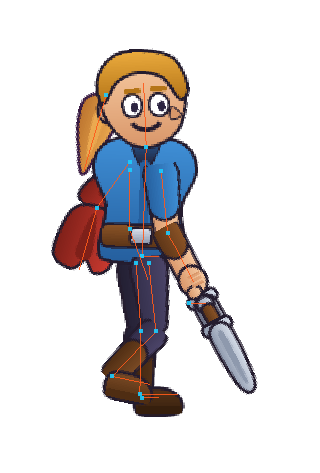 | 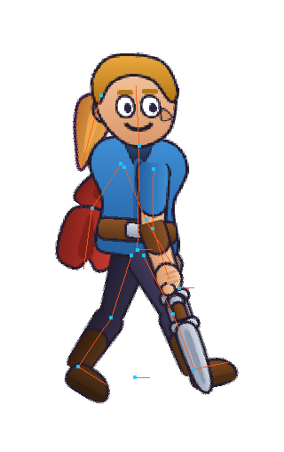 | 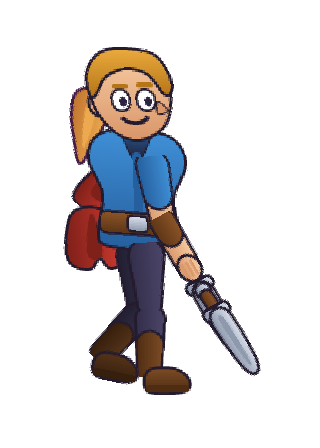 |

Para gerar a imagem de um quadro qualquer, sem abrir o editor:

```
node ferramentas/render-png.mjs walk 0.5 saida.png
```

---

## O selo — o que este capítulo confirma

Regra da casa: toda função leva um selo — **existe** · **existe diferente** ·
**falta** · **muda com as bases** — e quem não achou no código escreve **não
confirmei**. Conferido em 07/10/2026, na v36.5, **lendo o código** (não usei o
programa com o mouse).

| Função | Selo | Onde no código, ou o que muda |
|:---|:---:|:---|
| Abre vazio, com quatro botões no meio | existe | `editor/src/main.ts:162-165`, `viewport/welcome-model.ts:36-62` |
| Os doze menus, nesta ordem | existe | `ui/menus.ts:1886-1906` |
| A barra de ações, os grupos e o **Mais ▾** | existe | `ui/action-bar-model.ts:204-227,320-334`, `viewport/viewport-toolbar.ts:79-82` |
| As doze ferramentas e as letras (`T Q W E R Z Y B O X M G`) | existe | `ui/keys.ts:119-138`, `ui/toolbar-model.ts:60-63` |
| Nenhuma ferramenta some na animação | existe | `ui/toolbar-model.ts:32-35` |
| O interruptor de modo e o `Ctrl+Tab` | saiu | `ui/action-bar-model.ts:76-82`, `ui/where-model.ts:1-15` |
| O rodapé diz **Base: …** ou **Animação: …** | existe | `ui/where-model.ts:53-72` |
| Gravar sozinho (`A`) | saiu | `ui/menus.ts:1436-1437`: editar sempre grava |
| Os quatro de ver e travar, em palavra | existe | `ui/action-bar-model.ts:155-192` |
| Item cinza diz o motivo no rodapé | existe | `ui/menus.ts:2031-2033` |
| Paleta de comandos, sem acento | existe | `ui/menus.ts:1865-1871`, `ui/palette.ts:44-50` |
| Painéis de fábrica nas duas colunas | existe | `ui/layout-model.ts:54-88` |
| Arrastar aba, soltar da parede, recolher em ícone, `Shift+Tab` | existe | `documentos/projeto do programa/09 OS PAINEIS`, §9 (v26.6 a v27.3); `ui/menus.ts:1747-1811` |
| O botão dos contextos, no canto de cima | existe | `ui/shell.ts:384-389`, `ui/contexts.ts` |
| A arrumação mora na máquina, não no `.bone` | existe | `ui/layout-model.ts:127-131` (`localStorage`) |
| Zoom no canto, com o campo `100%` | existe | `viewport/viewport.ts:646-649,738-742,782` |
| Tema escuro de fábrica | existe | `ui/theme.ts:233` |
| As três frases de salvo | existe | `ui/salvar-avisos.ts:85-89` |
| Histórico com ● e ○, e "Arquivo aberto" | existe | `panels/history.ts:74`, `panels/history-model.ts:42-49` |
| Abrir recente: os cinco últimos | existe | `io/recent.ts:25` |
| O `.boneb` cerca de 36% menor que o `.bone` | existe | medido em 07/10: herói 27.917 → 17.804 bytes (`ferramentas/converter.mjs`) |
| O Manual abre numa aba nova do navegador | existe | `io/manual.ts:294-301` (`open(..., '_blank')`). Janela barrada: o editor avisa (`ui/shell-file.ts:947-962`) |

---

## O que ainda não funciona

| O quê | Requisito | Como contornar |
|:---|:---|:---|
| Não há vídeos curtos por ferramenta. | C5 | Os capítulos 1 a 7 servem de roteiro. |
| Não há repositório público onde abrir uma issue. | C4 | Fale direto com o autor. |
| Não há fórum nem canal de conversa. | C3 | — |
| A interface só existe em português. | — | O manual existe em inglês, com o rótulo português entre parênteses. |
| A dica do rodapé diz *"No menu Animação, Abrir a base"*, mas o item mora no menu **Base**. | — | Use **Base → Abrir a base**. |

---

Próximo: [1. Montar um corpo](01-montar-um-corpo.md)
