# 1. Montar um corpo

Também em inglês: [English](en/01-build-a-body.md)

> Revisto em 07/10/2026, pela versão **v36.5**. Desde 15/09 mudaram: a tecla do
> Criar osso (`B`), a Árvore (uma árvore só), o gesto do `P`, onde a imagem
> solta nasce, e o modo Montagem (hoje é **a base**).

## O que você vai conseguir fazer no fim

1. Trazer as imagens e pôr cada peça no lugar.
2. Criar os ossos, prender cada desenho no seu, e arrumar quem move quem.
3. Acertar a ordem de desenho, sem que o braço apareça por cima da cabeça.

> **Tudo neste capítulo se faz na base.** O rodapé tem de dizer
> **Base: …**. Se disser **Animação: …**, use **Base → Abrir a base**, ou
> clique na linha **Base — montar** da aba Animações.

---

## As cinco peças

| Peça | O que é | Onde fica |
|:---|:---|:---|
| **Osso** | Move o desenho. É invisível no jogo. | Árvore |
| **Desenho** (slot) | O lugar onde uma imagem aparece. Fica preso num osso. | Árvore, debaixo do osso dele |
| **Anexo** | A coisa em si: imagem, malha, caixa, ponto, máscara, caminho. | dentro do desenho |
| **Skin** | Um conjunto de anexos. Troca a roupa toda de uma vez. | Aba **Skins** — [capítulo 3](03-peles.md) |
| **Regra** | Um cálculo automático em cima dos ossos. | Aba **Regras** — [capítulo 7](07-as-cinco-regras.md) |

Na tela, o slot se chama **desenho**. A palavra *slot* fica nas dicas.

A cadeia é sempre esta:

```
osso  ->  desenho (slot)  ->  anexo
```

O osso move. O desenho diz onde e em que ordem. O anexo é o que se vê.

---

## Passo 1 — Trazer as imagens

### O jeito de sempre: a pasta do projeto

Como no Spriter, **primeiro a arte, depois os ossos**.

| Gesto | O que acontece |
|:---|:---|
| **Arquivo → Novo projeto…** (`Ctrl+N`) | pede a pasta e começa nela |
| **Arquivo → Abrir pasta do projeto…** | as imagens da pasta vão para a aba **Imagens**, por subpasta |
| soltar uma **pasta** na janela | abre aquela pasta |
| soltar **PNGs** na janela | entram na aba **Imagens** |

**Nada entra na cena sozinho.** Você arrasta cada imagem da aba Imagens para
a cena (veja abaixo).

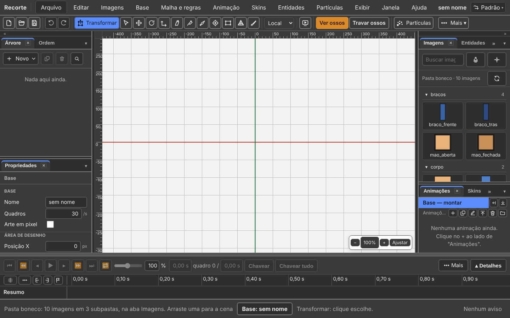

*Um boneco de teste: cada peça é um retângulo colorido. A foto mostra o
programa, não a arte.*

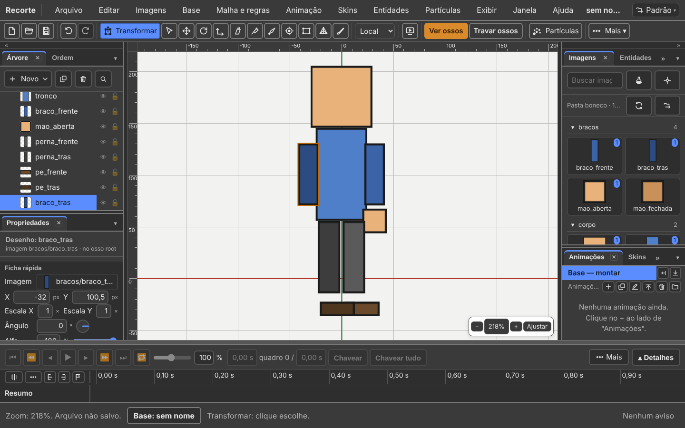

Mudou a imagem no Photoshop? **Imagens → Recarregar a pasta.** Imagem nova
entra, apagada sai, e o rodapé diz o que mudou.

**Saiu desde 15/09:** **Arquivo → Importar → Imagens…**. As imagens chegam
pela pasta, ou soltas na janela.

### Se a arte veio do Photoshop

**Arquivo → Importar → PSD…** e escolha o `.psd` (ou o `.psb`).

| O que acontece | Detalhe |
|:---|:---|
| cada camada com desenho vira um desenho | com a imagem dela |
| **cada desenho nasce no lugar exato em que a camada estava** | é isto que se perde ao exportar PNG por PNG |
| a ordem de desenho é a do Photoshop | a camada de baixo é desenhada primeiro |
| um grupo vira **pasta** | a camada `braco` dentro do grupo `corpo` sai como `braco`, na pasta `corpo` |
| camada com o olho desligado entra com o desenho desligado | e o editor avisa |

Tudo isso é **um** passo de desfazer.

Se o arquivo já tem um personagem, o editor **pergunta antes**: **Substituir o
que já existe** ou **Acrescentar ao que já existe**. `Esc` cancela e nada é
mexido.

**Nada some calado.** O que o `.bone` não guarda sai numa lista de avisos em
português: uma mistura que o formato não conhece, uma máscara de camada, uma
camada sem pixels, um nome repetido.

Pela linha de comando:

```
npm run importar-psd -- personagem.psd saida
```

### Com os ossos desenhados no PSD

Dá para desenhar o esqueleto no próprio Photoshop, por cima da arte.
**Arquivo → Importar → PSD com ossos…** lê as linhas e monta os ossos.

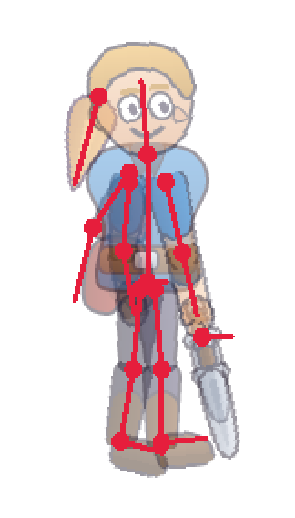

| O que você desenha | O que vira |
|:---|:---|
| uma camada chamada **`ossos`** (ou camadas dentro de um grupo `ossos`), por cima de tudo | só ela vira esqueleto; ela **não** vira desenho |
| cada **linha** dessa camada | um osso, da base à ponta |
| uma **bolinha** gorda numa das pontas | a base do osso, onde ele gira |
| sem bolinha | a ponta que encosta noutro osso vira a base |
| uma base que **encosta** noutra linha (até 12 px) | filho daquela linha |
| várias bases no mesmo ponto, uma bem mais curta | a curta (a bacia) é o pai das outras |
| uma linha que não encosta em nada | filha da raiz |
| o nome | `osso_1`, `osso_2`… da raiz para as pontas. Renomeie depois |
| cada camada de desenho | presa ao osso cuja linha mais passa por cima dela |

Dicas:

- **Ponha a bolinha em todo osso.** Sem ela, o Recorte adivinha a base.
- Encoste a base do filho **em cima** da linha do pai.
- As linhas podem se cruzar. Todas numa camada, ou uma por camada dentro do
  grupo `ossos`: as duas formas funcionam.
- O desenho não sai do lugar. Ele só passa a ser medido a partir do osso.
- Regra de IK não vem do PSD. Um alvo de IK desenhado vira um osso comum.

Tudo isso continua **um** passo de desfazer.

Pela linha de comando:

```
npm run importar-psd -- personagem.psd saida --ossos
```

No **PSD…** de sempre, a camada `ossos` fica de fora: ela nunca vira desenho.
O aviso diz para usar **PSD com ossos…**.

### Se você já tem um projeto de outro programa

**Arquivo → Importar → De outro programa…** pede a **pasta** do projeto do
Spriter, do Spine ou do DragonBones. Veja o
[capítulo 9](09-vindo-do-spriter-spine-e-dragonbones.md).

### O atlas

O atlas (a página que junta as imagens) nasce **ao Salvar**, só com as imagens
em uso. **Esqueleto → Reempacotar atlas saiu**: reempacotar é o Salvar.

---

## O painel Imagens: o que existe, e o que ninguém está usando

Aba **Imagens**, no alto da coluna da direita.

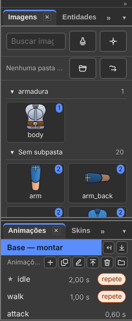

*A aba mostra as imagens **por subpasta** da pasta do projeto. No herói:
`armadura` e "Sem subpasta".*

O ponto com número numa imagem diz **quantos desenhos a usam**. Imagem que
ninguém usa fica sem ponto.

**Arraste uma imagem para a cena.** Onde você soltar, nasce um desenho:

- com o nome da imagem;
- **na raiz, sempre** — e não no osso escolhido. O desenho fica livre, como o
  sprite sem pai do Spriter. O osso vem depois e pega os desenhos;
- é **um** passo de desfazer.

*(Mudou desde 15/09: antes o desenho grudava no osso escolhido.)*

Não quer arrastar? **Imagens → Pôr imagem na cena…** escolhe numa lista.

A caixa de busca filtra ao digitar, e não liga para acento nem para maiúscula:
`MAO` acha `mão_fechada`.

| Gesto na aba | O que faz |
|:---|:---|
| **duplo clique** numa imagem | **Definir pivô…**, como no Spriter |
| botão direito numa imagem | o menu da imagem: pivô, copiar e colar pivô |
| botão direito numa subpasta | trazer como sequência |

O pivô também está em **Imagens → Definir pivô…** e na aba **Pivôs**.

---

## Passo 2 — Criar os ossos

Ferramenta **Criar osso** (`B`). *(Era `N` até 17/09.)*

| Gesto | O que faz |
|:---|:---|
| clique | põe a raiz do osso naquele ponto |
| arrastar e soltar | o comprimento e o ângulo vêm do arrasto |
| arrastar **com desenhos escolhidos** | o osso novo **pega** os desenhos, sem movê-los, e leva o nome do primeiro |
| **`Ctrl`** + arrastar | cria o osso **sem** pegar os desenhos escolhidos |
| **`Alt`** + arrastar sobre um osso | **redesenha** aquele osso, sem mover os filhos |

**Mudou desde 15/09:** o `Ctrl` fazia o contrário. Hoje pegar os desenhos é o
gesto de sempre, e o `Ctrl` é a exceção.

**Com a ferramenta na mão, o rodapé diz os gestos.**

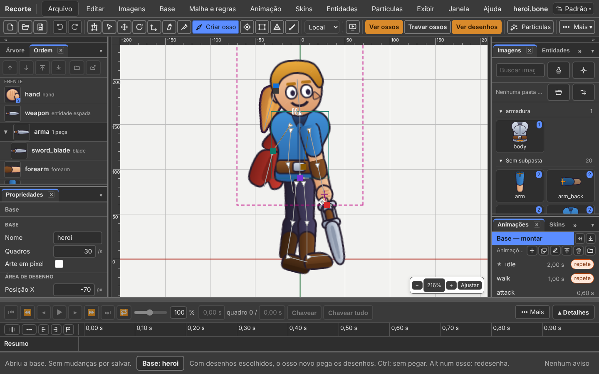


*O rodapé diz o gesto: "o osso novo pega os desenhos. Ctrl: sem pegar". Onde
você começa o arrasto é a raiz do osso; onde solta é a ponta.*

O osso novo nasce **filho do osso que você escolheu**. Sem osso escolhido, ele
nasce solto, pendurado na raiz. Clicar numa imagem na cena **não** escolhe o
osso dela: o osso novo não engancha em coisa que ninguém escolheu.

O gesto de montagem mais comum, em um só movimento: trouxe a imagem, escolheu
ela, arrastou o osso. Um `Ctrl+Z` desfaz tudo.

`Alt` + arrastar conserta um osso torto **sem apagar o que já foi animado com
ele**: as chaves ficam, e os filhos não se mexem.

Com uma animação aberta, o osso novo **vai para a base** e vale em todas as
animações. O rodapé diz *"(foi para a base)"*.

### Renomear

Dois cliques no nome, digite, `Enter`. Ou `F2`. O nome novo é trocado em
**todos** os lugares que apontavam para o antigo: desenhos, regras, chaves.

Para trocar um pedaço do nome em vinte ossos de uma vez: **Editar → Substituir
nomes…**. A janela **mostra antes** quantos vão mudar, quais, e o que vai ser
pulado com o motivo. Cuidado com pedaços curtos: `_b` também pega `arm_back`.

---

## A Árvore: onde tudo mora

Aba **Árvore**, no alto da coluna da esquerda.

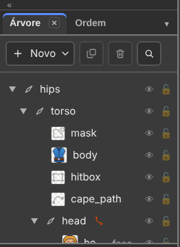

*É **uma árvore só**, como a Hierarchy do Spriter: osso, e dentro dele os
desenhos.*

| Na Árvore | O que é |
|:---|:---|
| a primeira linha | a **raiz** |
| cada osso | primeiro os **desenhos dele**, depois os **ossos filhos** |
| o triângulo `▶` `▼` | dobra e abre o osso |
| a marca laranja ao lado de um osso | uma regra manda nele |
| *por chave*, ao lado do nome | com uma animação aberta: o pai deste quadro é outro |
| o grupo do fim | os **eventos** e os **parâmetros** |

Cada linha de desenho mostra a **miniatura** do que ele mostra agora. Cada linha
tem um **olho** (esconde) e um **cadeado** (trava).

No cabeçalho:

| Botão | O que faz |
|:---|:---|
| **Novo ▾** | osso, regra, evento, skin, parâmetro ou emissor de partículas |
| **Duplicar** (`Ctrl+D`) | o osso vem com os filhos e os desenhos, 20 px à direita |
| **Apagar** (`Delete`) | o osso leva os de baixo e os desenhos deles, e **pergunta antes** |
| **Buscar na Árvore** (`Ctrl+F`) | filtra pelo nome, sem acento e sem caixa. `Esc` fecha |

Botão direito numa linha de osso: **Novo osso filho**, **Duplicar**,
**Substituir nomes…**, **Renomear**, **Apagar**. Numa linha de desenho, também
**Copiar** e **Colar posição no osso**, e **Trocar a imagem em todas as
skins…**.

Com o foco na Árvore, as setas andam:

| Tecla | Faz |
|:---:|:---|
| `↑` `↓` | a linha de cima, a de baixo |
| `←` | dobra o osso, ou vai ao pai |
| `→` | abre o osso dobrado |

**Todo desenho tem miniatura, e nenhuma fica vazia:**

| O desenho é | A miniatura mostra |
|:---|:---|
| uma imagem | a imagem |
| uma **sequência** de imagens | o quadro de repouso, com um cantinho dizendo **quantos quadros** |
| uma **malha** | a imagem dela |
| um **esqueleto filho** (uma espada, um capacete) | o esqueleto **desenhado** |
| um ponto, uma caixa, um caminho, uma máscara | o **ícone do tipo**; o nome do tipo está na dica |

---

## Passo 3 — Prender cada desenho no seu osso

O jeito mais rápido é o do Passo 2: escolher os desenhos e **criar o osso por
cima deles**.

Para um desenho que já existe: clique nele. No painel **Propriedades**, grupo
**Desenho**, o campo **Osso** é uma lista com todos os ossos. Escolha o certo.

Pronto: aquele desenho passa a andar com aquele osso.

### Mudar o pai depois

| Onde | Como |
|:---|:---|
| **Na cena, segurando `P`** | escolha **um** osso — ele é o pai —, **segure** `P` e clique em cada osso e cada desenho que vai virar filho dele. Solte `P` para terminar |
| **Pelo menu** | **Base → Virar filho de…**: o mesmo gesto, sem segurar a tecla. Clique nos filhos até o `Esc` |
| **Na Árvore** | arraste o nome por cima do nome do futuro pai |
| **Na Árvore, para soltar** | arraste até o fim vazio da lista: fica solto, sem osso |
| **No campo Osso** | Propriedades, grupo **Desenho** |

**Saiu desde 15/09:** o gesto do Spine (escolher vários, apertar `P`, clicar no
pai) e a janela "Virar filho de qual osso?". Hoje o `P` é um gesto só: **o pai
primeiro**. Com outra escolha, o `P` só diz no rodapé o que fazer.

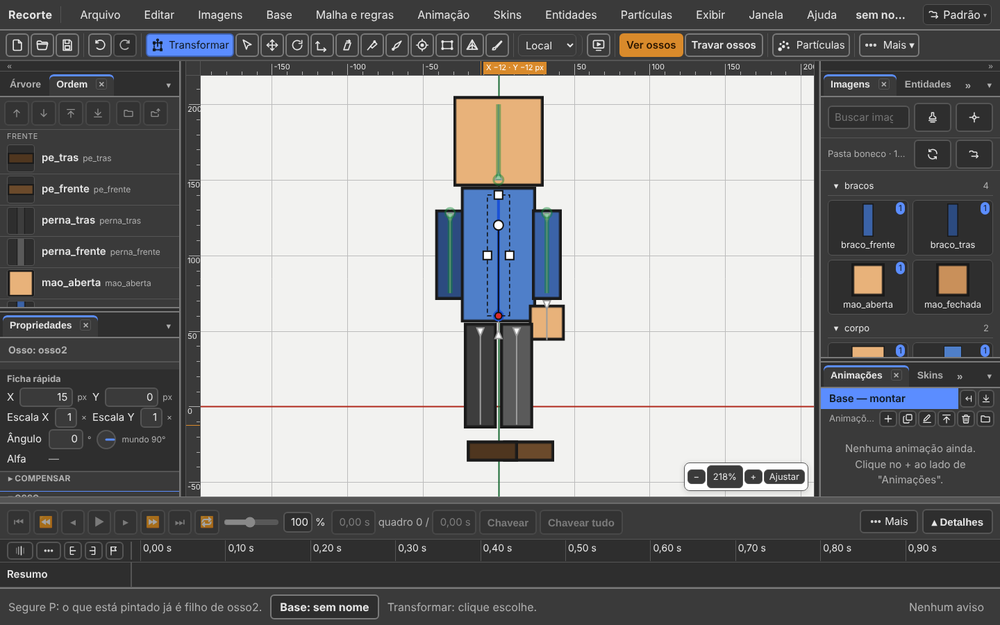

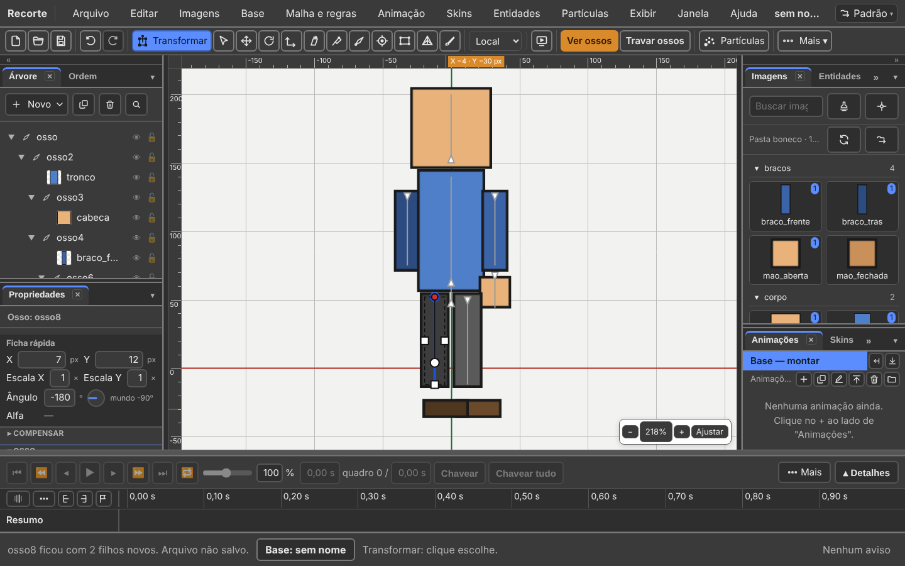


*Segure `P` e o rodapé passa a dizer de quem os cliques estão virando filhos. O
cursor muda junto.*

Segurando `P`:

| O clique em… | O que faz |
|:---|:---|
| um osso ou desenho qualquer | prende como filho |
| o mesmo de novo | solta: ele volta ao pai que tinha |
| quem **já era filho** antes do gesto | sai de baixo do pai e fica solto |
| um **ancestral** do pai | os dois **trocam de lugar**, e a cadeia continua de pé |

Os filhos que o osso já tem ficam **marcados na cena** enquanto o `P` está
embaixo: você vê o que já está preso antes de clicar.

Cada clique é um passo de **Desfazer** com o nome do filho.

O osso raiz não muda de pai. Se algo não puder ir, o rodapé diz qual e por quê.

**Trocar de pai não move nada.** O osso e o desenho ficam exatamente onde
estavam na tela. Os números de Propriedades mudam — eles são medidos a partir
do novo pai —, e é isso que mantém o desenho parado.

**Com uma animação aberta**, trocar de pai **vira chave**: a arma sai da mão e
vai para as costas no meio da animação. A Árvore mostra o pai **daquele
quadro**. O rodapé diz onde gravou: *"body virou filho de head (chave de pai em
0,00 s)"*.

### Trocar a imagem de um desenho

Um desenho mostra **uma** imagem de cada vez: a mão aberta ou a mão fechada,
nunca as duas.

| Onde | Como |
|:---|:---|
| **na cena** | botão direito no desenho: a grade, com as imagens. Clique na nova |
| **pelo menu** | **Imagens → Opções do desenho…** |
| **Propriedades** | grupo **Desenho**, campo **Mostra**: uma lista. Abra e escolha |

**Nenhuma** no campo Mostra deixa o desenho vazio.

A imagem nova ficou maior que a antiga? **Imagens → Caber no lugar da antiga.**

**Numa animação isso vira chave.** Trocar a imagem grava uma chave no tempo da
agulha, e a base fica intacta.

---

## Hierarquia: quem move quem

Girar um osso pai move todos os filhos junto.

Este é o desenho que quase todo personagem humano usa:

```
root
└── quadril
    ├── tronco
    │   ├── cabeca
    │   ├── braco_esq
    │   │   └── antebraco_esq
    │   └── braco_dir
    │       └── antebraco_dir
    ├── perna_esq
    │   └── canela_esq
    └── perna_dir
        └── canela_dir
```

O `root` fica parado, no chão, no ponto zero — a engine usa ele como a posição
do personagem no mundo. O `quadril` é o que você move para o personagem andar.

### Herança, item por item

No painel Propriedades, grupo **Herança do osso pai**:

| Caixa | Desligada quer dizer |
|:---|:---|
| Herda rotação | o osso fica no mesmo ângulo na tela quando o pai gira |
| Herda escala | o osso guarda o próprio tamanho quando o pai muda |
| Herda espelhamento | o osso não vira do avesso quando o pai vira |

Use com parcimônia. Um exemplo bom: uma mochila que fica sempre em pé, mesmo com
o tronco inclinado — desligue **Herda rotação**.

---

## Propriedades e a ficha rápida

Aba **Propriedades**, embaixo da Árvore.

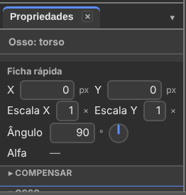

*No alto, sempre as mesmas seis linhas: X, Y, Escala X, Escala Y, Ângulo e
Alfa. Embaixo, tudo o mais que aquele osso ou desenho tem.*

| Linha da ficha | Como se mexe |
|:---|:---|
| **X** e **Y** | digite o número, em px |
| **Escala X** e **Escala Y** | digite o número. `1` é o tamanho de montar; negativo espelha |
| **Ângulo** | digite os graus, **ou arraste o disco** ao lado, **ou arraste o rótulo** |
| **Alfa** | digite de 0 a 100, **ou arraste a barra** |

O campo aceita conta: `90+15` vira `105`.

O disco gira como se gira: direita é 0°, cima é 90°, esquerda é 180°, baixo é
−90°. Arrastar o disco é um passo de desfazer.

| Caso | A ficha |
|:---|:---|
| num **osso** | a linha do Alfa fica vazia: alfa é do desenho, não do osso |
| osso **inclinado** | ganha as linhas **Inclinação X** e **Y**, só quando não são zero |
| uma **malha** | perde X, Y, escala e ângulo: quem move a malha é o osso, ou os vértices |

Pare o mouse em cima de uma linha: a dica diz a **unidade** e a faixa.

**Setas nos campos de número.** Com o cursor num campo de número, `↑` sobe um
passo e `↓` desce um.

| Tecla | Passo |
|:---:|:---|
| `↑` ou `↓` | um passo: 1 em X, Y e Ângulo; 0,01 na escala; 1 no Alfa |
| `Shift` + seta | dez passos |
| `Alt` + seta | um décimo de passo |

Segurar a tecla é **um passo de desfazer** só. Dentro do campo a seta é do
campo: ela não anda na linha do tempo. Com `Shift` e `Alt` juntos, vale o
`Shift`.

### Os campos do desenho

| Grupo | Campo | O que faz |
|:---|:---|:---|
| Desenho | Nome | o nome do desenho |
| Desenho | Osso | em qual osso ele anda |
| Desenho | Mostra | qual imagem está visível agora |
| Desenho | Visível | desmarque para sumir com ele |
| Cor | Cor | tinge o desenho. Branco é sem tingir. A opacidade vai em % |
| Cor | Cor escura | tinge as sombras. Preto não muda nada |
| Cor | Mistura | normal, aditiva, multiplicar ou clarear |

### Os campos do osso

| Grupo | Campos |
|:---|:---|
| Osso | Nome · Comprimento |
| Marcação no editor | Cor do osso · Ícone (só no editor) |
| Posição e forma | Posição X e Y · Rotação · Escala X e Y · Inclinação X e Y |
| Herança do osso pai | as três caixas de cima |
| Skins | de que skin o osso é |

---

## Ordem de desenho

Aba **Ordem**, ao lado da Árvore.

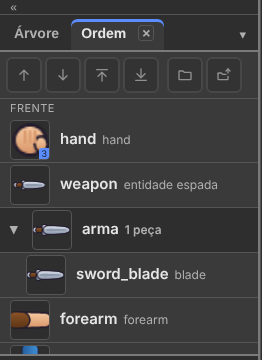

*Um desenho por linha, com a miniatura. **O de cima da lista fica na FRENTE**,
como em todo programa de camadas.*

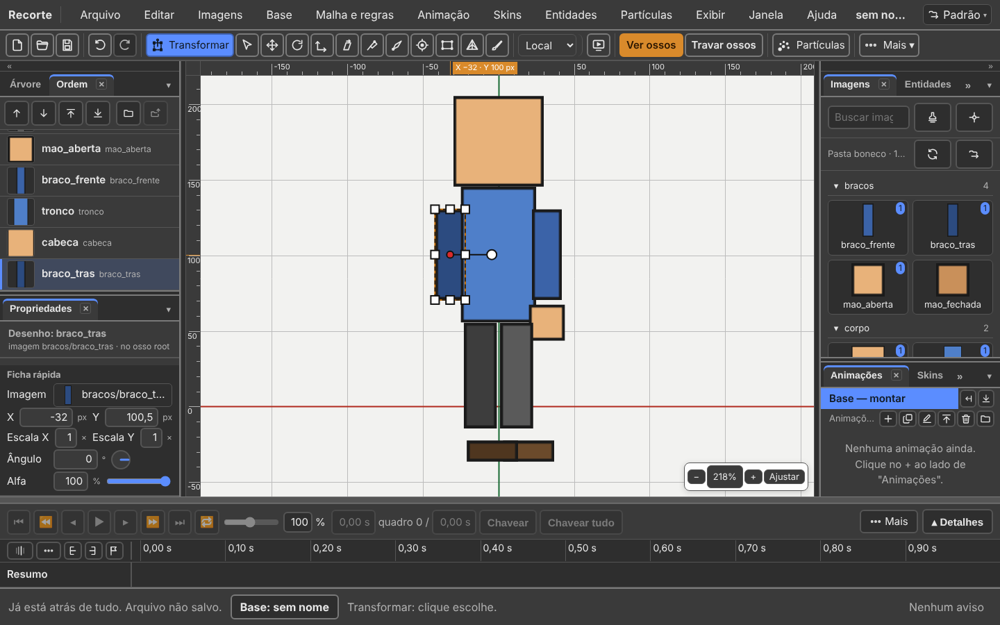

**Os seis botões no alto da aba:**

| Botão | O que faz | Tecla |
|:---|:---|:---|
| **Trazer para a frente** | sobe um lugar | `Ctrl+↑` |
| **Mandar para trás** | desce um lugar | `Ctrl+↓` |
| **Frente de tudo** | vai para o topo | `Ctrl+→` (ou `Ctrl+Shift+↑`) |
| **Fundo de tudo** | vai para o fim | `Ctrl+←` (ou `Ctrl+Shift+↓`) |
| **Nova pasta** | junta as escolhidas numa pasta | — |
| **Tirar da pasta** | tira a pasta | — |

As teclas valem com o foco na aba Ordem **ou na cena**, com um desenho
escolhido. *(Mudou desde 15/09: Frente e Fundo de tudo ganharam `Ctrl+→` e
`Ctrl+←`.)*

**Numa animação, mudar a ordem vira chave.** Para a ordem de agora valer na
animação inteira: **Base → Copiar a ordem na animação**.

Eles ficam cinzas quando não há nada escolhido. **Peça de pasta leva a pasta
inteira** nos dois botões "de tudo".

Mais dois caminhos, todos com um passo de desfazer:

| Como | O que faz |
|:---|:---|
| **arrastar** uma linha para o terço de **cima** ou de **baixo** de outra | entra **entre** as duas. Uma linha fina mostra onde |
| arrastar para o **meio** de outra linha | o de sempre: as duas trocam de lugar |
| **Base → Trazer para a frente / Mandar para trás** (`+` e `−`) | o mesmo, pelo menu |

*(Mudou desde 15/09: soltar entre duas linhas agora funciona.)*

Um exemplo para um personagem de lado:

| Linha | Desenho | Fica |
|:---:|:---|:---|
| 1 | `braco_da_frente` | na frente de tudo |
| 2 | `perna_da_frente` | |
| 3 | `cabeca` | |
| 4 | `corpo` | |
| 5 | `perna_de_tras` | |
| 6 | `braco_de_tras` | atrás de tudo |

Se um braço aparece por cima da cabeça e não devia, é aqui que se resolve.

### Só desenho entra nesta aba

Caixa de colisão, ponto, caminho e máscara **não aparecem aqui**: eles têm
posição e têm nome, mas não desenham nada. Ficam na Árvore.

Um desenho que existe só em **outra skin** continua na lista, com o nome
apagado: ele tem ordem, só não é ele que aparece agora.

### Pastas

Um personagem com trinta peças vira uma lista de trinta linhas. Junte as que
andam juntas:

| Gesto | O que faz |
|:---|:---|
| escolher as peças, **botão direito → Pôr numa pasta…** | pede o nome. A janela **diz antes** quantas mudam de lugar |
| clicar no nome da pasta | fecha e abre. Fechada, ela é **uma linha** |
| **arrastar a pasta**, ou `Ctrl+↑` e `Ctrl+↓` nela | move **todas as peças de uma vez** |
| **duplo clique no nome** | renomeia, em todas as peças dela |
| **botão direito → Tirar da pasta** | tira a pasta. A ordem **não** muda |

A pasta é só um agrupamento: **a ordem de desenho continua sendo a da lista**.
Se uma peça de fora cair no meio de uma pasta, a aba mostra a pasta **em
pedaços**, com um botão **Juntar**.

Quem importa um PSD já chega com as pastas prontas: elas são os grupos do
Photoshop.

**Base → Limpar desenhos vazios** apaga os desenhos que não mostram nada em
skin nenhuma.

---

## Transformar: mover, girar e escalar sem trocar de ferramenta

O programa abre com a ferramenta **Transformar** (`T`) na mão. É o jeito do
Spriter: o escolhido ganha uma **caixa**, com quadradinhos, o **pivô** e uma
**haste** com uma bolinha na ponta.

| Escolhido | Quadradinhos | A bolinha de girar |
|:---|:---:|:---|
| um **desenho** | oito: cantos e meio dos lados | na ponta da haste |
| um **osso** | três: os dois lados e o de cima | a 3/4 do osso, perto da ponta, longe do pivô |

A caixa gira junto com o desenho.

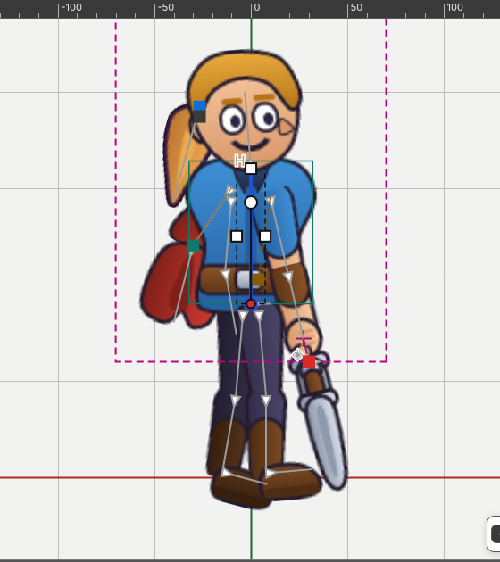


| Onde você arrasta | O que acontece |
|:---|:---|
| **dentro** da caixa | move |
| a **bolinha** | gira em volta do pivô. `Shift`: passos de 15° |
| um **canto** | escala nos dois eixos. `Shift`: mantém a proporção |
| o **meio de um lado** | escala num eixo só |
| **`Alt`** + o **meio de um lado**, com um **osso** escolhido | **inclina** naquele eixo. Sem osso, `Alt` não faz nada |
| em cima de algo **não escolhido** | escolhe e já move |
| **fora** da caixa, no vazio | o retângulo de seleção |

O cursor muda para dizer o que o arrasto vai fazer, e o rodapé diz o gesto e o
número. Cada arrasto é **um** passo de desfazer.

Pai e filho escolhidos juntos: só o pai recebe a conta.

**Mover** (`W`), **Girar** (`E`), **Escalar** (`R`) e **Inclinar** (`Z`)
continuam na barra, para quem prefere uma de cada vez. **Eixos** e
**Compensar** valem igual.

---

## Escolher, travar e esconder

| Gesto | O que faz |
|:---|:---|
| clique | escolhe o osso ou o desenho debaixo do ponteiro |
| `Shift` + clique, ou `Ctrl` + clique | soma à escolha, ou tira |
| `Alt` + clique de novo no mesmo lugar | passa para o que está embaixo, quando várias coisas se empilham |
| arrastar em área vazia | desenha um retângulo. Tudo que ele toca fica escolhido |
| `Shift` + arrastar | o retângulo soma |
| `Ctrl` + arrastar no vazio | o retângulo tira |
| `Ctrl` + arrastar **em cima do escolhido**, com **Mover** ou **Transformar** | **clona** e arrasta o clone. O original não se mexe |
| `Esc` | desmarca tudo |
| setas `← → ↑ ↓`, com o foco na cena | andam **um pixel**; `Shift` anda dez |

O clique passa pelo **transparente** da imagem: só a parte desenhada pega o
clique.

O **retângulo de seleção** não tem botão. Com **Selecionar** (`Q`) ou
**Transformar** (`T`), arraste em área vazia:

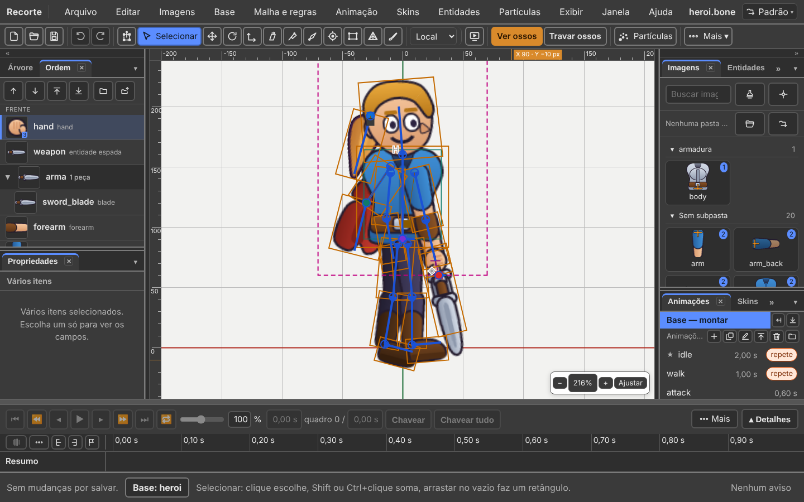


*Tudo o que o retângulo toca fica escolhido. O painel Propriedades passa a
dizer **Vários itens**.*

**Travado** e **escondido** são coisas diferentes:

| | Aparece? | Pega clique? |
|:---|:---:|:---:|
| **Travado** | sim, mais claro | não |
| **Escondido** | não | não |

Travar é para não esbarrar. Esconder é para tirar da frente.

| Tecla | Faz | Menu |
|:---:|:---|:---|
| `H` | esconde o escolhido | Exibir |
| `Shift+H` | esconde **todo o resto** | Exibir |
| `Ctrl+Alt+3` | mostra tudo de novo | Exibir |
| `Ctrl+Shift+H` | **Ver só o resultado** | Exibir |
| `Ctrl+2` | **Travar o escolhido** | Exibir → Travar |
| `Ctrl+Shift+2` | **Travar o resto** | Exibir → Travar |
| `Ctrl+Alt+2` | **Destravar tudo** | Exibir → Travar |
| `Ctrl+Shift+I` | **Inverter a seleção** | Editar |
| `]` | **Os filhos**: o osso, os descendentes e os desenhos deles | Editar → Escolher |
| `[` | **Os pais**: o osso e a corrente de pais até a raiz | Editar → Escolher |

Com a ferramenta **Pesos** na mão, `[` e `]` mudam o raio do pincel.

**Ver só o resultado** desliga de uma vez ossos, nomes, pontos, caixas,
máscaras, malhas, arestas, pesos, grade e eixos. É o personagem como o jogador
vai ver. Apertar de novo **devolve tudo como estava**.

Na Árvore, o **olho** e o **cadeado** de cada linha fazem isso para um item só.

---

## Guias

Uma guia é uma linha fina, ciano, que atravessa a cena: o chão onde os dois pés
pisam, a altura do ombro que se repete em cada pose.

| Gesto | O que faz |
|:---|:---|
| arrastar a partir da **régua de cima** | nasce uma guia **deitada** |
| arrastar a partir da **régua da esquerda** | nasce uma guia **em pé** |
| soltar de volta em cima da régua | desiste |

Com a ferramenta **Mover** (`W`), o osso e o desenho **imantam** na guia quando
chegam a 6 pixels dela. Com `Shift` o eixo fica preso, e o ímã não age.

| Menu **Exibir → A cena** | Faz |
|:---|:---|
| **Guias** | mostra ou esconde. Escondidas, elas não imantam |
| **Travar guias** | a guia não se arrasta, só se apaga |
| **Limpar guias** | apaga todas de uma vez |

As guias viajam dentro do arquivo, em `RECORTE_editor_state` — a parte do
`.bone` que só o editor lê. **O jogo nunca vê uma guia.**

---

## O painel Exibição

Aba **Exibição**, na coluna da direita.

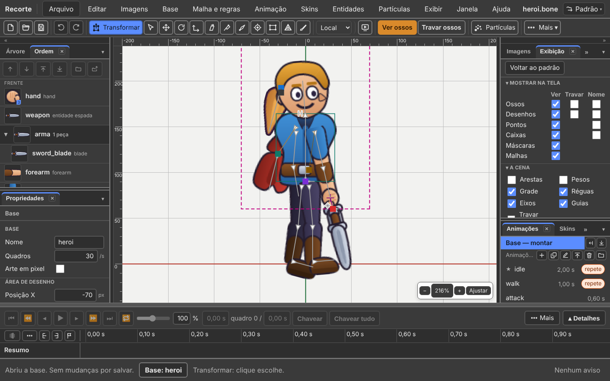

*Dois grupos: **Mostrar na tela** (Ver · Travar · Nome) e **A cena**.*

| Grupo | O que tem |
|:---|:---|
| **Mostrar na tela** | uma linha por tipo: Ossos · Desenhos · Pontos · Caixas · Máscaras · Malhas. Três colunas: **Ver** · **Travar** · **Nome** |
| **A cena** | Arestas · Pesos · Grade · Réguas · Eixos · Guias · Travar guias · **Cor do fundo** |
| **Skins** | a pilha de skins, uma marca por skin |

- **Ver** mostra ou esconde aquele tipo na cena.
- **Travar** deixa o tipo à vista, mas o clique passa por ele. Só existe para
  ossos e desenhos.
- **Nome** escreve o nome na cena, ao lado da coisa.

Onde a caixa não existe, a célula fica **vazia**.

**Nome ao passar o mouse** mora em **Exibir → A cena**: parar o ponteiro sobre
um osso ou um desenho mostra o nome dele.

---

## Mover o desenho sem mover o osso

A imagem entrou dois pixels fora. A espada está torta. O cabelo precisa descer.

**Clique no desenho na cena** (ou na linha dele na Árvore), **sem osso junto**.
As ferramentas **Transformar**, **Mover**, **Girar** e **Escalar** passam a
trabalhar no desenho. Uma **cruz** marca a âncora: o ponto em torno do qual ele
gira e cresce.

Com um **osso** escolhido, elas voltam a mexer no osso. A regra é essa.

| Onde | O que acontece |
|:---|:---|
| **na base** | o desenho muda de lugar dentro do osso, para todas as animações |
| **numa animação** | **vira chave**, como no Spriter. O programa dá ao desenho um **osso só dele**, escondido, e a chave é desse osso |

*(Mudou desde 15/09: antes mover o desenho nunca virava chave.)*

### Alinhar cinco desenhos de uma vez

A âncora são cinco números — `x`, `y`, giro e as duas escalas — que se acertam
de olho e depois precisam ser **iguais** nas cinco mãos de uma skin.

1. Escolha o desenho que já está certo. **Botão direito → Copiar posição no
   osso** (ou **Editar → Copiar posição no osso**).
2. Escolha os outros. **Colar posição no osso**.

Todos com a mesma pose dentro do osso, num passo de desfazer só. O **tamanho da
imagem não vai junto**, de propósito: igualar isso deformaria o desenho.

---

## Consertar o rig sem refazer a pose

O pivô do ombro ficou dois dedos fora do lugar. Se você mover o ombro, o braço
inteiro anda junto — e você refaz a pose do braço. Não precisa.

**Eixos: Local · Pai · Mundo**, na barra de ações (ou **Base → Eixos das
alças**). Diz em quais eixos as alças trabalham.

| Escolha | Quando usar |
|:---|:---|
| **Local** | as alças apontam para onde o próprio osso aponta. É o padrão |
| **Pai** | as alças seguem os eixos do osso pai |
| **Mundo** | as alças seguem a tela: para a direita é para a direita, sempre |

O que é **gravado** no arquivo continua sendo a posição, o giro e a escala em
relação ao pai. O eixo muda como você mexe, não o que fica guardado.

**Compensar** são três caixas, no alto do painel Propriedades. Aparecem com
**Transformar**, **Mover**, **Girar** ou **Escalar** na mão. Também em **Base →
Compensar**.

| Caixa | O que faz |
|:---|:---|
| **Não mexer nos filhos** | o osso vai para o lugar novo e os filhos ficam parados na tela |
| **Não mexer nos desenhos** | o mesmo para os desenhos presos ao osso |
| **Não mexer nas caixas** | o mesmo para as caixas de colisão |

As duas últimas só valem **na base**.

---

## Ponto, caixa e máscara: o que o jogo lê e não se vê

### Ponto — ferramenta `O`

Uma posição com nome, e uma direção. Serve para: a boca do cano da arma, o lugar
de onde sai a faísca, o alvo que a câmera segue. O jogo pergunta "onde está o
`cano`?" e recebe a posição no mundo, já girada com o osso.

1. Escolha o **osso** que vai carregar o ponto.
2. Ferramenta **Ponto** (`O`), ou **Base → Novo → Ponto**.
3. **Segure `Alt` e arraste**. Onde você começou é o lugar; para onde arrastou é
   a direção.

Depois: arrastar move, `Shift` + arrastar gira, e Propriedades aceita os números.

### Caixa de colisão — ferramenta `X`

Um contorno para o jogo perguntar "isto encostou naquilo?". Serve para: a área do
soco, o corpo que leva dano, o gatilho da armadilha.

Mesmo caminho: escolha o osso, pegue a ferramenta **Caixa** (`X`), **`Alt` +
arraste** de um canto ao outro. Ela nasce com quatro cantos; para mudar o
contorno, use a ferramenta **Malha**, que é a que move vértice.

A cor dela é **só no editor**. A caixa não desenha nada no jogo.

O arrasto **sem** `Alt` não cria nada. O rodapé diz isso assim que você pega a
ferramenta.

### Ponto e caixa dentro de um desenho que já existe

Os passos acima criam **um desenho novo** para cada ponto ou caixa. Às vezes o
que se quer é o contrário: a caixa do soco **dentro do desenho da mão**,
trocando por chave como a mão aberta troca com a fechada.

1. Escolha o **desenho** (na Árvore, a linha dele — sem osso junto).
2. **Base → Novo → Ponto neste slot**, ou **Caixa neste slot**.
3. **Segure `Alt` e arraste**, como sempre.

O anexo nasce **na skin do lápis**, e não vira o que o desenho mostra. Para
usá-lo, troque pelo campo **Mostra** de Propriedades, ou grave uma chave na
linha do tempo.

Sem desenho escolhido — ou com um osso junto —, Ponto e Caixa fazem o de
sempre: desenho novo.

### Máscara

Um contorno que recorta: o que estiver fora dela, dos desenhos que ela alcança,
não aparece. Serve para o cabelo dentro do gorro, o olho dentro da pálpebra.
**Nenhum desenho é apagado.**

**Base → Novo → Máscara.** Ela nasce no osso escolhido. O rodapé diz para
ajustar **Recorta até** nas Propriedades.

Ela nasce no **começo da ordem de desenho**, atrás de tudo, e com **Recorta
até** no último desenho. Ou seja: recém-criada, ela recorta **tudo**.

| Campo | O que faz |
|:---|:---|
| **Recorta até** | do desenho dela até este, inclusive |
| **Só estes** | uma lista de desenhos, com caixa. Marcou algum, ela **manda** no "Recorta até" |
| **Inverter: recorta o que está dentro** | o contrário do normal |
| **Cantos** | quantos cantos o contorno tem |

No painel Propriedades da máscara, o bloco **"Usar a silhueta de…"**: escolha um
desenho e clique em **Copiar a silhueta**. O contorno daquele desenho vira o
polígono da máscara, num passo de desfazer.

---

## Desenhar por cima de uma referência

O botão da **imagem** na barra de ações, ou **Exibir → Imagem de referência…**

| Campo | O que é |
|:---|:---|
| Arquivo | escreva `escolher` para abrir o seletor, ou `tirar` para remover |
| X e Y | onde a imagem fica, no mundo |
| Escala | 1 = um pixel da imagem por unidade |
| Opacidade | de 0 a 1. `0,5` deixa o guia bem atrás |

Botão **Aplicar**. Depois da primeira vez, deixe o campo do arquivo **vazio**
para mexer só nos números.

**A imagem fica guardada neste navegador, e não dentro do `.bone`.** O `.bone`
leva só a posição dela.

---

## Regras de bom rig

### Nome dos ossos

| Regra | Certo | Errado |
|:---|:---|:---|
| só minúsculas e sublinhado | `braco_esq` | `Braço Esquerdo` |
| sem acento e sem espaço | `cabeca` | `cabeça` |
| lado no fim, sempre igual | `perna_esq`, `perna_dir` | `esq_perna`, `perna_direita` |
| o par espelhado escrito igual | `mao_esq` / `mao_dir` | `mao_e` / `mao_direita` |

Nome com acento funciona, mas dá dor de cabeça depois, na engine e no
espelhamento.

### Onde pôr o pivô

O **pivô** é a raiz do osso: o ponto em volta do qual ele gira. A regra é uma
frase: **o pivô vai na articulação.**

| Osso | Pivô em |
|:---|:---|
| `braco` | no ombro |
| `antebraco` | no cotovelo |
| `mao` | no pulso |
| `perna` | no quadril |
| `canela` | no joelho |
| `cabeca` | na base do pescoço |

Pivô fora da articulação faz o membro "escorregar" ao girar. É o erro mais
comum, e é chato de arrumar depois.

### Comprimento do osso

Ponha o comprimento até a articulação seguinte. Não é enfeite: a regra de IK e a
regra de caminho usam esse número.

### Um osso a mais no quadril

Deixe um `quadril` entre o `root` e o resto. Assim o `root` fica sempre no chão e
você move o personagem inteiro pelo `quadril`.

---

## Conferir antes de seguir

```
npm run validar meu-personagem.bone
```

Resposta boa:

```
OK    meu-personagem.bone   (esqueleto)

1 válido(s), 0 com erro.
```

Se der erro, ele diz qual, em português, com o caminho de onde está o problema.

No editor: **Ajuda → Problemas do arquivo…** mostra o que o programa não
entendeu ao ler o arquivo, com o conserto onde há.

---

## O selo — o que este capítulo confirma

Regra da casa: toda função leva um selo — **existe** · **existe diferente** ·
**falta** · **muda com as bases** — e quem não achou no código escreve **não
confirmei**. Conferido em 07/10/2026, na v36.5, **lendo o código** (não usei o
programa com o mouse).

| Função | Selo | Onde no código, ou o que muda |
|:---|:---:|:---|
| Tudo de montar se faz na base; o rodapé diz **Base: …** | existe | `ui/where-model.ts:53-72`, `ui/menus.ts:703-707` |
| Abrir pasta: imagens na aba Imagens, nada na cena sozinho | existe | `ui/menus.ts:264-269`, `ui/shell-drop.ts:330-349` |
| Importar → Imagens… | saiu | `ui/menus.ts:292-294` |
| Reempacotar atlas | saiu | `ui/menus.ts:838-839`: o atlas nasce ao Salvar |
| Abrir a pasta é um passo de desfazer | falta | `O QUE NAO TEM PORTA 2026-10-05.md`: o `ImportImagesCommand` não tem porta |
| PSD: grupo vira pasta, camada desligada vira desenho desligado | existe | `io/import-psd.ts:358-364` |
| Imagem solta na cena nasce na raiz, nunca no osso escolhido | existe | `panels/palette-model.ts:217-233` |
| Duplo clique na imagem abre o pivô | existe | `panels/palette.ts:1162-1169`. Corrigido: o selo antigo dizia que só o botão direito abria |
| Número de desenhos que usam a imagem | existe | `panels/palette.ts:1121-1122` |
| Criar osso: `B`; pega os desenhos escolhidos; `Ctrl` cria sem pegar; `Alt` redesenha | existe | `ui/keys.ts:129-133`, `ui/toolbar-model.ts:94-95,221-222` |
| Osso novo nasce no osso escolhido, ou solto | existe | `viewport/tools/create-bone.ts:4-7` |
| Osso criado numa animação vai para a base | existe | `viewport/tools/create-bone.ts:48` |
| A Árvore é uma árvore só: osso, os desenhos dele, depois os filhos | existe | `panels/tree.ts:4-8`, `panels/tree-rows.ts:4-6` |
| Botões Novo ▾, Duplicar, Apagar, Buscar; olho e cadeado por linha | existe | `panels/tree.ts:58-65,344-354,436,451,1028-1031` |
| As setas andam na Árvore | existe | `ui/keys.ts:259-269` |
| A bolinha ● ○ de trocar o anexo na Árvore | saiu | as linhas de anexo viraram código morto: `O QUE NAO TEM PORTA`, `attachmentRows` |
| `P` segurado + clique: o pai primeiro | existe | `viewport/parent-gesture.ts:9-37` |
| `P` com vários escolhidos, clicar no pai (o gesto do Spine) | saiu | `viewport/parent-gesture.ts:9-13` (lote 63a) |
| `P` + clique num ancestral troca os dois; clique em quem já era filho o solta | existe | `viewport/parent-gesture.ts:46-53` |
| Base → Virar filho de…: o mesmo gesto, até o `Esc` | existe | `ui/menus.ts:753-758` |
| Trocar de pai numa animação vira chave; a Árvore mostra o pai do quadro | existe | `panels/tree-rows.ts:105-119`; doc `102`, linha 6 |
| Campo **Mostra** do desenho | existe | `panels/properties-model.ts:1012-1017` |
| Caber no lugar da antiga | existe | `ui/menus.ts:893-897` |
| Herança: rotação, escala, espelhamento | existe | `panels/properties-model.ts:969-977` |
| Ficha rápida: X, Y, Escala, Ângulo com disco, Alfa com barra; conta no campo | existe | `panels/quick-model.ts:127-195,211-213` |
| Inclinação na ficha só quando não é zero; malha sem X/Y/giro | existe | `panels/quick-model.ts:121-145,185-191` |
| Os passos de `Shift` (×10) e `Alt` (×0,1) nas setas do campo | existe | `panels/properties-model.ts:437-446`, chamado em `panels/campo-numero.ts:108` |
| Ordem: os seis botões; `Ctrl+→` e `Ctrl+←` para os "de tudo" | existe | `panels/draw-order-model.ts:298-320`, `ui/keys.ts:174-185,244-250` |
| Ordem: soltar entre duas linhas | existe | `panels/draw-order-model.ts:383-395`. Saiu da lista do que não funciona |
| Ordem numa animação vira chave; Copiar a ordem na animação | existe | `ui/menus.ts:772-777`; `ESTADO.md`, linha Ordem |
| Pastas: Pôr numa pasta…, Tirar da pasta, Juntar | existe | `panels/draw-order.ts:490,669-711` |
| Transformar: oito quadradinhos no desenho, três no osso | existe | `viewport/transform-box.ts:3-8,59-60` |
| `Alt` + meio de um lado inclina, só com osso | existe | `viewport/tools/transform-tool.ts:254` |
| `Ctrl` + clique soma; `Ctrl` + arrastar no vazio tira | existe | `viewport/tools/select.ts:560-569` |
| `Ctrl` + arrastar o escolhido clona | existe | `ui/toolbar-model.ts:100`, `viewport/tools/transform-tool.ts:19,281` |
| Esconder, travar, Ver só o resultado, Os filhos e Os pais | existe | `ui/menus.ts:483-500,624-646` |
| Guias: régua, ímã a 6 px, travar, limpar | existe | `viewport/guides-model.ts:8,24`, `ui/menus.ts:618-620` |
| Painel Exibição: Mostrar na tela, A cena, Skins | existe | `panels/view-panel.ts:141-156,343-438` |
| Mover o desenho numa animação vira chave (osso próprio) | existe | `doc/own-bone.ts:1-21`; decisões `02`, seção 8 |
| Copiar e colar posição no osso | existe | `ui/menus.ts:508-519`, `panels/tree.ts:768-774` |
| Eixos Local · Pai · Mundo | existe | `ui/menus.ts:828-837` |
| Compensar aparece com Transformar, Mover, Girar, Escalar; desenhos e caixas só na base | existe | `panels/properties-model.ts:230`, `viewport/tools/compensate.ts:253` |
| Ponto e Caixa: `Alt` + arrastar | existe | `ui/toolbar-model.ts:104-105,231-233` |
| Ponto neste slot / Caixa neste slot | existe | `ui/menus.ts:736-748` |
| Máscara: Recorta até, Só estes, Inverter, Cantos, Copiar a silhueta | existe | `panels/properties-model.ts:1559-1580`, `panels/properties.ts:671-707` |
| Máscara nasce no começo da ordem de desenho, recortando até o último | existe | `panels/tree-commands.ts:217-221,613-625` (`slots.unshift`) |
| Imagem de referência: os quatro campos, guardada no navegador | existe | `viewport/viewport-draw.ts:397-425` |
| Malha e pesos presos à base, mesmo numa animação | muda com as bases | hoje a forma e os pesos vão para a base, e só arrastar vértice grava chave (`ESTADO.md`, linha Malha). Ver o [capítulo 6](06-malha-e-pesos.md) |
| `npm run validar` | existe | `package.json:11` |

---

## O que ainda não funciona

| O quê | Requisito | Como contornar |
|:---|:---|:---|
| A máscara de camada do PSD não é importada: o desenho vem inteiro. | R3, I1 | Aplique a máscara no Photoshop antes de salvar. |
| Pelo **Importar → PSD…** de sempre, todo desenho nasce preso à raiz. | — | Desenhe os ossos numa camada `ossos` e use **PSD com ossos…**. Ou crie os ossos por cima dos desenhos escolhidos. |
| Regra de IK não vem do PSD. | — | Crie a regra depois, em **Malha e regras → Nova regra…**. |
| Um osso sob regra de caminho ou de física não fica parado com "Não mexer nos filhos". | R7 | A regra decide a posição depois. Ajuste a regra, não o osso. |
| Um filho com herança desligada é deixado como está pela compensação. | R7 | De propósito: mais vale parado do que movido errado. |
| Abrir a pasta de imagens não entra no Desfazer. | — | Para tirar uma imagem da aba, tire-a da pasta e use **Imagens → Recarregar a pasta**. |

---

Próximo: [2. Corpos e animações](02-corpos-e-animacoes.md)
