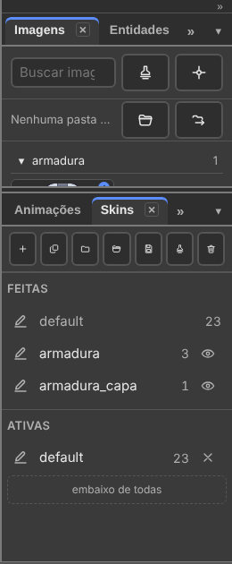

# 3. Skins

Também em inglês: [English](en/03-skins.md)

Atualizado em 07/10/2026, na v36.5. A "pele" agora se chama **skin**, no menu
e na aba (decisão de 04/10).

## O que você vai conseguir fazer no fim

1. Vestir a mesma base com outra roupa, sem refazer o rig nem as animações.
2. Empilhar duas skins, e esconder ou ignorar uma imagem numa delas.
3. Trocar a roupa dentro do jogo, com uma linha de código.

---

## O que é uma skin

Uma **skin** é uma versão alternativa salva do personagem. É o *Character
Map* do Spriter, com uma coisa a mais: **ossos**.

Os ossos são os mesmos. As animações são as mesmas. **Só o desenho muda** —
e, se você quiser, um osso a mais ou a menos.

A frase da aba: *"Skin é uma roupa: o desenho troca"*.

Serve para:

- roupa e armadura;
- o mesmo personagem com cabeça diferente;
- times de cores diferentes;
- o inimigo comum e o chefe, com o mesmo movimento;
- a águia: apaga os braços, cria as asas. A base não muda.

**Skin não é slot.** A skin veste o personagem. O slot encaixa outra peça nele
([capítulo 5](05-entidades.md)).

---

## A aba Skins

**Janela → Skins.** Coluna da direita, junto de Animações e Regras.



*No herói: `armadura` e `armadura_capa` estão desligadas (têm o olho). Só a
`default` está em Ativas.*

De cima para baixo:

| Parte | O que é |
|:---|:---|
| **A barra** | sete ícones (o nome está na dica) |
| **Feitas** | todas as skins desta base |
| **Ativas** | a pilha: o que está vestido agora. **A de cima vence** |
| **Nesta skin: nome** | o que a skin do lápis troca, esconde e apaga. Só aparece com o lápis numa skin que não é a `default` |

**A barra:**

| Ícone | Faz | Também em |
|:---|:---|:---|
| + | Nova skin. Pede o nome na hora | Skins → Nova skin |
| cópia | Clonar skin: cópia da skin do lápis, **com os mesmos ossos** | Skins → Clonar skin |
| pasta | Fazer a skin de uma pasta… | Skins → Fazer a skin de uma pasta… |
| abrir | Importar skin… (de um `.bone` de skin) | Arquivo → Importar → Skin, de outro boneco… |
| salvar | Exportar skin… (a skin do lápis num `.bone` só dela) | Arquivo → Exportar → Skin, para outro boneco… |
| carimbo | Promover skin a base… | Skins → Promover skin a base… |
| lixeira | Apagar skin. Pergunta antes. `Ctrl+Z` devolve | Skins → Apagar skin |

**Uma linha de skin:**

| O que | Gesto | O que faz |
|:---|:---|:---|
| **lápis** | clique | é aqui que o que você cria nasce: imagens, **ossos e regras**. Liga a skin junto |
| **nome** | duplo clique | renomeia. O nome novo entra nas linhas de tempo que citam a skin |
| **número** | — | quantos slots a skin veste |
| **olho** (só em Feitas, skin desligada) | clique | liga: a skin entra no **topo** da pilha |
| **×** (só em Ativas) | clique | desliga: a skin sai da pilha |

**O lápis e a pilha são coisas diferentes:**

| | Pergunta que responde |
|:---|:---|
| **Ativas** | *o que eu estou vendo agora?* |
| **lápis** | *onde vai parar o que eu criar agora?* |

Edita-se **uma skin por vez**. Vê-se **várias** empilhadas.

---

## A pilha: Feitas e Ativas

| Gesto | O que faz |
|:---|:---|
| Arrastar de Feitas para Ativas | liga a skin |
| Soltar no vazio da coluna Ativas | liga, no topo |
| Soltar em **embaixo de todas** | liga, no fundo: ela perde para todas |
| Arrastar dentro de Ativas | muda a ordem |
| Arrastar de Ativas para Feitas | desliga |

**A de cima vence** onde duas vestem o mesmo lugar.

O `heroi.bone` mostra como isso se usa:

| Skin | O que traz | Slots |
|:---|:---|:---:|
| `default` | o corpo inteiro | 23 |
| `armadura` | peito, ombro e capacete | 3 |
| `armadura_capa` | só a capa. Combina com a armadura | 1 |

`default` + `armadura` = o herói blindado. Some `armadura_capa` e ele ganha a
capa. **Três skins, quatro visuais**, sem uma animação a mais.

O desenho certo: **uma skin por peça de roupa**, e não uma skin por
combinação.

---

## A skin `default`

A `default` é a base. Ela **não se apaga**: o programa diz *"A skin "default"
não se apaga: ela é a base. Para escondê-la, tire-a de Ativas"*.

**Mudou desde 15/09: a `default` pode sair da pilha.** Tirá-la tira a arte
dela da cena — é o lobisomem que troca quase tudo. Sem nenhuma skin ligada, a
coluna Ativas diz: *"Nenhuma skin ligada: a base está sem arte"*.

---

## Criar uma skin, na prática

Você vai pôr um capacete no herói.

| Passo | O que fazer |
|:---:|:---|
| 1 | Aba **Skins** → **+** (Nova skin). Dê o nome `capacete` e confirme |
| 2 | Ela já nasce com o **lápis** nela, e ligada |
| 3 | Aba **Imagens**: arraste o desenho do capacete para a cena, em cima da cabeça |
| 4 | Acerte a posição com **Mover** (`W`), com **o desenho** escolhido — e não o osso |
| 5 | Confira: tire a `capacete` de Ativas (×) e ponha de volta (olho, em Feitas) |

Toque qualquer animação: o capacete acompanha a cabeça, porque quem manda é o
osso.

### Trocar, esconder ou ignorar uma imagem na skin

Com o **lápis** numa skin que não é a `default`, escolha um desenho.

| Para a skin… | Gesto |
|:---|:---|
| **trocar** a imagem | botão direito no desenho, na cena → clique na imagem nova, na grade |
| **esconder** (não é desenhada) | botão direito → **Esconder nesta skin** · Skins → Esconder esta imagem |
| **ignorar** (a skin não mexe; volta a da base) | botão direito → **Ignorar nesta skin** · Skins → Ignorar esta imagem |

A seção **Nesta skin** da aba lista cada mudança, com os botões **Esconder** e
**Ignorar** na linha. Clicar no nome escolhe o desenho.

### Fazer a skin de uma pasta

**Skins → Fazer a skin de uma pasta…** (ou o ícone de pasta). Escolha a
subpasta. Cada desenho procura nela uma imagem **com o mesmo nome de
arquivo**. O rodapé diz o que não achou.

### Clonar

**Clonar skin** copia a skin do lápis, com os **mesmos** ossos. É como se faz
a segunda cor de um time: clone, e troque só as imagens.

### Trocar a imagem em todas as skins

Você redesenhou a mão, e ela aparece em quatro skins.

| Passo | O que fazer |
|:---:|:---|
| 1 | Escolha o desenho. **Skins → Trocar imagem nas skins…** Ou, na **Árvore**, botão direito no desenho → **Trocar a imagem em todas as skins…** |
| 2 | O painel **Imagens** abre com a busca no foco e uma faixa dizendo o que vai trocar |
| 3 | Clique na imagem nova. `Esc`, ou o **✕** da faixa, cancela |

Na grade do botão direito, na cena, há também a chave **Em todas as skins**:
ligada, a imagem clicada troca em toda skin que usa a mesma; desligada, só na
skin do lápis.

Troca só onde a skin usa **a mesma imagem naquele slot**. Um passo de
desfazer.

### Apagar

**Apagar skin** age na skin do lápis. Leva junto as linhas de tempo dela. Por
isso pergunta antes. `Ctrl+Z` devolve.

---

## Um osso que só existe numa skin

Um rabo que só o gato tem. Uma antena que só o robô tem.

**Jeito 1 — criar com o lápis.** Lápis na skin do gato. Crie o osso do rabo.
Ele já nasce só nessa skin.

**Jeito 2 — marcar depois.** Escolha o osso. Em **Propriedades**, grupo
**Skins**, marque **Só com a skin**. Aparece embaixo **Skins que ativam**: uma
caixa por skin.

| Passo | O que fazer |
|:---:|:---|
| 1 | Aba **Skins**: clique no **lápis** da skin do gato |
| 2 | Escolha o osso do rabo. Em Propriedades, marque **Só com a skin** |
| 3 | O osso entrou na skin do lápis, e **Skins que ativam** mostra a caixa dela marcada |

Sem lápis numa skin, o rodapé diz *"Marque em que skin, em Propriedades"*. A
`default` não aparece na lista: ela está sempre na base.

A mesma caixa existe nas **regras**: a física do rabo só roda com o rabo
vestido.

Quando a skin sai da pilha, o osso dela **some** da cena e da Árvore.

### Apagar um osso só numa skin

A águia não tem braço. Lápis na skin `aguia`, escolha o braço, `Delete`.

| O que acontece | |
|:---|:---|
| O osso sai **só dessa skin** | na base e nas outras skins ele continua |
| Os filhos e os desenhos dele saem junto | o rodapé diz quantos: *"… da skin "aguia" 2 ossos (…) e 3 imagens. Na base e nas outras skins continuam"* |
| A seção **Nesta skin** mostra o osso apagado | com o botão **Devolver o osso** |
| `Ctrl+Z` | desfaz, um passo |

---

## Skin, troca de desenho e sequência: qual usar

| Jeito | Como é | Quando usar |
|:---|:---|:---|
| **Skin** | um conjunto de anexos, ligado de fora | o jogador ganhou uma armadura; um time de outra cor |
| **Troca de desenho** | dois anexos no mesmo slot, e uma chave escolhendo | a mão fecha no meio do golpe |
| **Sequência** | um anexo só, com uma lista de quadros | uma chama que tremula |

No `heroi.bone` os três estão lá: as três skins; o slot `hand`, com `hand` e
`hand_fist`; e o anexo `hand`, uma sequência de três quadros.

- **muda com o jogo** → skin;
- **muda com a animação** → troca de desenho;
- **muda sozinho, sempre igual** → sequência.

---

## Testar sem mexer no arquivo

**Janela → Prévia → Tela cheia** (`F11`; `Esc` volta). Ao lado, a lista
**Skins**: clique para pôr e tirar. A frase diz: *"Aqui é teste: pôr e tirar
skin não mexe no arquivo"*.

Skin de uma entidade, em teste: no cartão dela, na aba Entidades,
**skins ▾** ([capítulo 5](05-entidades.md)).

---

## Fazer da skin uma base

**Skins → Promover skin a base…** A pilha ligada vira a base de uma base nova.
Ela entra na lista **Bases**, com animações próprias
([capítulo 2](02-corpos-e-animacoes.md)).

---

## Levar a skin para outro boneco

| Para | Gesto |
|:---|:---|
| gravar a skin do lápis num `.bone` só dela, com os ossos que ela traz | Arquivo → Exportar → Skin, para outro boneco… · ícone salvar da aba |
| trazer uma skin de um `.bone` | Arquivo → Importar → Skin, de outro boneco… · ícone abrir da aba |

A skin importada entra em Feitas **e já vestida**, no topo de Ativas.

---

## Trocar a skin no jogo

Uma linha:

```js
skeleton.setSkin('armadura');
```

Várias, na ordem em que se empilham:

```js
skeleton.setSkin(['default', 'armadura', 'armadura_capa']);
```

`setSkin` sempre põe a `default` por baixo. Para a pilha pura, sem a
`default` (o lobisomem), use `skeleton.setSkinStack([...])`.

**O que você vê no editor é o que o jogo mostra.**

---

## Entregar só uma skin

Um jogo que só usa a armadura não precisa carregar o resto.

Pelo editor: **Arquivo → Exportar → Uma imagem por skin…** A janela fatia o
arquivo. Com a caixa **Pacote .bonez com o atlas (um arquivo só)** marcada,
sai um arquivo só: o `.bone` fatiado e o atlas só com as regiões que ele usa.

> **Atenção:** o nome do item e a dica dele falam de **imagem** ("A mesma
> exportação de imagem, uma vez para cada skin"). Mas o que a janela faz é
> **fatiar o `.bone`** — o aviso no fim se chama *"Arquivo fatiado"*. O nome
> está errado no programa.

Pela linha de comando:

```
npm run fatiar heroi.bone saida -- --peles armadura
npm run fatiar heroi.bonez saida -- --peles armadura
```

Com um `.bonez` na entrada, a saída também é `.bonez`. A `default` entra
sempre. Um arquivo por skin de uma vez: `--um-arquivo-por-pele`.

Osso só sai quando ninguém que ficou lê ele. O
[capítulo 8](08-exportar-e-usar-no-jogo.md) trata disso por inteiro.

---

## O que ainda não funciona

| O quê | Como é hoje |
|:---|:---|
| Entregar só uma skin, com o nome certo no menu | o item chama **Arquivo → Exportar → Uma imagem por skin…**: o nome diz imagem, mas a janela fatia o arquivo |

---

## O selo — o que este capítulo confirma

| Função | Selo | Gesto |
|:---|:---:|:---|
| A aba Skins, com Feitas e Ativas | existe | Janela → Skins |
| Nova skin, pedindo o nome | existe | ícone + · Skins → Nova skin |
| Clonar, com os mesmos ossos | existe | ícone cópia · Skins → Clonar skin |
| Fazer a skin de uma pasta | existe | ícone pasta · Skins → Fazer a skin de uma pasta… |
| Apagar skin | existe | ícone lixeira · Skins → Apagar skin |
| O lápis (onde nasce o que se cria) | existe | lápis da linha · Skins → Editar esta skin… |
| Ligar, desligar, reordenar a pilha | existe | arrastar entre Feitas e Ativas · olho · × |
| Tirar a `default` da pilha | existe | arrastar para Feitas, ou × |
| Esconder e ignorar uma imagem na skin | existe | botão direito na cena · Skins → Esconder / Ignorar esta imagem |
| A seção Nesta skin | existe | aba Skins, com o lápis numa skin |
| Trocar a imagem em todas as skins | existe | Skins → Trocar imagem nas skins… · Árvore, botão direito |
| Osso e regra só com a skin | existe | Propriedades → Skins → Só com a skin |
| Apagar osso só numa skin | existe | lápis na skin · `Delete` |
| Testar skins sem mexer no arquivo | existe | Prévia → Tela cheia → Skins |
| Promover skin a base | existe | ícone carimbo · Skins → Promover skin a base… |
| Exportar e importar skin | existe | Arquivo → Exportar / Importar → Skin… · ícones da aba |
| Trocar a skin no jogo | existe | `setSkin` · `setSkinStack` |
| Entregar só uma skin, fatiada | existe diferente | Arquivo → Exportar → Uma imagem por skin… — o nome diz imagem, a janela fatia |
| Fatiar pela linha de comando | existe | `npm run fatiar` |

---

Próximo: [4. Animar](04-animar.md)
