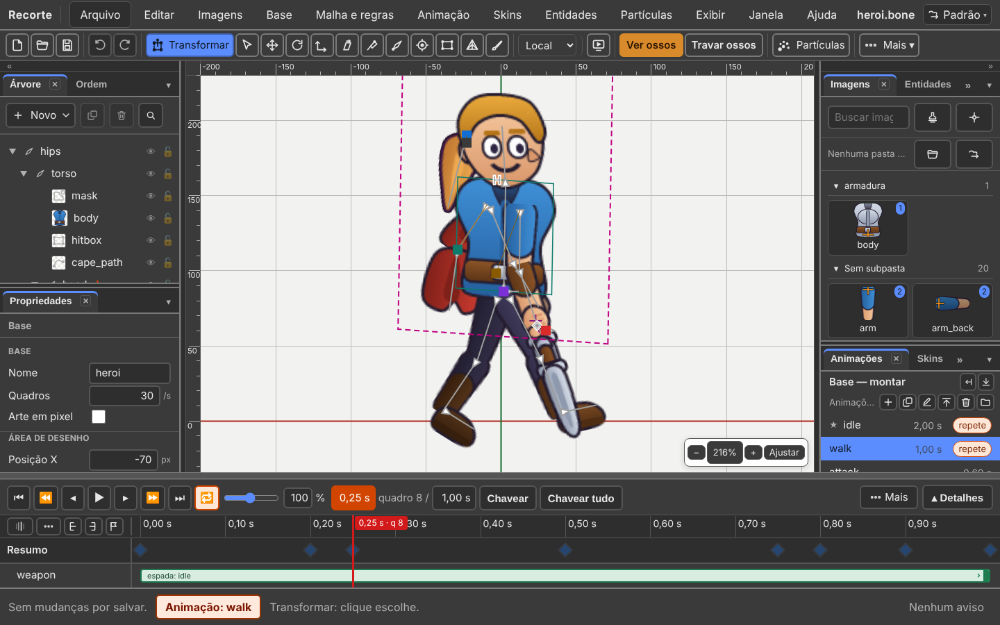
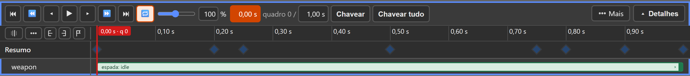
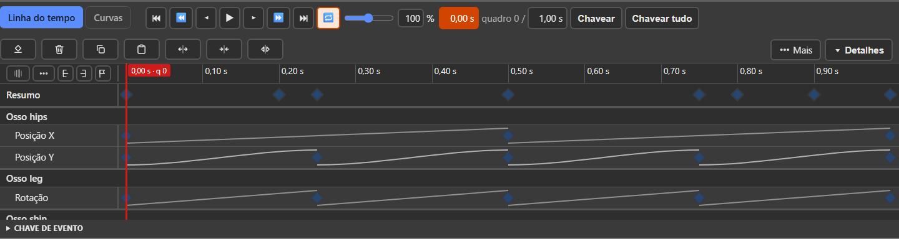
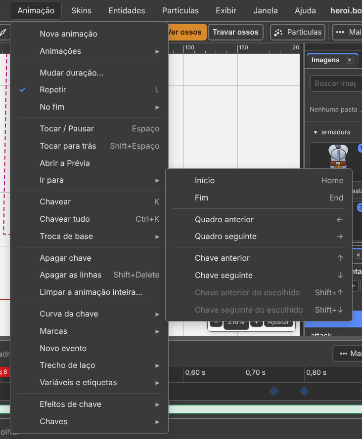
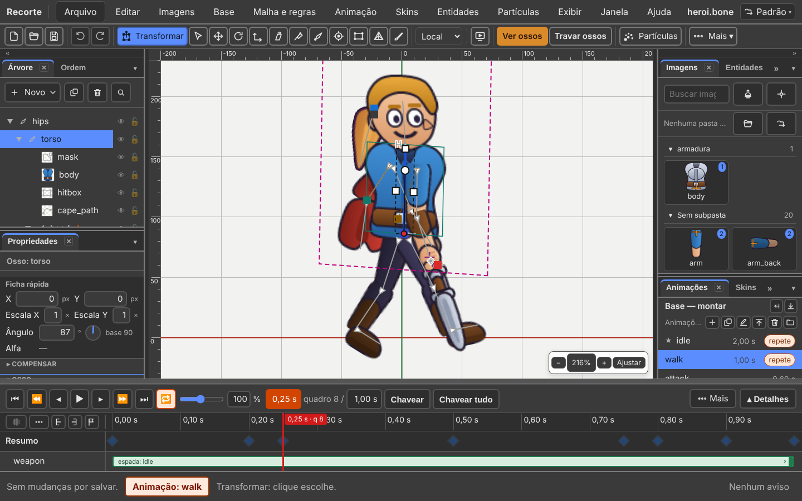
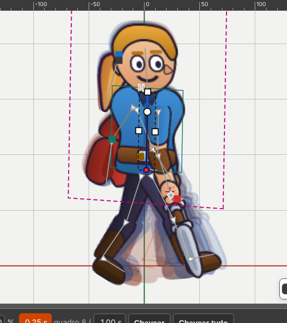

# 4. Animar

Também em inglês: [English](en/04-animate.md)

## O que você vai conseguir fazer no fim

1. Fazer duas poses e ver o programa desenhar as do meio.
2. Fechar um ciclo de caminhada que volta ao começo sem dar tranco.
3. Achar, copiar e colar chaves na linha do tempo.

---

## Comece por esta regra

É a que mais confunde quem começa. Leia antes de tudo.

> **Com uma animação aberta, mexer grava uma chave. Sempre.**
> A base não muda.

Não há mais interruptor de modo. Há **o que está aberto**: a base, ou uma
animação. O rodapé diz qual.

| O rodapé diz | O que está aberto | Mexer num osso |
|:---|:---|:---|
| **Base: heroi** | a base | muda a **base**. Vale para todas as animações |
| **Animação: walk** | a animação `walk` | grava uma **chave**, no tempo da agulha |



*A `walk` aberta: o rodapé diz **Animação: walk**.*

| Quero | Faça |
|:---|:---|
| abrir uma animação | painel **Animações**, clique no nome dela |
| voltar para a base | painel **Animações**, clique na linha **Base — montar** |
| voltar para a base, pelo menu | **Base → Abrir a base** |

Girou um osso achando que era a base, mas estava numa animação? `Ctrl+Z`,
abra a base, refaça.

### A base

A base é o personagem parado, como você o montou. É uma animação de um quadro
só. **Toda animação nasce dela, e só guarda a diferença.**

Por isso mexer na base mexe em todas as animações de uma vez. É poderoso e é
perigoso. Faça isso antes de animar, não depois.

Com a base aberta, o tocador fica à vista, mas cinza: o relógio diz `0,00 s`,
e a dica de cada botão diz por quê.

---

## Criar uma animação

Painel **Animações**. Em cima, a linha da base; embaixo, a lista
**Animações**, com seis botões em ícone na tira do título:

| Botão | Dica | O que faz |
|:---|:---|:---|
| **＋** | *Nova animação* | cria e abre. Nasce `animação`, com 1 s, e o nome já aberto para você escrever |
| **⧉** | *Duplicar* | copia a escolhida, com as chaves |
| **✎** | *Renomear* | troca o nome. Duplo clique no nome faz o mesmo |
| **⤒** | *Mandar para o topo* | leva a aberta para o primeiro lugar |
| **🗑** | *Apagar* | apaga a animação |
| pasta | *Biblioteca de animações* | traz parado, andar, correr e pular prontos. A janela diz o que a sua base não tem antes de trazer |

Os mesmos estão no menu: **Animação → Nova animação**, e o resto em
**Animação → Animações ▸**.

Cada linha da lista traz o nome, a duração e a palavra **repete** quando a
animação repete. Botão direito numa linha abre o menu do que os ícones fazem.

### Mais de uma base

Com um corpo só, a linha de cima diz **Base — montar**. Com mais de um, aparece
a lista **Bases**, uma linha por corpo, com o número de animações. Clicar numa
base abre a base dela, e a lista **Animações** troca para as dela. Ver o
[capítulo 2](02-corpos-e-animacoes.md).

### A animação padrão

**A primeira da lista é a que o jogo abre.** Ela tem uma estrelinha **★** na
frente do nome, e a dica diz **padrão**.

Quer outra? Abra a animação e clique em **Mandar para o topo**. Também está em
**Animação → Animações → Mandar para o topo**. `Ctrl+Z` devolve.

Não há campo no arquivo para isso: a ordem da lista é o que vale.

### Trocar de animação tocando

**Tocando, trocar de animação não para o tocador.** Clique em outra com o `▶`
aceso. Por padrão, a atual **termina**, e a clicada entra depois, do começo. A
linha dela ganha o sinal **⏭**, e a dica diz "próxima". Parado, troca na hora.

Isso se escolhe em **Arquivo → Configurações do projeto…**:

| Campo | O que faz |
|:---|:---|
| **Ao trocar de animação tocando** | `Terminar a atual antes` (padrão) ou `Trocar na hora`. É do tocador, não do personagem |
| **Tempo de mistura, em segundos** | a troca **mistura** uma animação na outra. `0` = troca seca. Vai para o arquivo (`defaultMix`): o jogo lê o mesmo número |

Nomes que a maioria dos jogos usa: `idle`, `walk`, `run`, `jump`, `attack`,
`hurt`, `die`.

---

## Chaves

Uma **chave** é o valor de uma propriedade num instante.

Entre duas chaves o Recorte calcula o meio do caminho sozinho. Isso é
*interpolar*: **você faz duas poses, o programa faz as vinte e oito do meio.**

### Os jeitos de criar uma

| Jeito | Como |
|:---|:---|
| mexer | arraste, gire, escale, ou digite um número na ficha. A chave nasce no tempo da agulha |
| à mão, só o escolhido | botão **Chavear** (`K`) |
| à mão, todas as linhas | botão **Chavear tudo** (`Ctrl+K`) |

Os dois Chavear gravam a pose de agora **sem mexer em nada**: servem para
proteger uma pose. São o *Key selected* e o *Key all* do Spriter.

**O começo se guarda sozinho.** A primeira chave de uma propriedade num tempo
depois do zero grava junto uma chave em `0,00 s`, com o valor da base. Assim a
animação anda, em vez de começar já na pose nova.

A ferramenta de partida, **Transformar** (`T`), faz os gestos numa caixa só:
arrastar dentro move, a bolinha gira, um quadradinho escala. Veja o
[capítulo 1](01-montar-um-corpo.md).

**Mover uma imagem** numa animação também grava chave. Por dentro ela ganha um
osso só dela, escondido.

### Voltar à pose da base

`Ctrl+1` devolve o osso escolhido à pose da base; `Ctrl+Shift+1` devolve todos.
Também em **Base → Voltar à pose de repouso**.

Com uma animação aberta, isso **grava uma chave** com o valor da base. Não é
apagar a chave: apagar deixaria o osso seguindo a chave anterior.

### O meio-termo

**Editar → Pose → Meio-termo**: na agulha, nasce a chave no meio do caminho
entre a de antes e a de depois, nos ossos escolhidos (nenhum = a pose inteira).

| Item | Onde fica a chave nova |
|:---|:---|
| **Meio-termo** | na metade do caminho |
| **Meio-termo → anterior** | a um terço, perto da chave de antes |
| **Meio-termo → seguinte** | a dois terços, perto da chave de depois |

### O que pode virar chave

| Grupo | Exemplos |
|:---|:---|
| Osso | posição, rotação, escala, inclinação, herança, **o pai** |
| Desenho | cor, cor escura, qual imagem aparece, visível, o osso do desenho, a sequência |
| Ordem | ordem de desenho, forma da malha, pesos da malha |
| Regras | a força de cada regra, os números da física |
| Partículas | **Emitindo**: liga e desliga o emissor |
| Base e entidade | a troca de base, a animação da entidade |
| Outros | evento, parâmetro, variável, etiqueta |

**Trocar de pai vira chave**: a arma sai da mão e vai para as costas no meio da
animação. A Árvore mostra o pai daquele quadro. Ver o
[capítulo 1](01-montar-um-corpo.md).

---

## A linha do tempo, fechada

A faixa de baixo **nasce fechada**, e fechada ela tem três linhas.



*Na `walk` do herói aparece uma quarta linha, `weapon`: é a faixa da entidade
espada.*

| Linha | O que tem |
|:---|:---|
| 1 | o tocador, e na ponta direita o **⋯ Mais** e o **Detalhes** |
| 2 | os botões do canto, a régua em segundos, e a agulha |
| 3 | o **Resumo**: um losango em cada tempo que tem chave |

Com uma entidade na animação, ganha uma quarta linha: a faixa da entidade.

**Ela nunca abre sozinha.** São três portas: o botão **Detalhes**, a **alça**
da borda de cima, e **Janela → Arrumar → Detalhes da linha do tempo**.

### O tocador, da esquerda para a direita

| Botão | Dica | Tecla |
|:---:|:---|:---:|
| `⏮` | *Início: vai para o começo* | `Home` |
| `⏪` | *Chave anterior* | `↑` |
| `◂` | *Quadro anterior: volta um quadro* | `←` |
| `▶` | *Tocar: toca e pausa* | `Espaço` |
| `▸` | *Quadro seguinte: avança um quadro* | `→` |
| `⏩` | *Próxima chave* | `↓` |
| `⏭` | *Fim* | `End` |
| `🔁` | *Repetir: volta ao começo quando chega ao fim. **Fica gravado no arquivo*** | `L` |
| barra | velocidade, de 10 % a 200 %, com o número ao lado | — |
| campo | **o tempo**, em segundos, e o quadro ao lado | — |
| campo | **a duração** da animação | — |
| **Chavear** | *Chavear escolhidos* | `K` |
| **Chavear tudo** | *Chavear tudo* | `Ctrl+K` |

**`Espaço` toca e pausa em qualquer lugar — menos na cena.** Na cena, `Espaço`
segurado arrasta a vista.

**Tocar para trás**: `Shift+Espaço`, ou **Animação → Tocar para trás**.

### A agulha e o campo laranja

A agulha é a linha **vermelha** que atravessa a faixa. Na régua, presa nela,
vai uma bandeirinha com o tempo e o quadro:

```
0,50 s · q 15
```

A régua conta em passos redondos: `0,00 s · 0,10 s · 0,20 s…`.

Quando a agulha para **em cima de uma chave**, o campo de tempo fica
**laranja**, e a dica diz *"Laranja: há chave neste tempo"*. Mexer ali grava
por cima.

Para pôr a agulha num tempo exato: clique no campo de tempo e digite.

### A duração, e o que fazer com as chaves

Digitar no campo da duração muda **só o número**: as chaves ficam onde estão.

Para esticar as chaves junto — a mesma caminhada, mais devagar —
**Animação → Mudar duração…**, que pergunta antes:

| Resposta | O que acontece |
|:---|:---|
| **Esticar as chaves** | tudo na mesma ordem, mais devagar. 1 s vira 2 s |
| **Só o número** | as chaves ficam onde estão |

Encurtando sem esticar, as chaves que passarem do fim **não se perdem**: aumente
a duração de novo e elas voltam a tocar.

### A linha Resumo

Um losango em cada tempo que tem chave — em qualquer linha. Ela **nunca sai da
vista**. Responde de relance: **onde estão as poses?**

| Losango | O que quer dizer |
|:---:|:---|
| escuro | naquele tempo só há chaves de um tipo |
| branco | há **mais de um tipo**: uma pose *e* um evento |

A dica de cada um conta: *13 chaves em 0,25 s, de mais de um tipo*.

| Gesto no Resumo | O que faz |
|:---|:---|
| clicar | escolhe **todas** as chaves daquele tempo |
| `Ctrl` + clicar | **soma** outro tempo |
| `Shift` + clicar | **tira** |
| arrastar | move todas juntas, num passo só de desfazer |
| botão direito | o mesmo menu do losango: curvas e apagar |

`Ctrl` soma e `Shift` tira **em todo lugar**: no Resumo, no losango e na caixa.

---

## A linha do tempo, aberta

O botão **Detalhes** abre o resto.



*A linha entre duas chaves desenha a curva do movimento.*

Aberta, ela ganha a linha dos botões em bloco, e uma linha por osso e por
desenho, com os grupos que se dobram.

Arrastar a borda de cima faz o mesmo. **Abrir pede um puxão de verdade** — um
esbarrão não abre nada. O editor **lembra** como você deixou.

### A curva desenhada na folha

Entre uma chave e a próxima, a folha desenha **como** o movimento passa:

| Desenho | Curva |
|:---|:---|
| reta, chata | **Linear** |
| arco | **Suave**, **Entrada suave**, **Saída suave**, **Curva à mão**. Cada uma tem o seu arco: a Entrada sai devagar, a Saída chega devagar |
| degrau pontilhado | **Parada**: segura o valor até a próxima |

O pontilhado é o mais importante: uma chave **Parada** por engano "trava" o
andar.

### A dica do losango

Passe o mouse num losango. A dica diz o tempo, o valor com a unidade, e a curva:

```
0,50 s · Rotação de leg = −110° · Suave
```

A última chave de cada linha diz *"a última: sem curva"*.

### A linha dos botões em bloco

| Botão | Dica |
|:---|:---|
| **Apagar chave** | *apaga a chave do tempo atual* |
| **Apagar seleção** | *apaga as chaves escolhidas* |
| **Copiar** | *copia as chaves escolhidas* |
| **Colar** | *cola as chaves no tempo atual* |
| **Esticar ×2** | *afasta as chaves escolhidas do tempo atual, dobrando o intervalo* |
| **Encolher ÷2** | *aproxima as chaves escolhidas do tempo atual, pela metade* |
| **Espelhar** | *inverte no tempo as chaves escolhidas, em volta do tempo atual* |

São ícones; o nome aparece ao lado com **Exibir → Mostrar nome das
ferramentas**.

### O que se faz com o mouse

| Gesto | O que faz |
|:---|:---|
| arrastar a agulha | o desenho acompanha na hora |
| clicar num losango | escolhe aquela chave **e leva a agulha até ela**. A ficha mostra o valor dela |
| `Ctrl` + clicar | soma à escolha. A agulha não anda |
| `Shift` + clicar | tira da escolha |
| **botão direito** num losango | o menu da chave: curvas e apagar |
| **duplo clique** num losango | apaga aquela chave |
| arrastar um losango | move as escolhidas, encaixando no quadro. Junto do mouse aparece o tempo novo: *0,57 s · q 17 · +2 quadros* |
| `Alt` + arrastar | move **sem** encaixar no quadro |
| `Ctrl` + arrastar | **clona**: as originais ficam, as cópias andam com o mouse |
| arrastar no vazio | caixa de escolha. `Ctrl` soma, `Shift` tira |
| clicar no nome de uma linha | marca a linha |
| botão direito no nome da linha **Desenho** | a **Chave de sequência**: qual imagem da sequência, e quanto cada uma fica |

A dica de todo losango repete os gestos: *Arrastar move as escolhidas · Ctrl
soma, Shift tira · Ctrl + arrastar clona · Botão direito: curva · Duplo clique:
apagar*.

### Pelo teclado (com o foco na folha)

| Tecla | Faz |
|:---:|:---|
| `←` `→` | um quadro para trás, um para a frente |
| `Shift+←` `Shift+→` | dez quadros |
| `↑` `↓` | chave anterior, chave seguinte — de qualquer linha |
| `Shift+↑` `Shift+↓` | chave anterior, seguinte — só das linhas marcadas |
| `Home` `End` | começo e fim |
| `Ctrl+↑` `Ctrl+↓` | marca anterior, marca seguinte |
| `M` | põe ou tira uma marca |
| `Ctrl+C` | copia as chaves marcadas. **Sem nenhuma marcada, copia a pose do escolhido na agulha** |
| `Ctrl+Shift+C` | copia a **pose inteira** do instante |
| `Ctrl+V` | cola na agulha |
| `Ctrl+Shift+V` | cola em **todas** as chaves da linha |
| `Ctrl+X` | recorta: copia e apaga |
| `Delete` ou `Backspace` | apaga as chaves escolhidas. Sem nenhuma, apaga o escolhido na cena |
| `Shift+Delete` | apaga as **linhas** do escolhido, inteiras |
| `Ctrl+K` | Chavear tudo |
| `Ctrl+D` | com chave escolhida, não duplica: o rodapé diz como (copiar, levar a agulha, colar) |



Fora da folha, **Animação → Ir para ▸** tem os mesmos de andar, e
`Shift+↑` `Shift+↓` andam pelas chaves **do escolhido**.

---

## Copiar e colar

Todo copiar e colar mora no menu **Editar**, como no Spriter.

| Item | Tecla | O que faz |
|:---|:---:|:---|
| **Copiar** | `Ctrl+C` | as chaves marcadas; sem nenhuma, a pose do escolhido na agulha |
| **Colar** | `Ctrl+V` | cola na agulha |
| **Colar espelhado** | — | cola trocando o lado pelo nome: o braço direito vira o esquerdo |
| **Recortar chaves** | `Ctrl+X` | copia e apaga |
| **Pose → Copiar a pose inteira** | `Ctrl+Shift+C` | como o personagem **está** agora, mesmo entre duas chaves |
| **Pose → Copiar a pose do escolhido** | — | o mesmo, só do escolhido e dos filhos |
| **Pose → Colar em todas as chaves** | `Ctrl+Shift+V` | o valor copiado em toda chave da linha |

**Pego o braço inteiro e colo.** Escolha o osso do ombro, na cena ou na Árvore,
sem marcar chave na folha, e aperte `Ctrl+C`. Vai a pose do ombro e de todos
os filhos, **no tempo da agulha**. O rodapé diz: *"Pose de 0,50 s copiada: 4
valores do escolhido"*. Quer as chaves de vários tempos? Marque-as na folha.

**A pose inteira** pode ser colada em **outra animação**: é como se leva uma
pose boa do `walk` para o `idle`.

### O colar que passa do fim

Se o colar vai passar do fim da animação, ele **pergunta antes**:

| Resposta | O que acontece |
|:---|:---|
| **Colar e esticar** | cola tudo, e a animação cresce |
| **Colar só o que cabe** | cola até o fim; o resto fica de fora, e o rodapé conta quantas |
| **Cancelar** | nada é colado |

### Colar espelhado

Usa a mesma regra de **Pares de nome** do ⋯ Mais (`_e/_d` por padrão).

**Numa animação que repete, ele dá a volta**: o que passaria do fim entra no
começo, e a duração **não muda**. Sem repetir, a animação cresce, e o rodapé diz.

O rodapé conta tudo: *"3 chaves: leg_b em 0,00 · 0,50 · 1,00 s. Deu a volta no
fim do laço: a duração não mudou."* A curva vai junto com cada chave.

---

## O menu Chaves

**Animação → Chaves ▸**, para mexer em muitas chaves de uma vez:

| Item | O que pede | O que faz |
|:---|:---|:---|
| **Selecionar todas as chaves** | nada | escolhe todas |
| **Esticar seleção…** | duas chaves ou mais | multiplica o tempo delas pelo **Fator** |
| **Espelhar no tempo** | chaves marcadas | vira a ordem do avesso |
| **Fechar ciclo** | nada, ou chaves marcadas | ver **Laço**, abaixo |
| **Espelhar esquerda e direita…** | os pares de nome | troca as linhas entre os ossos de nome espelhado |
| **Empurrar as chaves…** | chaves marcadas | anda N quadros, só as marcadas ou **estas e tudo o que vem depois** — abre espaço |
| **Deslocar em laço…** | uma chave em cada linha | a linha anda inteira, e o que passa do fim **volta no começo**. A duração não muda |
| **Limpar chaves repetidas** | nada, ou uma linha marcada | tira a chave que não muda nada. Nunca mexe numa **Parada** nem em linha que não é número |

**Empurrar** e **Deslocar** aceitam **quadros ou segundos** na mesma caixa:
`6` são seis quadros; `0,2 s` são segundos. `0,2` sem unidade é recusado, e a
janela diz como escrever — sem fechar.

O **Deslocar** já sugere **meia volta**: é o que põe a perna de trás no passo
oposto num andar pronto.

O **Empurrar** diz quando a animação cresce: *"A animação cresceu de 1,00 s
para 1,20 s"*.

Sem nenhuma linha marcada, **Limpar chaves repetidas** limpa a animação
inteira — cada linha encolhe até **uma** chave, nunca até zero.

### Apagar

| Item | O que faz |
|:---|:---|
| **Animação → Apagar chave** | as chaves escolhidas |
| **Animação → Apagar as linhas** (`Shift+Delete`) | tira a propriedade da animação. O osso volta a seguir a base ali |
| **Animação → Limpar a animação inteira…** | tira todas as chaves. **Pergunta** antes |

---

## O botão ⋯ Mais

A dica dele **lista o que tem dentro**: *No fim, esticar, espelhar, fechar
ciclo, pares de nome, mostrar só os escolhidos, tirar trecho de laço: o que se
usa de vez em quando.*

| Campo / botão | O que faz |
|:---|:---|
| **No fim** | o que o tocador faz ao chegar no fim. Ver abaixo |
| **Fator** + **Esticar seleção** | `2` deixa o trecho duas vezes mais lento, com a primeira chave no lugar |
| **Espelhar no tempo** | inverte a ordem das chaves escolhidas |
| **Fechar ciclo** | ver **Laço** |
| **Pares de nome** + **Espelhar esquerda e direita** | a regra dos lados, e a troca |
| **Mostrar só os escolhidos** | esconde as linhas dos outros. O Resumo continua inteiro |
| **Tirar trecho de laço** | tira o trecho marcado na régua |

### Esticar puxando a ponta

Escolha duas chaves ou mais. No **Resumo** aparecem duas alças, uma em cada
ponta. As dicas: *Puxe para esticar, com o fim parado* e *Puxe para esticar,
com o começo parado*. Puxe uma: o trecho estica, com a outra ponta no lugar.

### Os pares de nome

Pares separados por vírgula, os dois lados por barra. Padrão:
`_e/_d, _l/_r, _esq/_dir`. No herói os ossos de trás terminam em `_b`, então a
regra é `/_b`.

Os pares achados aparecem **escritos embaixo do campo antes de qualquer
troca**: `5 pares: leg ↔ leg_b   shin ↔ shin_b   …`. Ao clicar, uma janela
pergunta: **Trocar os lados** ou **Deixar como está**.

Só troca linhas de **osso**.

### O que fazer no fim

Também em **Animação → No fim ▸**.

| Escolha | O que faz |
|:---|:---|
| **Como o arquivo diz** | obedece ao Repetir da animação. **É o que o jogo vai fazer** |
| **Parar no fim** | chega ao fim e para |
| **Repetir** | volta ao começo e continua |
| **Vai e volta** | no fim, toca de trás para a frente |
| **Voltar ao início** | chega ao fim, volta ao começo e para |

São duas coisas diferentes:

| | O que é |
|:---|:---|
| o **`Repetir`** da animação (`L`) | o que o **jogo** vai fazer. Vai para o arquivo |
| o **No fim** do tocador | o que **você** está olhando. Não vai para o arquivo |

---

## Os botões do canto da régua

Cinco, na ponta esquerda da segunda linha:

| Botão | Dica |
|:---|:---|
| casca de cebola | *Casca de cebola desligada* / *ligada* |
| **⋯** | *Opções da casca de cebola* |
| `[` | *Início do trecho de laço (Alt + clique na régua)* |
| `]` | *Fim do trecho de laço (Alt + botão direito na régua)* |
| bandeirinha | *Pôr ou tirar marca aqui (M)* |

### Trecho de laço: olhar só um pedaço

Marque o começo e o fim com os dois colchetes, ou com `Alt` + clique e `Alt` +
botão direito na régua. Uma faixa sombreada aparece, e tocar repete **só ela**.

Para tirar: **⋯ Mais → Tirar trecho de laço**, ou **Animação → Trecho de laço →
Tirar o trecho**.

O trecho fica gravado na parte do arquivo que é do editor. **O jogo não vê.**

### Marcas: recados no tempo

Uma marca é um recado para você: "aqui o pé bate no chão".

| Onde | Faz |
|:---|:---|
| o botão da bandeirinha | põe ou tira uma marca no tempo atual |
| `M`, com o foco na folha | o mesmo |
| `Ctrl+↑` `Ctrl+↓`, com o foco na folha | marca anterior, seguinte |
| **Animação → Marcas ▸** | os três, pelo menu |

Na cena, `M` é a ferramenta Malha — por isso o botão existe.

Duplo clique numa marca **dá nome** a ela. Clique simples leva a agulha até
ela. O jogo não vê as marcas.

---

## Curvas

**Janela → Curvas**, ou **Curva à mão…** no menu da chave.



*Os botões do formato ficam cinza até você clicar numa chave do gráfico.*

Serve para uma coisa: **como o movimento sai de uma chave e chega na outra.**

A aba tem o próprio tocador (início, quadro anterior, tocar, quadro seguinte) e
o relógio. Ela **abre na chave escolhida na folha**, e a chave escolhida nela
vai para a folha. O eixo diz a unidade: `−60°` em cima, `0,50 s` embaixo.

### Os sete formatos prontos

| Formato | Dica do botão | Bom para |
|:---|:---|:---|
| **Suave** | *Começa devagar e termina devagar.* | quase tudo |
| **Entrada suave** | *Começa devagar e termina rápido.* | um golpe que ganha força |
| **Saída suave** | *Começa rápido e termina devagar.* | um braço que freia |
| **Linear** | *Reta entre as duas chaves.* | máquina, esteira |
| **Parada** | *Segura o valor até a próxima chave. Sem meio-termo.* | troca de desenho, piscar |
| **Passa do alvo** | *Passa um pouco do valor da próxima chave e volta a ele, como um elástico.* | impacto |
| **Recua e passa** | *Recua um pouco antes de sair, passa do alvo e volta* | golpe, pulo |

Para ajuste fino, arraste as alças de Bézier de um ponto.

| Botão | Faz |
|:---|:---|
| **Ajustar** | a altura enquadra a linha da chave escolhida |
| **Mostrar todas** | liga de novo as linhas escondidas na lista de baixo |

### Pelo botão direito no losango

**Linear · Suave · Entrada suave · Saída suave · Parada · Curva à mão… ·
Apagar chave**. Os mesmos nomes do gráfico. Vale para **todas as chaves
escolhidas**. A marca ✓ mostra a de hoje. Também em **Animação → Curva da
chave ▸**.

A **última chave de cada linha é pulada**: a curva é *desta chave até a
próxima*.

---

## Laço

Um laço é a animação que volta ao começo sem pulo.

A regra é uma frase: **a última chave tem que ser igual à primeira.**

1. Ponha as chaves do começo, em `0,00 s`.
2. Anime o ciclo.
3. Vá até o fim.
4. Copie as chaves de `0,00 s` e cole ali.

Ligue o **Repetir** (`L`) para conferir tocando. **Repetir fica gravado no
arquivo**: é o campo `loop` do `.bone`. Um lugar só para ligar: o tocador (ou
**Animação → Repetir**). No painel Animações a palavra *repete* é só leitura.

### Fechar ciclo faz isso sozinho

A dica: *Copia a primeira chave para o fim e casa as tangentes, para o laço não
dar solavanco.*

**Duas chaves iguais nas pontas ainda dão solavanco se a curva chega freando e
sai acelerando.** Casar as tangentes tira isso.

Sem nada escolhido, fecha todas as linhas. Com chaves escolhidas, só as linhas
delas. O rodapé conta: *23 linhas fechadas, 17 com as tangentes casadas*.

### Um andar em poucos gestos

| # | Gesto |
|:---:|:---|
| 1 | **Animação → Nova animação**, escreva `andar`, `Enter`. Nasce com 1 s, repetindo |
| 2 | escolha o osso `leg`; em `0`, `0,5` e `1 s` digite o ângulo na ficha |
| 3 | botão direito na chave de 0,5 s → **Suave** |
| 4 | escolha as três chaves, **Copiar** |
| 5 | agulha em `0,5 s`, **Editar → Colar espelhado**: a `leg_b` ganha as chaves, dando a volta |
| 6 | para abrir espaço: marque as chaves, **Animação → Chaves → Empurrar as chaves…** |

---

## Casca de cebola

Ela desenha fantasmas dos quadros de antes e de depois, por baixo do desenho de
agora.



| Cor (de fábrica) | Quando |
|:---|:---|
| vermelho | quadros de antes |
| azul | quadros de depois |

Fica no **canto da régua**: um clique liga e desliga; o **⋯** ao lado abre os
campos. Também em **Exibir → A cena → Casca de cebola** e **Exibir → Casca de
cebola: opções…**.

| Campo | |
|:---|:---|
| **Só nas chaves** | fantasma só onde há chave |
| **Desenhar como silhueta** | fantasma de uma cor só |
| os números | quantos antes e depois, o passo, quanto aparece, o deslocamento |
| **Cor de antes** · **Cor de depois** | as duas cores |

### Para que serve de verdade

Para achar o **pé escorregando**. Num andar, o pé no chão tem que ficar
**parado no mundo**. Ligue a casca e olhe o pé de apoio: se os fantasmas do pé
não ficam empilhados, ele escorrega. A própria janela lembra: *deslocar para o
lado compara uma passada com a outra*.

---

## Eventos

Um **evento** é um aviso que a animação manda para o jogo. No quadro em que o pé
bate no chão, a animação dispara `passo`; o jogo ouve e toca o som.

Cada evento leva: **nome**, um **número inteiro**, um **texto** e um **áudio**,
com volume e balanço. Criar: **Animação → Novo evento**.

O `heroi.bone` tem dois: `step`, com som, e `hit`, com dano 10 e o texto `sword`.

### Chavear um evento

O bloco **Chave de evento** fica no pé da Linha do tempo (**nasce fechado**:
clique no título para abrir) e no painel Propriedades.

| Passo | O que fazer |
|:---:|:---|
| 1 | ponha a agulha no instante do evento |
| 2 | escolha o evento na lista **Evento** |
| 3 | clique em **Chavear evento em 0,40 s** |
| 4 | preencha os campos que quiser mudar **nesta chave** |

Ao lado de cada campo está escrito de onde vem o valor:

| Escrito ao lado | O que quer dizer |
|:---|:---|
| **nesta chave** | vale só para esta chave |
| **da definição** | quem responde é a definição do evento |
| **vazio** | ninguém tem valor |

Apague um campo e ele **sai da chave**: a definição volta a responder.

Dois eventos podem dividir o mesmo instante. O **som** não muda por chave: vem
sempre da definição.

---

## Efeitos de chave

**Animação → Efeitos de chave ▸**. Cada um abre uma janela de números com
prévia, e grava chaves de verdade.

| Item | O que grava |
|:---|:---|
| **Flash…** | um pico de luz no desenho escolhido, e volta (chaves de Cor escura) |
| **Pulso…** | a escala do osso cresce e volta (chaves de escala, suaves) |
| **Tremor…** | empurrões sorteados por uma semente: a mesma semente dá o mesmo tremor |

Fogo, fumaça, faísca e poeira não moram aqui: estão no menu **Partículas**.

### Partículas na animação

| Quero | Faça |
|:---|:---|
| pôr fogo, fumaça, faísca ou poeira num osso | escolha o osso, **Partículas → Fogo** (ou Fumaça, Faísca, Poeira) |
| ligar e desligar o emissor no tempo | caixa **Emitindo (se anima)** na ficha do emissor: vira chave |

Os outros números do emissor (velocidade, direção…) **ainda não viram chave**.

---

## Camadas: andar com as pernas e atirar com os braços

No jogo, o personagem **anda** e, ao mesmo tempo, **atira**. São duas animações
tocando em **camadas**. O painel **Prévia** (**Animação → Abrir a Prévia**)
monta essa mistura dentro do editor.

| Passo | O que fazer |
|:---:|:---|
| 1 | na **camada 0**, escolha `walk`. Vazia, ela segue a animação aberta |
| 2 | abra a **camada 1** (nasce dobrada) e escolha `attack` |
| 3 | na camada 1, desmarque **Todos os ossos** |
| 4 | marque só os ossos do braço |
| 5 | **Tocar** |

São até quatro camadas. Cada uma tem:

| Campo | O que faz |
|:---|:---|
| **Animação** | qual toca. `— nenhuma —` desliga a camada |
| **Repetir** | nasce com o Repetir da animação. Não muda o arquivo |
| **Velocidade** | uma lista: 1/4 · metade · normal · dobro. Não muda o arquivo |
| **Quanto aparece** | o peso da camada, de 0 a 100 % |
| **Mistura** | em s, de 0 a 5: quanto a camada leva para entrar |
| **Todos os ossos** | ligado, move o corpo inteiro. Desligado, só os marcados |
| **Tempo** | o relógio da camada |

**Tela cheia** (`F11`, com o foco na Prévia) põe a mistura na tela inteira.
`Esc` volta.

**A lista de ossos de uma camada não vai para o arquivo.** É escolha da prévia
e do jogo. A prévia toca num **segundo esqueleto**: nada encosta na cena, na
agulha ou no arquivo.

### Copiar para a linha do tempo

O botão **Copiar para a linha do tempo** (na caixa dobrada do mesmo nome) grava
a mistura como uma animação nova, **uma chave por quadro**. É mão única:

- grava só os **ossos**: posição, giro, escala e inclinação;
- ficam de fora evento, ordem de desenho, cor, malha, sequência, parâmetros,
  variáveis e etiquetas;
- as curvas viram retas;
- mudar as camadas depois não muda a animação nova.

---

## O selo — o que este capítulo confirma

Regra da casa: toda função leva selo. Conferido em 07/10/2026, v36.5, no
código de `editor/src` e nos docs `39`, `44`, `50`, `54`, `101` e `102`.

| Função | Selo | Onde no código |
|:---|:---:|:---|
| Mexer numa animação sempre grava chave; sem "Gravar sozinho" nem tecla `A` | **existe** | `anim/pose-mode.ts:19-23`. Era "falta" em 15/09: entregue |
| O interruptor Montagem/Animando e o `Ctrl+Tab` saíram; o rodapé diz *Base:* / *Animação:* | **existe** | `ui/where-model.ts`, `ui/menus.ts:699` |
| Abrir a base: linha **Base — montar** e **Base → Abrir a base** | **existe** | `panels/animations-model.ts:647`, `ui/menus.ts:703` |
| Lista **Bases** em cima, Animações embaixo | **existe** | `panels/animations.ts:193`. Era "muda com as bases": entregue |
| Seis botões da lista, com a Biblioteca | **existe** | `panels/animations.ts:163-170` |
| O começo se guarda sozinho (chave em 0) | **existe** | `anim/keying.ts:1027-1041` |
| Mover a imagem grava chave pelo osso próprio | **existe** | `panels/image-key.ts` |
| Trocar de pai vira chave | **existe** | doc `102`, linha 6 |
| Meio-termo (três itens) | **existe** | `ui/menus.ts:462-467` |
| Tocador: 13 controles, sem o ● | **existe** | `panels/dopesheet-model.ts:153-263` |
| Tocar para trás (`Shift+Espaço`) | **existe** | `ui/menus.ts:1407` |
| Semáforo verde/vermelho do Chavear | **saiu** | `panels/dopesheet-player.ts:499`. Tirado do capítulo |
| Campo de tempo laranja em cima de chave, com dica | **existe** | `panels/dopesheet.ts:1725-1732` |
| Faixa fechada com a linha da entidade | **existe** | `panels/dock-model.ts:146-156` |
| `Ctrl` soma, `Shift` tira, igual no Resumo e no losango | **existe** | `panels/dopesheet-model.ts:67`, `dopesheet-player.ts:1000` |
| Clicar na chave leva a agulha | **existe** | `panels/dopesheet-pointer.ts:88-94` |
| Duplo clique apaga | **existe** | `panels/dopesheet-pointer.ts:72-78`; doc `54`, linha 2 |
| Tempo junto do mouse ao arrastar | **existe** | `panels/dopesheet.ts:2287-2297` |
| `Alt` + arrastar sem encaixe | **existe** | `panels/dopesheet.ts:2279-2281` |
| A folha desenha a curva; a dica diz valor e curva | **existe** | `panels/dopesheet.ts:998`, `dopesheet-model.ts:618-656` |
| Chave de sequência (botão direito no nome **Desenho**) | **existe** | `panels/dopesheet.ts:975-985` |
| `Ctrl+C` sem chave: a pose do escolhido **na agulha** | **existe diferente** | `panels/dopesheet-edit.ts:628-658`. Em 15/09 copiava as chaves de todos os tempos; mudou na rodada 50 |
| O colar que passa do fim pergunta (esticar · só o que cabe · cancelar) | **existe** | `panels/dopesheet-edit.ts:663-713` |
| Colar espelhado em **Editar**, ao lado do Colar; dá a volta no laço | **existe diferente** | `ui/menus.ts:437`, `dopesheet-edit.ts:733-748`. Em 15/09 estava em Animação |
| Copiar a pose do escolhido em **Editar → Pose** | **existe diferente** | `ui/menus.ts:455`. Em 15/09 estava em Animação |
| Deslocar em laço | **existe** | `ui/menus.ts:1615`, `dopesheet-edit.ts:772-826` |
| Empurrar e Deslocar aceitam quadros ou segundos; texto errado não fecha a janela | **existe** | `dopesheet-edit.ts:807-810`; CHANGELOG linha 507 |
| Limpar chaves repetidas | **existe** | `ui/menus.ts:1619` |
| Menu Chaves, No fim, Ir para, Marcas, Trecho de laço | **existe** | `ui/menus.ts:1383-1621` |
| Curvas: nomes iguais no menu e no gráfico (Parada, Curva à mão…) | **existe** | `anim/curves.ts:353-403`, `ui/menus.ts:1477-1484` |
| Curvas: Ajustar e Mostrar todas; abre na chave da folha | **existe** | `panels/graph.ts:453-479` |
| Bloco Chave de evento nasce fechado na Linha do tempo | **existe** | `panels/event-key-editor.ts:117-131` |
| Efeitos de chave: Flash, Pulso, Tremor | **existe** | `ui/menus.ts:1565-1592` |
| Partículas: Emitindo vira chave | **existe** | `anim/keying.ts:195`, `panels/properties-model.ts:1330` |
| Prévia: camada 0 vazia segue a aberta; as outras nascem dobradas | **existe** | `panels/preview.ts:63-75, 502-504` |
| Velocidade da camada na Prévia: 1/4, metade, normal, dobro | **existe** | `SPEED_OPTIONS` em `panels/animations-model.ts:113-118`, usada em `panels/preview.ts:540-546` |
| Casca de cebola: cores de fábrica vermelho e azul | **existe** | `viewport/onion.ts:198-199` |
| Marcas e trecho no `RECORTE_editor_state` | **existe** | `anim/markers.ts:1-20` |
| O resto do arco: Suave, Entrada e Saída desenham diferente na folha | **existe** | `panels/dopesheet-model.ts:738-757` desenha pelas alças do arquivo; `dopesheet.ts:1427-1439`. A Parada é degrau pontilhado (`dopesheet.css:634`) |

---

## O que ainda não funciona

| O quê | Como contornar |
|:---|:---|
| O painel Curvas não tem zoom nem rolagem: mostra a animação inteira | **Ajustar**, e esconda linhas na legenda |
| Os números do emissor (velocidade, direção…) não viram chave | Só **Emitindo** vira chave |
| Uma camada da Prévia só encadeia uma mistura por vez | Espere a mistura acabar antes de trocar de novo |
| Quicar (*bounce*) e elástico de verdade não existem | **Passa do alvo** e **Recua e passa** são de um trecho só. Quicar pede várias chaves |
| Em 1280×720 a folha aberta mostra pouco mais que o Resumo | Puxe a alça para cima, ou esconda as colunas (`Shift+Tab`: a linha do tempo fica) |

---

Próximo: [5. Tomadas](05-entidades.md)
