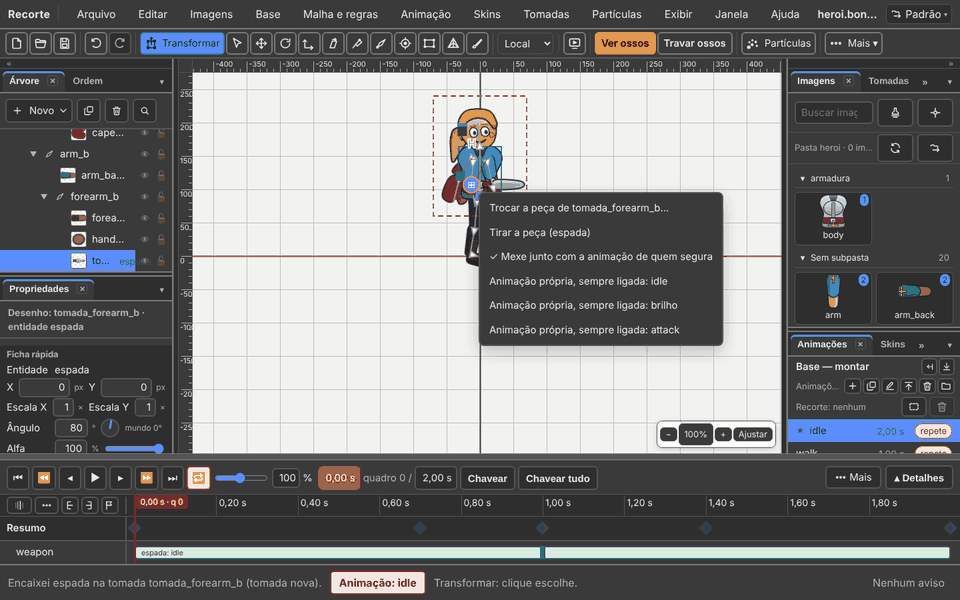
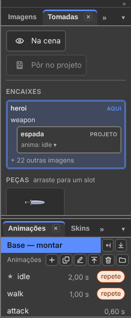

# 5. Tomadas: uma peça dentro da outra

Também em inglês: [English](en/05-entities.md)

Reescrito em 05/11/2026. A aba e o menu que se chamavam **Entidades** hoje
se chamam **Tomadas**. O passo a passo inteiro, com fotos, está no
[capítulo 11](11-a-espada-de-um-o-boneco-de-outro.md).

## O que você vai conseguir fazer no fim

1. Pôr uma espada na mão do herói, encaixando o projeto da espada.
2. Pôr o herói dentro do mecha, pelo mesmo gesto.
3. Escolher a animação da peça, e testar antes de gravar.

---

## As palavras

| Na tela | Quer dizer |
|:---|:---|
| **Tomada** | um lugar num osso onde uma peça entra: a mão, as costas, a cabine |
| **Peça** | outro projeto (`.bone`) encaixado numa tomada. A espada. O herói |
| **Encaixes** | a parte de cima da aba Tomadas: quem está dentro de quem |
| **Peças** | a parte de baixo da aba: o que se pode encaixar. Arraste até uma tomada |

**Um gesto só, nos dois sentidos.** Segurar a espada e entrar no mecha são a
mesma coisa: uma tomada recebe um projeto. Muda só qual projeto está aberto.

| Quero | Abra | Encaixe |
|:---|:---|:---|
| o herói **segura** a espada | o herói | `espada.bone` na tomada da mão |
| o herói **entra no** mecha | o mecha | `heroi.bone` na tomada da cabine |

---

## Encaixar: três portas, o mesmo gesto

1. Escolha o osso: a mão, ou a cabine.
2. Botão direito no osso, na cena ou na Árvore.
3. **Encaixar um projeto…**
4. Escolha o arquivo `.bone` da peça.

A mesma coisa pelo menu: **Tomadas → Encaixar um projeto…**, com o osso
escolhido. Ou arraste a peça da lista **Peças** até a tomada.

Osso sem tomada? Encaixar cria a tomada e encaixa, num passo só. Para criar
só o lugar vazio: **Tomadas → Pôr uma tomada aqui…**.

**O ícone de dois pinos** fica na ponta do osso que tem tomada. Clique nele:
abre o menu da tomada — trocar a peça, ou **Tomadas → Tirar a peça**.

---

## A aba Tomadas

**Janela → Tomadas.**

| Parte | O que mostra |
|:---|:---|
| **Encaixes** | a cadeia, de fora para dentro: mecha › cabine › herói › mão › espada |
| **Peças** | os projetos que se podem encaixar. Arraste um até a tomada |

---

## A peça na animação

A peça já chega animada. No cartão da tomada (clique no ícone):

| Caixa | Faz |
|:---|:---|
| **Mexe junto com a animação de quem segura** | o herói ataca, a espada ataca. Vem marcada |
| **Animação própria, sempre ligada** | a peça roda uma animação dela por baixo de tudo: o mecha anda |

Na linha do tempo, a peça é uma **faixa** com o nome da animação.

| Gesto | Efeito |
|:---|:---|
| arrastar a faixa | muda quando ela começa |
| puxar a ponta | mais devagar ou mais rápido |
| botão direito na faixa | qual animação toca, e o laço |

Pelo menu, com a peça escolhida: **Tomadas → Escolher a animação dela…** e
**Tomadas → Em laço**.

---

## Testar antes de gravar

Quer ver como fica, sem mexer no arquivo?

| Item do menu Tomadas | Faz |
|:---|:---|
| **Pôr em teste neste slot…** | a peça aparece no lugar da imagem escolhida, só de teste |
| **Desligar o teste deste slot** | tira a peça de teste |
| **Este boneco entra em…** | o boneco aberto aparece dentro de outro projeto, só de teste |
| **Tirar de volta** | tira o que está em volta |
| **Pôr no projeto…** | ficou bom: grava a peça de teste no arquivo |
| **O que a peça de teste toca…** · **Skins da peça de teste…** | a animação e a roupa da peça de teste |
| **Teste em todas as iguais** | a peça de teste em todos os lugares iguais (as rodas) |

---

## Os outros itens do menu Tomadas

| Item | Faz |
|:---|:---|
| **Trazer entidade de fora…** | um `.bone` de fora entra na lista Peças |
| **Pôr entidade na cena…** | a peça entra presa ao osso escolhido |
| **Marcar como slot…** · **Desmarcar o slot** | uma imagem vira uma base com nome e animações próprias, e volta |
| **Este boneco…** · **Tirar o Este boneco** | uma parte da peça atrás do boneco inteiro, outra na frente |
| **Tirar a entidade** | a imagem de antes volta |
| **Promover a base** · **Rebaixar a entidade** | uma peça vira base do projeto, e volta |

O que fazer passo a passo também está em **Ajuda → Quero fazer…**: digite
`arma` ou `mecha`.

---

## O que ainda não funciona

| O quê | Como é hoje |
|:---|:---|
| Arrastar um `.bone` do disco direto para a tomada | use o botão direito no osso, ou a lista Peças |
| Trocar pela grade numa animação valer **só dali em diante** | a grade grava na base |
| A Prévia mostrar o de fora **em volta** (o mecha) | a Prévia mostra só as peças **no** boneco |

---

## O selo — o que este capítulo confirma

| Função | Selo | Como foi conferido |
|:---|:---:|:---|
| Encaixar um projeto pelo botão direito no osso | existe | `npm run tomadas`, passo a2 |
| O ícone da tomada abre o menu dela | existe | passo a3 |
| Arrastar da lista Peças até o ícone | existe | passo a4 |
| Pôr uma tomada aqui… | existe | passo b2 |
| O herói na cabine do mecha | existe | passo b3 |
| Animação própria, sempre ligada | existe | passo b4 |
| A aba Tomadas mostra a cadeia | existe | passo b5 |
| O jogo desenha o herói na cabine | existe | passo d: o validador e o runtime |

---

Próximo: [6. Malha e pesos](06-malha-e-pesos.md)
