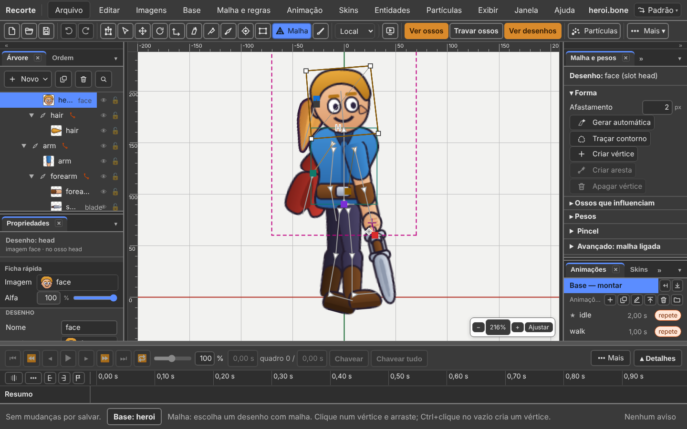
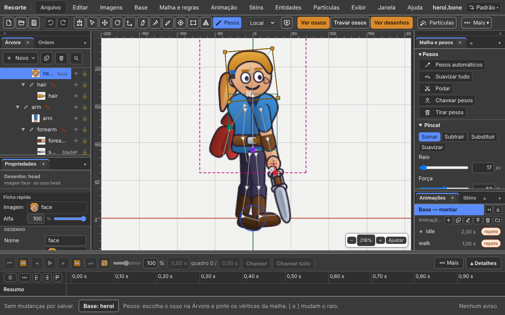

# 6. Malha e pesos

Também em inglês: [English](en/06-mesh-and-weights.md)

## O que você vai conseguir fazer no fim

1. Fazer uma capa ondular e um tronco curvar, em vez de girar como madeira.
2. Ligar uma imagem a dois ossos e deixar o programa repartir os pesos.
3. Reconhecer os seis erros comuns, pelo que se vê na tela.

---

## O problema que a malha resolve

Uma imagem presa num osso é um retângulo rígido. Ela gira e escorrega inteira.

Isso basta para um braço de madeira. **Não basta para uma capa ao vento, para um
tronco que se curva, para uma boca que abre.**

A **malha** recorta a imagem em triângulos. Aí cada ponto da imagem pode ir para
um lado diferente, e o desenho dobra por dentro.

Os **pesos** dizem quanto cada osso puxa cada ponto.

---

## Quando usar malha

| Peça | Usar malha? | Por quê |
|:---|:---:|:---|
| capa, saia, cabelo comprido | **sim** | precisa ondular |
| tronco, barriga | **sim** | curva ao andar e ao respirar |
| boca, olho, sobrancelha | **sim** | muda de forma |
| antebraço, canela | talvez | só se for de carne e tiver que esticar |
| mão, pé, espada, escudo | **não** | peça rígida. Girar basta |
| cabeça inteira, se não fala | **não** | girar basta |

A regra curta: **malha só onde a forma muda.**

Malha custa mais para o jogo desenhar. Não ponha em tudo "por garantia".

---

## Onde isso mora

Três portas, que fazem a mesma coisa:

| Porta | Onde |
|:---|:---|
| a aba | **Malha e pesos**, na coluna da direita |
| o menu | **Malha e regras → Malha ▸** e **Malha e regras → Pesos ▸** |
| a tela arrumada | **Janela → Arranjos → Pesos**: a aba grande, a Árvore ao lado |

Duas ferramentas na cena:

| Ferramenta | Tecla | Para quê |
|:---|:---:|:---|
| **Malha** | `M` | mexer nos vértices |
| **Pesos** | `G` | pintar peso |

A aba tem seis partes, nesta ordem:

| Parte | Como nasce |
|:---|:---|
| **Desenho**: o nome | sempre aberta |
| **Forma** | aberta com a Malha (ou outra ferramenta) na mão |
| **Ossos que influenciam** | aberta com os Pesos na mão, ou com Ligar ossos aceso |
| **Pesos** | aberta com os Pesos na mão |
| **Pincel** | dobrada; abre sozinha com os Pesos |
| **Avançado: malha ligada** | dobrada |

O **título** de cada parte é o botão de dobrar e abrir. O que você abriu ou
fechou fica assim até trocar de ferramenta.

---

## Vale na base e na animação

A malha **não expulsa** você da animação. Tudo funciona com uma animação aberta.

O que muda é **para onde vai** cada gesto:

| Gesto | Na base | Com uma animação aberta |
|:---|:---|:---|
| Virar malha, Gerar, Traçar | muda a forma | muda a forma **da base** |
| criar e apagar vértice, aresta | muda a forma | muda a forma **da base** |
| ligar osso, pintar, Pesos automáticos | muda os pesos | muda os pesos **da base** |
| **arrastar um vértice** | muda a forma | grava uma **chave de deformação** |
| **Chavear pesos** | não faz nada, e diz por quê | grava os pesos de agora como **chave** |

Com uma animação aberta, a aba diz isso no alto, numa linha:

> Forma e pesos gravam na base

A frase inteira está na dica dessa linha.

E o rodapé diz, a cada gesto, que foi para a base: *"(foi para a base)"*. Com a
virada de base aberta, ele diz de qual: *"(foi para a base de lobisomem)"*.

---

## Criar e gerar malha no meio da animação

É o gesto que mais se faz. Passo a passo, **com a animação aberta**:

| Passo | Gesto | O que se vê |
|:---:|:---|:---|
| 1 | Clique no desenho, na Árvore ou na cena | o título diz *Desenho: capa* |
| 2 | Na aba, parte **Forma**, clique em **Virar malha** | *"capa" virou malha: 4 vértices (foi para a base)*. A ferramenta Malha liga sozinha |
| 3 | Clique em **Gerar automática** | *Malha gerada: 40 vértices, 60 triângulos (foi para a base)* |
| 4 | Arraste um quadrado branco | a forma muda **só neste instante**: é uma chave |

No passo 4 a folha ganha uma linha **Malha** para aquele desenho.

> **Cuidado ao gerar de novo.** Se a malha já tem chaves de deformação, o
> rodapé avisa: *"Atenção: 3 chaves de deformação de "andar" foram gravadas na
> forma de antes e agora caem em outros vértices"*. Gerar troca os vértices; as
> chaves velhas não sabem disso.

Gerar também **apaga os pesos** da malha. Ligue os ossos de novo depois.

---

## O caminho inteiro, em cinco passos

### Passo 1 — Escolher o desenho

Clique no desenho na Árvore, ou na cena.

O alto da aba passa a dizer qual é: **Desenho: face**. Quando o slot tem outro
nome, ele vem entre parênteses; os dois nomes ficam na dica.

Nada escolhido? A aba diz: *Escolha um desenho na árvore ou na tela.*

### Passo 2 — Virar malha

Enquanto o desenho for uma imagem inteira, a parte **Forma** tem um botão só:
**Virar malha**.

A imagem vira uma malha de quatro cantos. Ainda não dobra nada: é a porta de
entrada. A ferramenta **Malha** (`M`) liga sozinha — só aqui, na malha que
acabou de nascer.

### Passo 3 — Gerar a forma

| Botão | O que faz |
|:---|:---|
| **Gerar automática** | contorno e miolo, pela silhueta da imagem |
| **Traçar contorno** | só o contorno, sem vértice por dentro |
| **Afastamento** (px) | quanto o contorno fica para fora da arte. Nasce em **2**. De 0 a 30; 0 desliga |

Use **Gerar automática** quase sempre. Gerar **não move** o desenho.

*A conta da forma (vértices, triângulos, contorno) está na dica do título
**Forma**.*

### Passo 4 — Ligar os ossos

Parte **Ossos que influenciam**, botão **Ligar ossos**.

| Passo | Gesto | O que se vê |
|:---:|:---|:---|
| 1 | Clique em **Ligar ossos** | o botão acende. Rodapé: *Clique nos ossos que puxam esta malha. Ligar ossos de novo termina.* |
| 2 | Clique no primeiro osso, na cena ou na Árvore | ele entra com peso 100 % |
| 3 | Clique no segundo osso | ele entra com 0 % |
| 4 | Clique em **Ligar ossos** de novo (com os Pesos na mão, `Esc` também fecha) | o modo fecha, e **os pesos se repartem sozinhos** |

No passo 4 o rodapé diz: *"Os 2 ossos ligados repartiram o peso sozinhos
(Pesos automáticos em 9 vértices). Pinte para ajustar; Ctrl+Z volta"*.

Vale com **qualquer ferramenta na mão**. A malha não sai da escolha no meio do
caminho. Clicar de novo num osso já ligado **tira** ele.

Cada osso ligado ganha **uma cor**. Na cena, cada vértice vira uma **pizza**,
uma fatia por osso, na cor dele.

Outro jeito, sem o botão: segure `P` e clique na malha. Liga o osso escolhido a
ela.

### Passo 5 — Ajustar

Parte **Pesos**:

| Botão | O que faz | Quando usar |
|:---|:---|:---|
| **Pesos automáticos** | cada vértice segue os ossos mais perto. Só os da lista; lista vazia, todos os ossos com comprimento | para começar, ou refazer |
| **Suavizar tudo** | mistura os pesos dos vizinhos | quando a dobra fica angulosa |
| **Podar** | tira os pesos abaixo de 2 % | quando um osso longe puxa um pouquinho |
| **Chavear pesos** | grava os pesos de agora como chave na animação aberta | quando o peso precisa mudar no tempo |
| **Tirar pesos** | a malha volta a seguir só o osso do slot | para refazer do zero |

Depois de cada um, a ferramenta **Pesos** entra na mão, para a cena mostrar as
pizzas.

**Testar:** gire um osso ligado e veja a malha seguir. `Ctrl+Z` volta.

---

## Editar a forma da malha

Ferramenta **Malha** (`M`). Os botões da parte **Forma** repetem as teclas:

| Gesto | O que faz | Botão |
|:---|:---|:---|
| arrastar um quadrado branco | move o vértice | — |
| clique num vértice | escolhe ele | — |
| `Shift` + clique | soma outro vértice à escolha | — |
| arrastar no vazio | uma **caixa** escolhe os vértices de dentro. `Shift` soma | — |
| `Ctrl` + clique no vazio | cria um vértice | — |
| clique no vazio, com o modo aceso | cria um vértice | **Criar vértice** (liga e desliga; `Esc` fecha) |
| `L`, com dois vértices escolhidos | cria a aresta entre eles | **Criar aresta** |
| `K`, com dois vértices escolhidos | apaga a aresta | o mesmo botão vira **Apagar aresta** |
| `Delete` | apaga os vértices escolhidos | **Apagar vértice** |

`Delete` sem vértice escolhido **não apaga o desenho**. Ele diz como fazer:
troque de ferramenta, ou **Editar → Apagar**.

Clique fora de vértice, sem o modo? O rodapé ensina, uma vez por malha: *Nenhum
vértice aqui. Clique num quadrado branco e arraste; Ctrl+clique cria um
vértice.*

No menu: **Malha e regras → Malha ▸ Criar ou apagar aresta**. Cinza sem dois
vértices, dizendo como escolher.

---

## Pintar peso

Ferramenta **Pesos** (`G`). Ou abra a parte **Pincel**: ela põe a ferramenta na
mão.

### Escolher o osso que se pinta

| Gesto | Onde |
|:---|:---|
| clique no **nome** do osso | na lista **Ossos que influenciam** |
| clique no **osso** | na cena, **fora** da malha |

O osso escolhido **brilha** na cor dele, por cima da malha.

Sem osso escolhido, o pincel avisa: *Escolha o osso que vai pintar: clique no
nome dele em Ossos que influenciam, ou no osso na cena, fora da malha.*

### A lista de ossos

Cada linha tem: a **bolinha da cor**, o **nome**, o **%**, a **caixa de travar**
e a **lixeira** (tira o osso da malha).

O que o % quer dizer está escrito em cima da lista:

| Vértices escolhidos | O % é |
|:---:|:---|
| nenhum | o peso **médio** na malha inteira |
| um | o peso **daquele** vértice. Vira caixa: digite o número |
| vários | o peso deles. Caixa vazia com *vários* = diferem entre si |

Digitar o % de um osso: **o resto vai para os outros**, na proporção que tinham.
O osso travado não muda.

### Escolher vértices para pintar

Com a ferramenta Pesos: `Shift` + clique num vértice escolhe ou larga ele.
Escolhidos, o pincel **pinta só neles**. `Esc` larga todos.

**Cuidado:** sem vértice escolhido, o `Esc` solta o **desenho** inteiro. Clique
nele de novo para voltar a pintar.

### Os quatro modos do pincel

| Modo | O que faz |
|:---|:---|
| **Somar** | dá mais peso ao osso escolhido; os outros perdem o mesmo tanto |
| **Subtrair** | tira peso dele e devolve aos outros |
| **Substituir** | leva o peso dele até 100 %, no passo da Força |
| **Suavizar** | mistura o peso de cada vértice com o dos vizinhos |

E dois números:

| Número | Faixa | Atalho |
|:---|:---|:---|
| **Raio** (px) | 1 a 400. Nasce em ¼ do maior lado da malha | `[` diminui, `]` aumenta |
| **Força** (%) | 0 a 100. Com 100 uma passada pinta tudo | `Alt` segurado pinta mais leve |

O círculo azul segue o mouse e muda de tamanho na hora.

Ao soltar, o rodapé conta: *Peso de cape2 pintado em 3 vértices.*

### Travar um osso

A caixa ao lado de cada osso. Travado, **o pincel, Suavizar e Podar não mexem
no peso dele**. Serve para mexer só entre dois ossos e deixar um terceiro em
paz.

### Ver os pesos sem a ferramenta

**Exibir → O boneco → Pesos**. Também **Malhas** e **Arestas**, no mesmo lugar.

---

## Como a soma funciona

A soma dos pesos de um ponto é sempre **100 %**.

Isso quer dizer: **dar mais peso a um osso tira peso dos outros do mesmo ponto.**

| Osso | Peso |
|:---|---:|
| `tronco` | 70 % |
| `quadril` | 30 % |
| **soma** | **100 %** |

Se você somar 20 % em `tronco`, o `quadril` cai para 10 %. Não há como os dois
somarem 120 %.

Não há limite de quatro ossos por ponto. Pode haver quantos precisar.

---

## Os seis erros comuns, e como perceber

### 1. Cotovelo que "amassa"

**O que se vê:** ao dobrar o braço, a manga afunda e some no cotovelo.

**Por quê:** os pontos perto do cotovelo estão quase todos num osso só.

**Como arrumar:** escolha os vértices do cotovelo (`Shift` + clique) e digite
50 % no braço. Ou passe **Suavizar**.

### 2. Ponto que fica para trás

**O que se vê:** um pedacinho do desenho não acompanha o resto e estica como
chiclete.

**Por quê:** aquele ponto ficou sem peso, ou com peso no osso errado.

**Como perceber:** olhe as pizzas. **A pizza de outra cor no meio da área, ou o
vértice sem pizza, é o culpado.** Clique nele: a lista mostra o peso dele.

**Como arrumar:** digite o % na lista. Ou pincel em **Substituir**, Força 100,
uma passada.

### 3. Osso longe puxando de leve

**O que se vê:** girar a cabeça mexe um pouquinho na barra da capa.

**Por quê:** os pesos automáticos deram uma fatia mínima a um osso distante.

**Como arrumar:** botão **Podar**. Ou a lixeira do osso, na lista.

### 4. Contorno com buraco por dentro

**O que se vê:** o desenho tem um vazado — uma alça, um anel — e a malha passa
por cima do buraco.

**Por quê:** o traçado segue só o contorno de fora.

**Como arrumar:** por enquanto, edite os vértices à mão com a ferramenta Malha.

### 5. Malha grosseira demais

**O que se vê:** a curva do desenho fica em ângulos retos ao dobrar.

**Por quê:** poucos triângulos.

**Como arrumar:** **Criar vértice** (ou `Ctrl` + clique) onde a curva é maior.

### 6. Malha fina demais

**O que se vê:** o jogo fica lento com muitos personagens na tela.

**Por quê:** triângulos demais.

**Como arrumar:** gere de novo, ou apague vértices onde a forma é reta.

---

## Malha ligada: uma forma, vários desenhos

Uma **malha ligada** usa a forma e os pesos de outra malha.

Serve para: a mesma capa em três cores; o mesmo rosto com bocas diferentes. Você
desenha e pesa **uma vez**, e as outras seguem.

| Passo | Gesto |
|:---:|:---|
| 1 | Escolha o slot, ou o desenho, na Árvore ou na cena |
| 2 | Abra **Avançado: malha ligada**, no fim da aba |
| 3 | Em **Malha de origem**, escolha de qual malha a forma vem |
| 4 | Clique em **Usar forma** (ou **Malha e regras → Malha → Usar a forma de outra malha**) |
| 5 | Em **Propriedades**, troque a **Imagem** da malha nova |

O rodapé diz: *"… criada, emprestando a forma de "capa". Ela começa com a mesma
imagem; troque em Propriedades, no campo Imagem."*

A lista de origens traz as malhas **do mesmo slot**, em qualquer skin. É o que o
formato permite: a forma está no espaço do osso daquele slot.

**Nada é copiado.** Mexeu num vértice da origem, a ligada acompanha, sempre.
Escolhida a ligada, a aba diz: *Malha ligada: usa a forma de "capa". A forma e
os pesos se mudam lá.*

Slot sem malha nenhuma? A aba diz: *Este slot não tem nenhuma malha para servir
de origem. Vire um desenho em malha primeiro.*

---

## O que ainda não funciona

| O quê | Como contornar |
|:---|:---|
| O traçado ignora buracos por dentro | Edite os vértices à mão com a ferramenta Malha |
| Não há alça para mover a textura sem mover o vértice (o `keepUv` existe no código, sem botão) | Mova o vértice na base: a textura acompanha |
| Gerar de novo não reaproveita os pesos | Ligue os ossos de novo, ou **Pesos automáticos** |

---

## O selo — o que este capítulo confirma

Regra da casa: toda função leva selo. Conferido em 07/10/2026, na v36.5, no
código.

| Função | Selo | Onde no código |
|:---|:---:|:---|
| Malha e pesos valem com uma animação aberta | **existe** | `mesh/mesh-doc.ts:397` (`MESH_REST_POSE_NOTICE`); `panels/mesh-panel.ts:280-285` |
| **Criar e gerar malha no meio da animação**: vai para a base do corpo do instante | **existe** | `panels/mesh-panel.ts:1012-1043` (Virar) e `1096-1107` (Gerar, `corpoDe`); `contract.ts:372` (`wentToBase`) |
| Aviso das chaves de deformação velhas ao gerar de novo | **existe** | `mesh/mesh-doc.ts:553-575` |
| Arrastar vértice com animação aberta grava chave de deformação | **existe** | `mesh/mesh-doc.ts:641-655` |
| Virar malha liga a ferramenta Malha só na malha nova | **existe** | `panels/mesh-panel-model.ts:269` |
| Gerar automática · Traçar contorno · Afastamento | **existe** | `panels/mesh-panel.ts:536-539`, `608-628` |
| Criar vértice (modo, clique simples) e `Ctrl` + clique | **existe** | `viewport/tools/mesh-tool.ts:217-242` |
| Caixa de escolher vértices; `Shift` soma | **existe** | `viewport/tools/mesh-tool.ts:220-224`, `253-272` |
| `L` / `K` / `Delete`, e o botão de aresta que troca de nome | **existe** | `viewport/tools/mesh-tool.ts:286-314`; `panels/mesh-panel.ts:559-579` |
| `Delete` sem vértice não apaga o desenho | **existe** | `viewport/tools/mesh-tool.ts:38-39`, `291-294` |
| Ligar ossos (modo, qualquer ferramenta, cena ou Árvore) | **existe** | `panels/mesh-panel-model.ts:85-163` |
| `Esc` fecha o Ligar | **existe diferente** | só com a ferramenta Pesos na mão (`viewport/tools/weights-tool.ts:347`); o comentário do modelo promete com qualquer uma |
| Fechar o Ligar reparte os pesos sozinho | **existe** | `panels/mesh-panel-model.ts:485-501`; `panels/mesh-panel.ts:905-917` |
| `P` segurado + clique numa malha liga o osso | **existe** | `mesh/mesh-doc.ts:409-420` (`toggleMeshBone`); `ESTADO.md` |
| Pizza por vértice, cor por osso | **existe** | `viewport/tools/weights-tool.ts:8-11`, `161-196`; `panels/mesh-panel-model.ts:193` |
| Pesos automáticos · Suavizar tudo · Podar (2 %) · Tirar pesos | **existe** | `panels/mesh-panel.ts:1110-1146` |
| Chavear pesos | **existe** | `mesh/mesh-doc.ts:593-618` |
| Peso exato digitado nos vértices escolhidos | **existe** | `panels/mesh-panel.ts:882-901` |
| Pincel: 4 modos, Raio em px, Força em % | **existe** | `panels/mesh-panel-model.ts:337-360` |
| `[` e `]` mudam o Raio, só com os Pesos na mão | **existe** | `ui/keys.ts:189-190`; `viewport/tools/weights-tool.ts:339-345` |
| `Alt` pinta mais leve (40 % da Força) | **existe** | `viewport/tools/weights-tool.ts:369`. Não está em dica nenhuma |
| `Shift` + clique escolhe vértice para pintar; `Esc` larga | **existe** | `viewport/tools/weights-tool.ts:270-281`, `349-353` |
| Clique no osso fora da malha escolhe o osso a pintar | **existe** | `viewport/tools/weights-tool.ts:254-266` |
| Travar osso | **existe** | `panels/mesh-panel.ts:853-860`; `panels/mesh-panel-model.ts:391` |
| As seções dobram e abrem pela ferramenta | **existe** | `panels/mesh-panel-model.ts:53-64` |
| Malha ligada (Usar forma) | **existe** | `panels/mesh-panel.ts:453-521`; `mesh/linked-mesh.ts:96-101`, `238` |
| Portas no menu Malha e regras | **existe** | `ui/menus.ts:931-1004` |
| Arranjo **Pesos** | **existe** | `ui/contexts.ts:71-80`; `ui/menus.ts:1711-1720` |
| Exibir → O boneco → Malhas, Arestas, Pesos | **existe** | `ui/menus.ts:600-602` |
| O traçado com buracos por dentro | **falta** | `mesh/mesh-edit.ts:961`: só segue a borda de fora |
| Alça para mover a textura (`keepUv`) | **falta** | `mesh/mesh-doc.ts:643`, `660`: existe no código, sem botão |
| `Esc` depois de pintar, sem vértice escolhido, solta o desenho inteiro | **existe (defeito)** | visto na tela em 07/10: pincelada no `face`, `Esc`, e a aba volta a *Escolha um desenho*. Com vértice escolhido, o `Esc` larga só os vértices (`weights-tool.ts:349-354`) |

Saiu do capítulo, porque sumiu do programa: a frase *"Escolha a ferramenta
Malha (M) ou Pesos (G) para editar"* (a aba não a desenha mais), as cores azul e
vermelho (viraram a pizza) e *"mover um vértice recarrega o arquivo"* (não achei
no código nem no `CHANGELOG`).

---

Próximo: [7. As cinco regras](07-as-cinco-regras.md)
