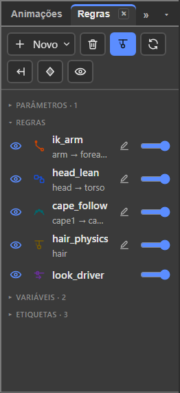
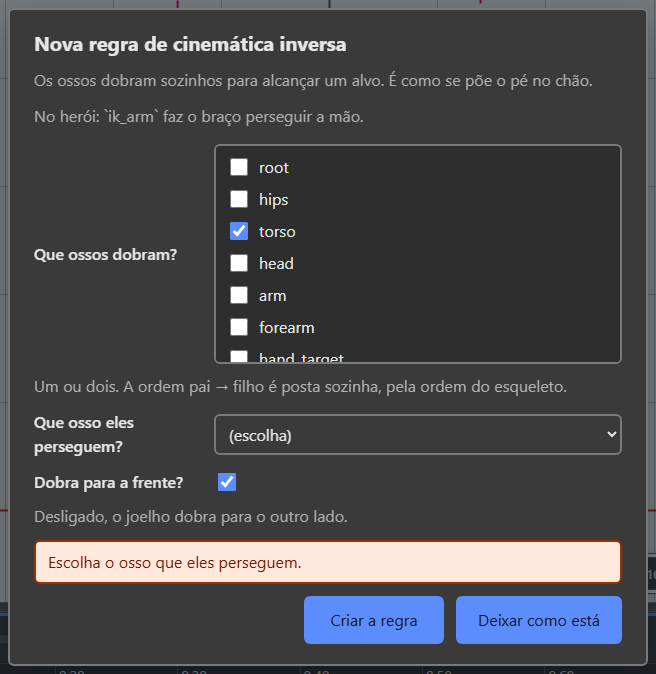

# 7. As cinco regras

Também em inglês: [English](en/05-rules.md)

## O que você vai conseguir fazer no fim

1. Criar qualquer uma das cinco regras pela janela que pergunta, sem escrever no
   arquivo.
2. Fazer o pé não escorregar no chão e o cabelo balançar sozinho.
3. Ligar e desligar uma regra no meio de uma animação.
4. Trocar os ossos de uma regra sem apagar e refazer.

---

## O que é uma regra

Uma **regra** é um cálculo automático em cima dos ossos.

**Você não anima o resultado. Você anima a causa**, e a regra faz o resto a cada
quadro — no editor e dentro do jogo, igual.

No arquivo `.bone` elas se chamam *constraints*. No editor ficam na aba
**Regras**, e os campos ficam em **Propriedades**.

| Regra | Em uma frase | Exemplo clássico | No `heroi.bone` |
|:---|:---|:---|:---|
| **Cinemática inversa** | você move a mão; o cotovelo dobra sozinho | pé que não escorrega no chão | `ik_arm` |
| **Transformação** | um osso copia o giro, a posição ou o tamanho de outro | cabeça que se inclina com o tronco | `head_lean` |
| **Caminho** | ossos deslizam ao longo de uma linha desenhada | capa, corrente, trilho, cobra | `cape_follow` |
| **Física** | o osso atrasa e balança sozinho quando o corpo se move | cabelo, brinco, rabo, roupa solta | `hair_physics` |
| **Comando** | um número controla várias coisas ao mesmo tempo | um botão "olhar" que move a cabeça | `look_driver` |

---

## Onde isso mora

| Porta | O que tem |
|:---|:---|
| aba **Regras** | a lista, a barra de botões |
| menu **Malha e regras** | Nova regra… · Trocar os ossos da regra… · Apagar regra · Novo parâmetro · Chave do parâmetro aqui · Apagar parâmetro · Física ▸ |
| **Novo** da Árvore | Regra… e Parâmetro |
| **Propriedades** | todos os campos da regra escolhida |

---

## A aba Regras



### A barra de cima

Ícones, com o nome na dica:

| Botão | O que faz |
|:---|:---|
| **Novo ▾** | abre a lista: Regra… · Parâmetro · Variável · Etiqueta |
| lixeira | apaga o escolhido na lista: a regra, o parâmetro ou a variável |
| **Simular a física** | liga e desliga o balanço na tela |
| **Reiniciar esta física** | zera o balanço da regra de física escolhida |
| **Reiniciar todas as físicas** | zera todas de uma vez |
| **Assar a física em chaves** | troca a simulação por chaves comuns |
| olho | mostra ou esconde variáveis e etiquetas |

### A lista

Três partes, nesta ordem. Cada título dobra e abre com um clique.

| Parte | O que é |
|:---|:---|
| **Parâmetros** | os números que o jogo manda de fora. Vêm primeiro: é deles que o Comando lê |
| **Regras** | uma linha por regra |
| **Variáveis** e **Etiquetas** | não mexem no desenho. Podem ser escondidas pelo olho |

### Uma linha de regra

| O que | O que é |
|:---|:---|
| **olho** | liga e desliga. Desligar é Força zero, e **o valor que estava lá volta** ao religar |
| **ícone** | o tipo. Cada um dos cinco tem o seu desenho |
| **nome** | e, embaixo, a cadeia e o alvo: `arm → forearm → hand_target` |
| **lápis** | Trocar os ossos da regra. Não aparece no Comando |
| **barra** | a Força, de 0 a 100 % |

Uma regra que cita um nome que não existe fica **em vermelho**, dizendo qual
nome está errado.

Na Árvore, o osso que tem regra ganha uma marca ao lado do nome, com a dica
*Este osso tem regra. Veja na aba Regras*.

### Quando a regra segura o osso

Girou um osso e ele não girou? A regra manda nele. O rodapé diz qual:

> cape2 não girou: a regra cape_follow manda nele. Desligue o olho dela na aba
> Regras.

---

## Nova regra: a janela pergunta

Três portas, a mesma janela:

| Porta | Gesto |
|:---|:---|
| menu | **Malha e regras → Nova regra…** |
| aba Regras | **Novo ▾ → Regra…** |
| Árvore | **Novo → Regra…** |

A janela vem em duas partes.

**Primeiro o tipo.** *Que tipo de regra?* A lista dos cinco, cada um com uma
frase do que faz. Botão **Continuar**.

**Depois as perguntas daquele tipo, em palavras:**



*Enquanto faltar alguma coisa, o botão **Criar a regra** fica cinza e a frase
embaixo diz o quê. A janela não fecha errada.*

| Tipo | O que ela pergunta |
|:---|:---|
| **Cinemática inversa** | "Que ossos dobram?" · "Que osso eles perseguem?" · "Dobra para a frente?" |
| **Transformação** | "Quem copia?" · "Copia de quem?" |
| **Caminho** | "Que ossos deslizam?" · "Por qual caminho?" |
| **Física** | "Que osso balança?" |
| **Comando** | "Que parâmetro manda?" · "Em que osso ele manda?" · "O que ele mexe nesse osso?" |

Duas coisas que ela faz por você:

- os ossos que você já tinha escolhido na cena **já entram marcados**;
- a ordem **pai → filho** da cadeia é posta sozinha, pela ordem do esqueleto.

E o que ela **não** deixa:

| Tentou | A frase |
|:---|:---|
| alvo que é um dos ossos que dobram | *O alvo não pode ser um dos ossos que dobram.* |
| IK com três ossos ou mais | *Uma regra de IK dobra um ou dois ossos. Escolha até dois.* |
| o mesmo osso duas vezes | *O mesmo osso está na cadeia duas vezes.* |

Com o lápis de uma skin aceso, a regra nasce **dentro** daquela skin.

### Trocar os ossos depois

Três jeitos, a mesma janela:

| Porta | Gesto |
|:---|:---|
| aba Regras | o **lápis** da linha |
| menu | **Malha e regras → Trocar os ossos da regra…** |
| Propriedades | o campo **Ossos da cadeia**, uma lista de caixas |

É assim que uma IK de um osso vira uma de dois **depois** de criada. O alvo
continua o mesmo.

---

## O campo que todas têm: Força

Toda regra tem um campo **Força**, de 0 a 100 %. É a mistura entre a pose
animada e o que a regra quer.

| Valor | Efeito |
|:---|:---|
| `0 %` | a regra não faz nada |
| `50 %` | meio caminho |
| `100 %` | a regra manda |

**Força é animável.** É assim que se liga e desliga uma regra no meio de uma
animação: o pé fica preso ao chão com 100 % enquanto o personagem pisa, e vai
para 0 % quando ele levanta o pé.

> **Onde se grava a chave.** Com a animação aberta, mude a **Força em
> Propriedades**: vira chave no cursor. **O olho e a barra da aba Regras não
> gravam chave** — eles mudam a regra na base, em todas as animações.

O outro campo comum é **Só com a skin**: a regra só vale quando a skin que a
declara está ligada. Ver o [capítulo 3](03-peles.md).

---

## As alças na cena

Com a ferramenta **Posar** (`Y`), as regras têm alças na cena:

| Alça | Regra | O que arrastar faz |
|:---|:---|:---|
| Alvo de IK | cinemática inversa | move o osso alvo |
| Dobra | IK de dois ossos | troca o lado da dobra |
| Alvo de transformar | transformação | move o osso alvo |
| Posição no caminho | caminho | anda com o primeiro osso pela linha |
| Vento | física | muda o vento |
| Gravidade | física | muda a gravidade |

Com uma animação aberta, cada arrasto grava chave no cursor.

---

## 1. Cinemática inversa

Normalmente você gira o ombro, depois o cotovelo, depois o pulso, e a mão vai
parar onde for. Isso é trabalhoso e impreciso.

A cinemática inversa faz o contrário: **você põe a mão onde quer, e o ombro e o
cotovelo se acertam sozinhos.** "Inversa" porque vai da ponta para a raiz.

### O exemplo: o pé que não escorrega

O personagem anda. O pé de apoio tem que ficar **parado no chão** enquanto o
corpo passa por cima dele.

| Passo | O que fazer |
|:---:|:---|
| 1 | Crie um osso solto no chão. Chame de `alvo_pe_esq`. |
| 2 | **Malha e regras → Nova regra… → cinemática inversa.** Em "que ossos dobram?", marque `perna_esq` e `canela_esq`. |
| 3 | Em "que osso eles perseguem?", escolha `alvo_pe_esq`. |
| 4 | Anime só o `alvo_pe_esq` e o `quadril`. A perna se dobra sozinha. |

Sem isso, o pé escorrega. Com isso, ele gruda.

No herói, `ik_arm` faz o mesmo com o braço: `arm → forearm` perseguindo
`hand_target`.

### Os campos, em Propriedades

| Campo | O que faz |
|:---|:---|
| **Ossos da cadeia** | os ossos que dobram |
| **Alvo** | o osso que a ponta da cadeia persegue |
| **Dobra para o lado positivo** | de que lado o cotovelo ou o joelho dobra. Dobrou ao contrário? É esta caixa |
| **Encolhe** | deixa o osso encolher para alcançar um alvo perto demais. Só com um osso |
| **Estica** | deixa o osso esticar para alcançar um alvo longe demais |
| **Escala uniforme** | ao esticar ou encolher, escala nos dois sentidos |
| **Suavidade** (px) | amacia o movimento pouco antes de a perna esticar toda. Tira o "estalo" do joelho. Típico: 0 a 20 px |

### Regras a respeitar

- Um ou dois ossos. Com dois, o segundo tem que ser filho do primeiro.
- O alvo não pode ser um dos ossos da cadeia.

### Posar não é IK

A ferramenta **Posar** (`Y`) arrasta a ponta de uma cadeia de dois ossos e ela
dobra sozinha, com a mesma conta que o jogo faz.

> **Posar não cria regra.** Ela dobra a cadeia **agora**, escrevendo rotações na
> pose, como qualquer outra ferramenta. Com a ferramenta na mão, o rodapé diz:
> *Posar dobra a cadeia agora, sem criar regra. Para o jogo dobrar sozinho,
> crie uma regra de IK.*

É a confusão mais cara que existe aqui: quem pensa que "posou uma perna de IK"
descobre no jogo que ela não dobra sozinha.

---

## 2. Transformação

Um osso copia o giro, a posição, o tamanho ou a inclinação de outro. É a regra
do "siga aquele ali".

### O exemplo: a cabeça que acompanha o tronco

A cabeça deve se inclinar um pouco quando o tronco se inclina, mas não tanto
quanto ele.

| Passo | O que fazer |
|:---:|:---|
| 1 | **Nova regra… → transformação.** Em "quem copia?", `cabeca`. |
| 2 | Em "copia de quem?", `tronco`. |
| 3 | Em Propriedades, **Força de cada parte → Rotação** em `5 %`. |

Agora a cabeça acompanha o tronco em cinco por cento. É o que o herói faz, na
regra `head_lean`.

| Outra situação | Como |
|:---|:---|
| duas rodas giram juntas | alvo é a primeira roda, Rotação `100 %` |
| uma engrenagem gira ao contrário | alvo é a outra, e **Somar giro** compensa |
| uma mochila fica sempre em pé | alvo é o `root`, Rotação `100 %` |

### Os campos, em Propriedades

| Campo | O que faz |
|:---|:---|
| **Alvo** | o osso que serve de fonte |
| **Espaço local** | ligado, compara as poses locais. Desligado, as poses no mundo |
| **Relativo** | ligado, **soma** o valor do alvo. Desligado, **vai em direção** ao valor do alvo |
| **Somar giro** (°) | graus somados ao giro do alvo |
| **Somar X**, **Somar Y** (px) | somados à posição do alvo |
| **Somar escala X / Y** (×) e **Somar inclinação Y** (°) | o mesmo, para tamanho e inclinação |

Grupo **Força de cada parte**, cada um de 0 a 100 %: **Rotação** · **X** ·
**Y** · **Escala X** · **Escala Y** · **Inclinação Y**.

Cada parte tem sua própria força: dá para copiar só o giro e ignorar a posição.

---

## 3. Caminho

Vários ossos deslizam ao longo de uma linha curva que você desenhou. A linha é
um desenho do tipo caminho, dentro de um slot.

### O exemplo: a capa que ondula

| Passo | O que fazer |
|:---:|:---|
| 1 | Desenhe o caminho da capa num slot. Chame de `caminho_capa`. |
| 2 | Crie os ossos `capa1`, `capa2`, `capa3` em cadeia. |
| 3 | **Nova regra… → caminho.** Em "que ossos deslizam?", os três. |
| 4 | Em "por qual caminho?", `caminho_capa`. |
| 5 | Em Propriedades, **Modo da rotação** em `corrente`. |

Agora anime só o caminho: os três ossos seguem a curva. É o que o herói faz, na
regra `cape_follow`.

Outros usos: corrente de bicicleta, trem no trilho, cobra, tentáculo.

### Os campos, em Propriedades

| Campo | O que faz |
|:---|:---|
| **Slot do caminho** | o slot que tem o desenho do caminho |
| **Modo da posição** | `porcentagem` (0 a 100 % do caminho) ou `fixa` (px) |
| **Modo do espaço** | `comprimento` · `fixo` · `porcentagem` · `proporcional` |
| **Modo da rotação** | como cada osso se vira (tabela abaixo) |
| **Somar giro** (°) | graus somados à rotação que o caminho dá |
| **Posição** | onde o primeiro osso fica no caminho. **É este que se anima** |
| **Espaço** | a distância entre um osso e o seguinte |

Grupo **Força de cada parte**: **Rotação** · **X** · **Y**, de 0 a 100 %.

| Modo da rotação | O osso |
|:---|:---|
| `tangente` | aponta na direção da curva naquele ponto |
| `corrente` | aponta para o osso seguinte |
| `corrente com escala` | aponta para o seguinte e ainda estica para encostar nele |

Para uma capa, use `corrente`. Para um trem no trilho, `tangente`.

---

## 4. Física

O osso **atrasa** e balança sozinho quando o corpo se move. É o "movimento
secundário": o cabelo que continua indo quando a cabeça já parou.

**Você não anima nada disso.** A física roda no jogo, a cada quadro — e no
editor também, enquanto **Simular a física** está ligado.

### O exemplo: o rabo de cavalo

| Passo | O que fazer |
|:---:|:---|
| 1 | Crie um osso `cabelo`, filho da `cabeca`. |
| 2 | **Nova regra… → física.** Em "que osso balança?", `cabelo`. |
| 3 | Em Propriedades, **No giro** em `100 %`. |
| 4 | **Gravidade** em `20`. |

Agora o cabelo balança quando a cabeça se mexe, e cai quando ela para. É o que o
herói faz, na regra `hair_physics`.

Use também em: brinco, capa, saia, orelha comprida, antena, corrente pendurada.

### Primeiro, o que entra na simulação

Grupo **Física**. Cada um de 0 a 100 %.

| Campo | Efeito |
|:---|:---|
| **No giro** | o osso balança girando. É o mais usado |
| **Em X** e **Em Y** | o osso balança se deslocando |
| **Na escala X** | o osso estica e encolhe |
| **Na inclinação X** | o osso entorta |

### Depois, como ela se comporta

Grupo **Comportamento**.

| Campo | Quer dizer | Aumente para |
|:---|:---|:---|
| **Inércia** (%) | quanto do movimento do corpo vira atraso | mais balanço |
| **Força** | a mola que puxa de volta para o lugar. Típico: 100 | voltar mais rápido |
| **Amortecimento** (%) | o freio. `100 %` é sem freio | parar mais devagar |
| **Massa** | o peso | ficar mais preguiçoso |
| **Vento** | um empurrão constante para o lado | vento na cena |
| **Gravidade** | um puxão constante para baixo | cair mais |
| **Limite** (px/s) | movimento acima disto não entra na simulação | aguentar trancos maiores |
| **Passos** (/s) | quantas contas por segundo | mais fino, e mais caro |

### Os gestos da física na tela

Na barra da aba Regras, ou em **Malha e regras → Física ▸**:

| Gesto | O que faz |
|:---|:---|
| **Simular a física** | liga e desliga o balanço na tela. É preferência sua: **não vai para o arquivo**. Desligada, a linha da regra diz *simulação desligada na tela* |
| **Reiniciar esta física** | zera o balanço da regra escolhida |
| **Reiniciar todas as físicas** | zera todas |
| **Assar a física em chaves…** | troca a simulação por chaves comuns. Depois disso a animação toca para trás igual |

### Teletransporte, no jogo

Se o jogo move o personagem de repente, avise a física: o runtime tem
`physicsReset()`. Sem ele o cabelo dá um chicote.

---

## 5. Comando

Um número só controla várias coisas ao mesmo tempo.

Você cria um **parâmetro** — por exemplo `olhar_x`, de `−1` a `1`. Depois cria
uma regra de comando que diz: quando `olhar_x` for `−1`, a cabeça gira `−12`
graus; quando for `1`, gira `12`.

Depois disso, o jogo mexe num número só e o rosto inteiro responde.

### O exemplo: olhar para os lados

| Passo | O que fazer |
|:---:|:---|
| 1 | **Malha e regras → Novo parâmetro.** Ele nasce de `−1` a `1`. Dê o nome `olhar_x` em Propriedades. |
| 2 | **Nova regra… → comando.** "Que parâmetro manda?": `olhar_x`. |
| 3 | "Em que osso ele manda?": `cabeca`. "O que ele mexe nesse osso?": Rotação. |
| 4 | Em Propriedades, no grupo **Alvo 1**: **Com o parâmetro em −1** = `−12`; **Com o parâmetro em 1** = `12`. |
| 5 | Mais um osso? O **+** do grupo: *Mais um alvo*. |

É o que o herói faz, na regra `look_driver`. No jogo, uma linha só:

```js
skeleton.setParameter('olhar_x', 0.7);
```

Na aba Regras, a linha do parâmetro tem uma **barra** para testar o valor, e o
botão **Gravar a chave aqui** (também em **Malha e regras → Chave do parâmetro
aqui**).

### Os dois jeitos de usar

| Jeito | Como funciona | Bom para |
|:---|:---|:---|
| **Por alvos** | o parâmetro escreve direto nos ossos | olhar, inclinar |
| **Contínuo** | o parâmetro vira o tempo dentro de uma animação de controle | um botão que toca uma pose inteira |

| Campo | Onde | O que faz |
|:---|:---|:---|
| **Parâmetro** | Comando por parâmetro | qual número comanda |
| **Animação inteira** | Comando por parâmetro | escolhida, liga o modo contínuo |
| **Osso** · **Propriedade** · **Modo** | cada Alvo | em quem manda, o quê, `substituir` ou `somar` |
| **Com o parâmetro em …** | cada Alvo | o valor naquele ponto do parâmetro |
| **De** e **Até** (parâmetro) | Modo contínuo | a faixa do parâmetro que é usada |
| **Tempo inicial** e **Tempo final** | Modo contínuo | o trecho da animação de controle |
| **Modo** | Modo contínuo | `substituir` ou `somar` |

Comando sem alvo e sem animação fica em vermelho: *esta regra não manda em
nada: o runtime a ignora enquanto ela estiver sem alvo*.

---

## Ordem: quem roda primeiro

As regras rodam **na ordem em que estão na lista**, de cima para baixo.

Isso importa. Se a cinemática inversa dobra a perna e a física depois balança o
cabelo, o cabelo já viu a perna dobrada. Se fosse ao contrário, o cabelo
responderia a uma pose que ainda ia mudar.

---

## Ver as cinco funcionando

Abra o `formato/exemplos/heroi.bone` e clique em cada linha da aba Regras.

| Nome | Tipo | O que faz |
|:---|:---|:---|
| `ik_arm` | cinemática inversa | o braço persegue o osso `hand_target` |
| `head_lean` | transformação | a cabeça acompanha o tronco em 5 % |
| `cape_follow` | caminho | dois ossos da capa seguem o caminho `cape_path` |
| `hair_physics` | física | o cabelo balança, com gravidade 20 |
| `look_driver` | comando | o parâmetro `lookX` gira a cabeça e abre o sorriso |

Desligue o olho de uma delas e toque a animação: dá para ver exatamente o que
cada regra estava fazendo.

---

## O que ainda não funciona

| O quê | Como contornar |
|:---|:---|
| Cadeias de IK com **mais de dois ossos**. Decidido em 17/09: a 1.0 do formato fica com um ou dois; mais que isso vira a extensão `BONE_ik_chain`, depois | Use cadeias de um ou dois ossos |
| O pêndulo próprio (`BONE_pendulum`) continua extensão, não núcleo (decisão de 17/09) | Use a regra de física, que está no núcleo |
| Mudar a ordem em que as regras rodam | Mexa no arquivo. A lista não é arrastável |
| No Comando, um alvo que **não é osso** (o morph `smile` do herói) | O herói já traz. No editor, só alvo de osso |

---

## O selo — o que este capítulo confirma

Regra da casa: toda função leva selo. Conferido em 07/10/2026, na v36.5, no
código.

| Função | Selo | Onde no código |
|:---|:---:|:---|
| Malha e regras → Nova regra…, e a janela em duas partes | **existe** | `ui/menus.ts:1009-1014`; `panels/rules.ts:200-336` |
| Novo ▾ da aba (Regra…, Parâmetro, Variável, Etiqueta) | **existe** | `panels/rules-model.ts:1072`; `panels/rules.ts:340-385` |
| Novo da Árvore → Regra… | **existe** | `panels/tree.ts:403` |
| As perguntas de cada tipo | **existe** | `panels/rules.ts:222-273` |
| As recusas da janela (alvo na cadeia, IK com 3, osso repetido) | **existe** | `panels/rules-model.ts:273-318` |
| Trocar os ossos (lápis, menu, Ossos da cadeia) | **existe** | `panels/rules.ts:1122-1192`; `panels/properties-model.ts:1749-1753` |
| Olho guarda a Força de antes | **existe** | `panels/rules-model.ts:576-601` |
| Barra e olho da aba gravam na base, nunca chave | **existe diferente** | `panels/rules-model.ts:604-623` escreve direto no arquivo. A chave da Força sai só por Propriedades (`panels/properties.ts:1767`; `anim/keying.ts:611-612`) |
| Força em %, de 0 a 100 | **existe** | `panels/regua-numeros.ts:55` |
| Regra em vermelho com o nome errado | **existe** | `panels/rules-model.ts:195-222` |
| Marca na Árvore | **existe** | `panels/tree.ts:898-906` |
| "X não girou: a regra Y manda nele" | **existe** | `viewport/held-by-rule.ts` |
| Alças na cena, com a Posar (`Y`) | **existe** | `viewport/handles.ts:9-16`; `viewport/tools/pose-tool.ts`; `ui/keys.ts:132` |
| A frase da Posar no rodapé | **existe** | `ui/toolbar-model.ts:199-201` |
| Campos da IK (com Escala uniforme; Suavidade em px) | **existe** | `panels/properties-model.ts:1755-1767`; `panels/regua-numeros.ts:58-61` |
| Campos da transformação (Somar…, Força de cada parte) | **existe** | `panels/properties-model.ts:1770-1795`; `panels/regua-numeros.ts:64-75` |
| Campos do caminho (com Modo do espaço) | **existe** | `panels/properties-model.ts:1798-1820`; `820-836` |
| Campos da física, em % | **existe** | `panels/properties-model.ts:1823-1855`; `panels/regua-numeros.ts:84-96` |
| Simular · Reiniciar · Reiniciar todas · Assar | **existe** | `panels/rules.ts:115-121`; `ui/menus.ts:1042-1064`; `panels/rules-physics.ts:49-70` |
| Novo parâmetro nasce de −1 a 1 | **existe** | `panels/rules.ts:1022-1030` |
| Comando: alvos de osso, + Mais um alvo, chaves "Com o parâmetro em …" | **existe** | `panels/properties-model.ts:1892-1993` |
| Comando contínuo (Animação inteira, De, Até, Tempos, Modo) | **existe** | `panels/properties-model.ts:1901-1925` |
| Gravar a chave do parâmetro | **existe** | `panels/rules.ts:894`; `ui/menus.ts:1031-1033` |
| Só com a skin | **existe** | `panels/properties-model.ts:860-864`, `1732` |
| Regra nasce dentro da skin com o lápis aceso | **existe** | `panels/rules.ts:296-305` |
| Comando com alvo de morph | **falta** | `panels/properties-model.ts:1945-1948`: o alvo só oferece osso |
| Reordenar as regras pela lista | **falta** | nenhum comando de mover regra em `editor/src` |
| IK com mais de dois ossos | **falta** — decidido | `formato/ESPECIFICACAO 2026-09-17.md:3959` |
| `BONE_pendulum` no núcleo | **falta** — decidido | `formato/ESPECIFICACAO 2026-09-17.md:3958` |
| "O `root` não entra na cadeia" e "alvo descendente da cadeia" | **não confirmei** | estavam no texto de antes; a janela não recusa nenhum dos dois (`panels/rules-model.ts:273-318`). Saíram das "Regras a respeitar" |

Saiu do capítulo, porque mudou no programa: o caminho **Esqueleto → Novo →
Regra ▸** (virou **Malha e regras → Nova regra…**), os botões soltos **Nova
regra** e **Apagar regra** da aba (viraram **Novo ▾** e a lixeira), a tecla `B`
da Posar (virou `Y`; `B` cria osso) e o nome **Deslocar rotação** (virou
**Somar giro**).

---

Próximo: [8. Exportar e usar no jogo](08-exportar-e-usar-no-jogo.md)
