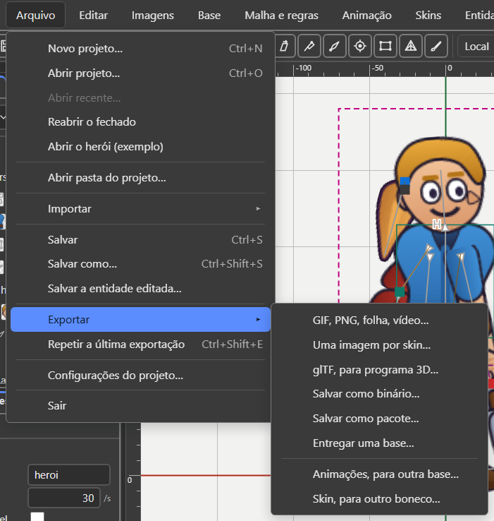
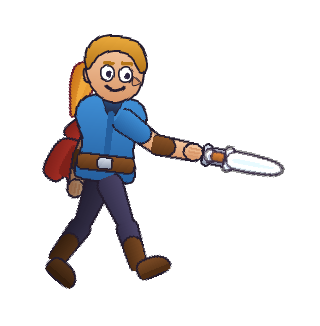

# 8. Exportar e usar no jogo

Também em inglês: [English](en/07-export-and-use-in-a-game.md)

*Conferido no código em 07/10/2026, versão v36.5.*

## O que você vai conseguir fazer no fim

1. Escolher entre as três embalagens do arquivo, sabendo o que cada uma serve.
2. Conferir que o arquivo está certo antes de mandar para o jogo.
3. Pôr o personagem tocando no jogo: no Construct 3, no Godot, ou com trinta
   linhas de código.

---

## A ideia que muda tudo

**Não existe "exportar" no Recorte.**

O documento do editor **já é** o arquivo do jogo. Você salva um `.bone` e é isso
que a engine lê. Não há um modelo interno que depois vira outra coisa.

Isso quer dizer: **nada do que você fez se perde no caminho.** Se coube no
editor, cabe no arquivo.

O que este capítulo chama de "exportar" é outra coisa: virar imagem, virar
glTF, fatiar por skin. São saídas para fora do formato.

---

## As três embalagens

O mesmo conteúdo, em três embrulhos.

| Extensão | O que é | Bom para |
|:---|:---|:---|
| `.bone` | texto JSON. Abre no bloco de notas | trabalhar, versionar, ler, revisar |
| `.boneb` | binário compacto | o jogo carregar rápido |
| `.bonez` | um pacote ZIP com tudo dentro | entregar num arquivo só |

**O modelo de dados é o mesmo nos três.** Nada se perde na conversão.

| Arquivo | Tamanho | Redução |
|:---|---:|---:|
| `heroi.bone` | cerca de 28 KB | — |
| `heroi.boneb` | cerca de 18 KB | cerca de 36% |
| `heroi.bonez` | cerca de 23 KB | cerca de 16% |

O `.bonez` parece maior que o `.boneb`, mas leva **também** o atlas e as
imagens. O `.boneb` sozinho não leva.

*(Medido em 07/10/2026 com `ferramentas/converter.mjs`: 27.917 · 17.804 ·
23.465 bytes.)*

---

## Abrir e salvar

| Item do menu **Arquivo** | O que faz |
|:---|:---|
| **Novo projeto…** (`Ctrl+N`) | pede a pasta do projeto e começa nela, com uma base vazia |
| **Abrir projeto…** (`Ctrl+O`) | lê um `.bone`, `.boneb` ou `.bonez` |
| **Abrir recente…** | os últimos arquivos abertos ou salvos |
| **Reabrir o fechado** | traz de volta o trabalho que estava aberto quando a aba fechou |
| **Abrir o herói (exemplo)** | o personagem de exemplo, para olhar por dentro |
| **Abrir pasta do projeto…** | a pasta de trabalho: as imagens vão para a aba **Imagens** |
| **Salvar** (`Ctrl+S`) | grava a pasta inteira: o `.bone`, o atlas e as imagens em uso |
| **Salvar como…** (`Ctrl+Shift+S`) | uma cópia, numa pasta nova, ou só o `.bone` |
| **Salvar a entidade editada…** | para um arquivo que veio de fora: cópia neste projeto, ou por cima do de origem |

**Com mais de uma base, ou com entidade**, o Salvar grava **um `.bone` para
cada** e mais um `manifest.json`. Reabrir a pasta traz tudo de volta.

### Trabalho não salvo

O título da janela ganha um ponto: `heroi.bone •`.

Abrir outro arquivo com trabalho não salvo abre a janela *"… tem mudanças não
salvas"*:

| Botão | O que faz |
|:---|:---|
| **Salvar e continuar** | grava como o `Ctrl+S`, e segue |
| **Descartar as mudanças** | segue sem salvar |
| **Cancelar** | nada muda: o arquivo continua aberto, com as mudanças |

O rodapé **nunca** diz "salvo" sem ter salvado.

### Reabrir o fechado

O editor guarda sozinho o que está aberto, a cada poucos segundos.

**Arquivo → Reabrir o fechado** pergunta antes, com a hora da gravação. Depois
**Reabrir**.

**As imagens não vêm no guardado.** O rodapé diz o remédio: **Arquivo → Abrir
pasta do projeto…**

---

## O menu Exportar

**Arquivo → Exportar ▸**. Dois blocos: em cima o que vai **para o jogo**, embaixo
o que vai **para outro boneco**.



| Item | O que grava |
|:---|:---|
| **GIF, PNG, folha, vídeo…** | a animação em imagem. Ver "Virar imagem" |
| **Uma imagem por skin…** | abre a janela *Exportar por skin*: um `.bone` fatiado. Ver "Fatiar" |
| **glTF, para programa 3D…** | um `.glb` com os ossos e as animações |
| **Salvar como binário…** | um `.boneb` |
| **Salvar como pacote…** | um `.bonez`: as bases, as entidades, o atlas e as imagens |
| **Entregar uma base…** | uma base sozinha, com o atlas fatiado: só as imagens que ela usa |
| **Animações, para outra base…** | as animações marcadas, num `.bone` com o contrato de rig. Ver o [capítulo 5](05-entidades.md) |
| **Skin, para outro boneco…** | a skin do lápis, num `.bone` só dela. Ver o [capítulo 3](03-peles.md) |

Fora do submenu, no mesmo menu Arquivo:

| Item | O que faz |
|:---|:---|
| **Repetir a última exportação** (`Ctrl+Shift+E`) | repete a última, com as mesmas opções |
| **Configurações do projeto…** | quadros por segundo, cor de fundo, grade, mistura |

**Atenção ao nome "Uma imagem por skin…".** O nome diz imagem; a janela que abre
corta o `.bone` por skin. Não sai imagem nenhuma. O nome do menu está errado,
não a janela.

### Entregar uma base

**Arquivo → Exportar → Entregar uma base…**

1. Com mais de uma base, a janela pergunta *"Qual base vai para o jogo?"*.
2. Saem o `.bone` e o atlas, com **só as imagens que ESTA base usa**.
3. Sem imagem da pasta para fatiar, sai só o `.bone`, e a janela diz por quê.

### Repetir a última exportação

Exportar é gesto que se repete dez vezes por tarde: mexeu, exporta, olha no jogo.

`Ctrl+Shift+E` repete a última exportação com as mesmas opções, sem perguntar
nada de novo. Vale para imagem, glTF e o corte por skin.

- Sem nada exportado ainda, ele abre a janela normal. **Nunca adivinha.**
- As opções ficam guardadas **neste navegador**, e não no `.bone`.
- **Onde gravar continua sendo pergunta do navegador.**

### Configurações do projeto

| Campo | Onde fica guardado |
|:---|:---|
| Quadros por segundo | **no arquivo** — é o passo do quadro que o jogo vai usar |
| Cor de fundo | nas opções de ver |
| Grade, em pixels | nas opções de ver. Menor = grade mais fina |
| Ao trocar de animação tocando | nas opções de ver. Ver o [capítulo 4](04-animar.md) |
| Tempo de mistura, em segundos | **no arquivo**, no `defaultMix` das animações |

Os campos novos só valem depois de **Aplicar**.

### Arte em pixel

A caixa **Arte em pixel** fica em **Propriedades**, com nada escolhido, no
grupo **Base**. Ela é gravada **no arquivo**, e o jogo lê a mesma marca.

**Com Arte em pixel, a cena e a exportação não suavizam.** O pixel ampliado
continua quadrado: na cena, na Prévia, nas miniaturas e em toda exportação de
imagem.

---

## Converter pela linha de comando

Serve para lote, e para o passo de build do jogo. A direção é escolhida pela
extensão da saída.

```
npm run converter heroi.bone heroi.boneb
npm run converter heroi.boneb heroi.bone
npm run converter heroi.bone heroi.bonez
```

A saída é uma tabela em colunas:

```
  Entrada   heroi.bone                      28.467 bytes
  Saida     heroi.boneb                     17.804 bytes
  Reducao                                          37,5%
```

Com `--validar` ele relê a saída, compara com a entrada e chama o validador:

```
npm run converter heroi.bone heroi.bonez -- --validar
```

```
  Ida e volta: igual
  OK    conferir.bone   (esqueleto)
```

O `--` antes das opções é obrigatório: ele diz ao npm que a opção é do programa,
não dele.

**Voltar do binário para o texto é exato.** `0.6` volta como `0.6`, não como
`0.6000000238418579`.

---

## Fatiar: mandar só o que o jogo usa

Um jogo que só usa a armadura não precisa carregar o resto.

```
npm run fatiar heroi.bone saida -- --peles armadura
npm run fatiar heroi.bone saida -- --animacoes walk,idle
npm run fatiar heroi.bone saida -- --pasta capa
npm run fatiar heroi.bone saida -- --um-arquivo-por-pele
npm run fatiar heroi.bonez saida -- --peles armadura
```

| Opção | Para quê |
|:---|:---|
| `--peles LISTA` | skins a manter, por vírgula |
| `--animacoes LISTA` | animações a manter |
| `--pasta LISTA` | pastas de slot a manter |
| `--um-arquivo-por-pele` | um `.bone` para cada skin |
| `--sem-atlas` | não grava atlas nem página |
| `--max N` | lado maior da página nova. Padrão 2048 |
| `--padding N` | espaço entre as imagens. Padrão 2 |

Só sai o que não move nada: **osso só sai quando ninguém que sobrou lê ele.** O
atlas é reempacotado com as regiões que ficaram.

**Pacote entra, pacote sai.** Com um `.bonez` na entrada, sai um `.bonez`.

### No editor

**Arquivo → Exportar → Uma imagem por skin…** abre a janela *Exportar por skin*.

| Parte da janela | O que faz |
|:---|:---|
| **Skins** | uma caixa por skin. A `default` vai sempre |
| **Animações** | uma caixa por animação |
| **O que vai sair** | ossos, slots, skins, desenhos, regras, eventos, animações, chaves e bytes: *agora / arquivo inteiro*. Muda a cada clique |
| **Pacote .bonez com o atlas (um arquivo só)** | nasce marcada quando há atlas aberto. Sem atlas, fica cinza, e sai só o `.bone` |
| **Exportar** · **Fechar sem exportar** | os dois botões |

No fim, a janela *Arquivo fatiado* lista o que saiu.

---

## O empacotador de imagens

Pega uma pasta de PNGs e devolve uma página só, mais a lista de onde cada imagem
está dentro dela.

```
npm run empacotar imagens/ heroi
```

Saem dois arquivos: `heroi.atlas.json` e `heroi.png`.

No editor não precisa: **o atlas nasce ao Salvar**.

### O que ele faz sozinho

- corta a borda transparente de cada imagem;
- gira 90 graus o que couber melhor deitado;
- junta imagens idênticas numa região só, com apelido;
- duplica alguns pixels na borda, para não aparecer costura.

### As opções

| Opção | Para quê |
|:---|:---|
| `--max N` | lado maior da página. Padrão 2048 |
| `--padding N` | espaço entre as imagens. Padrão 2 |
| `--sangria N` | pixels de borda duplicada |
| `--pot` | lados em potência de dois |
| `--multiplo-de-4` | lados em múltiplo de quatro |
| `--quadrado` | página quadrada |
| `--escala 1,0.5` | um atlas por resolução. Bom para celular |
| `--premultiplicado` | alfa pré-multiplicado |
| `--sem-rotacao` | não gira nada |
| `--sem-corte` | não corta a borda transparente |
| `--sem-apelidos` | não junta imagens iguais |
| `--grade` | todas as células do mesmo tamanho |

---

## Validar antes de mandar para o jogo

```
npm run validar heroi.bone
npm run validar heroi.atlas.json
npm run validar heroi.bonez
npm run validar -- --todos
npm run validar -- --json heroi.bone
```

| Termina em | O validador lê como |
|:---|:---|
| `.bone` | esqueleto |
| `.atlas.json` | atlas |
| `manifest.json` | manifesto de projeto |
| `.bonez` | pacote: o manifesto, cada esqueleto e cada atlas de dentro |

`--json` dá o relatório para máquina. `--todos` valida `formato/exemplos/`.

Resposta boa:

```
OK    formato/exemplos/heroi.bone   (esqueleto)

1 válido(s), 0 com erro.
```

**Ponha isso no seu passo de build.** É barato e pega erro antes do jogador.

### No editor

**Ajuda → Problemas do arquivo…** mostra o que o programa não entendeu ao ler
o arquivo, com o conserto onde há.

### Para quem não tem Node: o validador na web

```
npm run site
```

Abre `http://localhost:5174/site/`. Na página do validador você **arrasta o
arquivo** e vê o resultado na hora.

| | |
|:---|:---|
| **O que ela aceita** | `.bone`, `.boneb`, `.bonez` e `.atlas.json`. Ela decide **pelos bytes** |
| **O que ela mostra** | o veredito; os problemas com **linha do arquivo**, ponteiro JSON e seção da especificação; e o **esqueleto desenhado**, com botão de tocar |
| **Onde o arquivo vai** | **em lugar nenhum.** Ele é lido dentro do navegador |

A página e a linha de comando usam **o mesmo núcleo**
(`site/validador/nucleo.js`): as regras moram num lugar só, e as duas não
divergem.

---

## Usar no jogo

### Os leitores prontos

| Onde | Pasta | Estado em 07/10/2026 |
|:---|:---|:---|
| **Construct 3** (r449) | `leitor-construct/` | **existe**, desde 05/10. 120 de 120 casos sobre o pacote. **Ainda não visto no Construct**: é a sua mão |
| **Godot 4.7** | `leitor-godot/` | **existe**. 119 de 120 casos, até copiar um conserto do Python |
| **TypeScript** (navegador, Node) | `runtime/` | o runtime de referência. 120 de 120 |
| **Python** | `runtime-python/` | o segundo runtime, escrito só pela especificação |

### Uma porta de entrada só

O runtime olha os primeiros bytes e resolve qual das três embalagens é. **O jogo
não precisa saber.**

| Primeiros bytes | Embalagem |
|:---|:---|
| `PK` | `.bonez` |
| `\x89BONE` | `.boneb` |
| qualquer outro | `.bone` |

### No Construct 3

O addon leva o runtime inteiro dentro. Só o desenho é novo.

**Ver o herói andando, em cinco passos:**

| # | Faça |
|:---:|:---|
| 1 | Abra o Construct 3 **r449** |
| 2 | Arraste `leitor-construct/saida/Recorte.c3addon` para a janela. Confirme. Feche e abra o Construct |
| 3 | Arraste `leitor-construct/saida/heroi-andando.c3p` para a janela. O herói aparece parado no layout |
| 4 | Aperte **Visualizar** (`F5`) |
| 5 | O herói anda |

**As teclas do exemplo:**

| Tecla | Faz |
|:---:|:---|
| `Espaço` | ataca, e volta a andar sozinho |
| `W` | anda |
| `A` · `S` | veste e tira a armadura |
| `F` | fogo na mão |
| `X` | espelha |
| `E` | troca a espada pelo capacete, e volta |
| `Q` | liga e desliga a aura rosa em volta do herói |
| `P` · `C` | pausa · continua |

**As propriedades do objeto, no layout:**

| Propriedade | O que faz |
|:---|:---|
| Arquivo .bone | o boneco, na pasta Files. O atlas e a imagem ficam ao lado |
| Animação inicial | a que toca ao começar. Vazio: parado |
| Em laço | se a inicial volta ao começo |
| Escala | 1 é o tamanho do editor |
| Skins iniciais | as vestidas ao começar, por vírgula. A última vence |

**As palavras nos eventos:**

| Tipo | Nome |
|:---|:---|
| Ações | Tocar animação · Mudar a velocidade · Pausar · Continuar · Vestir skin · Tirar skin · Espelhar |
| Ações da conexão | Encaixar · Desencaixar · Encaixar todas · Animar a peça · Soltar a peça |
| Condições | Está tocando a animação · Está vestindo a skin · Está espelhado · O slot mostra a peça |
| Gatilhos | Ao terminar a animação (só sem laço) · Ao evento · Ao encaixar |
| Expressões | AnimacaoTocando · Velocidade · Skins · EventoNome · EventoInteiro · EventoNumero · EventoTexto · Avisos |
| Expressões da conexão | Slots · Entidades · PecaDoSlot · SlotDoEncaixe · OssoX · OssoY · OssoAngulo · SlotX · SlotY · SlotAngulo |

**Encaixar** põe uma entidade (um `.bone` da pasta Files) num slot. Ela cai no
lugar da imagem. Só aquele slot muda.

Peça, slot ou animação que não existe: **nada muda, e vira aviso**, no texto e
no console, com **[Recorte]**.

O passo a passo inteiro, e as 18 perguntas que só a sua mão responde:
`leitor-construct/LEIA-ME.md`.

Para quem programa: `npm run leitor:construct` monta o pacote;
`npm run leitor:construct:conformidade` roda os casos sobre ele.

### No Godot

A pasta `leitor-godot/` inteira é um projeto do Godot 4.7.

| # | Faça |
|:---:|:---|
| 1 | Godot 4.7 › **Importar** › `leitor-godot/project.godot` |
| 2 | Clique no nó **Heroi**: ele aparece parado, e o Inspetor mostra Arquivo, Animação inicial, Em laço, Escala, Skins iniciais |
| 3 | **F5**: o herói anda |

No seu jogo, em GDScript:

```gdscript
$Heroi.tocar("walk")             # em laço
$Heroi.tocar("attack", false)    # uma vez
$Heroi.vestir("armadura")
$Heroi.evento.connect(func(nome, dados): print(nome))
```

O resto das chamadas, e as 15 perguntas da mão: `leitor-godot/LEIA-ME.md`.

### Em TypeScript ou JavaScript

O runtime é TypeScript. Gere o JavaScript uma vez:

```
npx tsc -p ferramentas/visualizador/tsconfig.json
```

Isso cria `ferramentas/visualizador/dist/`. É código gerado: não edite nada lá.

Grave como `tocar.mjs`, na raiz do projeto, e rode:

```
node tocar.mjs formato/exemplos/heroi.bone
```

```js
import { readFileSync } from 'node:fs';
import { inflateRawSync } from 'node:zlib';
import {
  loadSkeletonFile, Skeleton, applyAnimation, fireEvents,
} from './ferramentas/visualizador/dist/index.js';

// 1. Ler os bytes. Serve .bone, .boneb ou .bonez: o runtime descobre sozinho.
const bytes = new Uint8Array(readFileSync(process.argv[2]));
const { data, encoding } = loadSkeletonFile(bytes, {
  codec: { inflateRaw: (dados) => inflateRawSync(dados) },
});
console.log('embalagem:', encoding, '| ossos:', data.bones.length);

// 2. Montar o esqueleto e escolher a animação.
const skeleton = new Skeleton(data);
const andar = data.findAnimation('walk');
const pe = skeleton.findBone('foot');

// 3. A cada quadro do jogo.
let tempo = 0;
const dt = 1 / 60;
for (let quadro = 0; quadro < 4; quadro++) {
  const antes = tempo;
  tempo += dt;

  skeleton.setToSetupPose();
  applyAnimation(skeleton, andar, tempo % andar.duration);
  skeleton.advance(dt);          // relógio da física
  skeleton.updateWorldTransform();

  for (const e of fireEvents(andar, antes, tempo, true)) {
    console.log('  evento:', e.key.name);
  }
  console.log('quadro', quadro, '| pé em', pe.worldX.toFixed(1), pe.worldY.toFixed(1));
}
```

O que ele imprime (rodado em 07/10/2026):

```
embalagem: bone | ossos: 18
quadro 0 | pé em -15.7 11.5
quadro 1 | pé em -12.1 9.7
quadro 2 | pé em -8.4 8.0
quadro 3 | pé em -4.6 6.4
```

Troque o arquivo por um `.boneb` ou um `.bonez`: **o código não muda.**

### Os cinco passos de um quadro

Esta é a ordem. Não a mude.

| # | Chamada | O que faz |
|:---:|:---|:---|
| 1 | `setToSetupPose()` | devolve o esqueleto à pose de repouso |
| 2 | `applyAnimation(...)` | escreve por cima o que a animação diz naquele instante |
| 3 | `advance(dt)` | anda o relógio da física |
| 4 | `updateWorldTransform()` | calcula a posição final de cada osso e roda as cinco regras |
| 5 | `fireEvents(...)` | diz quais eventos cruzaram entre o quadro anterior e este |

### O que mais o runtime oferece

| Chamada | Para quê |
|:---|:---|
| `skeleton.findBone(nome)` | pega um osso, para ler a posição no mundo |
| `skeleton.findSlot(nome)` | pega um slot, para ler a cor |
| `skeleton.setSkin(nome)` | troca a skin. Aceita uma lista para combinar skins |
| `skeleton.setParameter(nome, valor)` | mexe num parâmetro. Ver a regra de comando |
| `skeleton.getBounds()` | a caixa que envolve o personagem |
| `skeleton.physicsReset()` | avisa a física de um teletransporte |
| `loadAtlas(json)` | carrega o atlas separado, quando não veio num `.bonez` |
| `collectDrawables(skeleton)` | a lista do que desenhar, na ordem, com a máscara aplicada |
| `CanvasRenderer` | um desenhista pronto para Canvas 2D, de referência |

### Duas animações ao mesmo tempo

O que o painel **Prévia** mostra no editor, o runtime faz no jogo com
`AnimationState`: faixas, laço, velocidade, mistura, fila.

A máscara de ossos mora na faixa, e **nunca no arquivo**: é escolha do jogo.

### Desenhar no navegador

Há um exemplo completo em `ferramentas/visualizador/`.

```
npx tsc -p ferramentas/visualizador/tsconfig.json
python -m http.server 8000
```

Depois abra `http://localhost:8000/ferramentas/visualizador/`.

Tem que ser por servidor. Abrir o arquivo direto não funciona.

---

## Virar imagem

### No editor

**Arquivo → Exportar → GIF, PNG, folha, vídeo…** abre a janela *Exportar
imagem*. A janela mora no topo da tela: trocar o formato não move as caixas.

| Campo | O que faz |
|:---|:---|
| **Animação** | qual vai virar imagem. Sem animação: *A base (pose de repouso)* |
| **Todas as animações** | um arquivo por animação. De e Até ficam cinzas |
| **Só este quadro** | uma imagem só: a pose no segundo da agulha |
| **De (s)** · **Até (s)** | o trecho, em segundos |
| **Formato** | Sequência de imagens PNG · Folha de sprites, com o índice em JSON · GIF animado · Vídeo WebM |
| **Velocidade (quadros/s)** | de 1 a 120. 30 é o comum |
| **Escala (×)** | de 0,05× a 8×. 1× é o tamanho da cena |
| **Fundo transparente** · **Cor do fundo** | sem cor atrás, ou a cor escolhida |
| **Recorte** | Cortar a borda vazia (automático) · A área desenhada nesta animação · Não cortar |
| **Margem (px)** | o espaço vazio em volta, de 0 a 64 |
| **Desenhar os ossos** | as linhas dos ossos por cima da arte |
| **Quadros por linha (n.º)** | só na folha |
| **Um arquivo só (.zip)** | só no PNG: a sequência inteira num `.zip` |
| **Cores do GIF (n.º)** · **Repetições do GIF (vezes)** | só no GIF. `0` = sem parar |
| **Voltas no vídeo (vezes)** | só no WebM |

**Só este quadro troca o formato para PNG.** Desmarcada, volta o formato de
antes. O arquivo sai como `heroi.png`.

De maior que Até, ou fora da animação: a janela **recusa por escrito**.

No fim, o relatório diz os arquivos, o tamanho de cada quadro e **a pasta**: a de
downloads do navegador (`Ctrl+J` mostra).

### Vídeo WebM

Sai um `.webm`, gravado pelo próprio navegador. Chrome, Edge e Firefox.

**O tempo é o do relógio do navegador.** Se o computador engasgar, um quadro
pode pular. Para quadro exato, use a sequência de PNG.

Navegador sem gravador de vídeo: o formato fica cinza, e a dica diz por quê.

Só no editor. A linha de comando não grava WebM.

### MP4 e AVI

**Não saem do Recorte.** Junte a sequência de PNG com o `ffmpeg`. O comando
aparece no relatório de cada exportação em PNG:

```
ffmpeg -framerate 30 -i quadro_%04d.png -c:v libx264 -pix_fmt yuv420p saida.mp4
```

### Pela linha de comando: um quadro

```
node ferramentas/render-png.mjs attack 0.3 golpe.png --largura 320 --sem-ossos
```



| Opção | Para quê |
|:---|:---|
| `--largura N` | largura do PNG |
| `--bone CAMINHO` | outro arquivo `.bone`. Padrão: o exemplo |
| `--sem-ossos` | não desenha as linhas dos ossos |
| `--fundo RRGGBB` | cor de fundo opaca |
| `--margem F` | folga em volta |

### Pela linha de comando: a animação inteira

```
npm run exportar-imagem -- heroi.bone walk saida --formato gif --fps 30
npm run exportar-imagem -- heroi.bone walk saida --formato folha --colunas 8
npm run exportar-imagem -- heroi.bone --todas saida --formato gif
```

| Formato | O que sai |
|:---|:---|
| `png` | um arquivo por quadro: `saida_0000.png`, `saida_0001.png`, … |
| `folha` | `saida.png` com a grade, e `saida.json` dizendo onde cada quadro está |
| `gif` | `saida.gif`, animado, com laço |

| Opção | Para quê |
|:---|:---|
| `--fps N` | quadros por segundo. Padrão 30 |
| `--escala N` | pixels por unidade de mundo. Padrão 1 |
| `--largura N` | largura em pixels. Manda mais que `--escala` |
| `--margem F` | folga em volta. Padrão 0,12 |
| `--fundo RRGGBB` | cor de fundo opaca |
| `--sem-recorte` | não corta a borda vazia |
| `--todas` | todas as animações do arquivo |
| `--de N` · `--ate N` | só um trecho, em segundos |
| `--colunas N` | quadros por linha na folha |
| `--cores N` | cores do GIF, no máximo 256 |
| `--laco N` | quantas vezes o GIF repete. `0` = para sempre |
| `--com-ossos` | desenha também as linhas dos ossos |

**O recorte é o mesmo para todos os quadros**, nunca um por quadro. Senão a
grade da folha não fecha, e o personagem treme no lugar.

---

## Exportar glTF

**Arquivo → Exportar → glTF, para programa 3D…**

1. Com mais de uma base, a janela pergunta *"Qual base vai para o glTF?"*.
2. Sai o arquivo.
3. A janela *glTF exportado* diz o que não coube, uma linha por animação.

glTF não tem regras, nem ordem de desenho, nem inclinar. **Nada some calado.**

Pela linha de comando:

```
npm run exportar -- heroi.bone saida.glb
npm run exportar -- heroi.bonez saida.gltf --animacoes walk,attack
```

| Opção | Para quê |
|:---|:---|
| `--formato gltf\|glb` | força o formato. Padrão: pela extensão |
| `--animacoes LISTA` | só estas animações |
| `--peles LISTA` | skins ativas na pose de repouso |
| `--sem-imagens` | não põe as imagens dentro |
| `--passo-z N` | distância em z entre dois desenhos. Padrão 0,1 |
| `--quadros N` | amostras por segundo ao converter curva |

---

## Uma lista para o dia da entrega

| # | Passo |
|:---:|:---|
| 1 | `npm run validar meu.bone` — zero erros |
| 2 | `npm run validar meu.atlas.json` — zero erros |
| 3 | `npm run converter meu.bone meu.boneb -- --validar` — "Ida e volta: igual" |
| 4 | Ou, no editor: **Arquivo → Exportar → Entregar uma base…** |
| 5 | Abrir no leitor do seu jogo e ver todas as animações rodarem |
| 6 | Copiar para o jogo: só o `.boneb` (ou o `.bonez`) e as páginas do atlas |
| 7 | Quem não tem Node: mande o arquivo e o endereço do validador na web |

---

## O selo — o que este capítulo confirma

Selos: **existe** · **existe diferente** · **falta** · **muda com as bases**.
Conferido no código em 07/10/2026.

| Função | Selo | Onde |
|:---|:---:|:---|
| As três embalagens, `.bone` `.boneb` `.bonez` | existe | `runtime/src/file.ts` |
| Abrir, Salvar, Salvar como, Abrir recente | existe | `ui/menus.ts`, `ui/shell-file.ts` |
| Salvar grava a pasta, com `manifest.json` para várias bases | existe | `ui/menus.ts` (dica do Salvar), `io/folder-save.ts` |
| A janela de mudanças não salvas | existe | `ui/shell-drop.ts` |
| Reabrir o fechado, com o remédio das imagens | existe | `shell-file.ts` `reopenClosed` |
| Salvar como binário · como pacote | existe | `io/save-binary.ts`, `shell-file.ts` |
| Entregar uma base | existe | `shell-file.ts` `deliverOneBody` |
| Corte por skin no editor, com o pacote `.bonez` | existe diferente | `io/export-skin.ts`. **O item do menu se chama "Uma imagem por skin…"**, e não sai imagem |
| Repetir a última exportação (`Ctrl+Shift+E`) | existe | `io/last-export.ts` |
| Configurações do projeto | existe | `shell-file.ts` `projectSettings` |
| Arte em pixel, no grupo Base | existe | `panels/properties-model.ts` |
| Exportar imagem: PNG, folha, GIF, WebM, Só este quadro, `.zip` | existe | `io/export-image.ts` |
| MP4 e AVI | falta | o relatório dá o comando do `ffmpeg` |
| glTF, no editor e na linha de comando | existe | `io/export-gltf.ts`, `ferramentas/exportar.mjs` |
| `converter`, `fatiar`, `empacotar`, `validar`, `exportar-imagem` | existe | `ferramentas/`, `package.json` |
| Validador na web | existe | `site/validador/` |
| Ajuda → Problemas do arquivo… | existe | `ui/menus.ts` |
| Leitor do Construct 3 (r449) | existe | `leitor-construct/`. **Não visto dentro do Construct** |
| Leitor do Godot 4.7 | existe | `leitor-godot/`. 119 de 120 casos |
| Runtime TypeScript e Python | existe | `runtime/`, `runtime-python/` |
| Leitor de C, C++, C#, Unity ou Unreal | falta | — |

---

## O que ainda não funciona

| O quê | Requisito | Como contornar |
|:---|:---|:---|
| Não há leitor de **C, C++, C#, Unity nem Unreal**. Prontos: TypeScript, Python, Construct 3 e Godot. | T1, T3 | Porte a partir da especificação: a suíte de conformidade existe para isso. |
| **Vídeo MP4 ou AVI não sai do Recorte.** Vídeo sai em WebM, só pelo editor. | E5 | `npm run exportar-imagem`, depois `ffmpeg` na sequência. |
| O leitor do Construct **nunca foi visto dentro do Construct**. | — | O passo a passo está em `leitor-construct/LEIA-ME.md`. Deu errado: foto, e as linhas do console com **[Recorte]**. |
| O leitor do Godot fica em **119 de 120**. | — | Falta copiar o conserto do caso C-326, que o Python já tem. |
| O item **"Uma imagem por skin…"** tem nome de imagem e faz o corte do `.bone`. | — | Use sabendo disso. Imagem por skin, hoje: mude a skin e exporte a imagem uma vez para cada. |
| A cor escura (*tint black*) não sai no Construct nem no Godot. | — | Os dois leitores avisam. |

---

Próximo: [9. Vindo do Spriter, Spine e DragonBones](09-vindo-do-spriter-spine-e-dragonbones.md)
