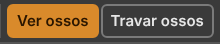
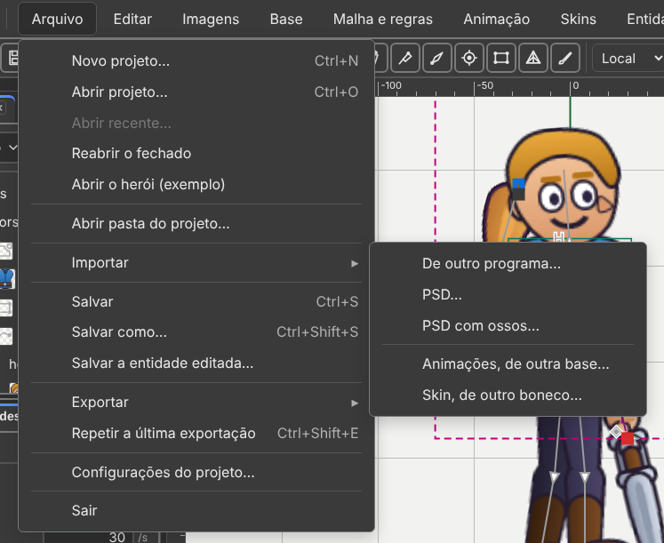

# 9. Vindo do Spriter, Spine e DragonBones

Também em inglês: [English](en/09-coming-from-spriter-spine-and-dragonbones.md)

*Conferido no código em 07/10/2026, versão v36.5.*

## O que você vai conseguir fazer no fim

1. Achar, assunto por assunto, onde está no Recorte cada coisa que você usava no
   Spriter.
2. Trazer um projeto `.scml` inteiro e continuar de onde parou.
3. Saber de antemão o que **não** vem, e o que fazer no lugar.

---

## As teclas que você já sabe

Comece por aqui: **estas teclas são as mesmas nos dois programas.**

| Tecla | Faz |
|:---:|:---|
| `7` | ver ossos |
| `8` | travar ossos |
| `9` | ver desenhos (*sprites*) |
| `0` | travar desenhos |
| `Ctrl+↑` `Ctrl+↓` | sobe e desce na ordem de desenho |
| `Ctrl+→` `Ctrl+←` | frente de tudo · fundo de tudo |
| `Ctrl` + arrastar, com **Mover** | clona o que está escolhido |
| botão do meio, ou `Espaço` + arrastar | move a vista |
| roda do mouse | zoom |

As teclas de ordem valem com **um desenho escolhido**, na cena ou na aba
**Ordem**.

Os quatro primeiros estão também em **Exibir → O boneco** e **Exibir → Travar**,
e na aba **Exibição**.




---

## Assunto por assunto

### Montar

| Assunto | No Spriter | No Recorte | Onde fica |
|:---|:---|:---|:---|
| **Criar osso** | `Alt` + arrastar, com *create bone* | ferramenta **Criar osso** (`B`), clicar e arrastar | barra de ferramentas; **Base → Novo → Osso** |
| **Prender sprite no osso** | segurar `B` e clicar no sprite | **o mesmo gesto, com `P`**: escolher o osso pai, segurar **`P`**, clicar em cada desenho | cena e Árvore; **Base → Virar filho de…** |
| **Collision box** | `Alt` + arrastar, com *create box* | ferramenta **Caixa** (`X`), e `Alt` + arrastar | barra de ferramentas; **Base → Novo → Caixa de colisão** |
| **Action point** | `Alt` + arrastar, com *create point* | ferramenta **Ponto** (`O`), e `Alt` + arrastar | barra de ferramentas; **Base → Novo → Ponto** |
| **A escolha do que o `Alt` cria** | um seletor no alto | **não existe, e não faz falta**: três ferramentas com tecla própria | — |
| **Hierarchy** | painel próprio | painel **Árvore**: o osso, os desenhos dele, depois os filhos | **Janela → Árvore** |
| **Object properties** | painel próprio | painel **Propriedades** | **Janela → Propriedades** |
| **File palette** | painel próprio | aba **Imagens**, por subpasta | **Janela → Imagens** |
| **Começar pela pasta de imagens** | *File → New Project* | **Arquivo → Novo projeto…** pede a pasta; **Arquivo → Abrir pasta do projeto…** | menu Arquivo |
| **Reload all images** | botão no file palette | **Imagens → Recarregar a pasta** | menu Imagens |
| **trocar a imagem de um sprite** | botão direito na imagem | **botão direito no desenho**: abre a grade para trocar | cena |

### O pivô

| | No Spriter | No Recorte |
|:---|:---|:---|
| onde mora | um **pivô por imagem** | **um pivô por imagem**, igual. Gravado no atlas |
| como se define | duplo clique na imagem, caixa com nove ícones | **Imagens → Definir pivô…**, ou a aba **Pivôs** |
| copiar e colar | *Copy/Paste Default Pivots* | **Imagens → Copiar pivô** e **Colar pivô**, na mesma proporção |
| para a pasta inteira | — | **Imagens → Carimbar pivôs** |
| voltar ao osso | — | **Imagens → Voltar o pivô para o osso** |
| pivô **animado** | sim | **não**. Ver "O que o Spriter tem e o Recorte não" |

Também há **Editar → Copiar posição no osso** e **Colar posição no osso**: alinha
vários desenhos de uma vez, num passo de desfazer.

O [capítulo 1](01-montar-um-corpo.md) trata do pivô por inteiro.

### Ordem de desenho

| Assunto | No Spriter | No Recorte | Onde fica |
|:---|:---|:---|:---|
| **Z-order palette** | painel próprio | aba **Ordem**, com miniatura | **Janela → Ordem** |
| **subir e descer** | `Ctrl+↑` `Ctrl+↓` | **as mesmas teclas** | cena e aba Ordem |
| **frente / fundo de tudo** | `Ctrl+→` `Ctrl+←` | **as mesmas teclas**; também `Ctrl+Shift+↑` `Ctrl+Shift+↓` | **Base → Frente de tudo / Fundo de tudo** |
| **um passo, pelo menu** | — | `+` e `−` | **Base → Trazer para a frente / Mandar para trás** |
| **ordem que muda na animação** | chave de ordem | **igual**: com uma animação aberta, mudar a ordem vira chave | — |
| **Copy Z-order to all keyframes** | item de menu | **Base → Copiar a ordem na animação** | menu Base |
| **juntar peças** | não tem | **pastas**: **Base → Nova pasta…** e **Tirar da pasta** | menu Base, aba Ordem |

**O de cima da lista fica na frente**, nos dois programas.

### Animar

| Assunto | No Spriter | No Recorte | Onde fica |
|:---|:---|:---|:---|
| **Key selected** | botão | **Chavear** (`K`) | menu Animação |
| **Key all** | botão | **Chavear tudo** (`Ctrl+K`) | menu Animação |
| **quadro-chave anterior / próximo** | `1` e `2` | `↑` e `↓` | linha do tempo |
| **tocar** | `4` | `Espaço` | em toda parte |
| **começo e fim** | `3` e `5` | `Home` e `End` | linha do tempo |
| **andar no tempo** | `Ctrl+1` `Ctrl+2`, 1 ms | `←` e `→` andam **um quadro**; `Shift` anda dez | linha do tempo |
| **copiar o quadro inteiro** | `Ctrl+Shift+C` | **a mesma tecla** — *Copiar a pose inteira* | **Editar → Pose** |
| **colar em todos os quadros** | `Ctrl+Shift+V` | **a mesma tecla** — *Colar em todas as chaves* | **Editar → Pose** |
| **apagar de todos os quadros** | `Shift+Delete` | **a mesma tecla** — apaga as linhas inteiras | linha do tempo |
| **trocar de pai no meio da animação** | sim | **sim**: com a animação aberta, *virar filho* vira chave de pai | cena e Árvore, com `P` |
| **abrir uma linha por objeto** | puxar o topo da linha do tempo | botão **Detalhes** | tocador; **Janela → Arrumar → Detalhes da linha do tempo** |
| **velocidade da prévia** | slider | a velocidade no tocador | tocador |
| **mudar a duração** | clicar no tempo total | **Animação → Mudar duração…** | menu Animação |
| **Onion skin** (Pro) | painel | **Exibir → A cena → Casca de cebola**; opções em **Exibir → Casca de cebola: opções…** | menu Exibir, canto da régua |
| **easing avançado** (Pro) | curvas | aba **Curvas**, e **Animação → Curva da chave** | **Janela → Curvas** |

### Trocar imagens e roupas

| Assunto | No Spriter | No Recorte | Onde fica |
|:---|:---|:---|:---|
| **Character maps** (Pro) | colunas *available* e *active* | aba **Skins**, com as colunas **Feitas** e **Ativas** | **Janela → Skins** |
| **empilhar character maps** | arrastar de uma coluna para a outra | **o mesmo gesto**: arrastar de Feitas para Ativas. O `×` tira | aba Skins |
| **Merge active to new** | botão | **Skins → Clonar skin** | menu Skins |
| **Bake active to entity** | botão | **Skins → Promover skin a base…**: a pilha ligada vira uma base nova, com animações próprias | menu Skins |
| **salvar a pilha num `.scms`** | arquivo próprio | não existe: as skins moram dentro do `.bone`. Levar uma para outro boneco: **Arquivo → Exportar → Skin, para outro boneco…** | menu Arquivo |
| **trocar a imagem em todas** | — | **Skins → Trocar imagem nas skins…**: troca em toda skin que usa a mesma | menu Skins |

O capítulo [3. Peles](03-peles.md) trata disso por inteiro. A diferença: **um
character map troca imagens; uma skin é um conjunto de anexos, e pode trazer
desenho que o corpo nem tinha.**

### O que o jogo lê

| Assunto | No Spriter | No Recorte | Onde fica |
|:---|:---|:---|:---|
| **Variables** (Pro) | *Edit MetaData* | **Animação → Variáveis e etiquetas → Nova variável**; e os **parâmetros**, com a regra de comando | menu Animação; **Malha e regras → Novo parâmetro** |
| **Tags** (Pro) | *active* e *available* | **Animação → Variáveis e etiquetas → Nova etiqueta** | menu Animação |
| **Event triggers** (Pro) | ponto na linha do tempo | **Animação → Novo evento**: nome, inteiro, número, texto e áudio | menu Animação |
| **Sound na linha do tempo** (Pro) | objeto próprio | o som vai **dentro do evento** | definição do evento |
| **Action points** | ponto com nome e ângulo | **Ponto**, com nome e direção | ferramenta `O` |
| **Collision rectangles** | retângulo com nome | **Caixa**, com quantos cantos quiser | ferramenta `X` |

O ponto e a caixa **se animam por chave**, como no Spriter. Vindo de um `.scml`,
cada um ganha um **osso próprio**, escondido, e as chaves dele viram chaves de
posição e giro desse osso (`ferramentas/src/importar/spriter.ts:535-545` e
`736-740`). Feitos no Recorte, eles andam com o osso em que nasceram.

### O que muda de nome

| No Spriter | No Recorte |
|:---|:---|
| *entity* | **base**. Um projeto tem várias bases: o Salvar grava um `.bone` por base e um `manifest.json` |
| *sub-entity* | **entidade**: um `.bone` pendurado num slot de outro. Menu **Entidades**. Ver o [capítulo 5](05-entidades.md) |
| *character map* | **skin** |
| *sprite* | **slot** mais **anexo** |
| *bone* | **osso** |
| *keyframe* | **chave** |
| *timeline* | **linha do tempo**, e cada linha dela é uma propriedade |

---

## O que o Spriter tem e o Recorte não

| O que | O que fazer aqui |
|:---|:---|
| **pivô animado por imagem** | ponha o osso na articulação. O importador usa o pivô da primeira chave, e avisa |
| **Papagayo lip sync** | não existe. Faça as bocas como troca de desenho, chave a chave |
| **marca d'água na exportação** | não existe |
| **clonar o projeto em outra escala** | `--escala` no empacotador faz um atlas por resolução |
| **troca de paleta em cor indexada** | não existe. A **Cor** e a **Cor escura** do slot tingem o desenho |
| **`M` + arrastar**, mover o 0,0 da animação | não existe. Mova o osso `root` |
| **Load and Fix Corrupt File** | **Ajuda → Problemas do arquivo…** diz o que não foi entendido, com o conserto onde há |

### O que estava nesta lista e já entrou

| O que | Onde está hoje |
|:---|:---|
| pivô por imagem | **Imagens → Definir pivô…** e a aba **Pivôs** |
| trocar o pai no meio da animação | vira **chave de pai**. A Árvore mostra o pai daquele quadro |
| guias na cena | puxadas da régua. **Exibir → A cena → Guias · Travar guias · Limpar guias** |
| `Z` e `Shift+Z`, escolher descendentes e ancestrais | **Editar → Escolher → Os filhos** (`]`) e **Os pais** (`[`) |
| `Ctrl` + arrastar para clonar | **o mesmo gesto**, com a ferramenta **Mover** |
| `Ctrl+←` `Ctrl+→`, fundo e frente de tudo | **as mesmas teclas** |

---

## O que o Recorte tem e o Spriter não

| O que | Onde |
|:---|:---|
| **Malha e pesos** — dobrar o desenho por dentro | [capítulo 6](06-malha-e-pesos.md). **O formato do Spriter não tem malha** |
| **Cinco regras**: IK, transformação, caminho, física e comando | [capítulo 7](07-as-cinco-regras.md) |
| **Física de verdade**, rodando no jogo | **Malha e regras → Física** |
| **Máscara** que recorta sem apagar | **Base → Novo → Máscara** |
| **Inclinar** (`Z`) | barra de ferramentas |
| **Partículas** | menu **Partículas**: Fogo, Fumaça, Faísca, Poeira |
| **Camadas de animação**, andar e atirar ao mesmo tempo | painel **Prévia**, e `AnimationState` no jogo |
| **Biblioteca de animações** prontas | **Animação → Animações → Biblioteca de animações…** |
| **Um formato aberto**, com especificação, validador e suíte de conformidade | [capítulo 8](08-exportar-e-usar-no-jogo.md) |
| **Leitores prontos** para Construct 3 e Godot | [capítulo 8](08-exportar-e-usar-no-jogo.md) |
| **Runtime livre**, Apache 2.0 | — |

**O `.bone` é um padrão escrito.** O Spriter é o formato de um programa. Se o
programa parar — e o DragonBones parou em 2020 —, o trabalho fica preso.

---

## Trazer o projeto

### Pelo editor

**Arquivo → Importar → De outro programa…**



1. O programa pede **a pasta** do projeto do Spriter, do Spine ou do DragonBones.
2. A pasta tem mais de um projeto: a janela *"Qual projeto abrir?"* pergunta.
3. **O programa de origem é descoberto pelo conteúdo**, não pela extensão.
4. As imagens das subpastas vão para a aba **Imagens**. As que o boneco usa
   aparecem na cena. O rodapé conta: *Lendo as imagens… 12 de 21*.
5. A janela *Importado do …* lista o que não veio igual. Quando nada se perdeu,
   ela diz isso com todas as letras.

**Pelo editor entra só a primeira *entity***. A janela diz quais existem. Para o
projeto inteiro, use a linha de comando.

Antes de importar, se houver trabalho não salvo, o programa pergunta.

### Pela linha de comando

```
npm run importar -- boneco.scml saida/boneco.bone --relatorio avisos.txt
```

| Opção | Para quê |
|:---|:---|
| `--atlas <arquivo>` | o atlas de origem (`.atlas` do Spine, `_tex.json` do DragonBones) |
| `--formato <nome>` | força: `spine`, `dragonbones` ou `spriter` |
| `--parte <nome>` | só uma *entity* (Spriter) ou *armature* (DragonBones) |
| `--relatorio <arquivo>` | grava os avisos também num arquivo de texto |
| `--sem-validar` | não chama o validador no fim |
| `--assar` | Spriter: um pai só por osso, como antes. Sem chave de pai |

**Um `.scml` com várias *entities*, sem `--parte`, vira um projeto:** um `.bone`
por *entity* na pasta da saída, e o `manifest.json`. Depois, no editor:
**Arquivo → Abrir pasta do projeto…** traz as bases todas.

No DragonBones, sem `--parte`, sai a primeira, e ele **diz quais existem**.

**Os dois traços depois de `importar` são obrigatórios.** Ou chame direto:
`node ferramentas/importar.mjs boneco.scml boneco.bone`.

No fim ele valida a saída sozinho.

### Os avisos que o Spriter costuma dar

| Aviso | O que fazer |
|:---|:---|
| *O osso "x" troca de pai no meio da animação…* | nada. As outras chaves viram linha de pai |
| *O desenho "x" troca de osso no meio da animação…* | nada. Vira linha `slot/bone` |
| *O sprite "x" tem pivô por chave…* | o pivô da primeira chave vale. Entre chaves o desenho pode deslizar |
| *Curva "quartic"/"quintic" … aproximada por uma Bézier cúbica* | nada. Erro pequeno entre as chaves |
| *O objeto "x" é uma sub-entidade…* | converta aquela *entity* à parte, e pendure como entidade |
| *O Spriter não guarda mesh, pesos nem IK…* | nada. Não existe na origem |

### Depois de importar: a lista de conferência

| # | Passo |
|:---:|:---|
| 1 | Ler a lista de avisos inteira. Não pule |
| 2 | Abrir cada animação e tocar do começo ao fim |
| 3 | Conferir a ordem de desenho: braço na frente, braço atrás |
| 4 | Conferir as skins, uma por uma |
| 5 | Rodar `npm run validar meu.bone` |

---

## Vindo do Spine

O Spine é o que converte melhor: quase tudo vem inteiro.

| Coisa | No Spine | No Recorte |
|:---|:---|:---|
| coordenadas | Y para cima, graus anti-horário | **iguais.** Sem conversão |
| herança do osso | um campo `inherit` com cinco nomes | três caixas: rotação, escala, espelhamento |
| ordem das regras | um número `order` em cada uma | a posição na lista |
| nomes de mistura | `mixRotate`, `rotation`, `x`, `y` | `mixRotation`, `offsetRotation`, `offsetX`, `offsetY` |
| cor | texto hexadecimal | quatro números de 0 a 1 |
| sliders (4.3) | recurso próprio | parâmetro mais regra de comando, **à mão**. O importador **não converte** e **não avisa**: ele só lê `ik`, `transform`, `path` e `physics` (`importar/spine.ts:325-418`) |
| runtime | precisa de licença do editor | **livre, Apache 2.0** |
| esconder painéis | `F9` | **`Tab`** (**Janela → Arrumar → Esconder painéis**) |

**Leve o `.atlas` de texto junto sempre que tiver.** Sem ele, o pivô e as
regiões giradas não têm como ser acertados.

---

## Vindo do DragonBones

| Coisa | No DragonBones | No Recorte |
|:---|:---|:---|
| arquivos | `_ske.json` e `_tex.json` | um `.bone` e um `.atlas.json` |
| vários personagens | várias *armatures* num arquivo | várias **bases** num projeto. O importador traz uma por vez (`--parte`) |
| malha deformada | `ffd` | chave de forma da malha |
| suavização por número | `tweenEasing` | curva de Bézier |
| editor | parado desde 2020 | vivo |

| Aviso comum | O que fazer |
|:---|:---|
| `Mesh "x" tem pesos mas não tem "bonePose". Pesos descartados.` | refaça com **Malha e regras → Pesos → Pesos automáticos** |
| `Display "x" do tipo "y" não existe no formato. Descartado.` | recurso que só existe lá. Refaça de outro jeito |
| `Display "x" tem pivô fora do centro, mas o atlas não veio junto.` | importe de novo, com o `_tex.json` |

---

## Os avisos que valem para os três

| Aviso | Significa | O que fazer |
|:---|:---|:---|
| `Osso "x" aponta para o pai "y", que não existe. Virou filho da raiz.` | referência quebrada na origem | arrume o pai na Árvore |
| `Slot "x" está no osso "y", que não existe. Ligado ao primeiro osso.` | idem | escolha o osso certo |
| `Animação "a" mexe no osso "x", que não existe. Timeline descartada.` | chaves para um osso apagado | nada. Eram chaves órfãs |
| `Animação "a" dispara o evento "e", que não está declarado.` | o evento não tinha definição | nada. Foi criado com valores padrão |
| `Slot "x" com mistura "y", que o formato não tem. Usando "normal".` | modo de mistura raro | confira se o visual mudou |
| `IK "x" pede cadeia de 2 ossos, mas "y" não tem pai. Virou IK de 1 osso.` | a cadeia estava incompleta | confira a hierarquia |
| `Mesh "x" usa região girada, mas o atlas não veio junto. UVs não ajustados.` | faltou o atlas | importe de novo com o atlas |

Se o mesmo aviso acontece várias vezes, ele aparece uma vez só, com a contagem
no fim: `(7 vezes)`.

**Nada é descartado em silêncio.**

---

## E o Live2D e o Creature?

| Programa | Situação |
|:---|:---|
| **Live2D Cubism** | a especificação lista extensões pensadas para ele (grade de parâmetros, pêndulo, máscara pelo alfa). O importador não existe |
| **Creature** | ainda não implementado |

---

## O selo — o que este capítulo confirma

Selos: **existe** · **existe diferente** · **falta** · **muda com as bases**.
Conferido no código em 07/10/2026.

| Função | Selo | Onde |
|:---|:---:|:---|
| `7` `8` `9` `0`, ver e travar | existe | `ui/keys.ts` |
| `Ctrl` + setas na ordem, como no Spriter | existe | `ui/keys.ts` |
| Criar osso (`B`), Ponto (`O`), Caixa (`X`) | existe | `ui/keys.ts`, `viewport/tools/` |
| Prender no osso com `P` | existe diferente | o Spriter usa `B`; aqui é `P` |
| Pivô por imagem, copiar, colar, carimbar | existe | menu Imagens, aba Pivôs |
| Pivô animado | falta | o importador avisa |
| Ordem que vira chave na animação | existe | ESTADO, "Ordem" |
| Copiar a ordem na animação | existe | **Base → Copiar a ordem na animação** |
| Trocar de pai no meio da animação | existe | chave de pai; importador sem `--assar` |
| Guias puxadas da régua | existe | **Exibir → A cena** |
| Escolher filhos e pais (`]` `[`) | existe | **Editar → Escolher** |
| `Ctrl` + arrastar para clonar | existe | `doc/duplicate.ts` |
| Skins em Feitas e Ativas, arrastar | existe | `panels/skins-model.ts` |
| Variáveis, etiquetas, eventos com áudio | existe | menu Animação |
| Várias bases num projeto (*entities*) | existe | Salvar com `manifest.json` |
| Sub-entidade (entidade num slot) | existe | menu Entidades, [capítulo 5](05-entidades.md) |
| Importar pela pasta, no editor | existe | **Arquivo → Importar → De outro programa…** |
| Importar o `.scml` inteiro como projeto | existe diferente | só na linha de comando; o editor traz a primeira *entity* |
| Lip sync, marca d'água, paleta indexada, `M` + arrastar | falta | — |
| Sliders do Spine 4.3 | falta | o importador não lê; some **sem aviso** (`importar/spine.ts:325-418`). Refaça com parâmetro e regra de comando |
| Importador de Live2D, Creature, After Effects | falta | — |
| Importador de PSD | existe | porta própria: **Arquivo → Importar → PSD…** ([capítulo 1](01-montar-um-corpo.md)) |

---

## O que ainda não funciona

| O quê | Requisito | Como contornar |
|:---|:---|:---|
| Este importador não lê PSD nem PSB. | R3, I1 | O PSD tem porta própria: **Arquivo → Importar → PSD…** ou **PSD com ossos…** |
| Pelo editor, um `.scml` com várias *entities* traz só a primeira. | — | `npm run importar -- boneco.scml saida/boneco.bone`, e depois **Abrir pasta do projeto…** |
| Sem `--atlas`, um projeto do Spine importa, mas as regiões saem **sem recorte**. | — | Passe o `.atlas` de texto do Spine. O programa avisa quando falta. |
| Pivô animado do Spriter vira um pivô só. | — | Ponha o osso na articulação. |
| Não há importador de Live2D nem de After Effects. | — | — |

---

Voltar ao [índice](README.md)
