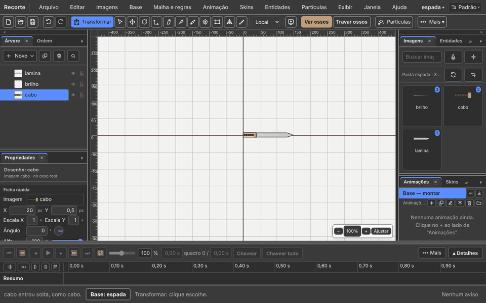
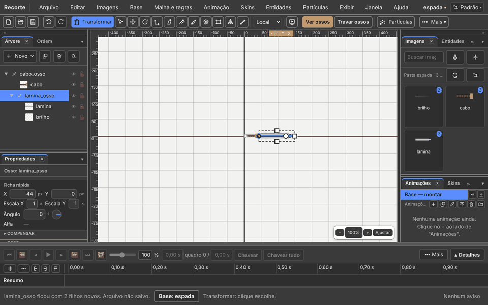
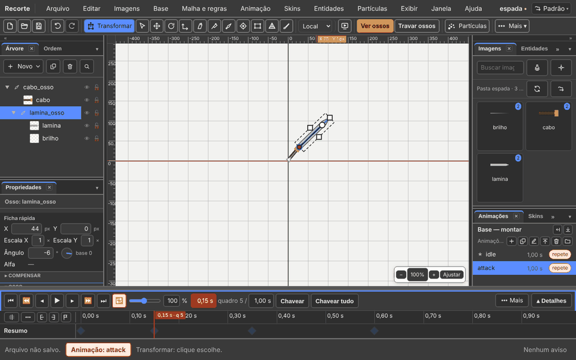
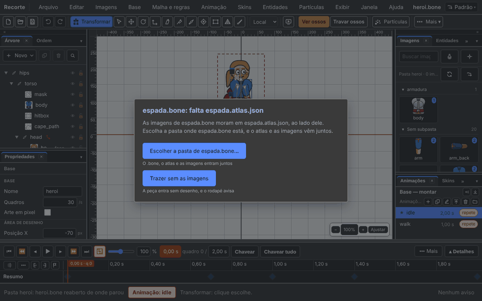
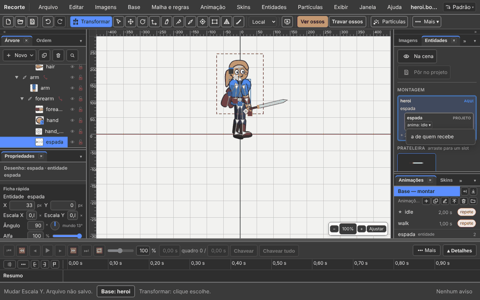
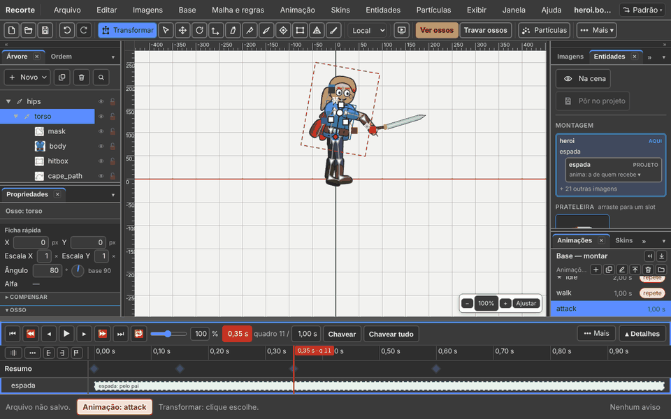
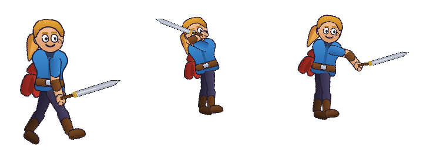
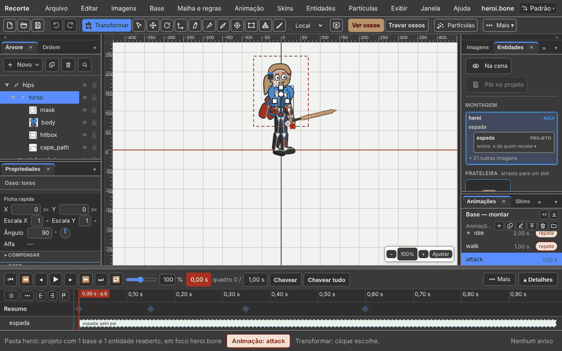
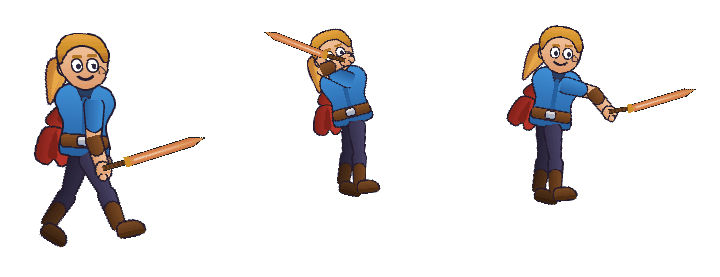

# 11. A espada de um, o boneco de outro

Também em inglês: [English](en/README.md)

Escrito em 05/11/2026, do programa rodando. Cada foto saiu da prova
`ferramentas/provas/espada-e-boneco.mjs`, que faz tudo isto sozinha.

> *"uma pessoa possa desenhar uma espada e outra possa animar um boneco, e
> nesse tipo de arquivo seja possível juntar os dois"* — o Humberto.

| Quem | Faz |
|:---|:---|
| **Pessoa A**, a desenhista | a espada: imagens, ossos, `idle` e `attack` |
| **Pessoa B**, a animadora | o herói: traz a espada, põe na mão, anima o golpe |

Ninguém abre um JSON.

---

## Pessoa A: a espada

### 1. O projeto

1. Ponha as imagens numa pasta só dela: `cabo.png`, `lamina.png`, `brilho.png`.
2. **Arquivo → Novo projeto…**
3. Escolha a pasta.
4. As três imagens aparecem na aba **Imagens**.

### 2. As imagens na cena

1. Arraste a `lamina` da aba **Imagens** para a cena.
2. Arraste o `brilho` por cima dela.
3. Arraste o `cabo` atrás da lâmina.

### 3. Os ossos

1. Clique no vazio da cena.
2. Tecla `B`.
3. Arraste do começo ao fim do cabo: nasce o osso do cabo.
4. Clique nele na **Árvore**.
5. Tecla `B` de novo.
6. Arraste ao longo da lâmina: nasce o osso filho.
7. Dois cliques no nome, na **Árvore**, para renomear.

Prender cada imagem no osso:

1. Clique no osso na **Árvore**.
2. Segure `P`.
3. Clique na imagem, na cena.
4. Solte `P`.

### 4. As animações

1. O `+` da aba **Animações**.
2. Escreva `idle`. Enter.
3. Escolha o osso da lâmina.
4. Escreva o tempo no relógio do tocador: `0,5`. Enter.
5. Escreva o **Ângulo** na ficha: `4`. Enter.
6. Relógio `1`. Ângulo `0`.

Agora o golpe:

1. O `+` de novo. Escreva `attack`.
2. Relógio `0,15`: o cabo a `50`.
3. Relógio `0,35`: o cabo a `-30`.
4. Relógio `0,6`: o cabo a `0`.
5. O botão **Repetir** do tocador: desligado. O golpe toca uma vez.

### 5. Salvar

1. `Ctrl+S`.
2. Na pasta ficam três arquivos que importam: `espada.bone`,
   `espada.atlas.json` e `espada-atlas.png`.

**Para entregar:** mande os três para a pessoa B.

---

## Pessoa B: o herói com a espada

### 1. Abrir o herói

1. **Arquivo → Abrir pasta do projeto…**
2. Escolha a pasta do herói.

### 2. Trazer a espada

1. **Entidades → Trazer entidade de fora…**
2. Escolha só o `espada.bone`.
3. O programa pergunta pela pasta dela: as imagens moram ao lado.
4. Clique **Escolher a pasta de espada.bone…**
5. Escolha a pasta onde está o `espada.bone`.

A espada entra na **Prateleira** da aba **Entidades**.

### 3. Pôr na mão

1. Clique **Base — montar**, na aba **Animações**. Assim vale em todas.
2. Arraste a espada da **Prateleira** até a mão, na cena.
3. Ela fica presa ao osso em que caiu.

### 4. Acertar posição e giro

Com a espada escolhida, na ficha das **Propriedades**:

| Campo | Exemplo |
|:---|:---|
| X | `33` |
| Y | `0` |
| Ângulo | `90` |
| Escala X e Escala Y | `0,8` |

### 5. Responder à animação

1. Na aba **Entidades**, no cartão **espada**, clique **anima ▾**.
2. Escolha **a de quem recebe**.

| O herói toca | A espada toca |
|:---|:---|
| `attack` | o `attack` dela |
| `walk` | ela não tem `walk`: toca o `idle` |

Clicar de novo desliga. `Ctrl+Z` desfaz.

### 6. O golpe

1. O `+` da aba **Animações**. Escreva `attack`.
2. Escolha o `hand_target` na **Árvore** (o alvo do braço).
3. Relógio `0,15`: X `-10`, Y `175`. A mão sobe.
4. Relógio `0,35`: X `80`, Y `105`. A mão desce na frente.
5. Relógio `0,6`: X `30`, Y `60`. Volta.
6. O tronco gira junto: `105`, `80`, `90`.

A faixa da espada diz **pelo pai**: ela segue o herói.

### 7. Salvar

1. `Ctrl+S`.
2. O programa leva para a pasta do herói o `espada.bone`, o atlas dela e a
   imagem dela. A pasta fica inteira: um jogo abre sem faltar nada.

---

## O jogo vê o mesmo

O runtime desenha o arquivo salvo. A espada segue a mão no `walk` e no
`attack`, e toca o `attack` dela junto.

---

## A pessoa A muda a espada

1. A pessoa A redesenha a `lamina.png` (outra cor).
2. Abre a pasta dela: **Arquivo → Abrir pasta do projeto…**
3. Botão **Recarregar a pasta**, na aba **Imagens**.
4. `Ctrl+S`. Salva por cima.
5. Manda de novo os três arquivos para a pessoa B.
6. A pessoa B põe os três na pasta do herói, por cima dos velhos.
7. A pessoa B abre a pasta do herói.

A espada nova está na mão. Nada foi refeito: o lugar, o giro, o "a de quem
recebe" e o golpe continuam.

---

## O que ainda não funciona

| O quê | Como é hoje |
|:---|:---|
| A espada nova chegar **sozinha** | a pessoa B põe os três arquivos na pasta dela. O navegador não deixa o programa ler a pasta da pessoa A de novo, sem pedir |
| Trazer a mesma espada de novo | entra como cópia, `espada-2.bone`. Para trocar, substitua os arquivos na pasta |
| Duas entidades com páginas de atlas de **mesmo nome** | o editor separa; o leitor do jogo pode confundir. Dê nomes diferentes aos projetos |

---

Anterior: [10. Partículas e biblioteca](10-particulas-e-biblioteca.md)
