# 0. Open Recorte

Also in Portuguese: [Português](../00-abrir-o-recorte.md)

> Revised on 07/10/2026, against version **v36.5**. The 15/09 chapter talked
> about seven menus, a Setup | Animating switch and eleven tools. None of that
> holds any more: today there are **twelve menus**, **twelve tools**, and what
> tells you where you are is **the status bar**.

> **About the labels.** The program's interface exists only in Portuguese.
> The first time a label appears in a chapter, it is written as it is on
> screen, in quotes, followed by the translation: **"Arquivo" (File)**. After
> that, the translation alone: **File**.

## What you will be able to do by the end

1. Open the editor and recognise every part of the screen.
2. Find any function in the program, even without knowing its name.
3. Always know whether you are working on the **base** or on an **animation** — and why that matters.

---

## What Recorte is

Recorte animates 2D drawings with bones.

You bring in the character's pieces as PNGs. You create bones underneath. You
rotate the bones over time. The drawing moves with them.

The work is saved into a `.bone` file. That file is **open**: any program may
read it, and nobody has to buy anything to use it in a game.

Recorte is the program. `.bone` is the standard. **The standard is the file.**

---

## What you need

| Item | Version | How to check |
|:---|:---|:---|
| Node.js | 22.18 or newer | `node --version` |
| A browser | current Chrome, Edge or Firefox | — |

Nothing else. There is no program to install on the system.

---

## Install and open

Once, in the project folder:

```
npm install
```

Then, whenever you want to work:

```
npm run editor
```

The terminal prints the address. Open it in the browser:

```
http://localhost:5173
```

To stop the editor, go back to the terminal and press `Ctrl+C`.

There is also the **built** editor, which needs no terminal: double-click
`programa\Abrir o editor.bat` (port 5180).

### What you see when it opens

The editor opens **empty**, with the **"Transformar" (Transform)** tool in
hand. In the middle of the stage, four big buttons:

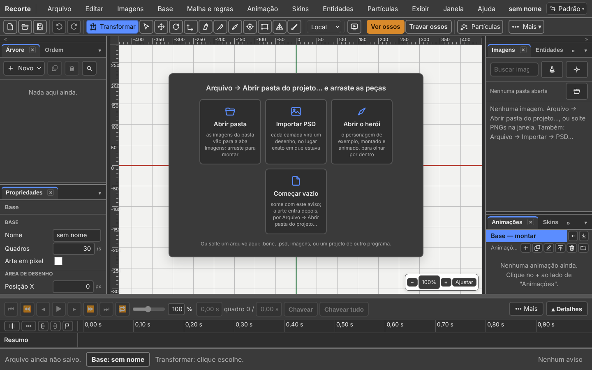

| Button | What it does |
|:---|:---|
| **"Abrir pasta" (Open folder)** | the folder's images go to the **"Imagens" (Images)** tab; you drag them in to build |
| **"Importar PSD" (Import PSD)** | each layer becomes a drawing, exactly where it was |
| **"Abrir o herói" (Open the hero)** | the example character, built and animated |
| **"Abrir a oficina" (Open the workshop)** | everything together: the chainsaw, the mecha with the hero inside, three characters sharing the same animations, two outfits |
| **"Começar vazio" (Start empty)** | hides the buttons; the art comes in later |

The buttons disappear by themselves at the first bone or the first image.

If the previous tab closed without saving, the editor **asks** whether you want
the work back. Nothing opens on its own.

---

## The screen, from top to bottom

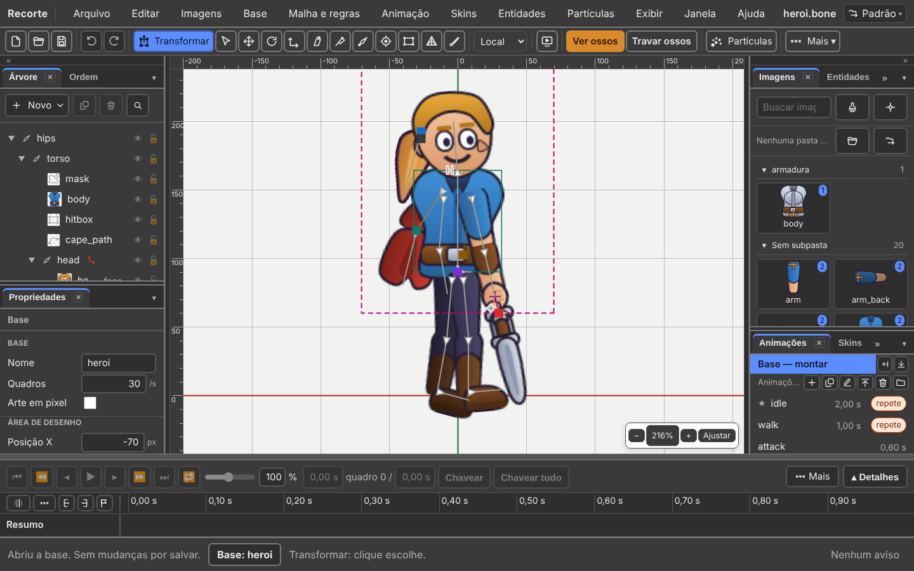

| Band | What it is |
|:---|:---|
| 1 | **The top bar**: the name Recorte, the **twelve menus**, the file name, and in the right corner the **contexts button** |
| 2 | **The action bar**: file, edit, the tools, the axes, see and lock, particles |
| 3 | **The two columns and the stage**: panels on the left, the drawing in the middle, panels on the right |
| 4 | **The timeline**, at the bottom, across the whole window |
| 5 | **The status bar**: what just happened, **where you are** (base or animation), and the warnings |

The browser tab's title gets a **•** when there is an unsaved change:
`heroi.bone • — Recorte`.

**The status bar never lies.** When you don't know what the program will do with
the next click, it is the status bar that answers. Sentence too long? Rest the
mouse on it: the whole sentence appears in the tooltip.

---

## The action bar

It sits just below the menu and is **one single line**.

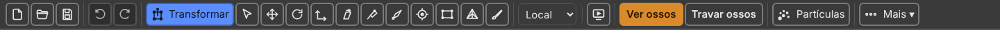

| Group | What it has |
|:---|:---|
| **"Arquivo" (File)** | "Novo" (New) (`Ctrl+N`) · "Abrir" (Open) (`Ctrl+O`) · "Salvar" (Save) (`Ctrl+S`) |
| **"Editar" (Edit)** | "Desfazer" (Undo) (`Ctrl+Z`) · "Refazer" (Redo) (`Ctrl+Y`) · "Recortar chaves" (Cut keys) (`Ctrl+X`) · "Copiar" (Copy) (`Ctrl+C`) · "Colar" (Paste) (`Ctrl+V`) · "Apagar" (Delete) (`Delete`) |
| **"Ferramentas" (Tools)** | the twelve, in gesture order |
| **"Eixos" (Axes)** | a list of three words: "Local" (Local) · "Pai" (Parent) · "Mundo" (World) |
| **"Exibir" (View)** | "Imagem de referência" (Reference image) · "Prévia" (Preview) |
| **"Ver e travar" (See and lock)** | "Ver ossos" (See bones) · "Travar ossos" (Lock bones) · "Ver desenhos" (See drawings) · "Travar desenhos" (Lock drawings) |
| **"Partículas" (Particles)** | a button with a name: the empty emitter and the four ready-made ones |
| **"Mais ▾" (More ▾)** | only appears when width runs out |

**The bar never scrolls sideways.** In a narrow window, what does not fit goes
into **More ▾**, at the end. First to go: Reference image, Cut, Paste, Copy and
Delete. Never go: the tool in hand, the Axes and Particles.

### The twelve tools

The button shows only the icon. **The tooltip says the name, the key and the
gesture** — hover over it and read.

| Tool | Key | What it does |
|:---|:---:|:---|
| **"Transformar" (Transform)** | `T` | moves, rotates and scales without changing tool. **It is the one the program opens with** |
| **"Selecionar" (Select)** | `Q` | picks; dragging on empty space makes a selection rectangle |
| **"Mover" (Move)** | `W` | moves what is selected. `Ctrl` + drag takes a copy |
| **"Girar" (Rotate)** | `E` | rotates around the pivot. `Shift`: in 15° steps |
| **"Escalar" (Scale)** | `R` | changes size. `Shift`: both axes together |
| **"Inclinar" (Shear)** | `Z` | the top moves, the base stays. **Only with a bone selected** |
| **"Posar" (Pose)** | `Y` | drags the tip of a chain and it bends along, without creating a rule |
| **"Criar osso" (Create bone)** | `B` | dragging creates a bone |
| **"Ponto" (Point)** | `O` | `Alt` + drag: a named position with a direction, which the game reads |
| **"Caixa" (Box)** | `X` | `Alt` + drag: a collision box |
| **"Malha" (Mesh)** | `M` | moves the mesh points |
| **"Pesos" (Weights)** | `G` | paints how much each bone pulls each point. `[` and `]`: the brush radius |

**Changed since 15/09:**

| Before | Today |
|:---|:---|
| Create bone was `N` | it is `B`, for *bone*. `N` is now free |
| Pose was `B` | it is `Y` |
| five tools disappeared in Animating | **none disappears**. All of them always work |

Prefer reading the word to memorising the picture? **"Exibir → Mostrar nome das
ferramentas" (View → Show tool names).** The word appears next to the icon.

Keys can be changed: **"Ajuda → Atalhos do teclado" (Help → Keyboard
shortcuts)** has a pencil on every line.

### The four see-and-lock buttons

These four are **words**, not icons. They turn **orange** while they are on.

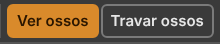

*At 1440 wide, only the two bone buttons fit on the bar. The two drawing
buttons are in **"Mais ▾" (More)**.*

| Button | Key | What it does |
|:---|:---:|:---|
| **See bones** | `7` | draws the bones on top of the character |
| **Lock bones** | `8` | clicks pass through them, but they stay visible |
| **See drawings** | `9` | shows the character's images |
| **Lock drawings** | `0` | clicks pass through them, but they stay visible |

See and lock are **states**: they stay on for half an hour while you work. A
state that is on reads better as a lit word. That is how Spriter does it.

---

## Base or animation: where you are

**The Setup | Animating ("Montagem | Animando") switch is gone** (18/09/2026).
`Ctrl+Tab` went with it. There is no mode: there is **what is open**.

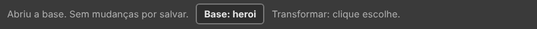

| The status bar says | Moving a bone |
|:---|:---|
| **"Base: heroi" (Base: heroi)** | changes the **base**: it applies to **all** animations |
| **"Animação: walk" (Animation: walk)** | **records a key** in this animation. The base does not change |

The **base** is the one-frame animation where you build the character. Every
animation is born from it.

| I want to | Do this |
|:---|:---|
| Open the base | **"Animações" (Animations)** tab, click the **"Base — montar" (Base — build)** line · or **"Base → Abrir a base" (Base → Open the base)** |
| Open an animation | **Animations** tab, click its name |
| Create an animation | **"Animação → Nova animação" (Animation → New animation)** |

**Changing something in an animation always records.** The old **"Gravar
sozinho" (Auto-key)** (`A`) is gone. **"Chavear" (Key)** (`K`) and **"Chavear
tudo" (Key all)** (`Ctrl+K`) stayed, to **protect the pose**: they record what
you did not touch.

What is structure goes to the base, even with an animation open: a new bone,
for example. The status bar warns: *"(foi para a base)"* ("went to the base").

Chapter [2. Bases and animations](02-bases-and-animations.md) and chapter
[4. Animate](04-animate.md) cover this in full.

---

## The twelve menus

In work order, as in Spriter: bring in the images, build, mesh and rules,
animate, dress, attach, effects — and then look.

| Menu | What lives in it |
|:---:|:---|
| **"Arquivo" (File)** | new project, open, project folder, import, save, export, settings |
| **"Editar" (Edit)** | undo, copy, paste, the pose, duplicate, pick, rename, preferences |
| **"Imagens" (Images)** | reload the folder, put an image on the stage, the pivot |
| **"Base" (Base)** | open the base, create bone and piece, who is whose parent, draw order, folders, rest pose |
| **"Malha e regras" (Mesh and rules)** | mesh, weights, rules, parameters, physics |
| **"Animação" (Animation)** | new, play, go to, key, curves, marks, events, effects, keys |
| **"Skins" (Skins)** | create, clone, edit, swap image, ignore, hide |
| **"Entidades" (Entities)** | bring in, put on the stage, test, This character, promote |
| **"Partículas" (Particles)** | the empty emitter, fire, smoke, spark, dust |
| **"Exibir" (View)** | theme, what appears on screen, hide, lock, zoom |
| **"Janela" (Window)** | layouts, arrange, and the sixteen panels |
| **"Ajuda" (Help)** | manual, shortcuts, problems, command palette, about |

**Renamed since 15/09:**

| Was | Today |
|:---|:---|
| **"Esqueleto" (Skeleton)** menu | **Base** menu |
| **"Peles" (Skins)** | **Skins** |
| body ("corpo") | base |

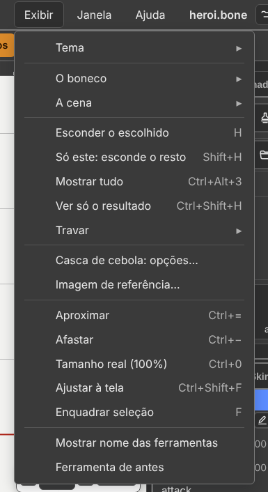

**The menu hides no button.** The button stays where it always was, and the
menu calls the same function. It is there for you to *find* a function and
*learn its key*.

**No item stays grey forever.** Either it works, or it is not in the menu. A
grey item **says why**:

| Why it is grey | How to tell |
|:---|:---|
| it exists and does not fit right now | the tooltip says what is missing — *"Abra uma animação primeiro"* ("Open an animation first") |
| it exists and has nothing to show yet | *"Os arquivos que você abrir ou salvar aparecem aqui"* ("The files you open or save appear here") |

Clicking a grey item that has a reason **runs nothing**: the reason goes to the
status bar.

To see every key at once: **Help → Keyboard shortcuts**, or `Shift+F1`. The
table is built from the menus themselves, so it is never out of date.

This manual opens from **"Ajuda → Manual" (Help → Manual)**, or `F1`.

---

## The twelve menus, item by item

**Use this as a reference**, not as reading. `▸` means submenu.

### File ("Arquivo")

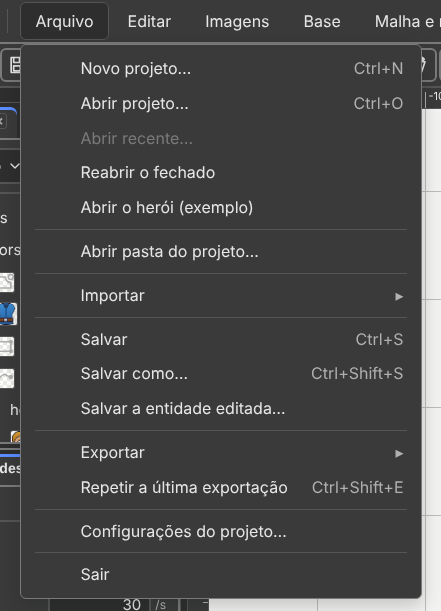

| Item | Key | What it does |
|:---|:---:|:---|
| **"Novo projeto…" (New project…)** | `Ctrl+N` | asks for the project folder and starts in it, with an empty base |
| **"Abrir projeto…" (Open project…)** | `Ctrl+O` | opens a `.bone`, `.boneb` or `.bonez` |
| **"Abrir recente…" (Open recent…)** | — | the last five, in a window with search |
| **"Reabrir o fechado" (Reopen closed)** | — | brings back the work the tab had when it closed |
| **"Abrir o herói (exemplo)" (Open the hero (example))** | — | the example character. With an unsaved change, it asks first |
| **"Abrir a oficina (exemplo)" (Open the workshop (example))** | — | the `exemplo/oficina` folder, with five bases: hero with a chainsaw, mecha with the hero in the cockpit, knight, goblin and robot sharing the same animations |
| **"Abrir pasta do projeto…" (Open project folder…)** | — | the images go to the Images tab, by subfolder. Nothing enters the stage by itself |
| **"Importar ▸ De outro programa…" (Import ▸ From another program…)** | — | asks for the Spriter, Spine or DragonBones project folder |
| **"Importar ▸ PSD…" (Import ▸ PSD…)** | — | each layer becomes a drawing, in place |
| **"Importar ▸ PSD com ossos…" (Import ▸ PSD with bones…)** | — | the same, and the `ossos` layer becomes the skeleton |
| **"Importar ▸ Animações, de outra base…" (Import ▸ Animations, from another base…)** | — | brings animations from a `.bone` |
| **"Importar ▸ Skin, de outro boneco…" (Import ▸ Skin, from another puppet…)** | — | brings a skin from a `.bone` |
| **"Salvar" (Save)** | `Ctrl+S` | writes the folder: the `.bone`, the atlas and the images in use |
| **"Salvar como…" (Save as…)** | `Ctrl+Shift+S` | a copy, in another folder |
| **"Salvar a entidade editada…" (Save the edited entity…)** | — | New, or Over the source file |
| **"Exportar ▸ GIF, PNG, folha, vídeo…" (Export ▸ GIF, PNG, sheet, video…)** | — | the animation as an image or a video |
| **"Exportar ▸ Uma imagem por skin…" (Export ▸ One image per skin…)** | — | the same export, once per skin |
| **"Exportar ▸ glTF, para programa 3D…" (Export ▸ glTF, for 3D programs…)** | — | a `.glb` with bones and animations |
| **"Exportar ▸ Salvar como binário…" (Export ▸ Save as binary…)** | — | a `.boneb`, smaller |
| **"Exportar ▸ Salvar como pacote…" (Export ▸ Save as package…)** | — | a single `.bonez`, with everything inside |
| **"Exportar ▸ Entregar uma base…" (Export ▸ Deliver a base…)** | — | one base on its own, only with the images it uses |
| **"Exportar ▸ Animações, para outra base…" (Export ▸ Animations, for another base…)** | — | writes the checked animations to a `.bone` |
| **"Exportar ▸ Skin, para outro boneco…" (Export ▸ Skin, for another puppet…)** | — | writes the pencil's skin to a `.bone` |
| **"Repetir a última exportação" (Repeat last export)** | `Ctrl+Shift+E` | exports again, without opening the window |
| **"Configurações do projeto…" (Project settings…)** | — | frames per second, background colour, grid, what to do on an animation switch while playing, mix time |
| **"Sair" (Quit)** | — | closes. What was not saved comes back through Reopen closed |

**Gone from File:** **"Importar → Imagens…" (Import → Images…)** (images arrive
through the folder, or dropped on the window) and **"Reempacotar atlas"
(Repack atlas)** (Save makes the atlas).

### Edit ("Editar")

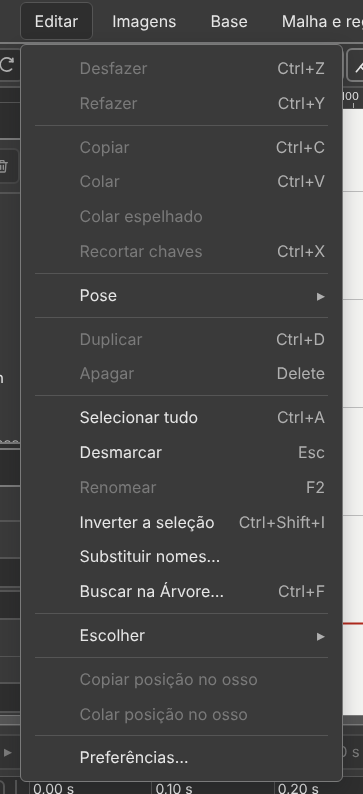

| Item | Key | What it does |
|:---|:---:|:---|
| **"Desfazer" (Undo)** | `Ctrl+Z` | goes back one step; the step's name comes in the item |
| **"Refazer" (Redo)** | `Ctrl+Y` | redoes. `Ctrl+Shift+Z` too |
| **"Copiar" (Copy)** | `Ctrl+C` | copies what is selected |
| **"Colar" (Paste)** | `Ctrl+V` | pastes what was copied |
| **"Colar espelhado" (Paste mirrored)** | — | pastes swapping left and right by name |
| **"Recortar chaves" (Cut keys)** | `Ctrl+X` | copies and deletes the keys |
| **"Pose ▸ Copiar a pose inteira" (Pose ▸ Copy the whole pose)** | `Ctrl+Shift+C` | how the character **is**, even between two keys |
| **"Pose ▸ Copiar a pose do escolhido" (Pose ▸ Copy the selected one's pose)** | — | the same, only for what is selected |
| **"Pose ▸ Colar em todas as chaves" (Pose ▸ Paste on all keys)** | `Ctrl+Shift+V` | the copied value on every key of the row |
| **"Pose ▸ Meio-termo" (Pose ▸ Inbetween)** (and "→ anterior" (→ previous), "→ seguinte" (→ next)) | — | a key halfway between the one before and the one after |
| **"Duplicar" (Duplicate)** | `Ctrl+D` | the bone comes with its children and drawings, 20 px to the right |
| **"Apagar" (Delete)** | `Delete` | deletes what is selected |
| **"Selecionar tudo" (Select all)** | `Ctrl+A` | all bones and all drawings |
| **"Desmarcar" (Deselect)** | `Esc` | clears the selection |
| **"Renomear" (Rename)** | `F2` | like double-clicking the name |
| **"Inverter a seleção" (Invert selection)** | `Ctrl+Shift+I` | selects what was **not** selected |
| **"Substituir nomes…" (Replace names…)** | — | replaces part of the name in many items, with a preview |
| **"Buscar na Árvore…" (Search the Tree…)** | `Ctrl+F` | filters the Tree by name |
| **"Escolher ▸ Os filhos" (Pick ▸ The children)** | `]` | the bone, its descendants and their drawings |
| **"Escolher ▸ Os pais" (Pick ▸ The parents)** | `[` | the bone and the chain of parents up to the root |
| **"Copiar posição no osso" (Copy position on bone)** | — | `x`, `y`, rotation and the two scales of a drawing |
| **"Colar posição no osso" (Paste position on bone)** | — | the same five numbers on the selected drawings |
| **"Preferências…" (Preferences…)** | — | what the program does by itself, and how it warns |

### Images ("Imagens")

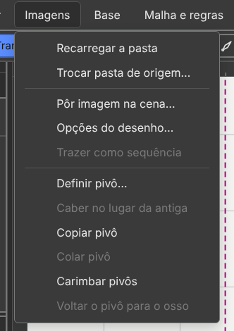

| Item | What it does |
|:---|:---|
| **"Recarregar a pasta" (Reload the folder)** | rereads the folder from disk: a new image comes in, a deleted one goes out |
| **"Trocar pasta de origem…" (Change source folder…)** | the images now come from another folder, by the same names |
| **"Pôr imagem na cena…" (Put image on stage…)** | picks an image from a list, instead of dragging |
| **"Opções do desenho…" (Drawing options…)** | the same as right-clicking a drawing: the grid to swap the image |
| **"Trazer como sequência" (Bring in as sequence)** | a numbered subfolder becomes a single drawing that changes frame |
| **"Definir pivô…" (Set pivot…)** | the pivot window, for the selected drawing's image |
| **"Caber no lugar da antiga" (Fit in place of the old one)** | the swapped image takes the size of the one that left |
| **"Copiar pivô" (Copy pivot)** · **"Colar pivô" (Paste pivot)** | one image's pivot onto another, in the same proportion |
| **"Carimbar pivôs" (Stamp pivots)** | writes into the atlas where each image fits on the bone |
| **"Voltar o pivô para o osso" (Return pivot to bone)** | a pivot moved by hand goes back to where the bone is |

### Base ("Base")

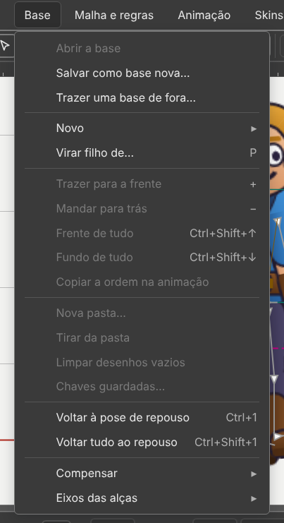

| Item | Key | What it does |
|:---|:---:|:---|
| **"Abrir a base" (Open the base)** | — | leaves the animation and opens the base |
| **"Salvar como base nova…" (Save as new base…)** | — | the current frame becomes a new base |
| **"Trazer uma base de fora…" (Bring in an outside base…)** | — | an outside `.bone` enters the Bases list |
| **"Novo ▸ Osso" (New ▸ Bone)** | — | a bone, child of the selected one |
| **"Novo ▸ Ponto" (New ▸ Point)** | `O` | a named position with a direction |
| **"Novo ▸ Caixa de colisão" (New ▸ Collision box)** | `X` | an outline for the game to measure |
| **"Novo ▸ Ponto neste desenho" (New ▸ Point in this drawing)** · **"Caixa neste desenho" (Box in this drawing)** | — | goes into the selected drawing, without creating another |
| **"Novo ▸ Máscara" (New ▸ Mask)** | — | an outline that clips without erasing |
| **"Virar filho de…" (Become child of…)** | `P` | with a bone selected: click whatever becomes its child, until `Esc` |
| **"Trazer para a frente" (Bring forward)** | `+` | moves up one place in the draw order |
| **"Mandar para trás" (Send backward)** | `−` | moves down one place |
| **"Frente de tudo" (Bring to front)** | `Ctrl+Shift+↑` | goes to the top |
| **"Fundo de tudo" (Send to back)** | `Ctrl+Shift+↓` | goes to the bottom |
| **"Copiar a ordem na animação" (Copy the order across the animation)** | — | the current order applies to the whole animation |
| **"Nova pasta…" (New folder…)** · **"Tirar da pasta" (Remove from folder)** | — | groups pieces in a folder, or ungroups them |
| **"Limpar desenhos vazios" (Clean up empty drawings)** | — | deletes drawings that show nothing in any skin |
| **"Chaves guardadas…" (Stored keys…)** | — | the keys of pieces removed from the base |
| **"Voltar à pose de repouso" (Back to rest pose)** | `Ctrl+1` | returns the selected bone to the base |
| **"Voltar tudo ao repouso" (All back to rest)** | `Ctrl+Shift+1` | returns all of them |
| **"Compensar ▸" (Compensate ▸)** | — | don't move the children · the drawings · the boxes |
| **"Eixos das alças ▸" (Handle axes ▸)** | — | Local · Parent · World |

**Gone from the old Skeleton:** New → Slot, Repack atlas, the four lock items
(moved to **View → Lock**), the skins (moved to **Skins**), the rules (moved to
**Mesh and rules**).

### Mesh and rules ("Malha e regras")

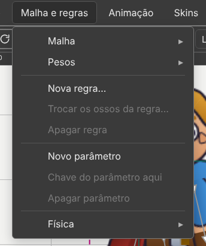

| Item | What it does |
|:---|:---|
| **"Malha ▸" (Mesh ▸)** | "Virar malha" (Turn into mesh) · "Gerar automática" (Generate automatically) · "Traçar contorno" (Trace outline) · "Criar vértice" (Create vertex) · "Criar ou apagar aresta" (Create or delete edge) · "Apagar vértice" (Delete vertex) · "Usar a forma de outra malha" (Use another mesh's shape) |
| **"Pesos ▸" (Weights ▸)** | "Ligar ossos" (Bind bones) · "Pesos automáticos" (Automatic weights) · "Suavizar tudo" (Smooth all) · "Podar" (Prune) · "Chavear pesos" (Key weights) · "Tirar pesos" (Remove weights) |
| **"Nova regra…" (New rule…)** | the window that asks which bones bend and what they chase |
| **"Trocar os ossos da regra…" (Change the rule's bones…)** · **"Apagar regra" (Delete rule)** | acts on the selected rule |
| **"Novo parâmetro" (New parameter)** · **"Chave do parâmetro aqui" (Parameter key here)** · **"Apagar parâmetro" (Delete parameter)** | the number the game sends from outside |
| **"Física ▸" (Physics ▸)** | "Simular a física" (Simulate physics) · "Reiniciar esta física" (Reset this physics) · "Reiniciar todas" (Reset all) · "Assar a física em chaves…" (Bake physics into keys…) |

See chapters [6](06-mesh-and-weights.md) and [7](07-the-five-rules.md).

### Animation ("Animação")

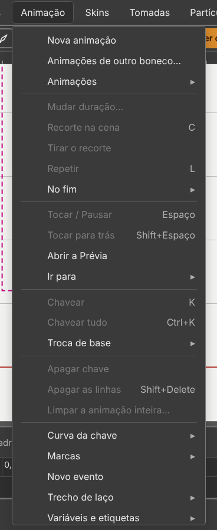

| Item | Key | What it does |
|:---|:---:|:---|
| **"Nova animação" (New animation)** | — | creates and opens |
| **"Animações ▸" (Animations ▸)** | — | "Duplicar" (Duplicate) · "Renomear" (Rename) · "Apagar" (Delete) · "Mandar para o topo" (Move to top) · "Biblioteca de animações…" (Animation library…) |
| **"Mudar duração…" (Change duration…)** | — | asks whether the keys stretch along |
| **"Repetir" (Loop)** | `L` | goes back to the start at the end. It is saved in the file |
| **"No fim ▸" (At the end ▸)** | — | what the player does at the end: "Como o arquivo diz" (As the file says) · "Parar" (Stop) · "Repetir" (Loop) · "Vai e volta" (Ping-pong) · "Voltar ao início" (Back to start) |
| **"Tocar / Pausar" (Play / Pause)** | `Space` | plays and pauses |
| **"Tocar para trás" (Play backwards)** | `Shift+Space` | from the end to the start |
| **"Abrir a Prévia" (Open the Preview)** | — | the Preview tab, with the animation playing |
| **"Ir para ▸" (Go to ▸)** | `Home` `End` `←` `→` `↑` `↓` | "Início" (Start) · "Fim" (End) · "Quadro anterior" / "Quadro seguinte" (Previous / Next frame) · "Chave anterior" / "Chave seguinte" (Previous / Next key) |
| **"Ir para ▸" (Go to ▸)** | `Shift+↑` `Shift+↓` | "Chave anterior do escolhido" / "Chave seguinte do escolhido" (Previous / Next key of the selected one) |
| **"Chavear" (Key)** | `K` | protects the pose: records the selected one's key |
| **"Chavear tudo" (Key all)** | `Ctrl+K` | records a key on every row |
| **"Troca de base ▸" (Base swap ▸)** | — | "Colar outra base aqui" (Paste another base here) · "Tirar a troca daqui" (Remove the swap here) |
| **"Recorte na cena" (Crop on the stage)** | `C` | the rectangle that the image export uses, for this animation only. See [chapter 8](08-export-and-use-in-a-game.md) |
| **"Tirar o recorte" (Remove the crop)** | — | deletes the rectangle; the export goes back to trimming the border by itself |
| **"Apagar chave" (Delete key)** | — | deletes the key at the current time |
| **"Apagar as linhas" (Delete the rows)** | `Shift+Delete` | removes the whole property from the animation |
| **"Limpar a animação inteira…" (Clear the whole animation…)** | — | asks first |
| **"Curva da chave ▸" (Key curve ▸)** | — | "Linear" (Linear) · "Suave" (Smooth) · "Entrada suave" (Ease in) · "Saída suave" (Ease out) · "Parada" (Stepped) · "Curva à mão…" (Hand-drawn curve…) |
| **"Marcas ▸" (Marks ▸)** | `M` · `Ctrl+↑` · `Ctrl+↓` | "Pôr ou tirar marca aqui" (Add or remove a mark here) · "Marca anterior" (Previous mark) · "Marca seguinte" (Next mark) |
| **"Novo evento" (New event)** | — | a signal the animation sends to the game |
| **"Trecho de laço ▸" (Loop range ▸)** | — | "Começo do trecho aqui" (Range start here) · "Fim do trecho aqui" (Range end here) · "Tirar o trecho" (Remove the range) |
| **"Variáveis e etiquetas ▸" (Variables and tags ▸)** | — | "Nova variável" (New variable) · "Apagar a variável" (Delete the variable) · "Nova etiqueta" (New tag) · "Renomear etiqueta" (Rename tag) · "Apagar etiqueta" (Delete tag) · "Mostrar na aba Regras" (Show in the Rules tab) |
| **"Efeitos de chave ▸" (Key effects ▸)** | — | "Flash…" (Flash…) · "Pulso…" (Pulse…) · "Tremor…" (Shake…) |
| **"Chaves ▸" (Keys ▸)** | — | "Selecionar todas" (Select all) · "Esticar" (Stretch) · "Espelhar no tempo" (Mirror in time) · "Fechar ciclo" (Close cycle) · "Espelhar esquerda e direita" (Mirror left and right) · "Empurrar" (Push) · "Deslocar em laço" (Shift in loop) · "Limpar repetidas" (Clean up repeated) |

**Gone from Animation:** Setup ⇄ Animating (`Ctrl+Tab`) and Auto-key (`A`).

### Skins ("Skins")

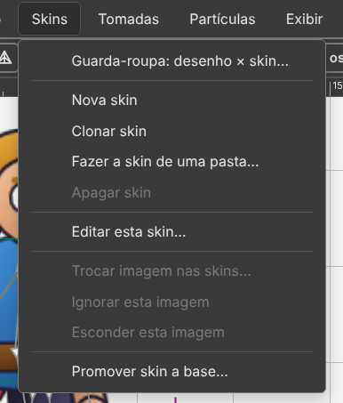

| Item | What it does |
|:---|:---|
| **"Nova skin" (New skin)** | an empty skin, which becomes the pencil's skin |
| **"Clonar skin" (Clone skin)** | a copy, with the same bones |
| **"Fazer a skin de uma pasta…" (Make the skin from a folder…)** | each drawing looks in the folder for the image with the same name |
| **"Apagar skin" (Delete skin)** | asks first. `Ctrl+Z` brings it back |
| **"Editar esta skin…" (Edit this skin…)** | the pencil: what you create from now on belongs to this skin |
| **"Trocar imagem nas skins…" (Swap image in skins…)** | swaps the image in every skin that uses the same one |
| **"Ignorar esta imagem" (Ignore this image)** · **"Esconder esta imagem" (Hide this image)** | the skin leaves the piece alone, or does not draw it |
| **"Promover skin a base…" (Promote skin to base…)** | the active skin becomes a new base |

Importing and exporting skins are in **File**. See [chapter 3](03-skins.md).

### Entities ("Entidades")

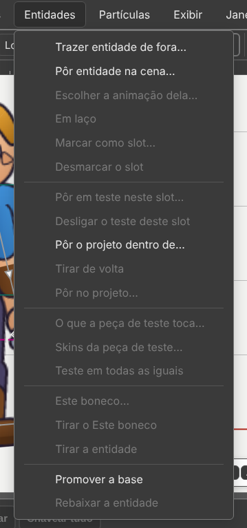

| Item | What it does |
|:---|:---|
| **"Trazer entidade de fora…" (Bring in outside entity…)** | an outside `.bone` enters the Entities list |
| **"Pôr entidade na cena…" (Put entity on stage…)** | attached to the selected bone |
| **"Escolher a animação dela…" (Pick its animation…)** · **"Em laço" (Looping)** | what it plays, and whether it repeats |
| **"Marcar como slot…" (Mark as slot…)** · **"Desmarcar o slot" (Unmark the slot)** | the image becomes a base, with a name and animations |
| **"Pôr em teste neste slot…" (Test in this slot…)** and the other test items | test without touching the file |
| **"Este boneco…" (This character…)** · **"Tirar o Este boneco" (Remove This character)** | the reverse socket |
| **"Tirar a entidade" (Remove the entity)** | the previous image comes back |
| **"Promover a base" (Promote to base)** · **"Rebaixar a entidade" (Demote to entity)** | swaps between base and entity |

See [chapter 5](05-entities.md).

### Particles ("Partículas")

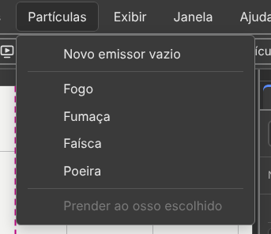

| Item | What it does |
|:---|:---|
| **"Novo emissor vazio" (New empty emitter)** | an emitter attached to the selected bone |
| **"Fogo" (Fire)** · **"Fumaça" (Smoke)** · **"Faísca" (Spark)** · **"Poeira" (Dust)** | a ready-made emitter |
| **"Prender ao osso escolhido" (Attach to selected bone)** | the emitter becomes the bone's child, without moving |

The same is on the **Particles** button of the action bar.

### View ("Exibir")

| Item | Key | What it does |
|:---|:---:|:---|
| **"Tema ▸ Escuro · Claro" (Theme ▸ Dark · Light)** | — | the program's colours. Dark is the default |
| **"O boneco ▸ Ossos" (The puppet ▸ Bones)** | `7` | draws the bones |
| **"O boneco ▸ Desenhos" (The puppet ▸ Drawings)** | `9` | shows the images |
| **The puppet ▸** "Nomes dos ossos" (Bone names) · "Pontos" (Points) · "Caixas" (Boxes) · "Máscaras" (Masks) · "Malhas" (Meshes) · "Arestas" (Edges) · "Pesos" (Weights) | — | what appears on top of the character |
| **"A cena ▸" (The stage ▸)** "Grade" (Grid) · "Réguas" (Rulers) · "Eixos" (Axes) · "Casca de cebola" (Onion skin) · "Nome ao passar o mouse" (Name on hover) | — | what belongs to the stage, not to the character |
| **The stage ▸** "Guias" (Guides) · "Travar guias" (Lock guides) · "Limpar guias" (Clear guides) | — | the lines you pull from the ruler |
| **"Esconder o escolhido" (Hide selected)** | `H` | hides what is selected |
| **"Só este: esconde o resto" (Only this: hide the rest)** | `Shift+H` | hides everything else |
| **"Mostrar tudo" (Show all)** | `Ctrl+Alt+3` | brings everything back |
| **"Ver só o resultado" (See only the result)** | `Ctrl+Shift+H` | turns off every screen aid at once |
| **"Travar ▸ Travar ossos" (Lock ▸ Lock bones)** | `8` | clicks pass through bones |
| **"Travar ▸ Travar desenhos" (Lock ▸ Lock drawings)** | `0` | clicks pass through drawings |
| **"Travar ▸ Travar o escolhido" (Lock ▸ Lock selected)** | `Ctrl+2` | locks only what is selected |
| **"Travar ▸ Travar o resto" (Lock ▸ Lock the rest)** | `Ctrl+Shift+2` | locks everything else |
| **"Travar ▸ Destravar tudo" (Lock ▸ Unlock all)** | `Ctrl+Alt+2` | unlocks |
| **"Casca de cebola: opções…" (Onion skin: options…)** | — | how many frames, the step, the colours |
| **"Imagem de referência…" (Reference image…)** | — | a drawing behind the stage, to trace over |
| **"Aproximar" (Zoom in)** | `Ctrl+=` | one zoom step in |
| **"Afastar" (Zoom out)** | `Ctrl+−` | one step out |
| **"Tamanho real (100%)" (Actual size (100%))** | `Ctrl+0` | back to 100% |
| **"Ajustar à tela" (Fit to screen)** | `Ctrl+Shift+F` | the whole character fits |
| **"Enquadrar seleção" (Frame selection)** | `F` | only what is selected fills the stage |
| **"Mostrar nome das ferramentas" (Show tool names)** | — | the word next to the icon |
| **"Ferramenta de antes" (Previous tool)** | — | the same as right-clicking on the stage |

### Window ("Janela")

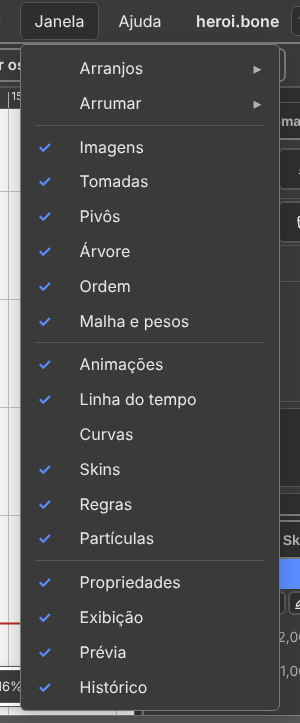

| Item | Key | What it does |
|:---|:---:|:---|
| **"Arranjos ▸" (Layouts ▸)** | — | "Montar" (Build) · "Animar" (Animate) · "Pesos" (Weights) · "Pivô" (Pivot) · "Visualização" (Viewing) · your own · "Guardar este arranjo…" (Store this layout…) · "Apagar um arranjo…" (Delete a layout…) · "Voltar ao padrão" (Back to default) |
| **"Arrumar ▸ Esconder painéis" (Arrange ▸ Hide panels)** | `Tab` | the columns and the timeline disappear |
| **"Arrumar ▸ Esconder só as colunas" (Arrange ▸ Hide only the columns)** | `Shift+Tab` | the columns disappear; the timeline stays |
| **"Arrumar ▸ Soltar o painel da parede" (Arrange ▸ Undock the panel)** | — | the panel in use floats over the stage |
| **"Arrumar ▸ Recolher em ícone" (Arrange ▸ Collapse to icons)** · **"Expandir" (Expand)** | — | the columns turn into icon strips, and back |
| **"Arrumar ▸ Mover para a outra coluna" (Arrange ▸ Move to the other column)** | — | asks which panel |
| **"Arrumar ▸ Fechar o grupo" (Arrange ▸ Close the group)** | — | closes the tab group in use |
| **"Arrumar ▸ Detalhes da linha do tempo" (Arrange ▸ Timeline details)** | — | opens and closes the bottom band |

Below, the **sixteen panels**, in three blocks, each with a mark showing which
ones are in a column. Click to open; click the one already in front to close.

| Block | Panels |
|:---|:---|
| build | **"Imagens" (Images) · "Entidades" (Entities) · "Pivôs" (Pivots) · "Árvore" (Tree) · "Ordem" (Order) · "Malha e pesos" (Mesh and weights)** |
| animate | **"Animações" (Animations) · "Linha do tempo" (Timeline) · "Curvas" (Curves) · "Skins" (Skins) · "Regras" (Rules) · "Partículas" (Particles)** |
| look | **"Propriedades" (Properties) · "Exibição" (Display) · "Prévia" (Preview) · "Histórico" (History)** |

### Help ("Ajuda")

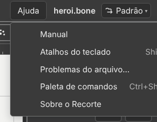

| Item | Key | What it does |
|:---|:---:|:---|
| **"Manual" (Manual)** | `F1` | this manual |
| **"Atalhos do teclado" (Keyboard shortcuts)** | `Shift+F1` | every key, with the pencil to change one |
| **"Problemas do arquivo…" (File problems…)** | — | what the program did not understand in the file, and where |
| **"Paleta de comandos" (Command palette)** | `Ctrl+Shift+P` | type part of the name and find the command |
| **"Sobre o Recorte" (About Recorte)** | — | the version, the licence and the format's address |

---

## Don't know how? **"Quero fazer…" (I want to…)**

You know what you want, but not the command's name. Start here.

1. Click **"Quero fazer…" (I want to…)**, in the status bar, on the right. Or **"Ajuda → Quero fazer…" (Help → I want to…)**.
2. Type the thing, in Portuguese: `arma` (weapon), `roupa` (outfit), `gif`, `psd`. Accents are optional.
3. Click the task. The steps appear below.
4. Click **"Mostrar onde" (Show where)**. The menu opens, and the item is **lit in orange**.
5. Click the lit item yourself.

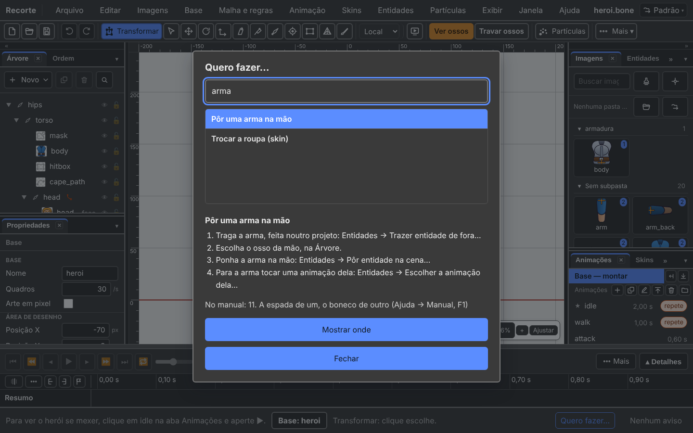

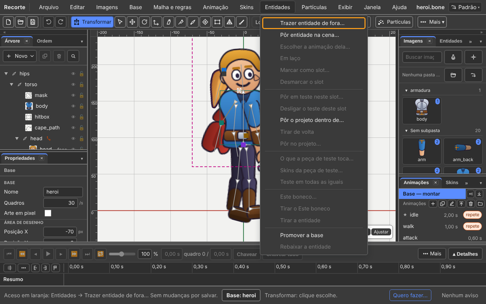

The path written in each step comes from the program's menus. If an item is
renamed, the step changes with it.

---

## A grey item: it says why

A **grey** item is not broken. Something is missing first.

1. Rest the mouse on the grey item.
2. **The status bar says why, and what to do.**
3. The item's tooltip says the same.

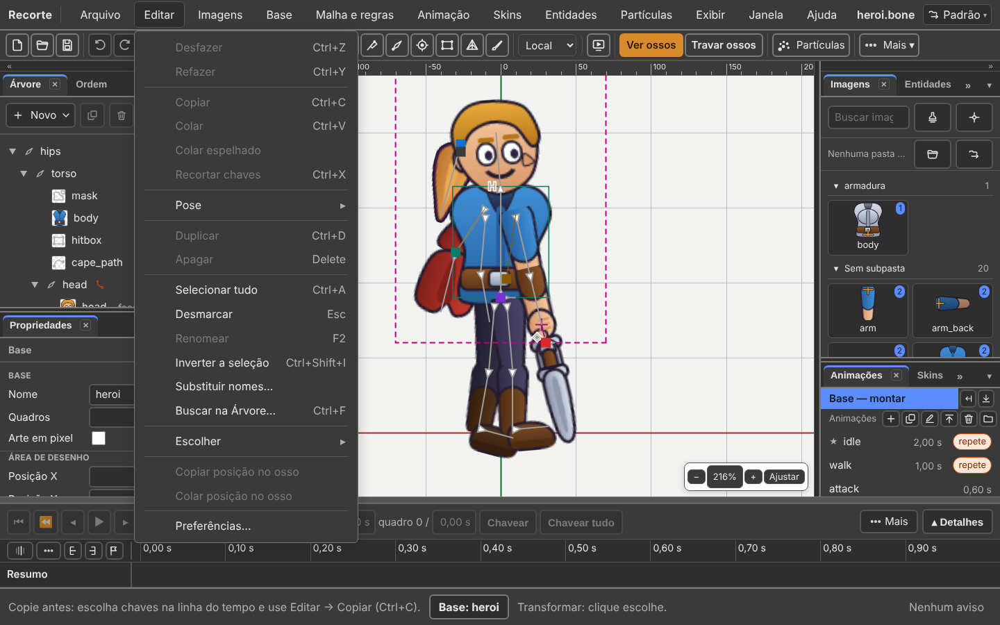

| Grey item | The status bar says |
|:---|:---|
| **"Editar → Colar" (Edit → Paste)** | copy first: select keys and use Edit → Copy |
| **"Animação → Chavear" (Animation → Key)** | open an animation first: click one, in the Animations tab |
| **"Base → Trazer para a frente" (Base → Bring forward)** | select a drawing first |
| **"Editar → Desfazer" (Edit → Undo)** | there is no step to undo yet |

Clicking the grey item does no harm: it only repeats the reason in the status bar.

---

## Can't find a command? `Ctrl+Shift+P`

Twelve menus and more than two hundred entries. The most common question is not
"does this exist?" — it is **"which menu is it in?"**.

Press `Ctrl+Shift+P`, type three letters, press `Enter`.

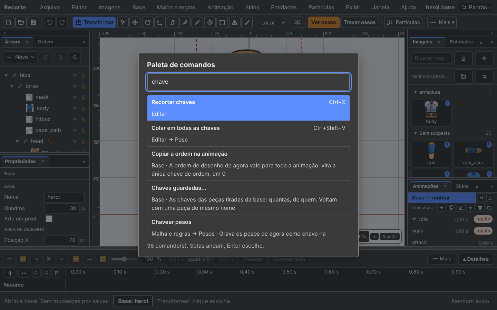

- No accents or capitals needed: `cebola` finds **"Casca de cebola" (Onion skin)**.
- The arrows move through the list, `Enter` picks, `Esc` closes.
- **The key appears next to the name.**
- The old name works too: each item's tooltip keeps what it used to be called.

Search with the Portuguese words: the names in the palette are the ones on
screen.

It is also in **Help → Command palette**, and on the **"Procurar um comando…"
(Search for a command…)** button of the Shortcuts window.

---

## The two columns, and `Tab`

The stage is in the middle, with a column on each side. Each column is **two tab
groups**, one above the other. In a group, one tab shows at a time.

Out of the box:

| Column | Top group | Bottom group |
|:---|:---|:---|
| **Left** | Tree · Order | Properties |
| **Right** | Images · Entities · Pivots · Mesh and weights · Particles · Display · Preview | Animations · Skins · Rules · History |

The **Timeline** and the **Curves** sit at the bottom, in the wide band.

On the left is what answers *"what is this thing I am looking at?"*. On the
right, what answers *"what do I want to do now?"*.

| You want to | How |
|:---|:---|
| move a tab to another group | **drag the tab**. A blue line shows where it goes in. `Esc` cancels |
| undock a panel | drag the tab **out**, over the stage. It floats, with a bar, `×` and a resize corner |
| dock it back | drag the floating panel's bar to a row of tabs |
| undock the whole group | drag the empty gap of the tab row |
| collapse a group | the `▾` at the end of the row, or **double-click the tab**. The space goes to the other group |
| close a panel | the `×` of the tab in use. It comes back through the **Window** menu, in the same place |
| close the whole group | right-click the tab row, or **Window → Arrange → Close the group** |
| a panel on the other side | **Window → Arrange → Move to the other column** |
| the columns as icons | the small double arrow `«»` at the top of the column, or **Window → Arrange → Collapse to icons** |
| more height for a group | drag the **handle between the two groups**. Double-clicking it restores automatic |
| more width for a column | drag the **handle between the column and the stage**. From 180 to 480 pixels |
| the whole window for the drawing | `Tab`. `Tab` again brings everything back |
| only the columns disappear | `Shift+Tab` |

The last open panel of a column does not close: the column is never empty.

### The contexts

In the **top right corner**, the contexts button. It is Photoshop's
"workspace": the screen arranged for one task.

| Context | What for |
|:---|:---|
| **"Montar" (Build)** | Tree, Order, Properties, Images. The timeline closed |
| **"Animar" (Animate)** | Animations and the timeline open |
| **"Pesos" (Weights)** | Mesh and weights with almost the full height |

Made a mess? **Window → Layouts → Back to default.**

**The arrangement lives on your machine, not in the `.bone`.** Opening someone
else's puppet does not change your screen. *(Changed since 15/09: it used to go
inside the file.)*

---

## The stage: rulers, grid and zoom

The **rulers** sit above and to the left of the drawing, with the world
numbers. **Ruler and grid are the same scale**, always. A thin line follows the
pointer on both.

**View → The stage → Rulers** turns them off and on.

The **zoom** sits in the corner of the stage: `−` · `100%` · `+` · "Ajustar"
(Fit). The `100%` is a field: type a number and press `Enter`.

| Key | Does |
|:---:|:---|
| `Ctrl+=` | zooms in one step |
| `Ctrl+−` | zooms out one step |
| `Ctrl+0` | **Actual size (100%)** |
| `Ctrl+Shift+F` | **Fit to screen**: the whole character fits |
| `F` | **Frame selection**: only what is selected |
| mouse wheel | zooms in and out where the pointer is |
| middle button, or `Space` held | drags the view |

`Space` pressed and released, without dragging, plays the animation.

There are no scroll bars, and that is on purpose: the stage has no edge.

---

## The theme

The editor opens **dark**: dark grey panels, light text, and the stage in light
grey — the colours of Spriter's screen.

**View → Theme → Light** goes back to white, at once. The choice is remembered.

The **stage stays light** in both themes, on purpose: a dark line on a dark
background cannot be seen. Another background colour: **Display** tab → **The
stage → "Cor do fundo" (Background colour)**. It belongs to the editor only: it
does not go into the exported file.

---

## Right-click on the stage

| Where | What it does |
|:---|:---|
| on empty space | goes back to the **previous tool** |
| on top of a drawing | opens the grid: swap the image, order, duplicate, delete |

You are on **Rotate**, press `W` and go to **Move**. Right-click on empty space,
and you are back on **Rotate**. Again, and back on **Move**.

Both doors are also in the menu: **View → Previous tool** and **Images →
Drawing options…**.

---

## Saving, and not losing work

`Ctrl+S` saves.

| The status bar says | Meaning |
|:---|:---|
| **"Arquivo não salvo." (File not saved.)** | there is a change. The title gets the **•** |
| **"Sem mudanças por salvar." (No changes to save.)** | what is on screen is what is on disk |
| **"Arquivo ainda não salvo." (File not saved yet.)** | the work has never been written |

| Item | What it writes |
|:---|:---|
| **File → Save** | the project folder: the `.bone`, the atlas and the images in use. With more than one base, one `.bone` for each and the `manifest.json` |
| **File → Export → Save as binary…** | a `.boneb`, smaller |
| **File → Export → Save as package…** | a `.bonez`, with everything together |

Keep the `.bone`, the atlas and the images **in the same folder**. Always.

The editor stores what is on screen by itself, every few seconds. Closed the
tab by accident, the computer shut down: **File → Reopen closed**. It tells you
the time of what it stored and **asks first**.

**The images do not come with what was stored.** The status bar gives the
remedy: *File → Open project folder…*.

Opening something else with an unsaved change also asks: **"Salvar e
continuar" (Save and continue)** · **"Descartar as mudanças" (Discard the
changes)** · **"Cancelar" (Cancel)**.

---

## The History: where was this still right?

**"Histórico" (History)** tab, in the right column, bottom group.

One line per step, with the name of what was done. The top line is always
**"Arquivo aberto" (File opened)**.

| What you see | What it means |
|:---|:---|
| line with **●** | where the document is now |
| lines with **○** | the other steps |
| **grey** lines | undone steps; they disappear when you do something new |

**Clicking a line goes to it** — backwards or forwards, as many steps as needed.

It is the answer to the question `Ctrl+Z` does not answer: *at what point was
this still right?*

---

## See the finished example

`heroi.bone` has everything: hierarchy, mesh, weights, three skins, the five
rules and three animations (`idle`, `walk`, `attack`). It is in
`formato/exemplos/heroi.bone`.

The editor does **not** open it by itself. Open it with **File → Open the hero
(example)**, or with the **Open the hero** button on the empty screen.

The `walk` animation, at three moments:

| `walk` at 0 s | `walk` at 0.25 s | `walk` at 0.5 s |
|:---:|:---:|:---:|
| 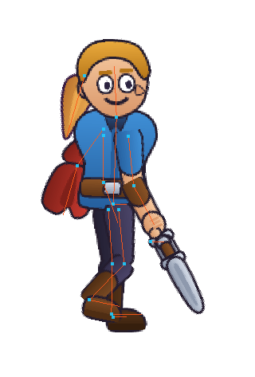 | 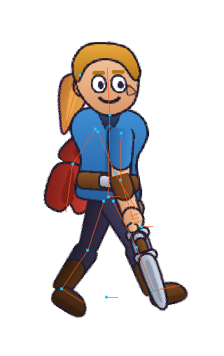 | 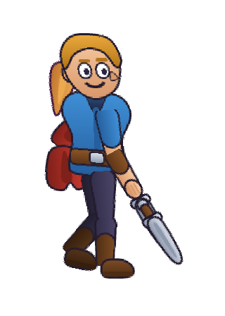 |

To render any frame as an image, without opening the editor:

```
node ferramentas/render-png.mjs walk 0.5 saida.png
```

---

## The seal — what this chapter confirms

House rule: every function gets a seal — **exists** · **exists differently** ·
**missing** · **changes with the bases** — and whoever did not find it in the
code writes **not confirmed**. Checked on 07/10/2026, on v36.5, **by reading the
code** (I did not use the program with the mouse).

| Function | Seal | Where in the code, or what changes |
|:---|:---:|:---|
| Opens empty, with four buttons in the middle | exists | `editor/src/main.ts:162-165`, `viewport/welcome-model.ts:36-62` |
| The twelve menus, in this order | exists | `ui/menus.ts:1886-1906` |
| The action bar, the groups and **More ▾** | exists | `ui/action-bar-model.ts:204-227,320-334`, `viewport/viewport-toolbar.ts:79-82` |
| The twelve tools and the letters (`T Q W E R Z Y B O X M G`) | exists | `ui/keys.ts:119-138`, `ui/toolbar-model.ts:60-63` |
| No tool disappears in an animation | exists | `ui/toolbar-model.ts:32-35` |
| The mode switch and `Ctrl+Tab` | removed | `ui/action-bar-model.ts:76-82`, `ui/where-model.ts:1-15` |
| The status bar says **Base: …** or **Animation: …** | exists | `ui/where-model.ts:53-72` |
| Auto-key (`A`) | removed | `ui/menus.ts:1436-1437`: editing always records |
| The four see-and-lock buttons, as words | exists | `ui/action-bar-model.ts:155-192` |
| A grey item gives its reason in the status bar | exists | `ui/menus.ts:2031-2033` |
| Command palette, accent-insensitive | exists | `ui/menus.ts:1865-1871`, `ui/palette.ts:44-50` |
| Default panels in the two columns | exists | `ui/layout-model.ts:54-88` |
| Drag a tab, undock, collapse to icons, `Shift+Tab` | exists | `documentos/projeto do programa/09 OS PAINEIS`, §9 (v26.6 to v27.3); `ui/menus.ts:1747-1811` |
| The contexts button, in the top corner | exists | `ui/shell.ts:384-389`, `ui/contexts.ts` |
| The arrangement lives on the machine, not in the `.bone` | exists | `ui/layout-model.ts:127-131` (`localStorage`) |
| Zoom in the corner, with the `100%` field | exists | `viewport/viewport.ts:646-649,738-742,782` |
| Dark theme by default | exists | `ui/theme.ts:233` |
| The three save messages | exists | `ui/salvar-avisos.ts:85-89` |
| History with ● and ○, and "File opened" | exists | `panels/history.ts:74`, `panels/history-model.ts:42-49` |
| Open recent: the last five | exists | `io/recent.ts:25` |
| The `.boneb` "about 37% smaller" | not confirmed | the number came from the old chapter; here it is only "smaller" |
| The Manual opens in a browser tab | not confirmed | `ui/shell-actions.ts:116` calls `showManual`; I did not read where it opens |

---

## What does not work yet

| What | Requirement | Workaround |
|:---|:---|:---|
| There are no short videos per tool. | C5 | Chapters 1 to 7 serve as a script. |
| There is no public repository to open an issue in. | C4 | Talk to the author directly. |
| There is no forum or chat channel. | C3 | — |
| The interface exists only in Portuguese. | — | The manual exists in English, with the Portuguese label in quotes and its translation. |
| The status bar tip says *"No menu Animação, Abrir a base"* ("In the Animation menu, Open the base"), but the item lives in the **Base** menu. | — | Use **Base → Open the base**. |

---

Next: [1. Build a body](01-build-a-body.md)
