# 1. Build a body

Also in Portuguese: [Português](../01-montar-um-corpo.md)

> Revised on 07/10/2026, against version **v36.5**. Changed since 15/09: the
> Create bone key (`B`), the Tree (a single tree), the `P` gesture, where a
> dropped image is born, and Setup mode (today it is **the base**).

> **About the labels.** The interface exists only in Portuguese. The first time
> a label appears in this chapter, it is written as on screen, in quotes,
> followed by the translation. After that, the translation alone.

## What you will be able to do by the end

1. Bring in the images and put each piece in place.
2. Create the bones, attach each drawing to its own, and sort out who moves whom.
3. Get the draw order right, so the arm does not show on top of the head.

> **Everything in this chapter is done on the base.** The status bar must say
> **"Base: …"**. If it says **"Animação: …" (Animation: …)**, use **"Base →
> Abrir a base" (Base → Open the base)**, or click the **"Base — montar" (Base —
> build)** line in the **"Animações" (Animations)** tab.

---

## The five pieces

| Piece | What it is | Where it is |
|:---|:---|:---|
| **Bone** ("Osso") | Moves the drawing. Invisible in the game. | **"Árvore" (Tree)** |
| **Drawing** ("Desenho", the slot) | The place where an image appears. Attached to a bone. | Tree, under its bone |
| **Attachment** ("Anexo") | The thing itself: image, mesh, box, point, mask, path. | inside the drawing |
| **Skin** | A set of attachments. Changes the whole outfit at once. | **"Skins"** tab — [chapter 3](03-skins.md) |
| **Rule** ("Regra") | An automatic calculation on top of the bones. | **"Regras" (Rules)** tab — [chapter 7](07-the-five-rules.md) |

On screen, the slot is called **"desenho" (drawing)**. The word *slot* stays in
the tooltips.

The chain is always this:

```
bone  ->  drawing (slot)  ->  attachment
```

The bone moves. The drawing says where and in what order. The attachment is
what you see.

---

## Step 1 — Bring in the images

### The usual way: the project folder

As in Spriter, **art first, bones second**.

| Gesture | What happens |
|:---|:---|
| **"Arquivo → Novo projeto…" (File → New project…)** (`Ctrl+N`) | asks for the folder and starts in it |
| **"Arquivo → Abrir pasta do projeto…" (File → Open project folder…)** | the folder's images go to the **"Imagens" (Images)** tab, by subfolder |
| drop a **folder** on the window | opens that folder |
| drop **PNGs** on the window | they go into the **Images** tab |

**Nothing enters the stage by itself.** You drag each image from the Images tab
to the stage (see below).

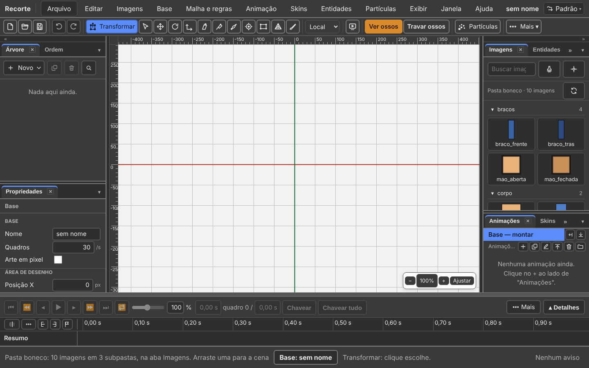

*A test puppet: each piece is a colored rectangle. The photo shows the
program, not the art.*

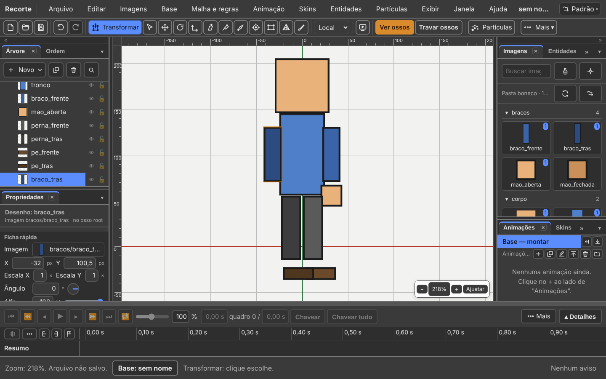

Changed the image in Photoshop? **"Imagens → Recarregar a pasta" (Images →
Reload the folder).** A new image comes in, a deleted one goes out, and the
status bar says what changed.

**Gone since 15/09:** **"Arquivo → Importar → Imagens…" (File → Import →
Images…)**. Images arrive through the folder, or dropped on the window.

### If the art came from Photoshop

**"Arquivo → Importar → PSD…" (File → Import → PSD…)** and pick the `.psd` (or
the `.psb`).

| What happens | Detail |
|:---|:---|
| each layer with pixels becomes a drawing | with its image |
| **each drawing is born exactly where the layer was** | this is what you lose when exporting PNG by PNG |
| the draw order is Photoshop's | the bottom layer is drawn first |
| a group becomes a **folder** | the `braco` layer inside the `corpo` group comes out as `braco`, in the `corpo` folder |
| a layer with its eye off comes in with the drawing turned off | and the editor warns |

All of that is **one** undo step.

If the file already has a character, the editor **asks first**: **"Substituir o
que já existe" (Replace what already exists)** or **"Acrescentar ao que já
existe" (Add to what already exists)**. `Esc` cancels and nothing is touched.

**Nothing disappears silently.** What the `.bone` does not store comes out in a
list of warnings in Portuguese: a blend mode the format does not know, a layer
mask, a layer with no pixels, a repeated name.

From the command line:

```
npm run importar-psd -- personagem.psd saida
```

### With the bones drawn in the PSD

You can draw the skeleton in Photoshop itself, on top of the art.
**"Arquivo → Importar → PSD com ossos…" (File → Import → PSD with bones…)** reads
the lines and builds the bones.

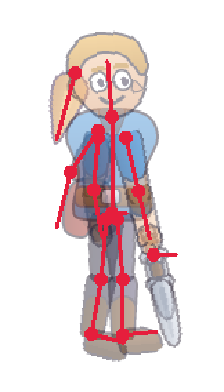

| What you draw | What it becomes |
|:---|:---|
| a layer called **`ossos`** (or layers inside an `ossos` group), on top of everything | only it becomes the skeleton; it does **not** become a drawing |
| each **line** in that layer | a bone, from base to tip |
| a fat **dot** at one of the ends | the bone's base, where it rotates |
| no dot | the end that touches another bone becomes the base |
| a base that **touches** another line (within 12 px) | child of that line |
| several bases at the same point, one much shorter | the short one (the pelvis) is the parent of the others |
| a line that touches nothing | child of the root |
| the name | `osso_1`, `osso_2`… from the root to the tips. Rename them later |
| each drawing layer | attached to the bone whose line passes over it the most |

Tips:

- **Put the dot on every bone.** Without it, Recorte guesses the base.
- Touch the child's base **on top of** the parent's line.
- Lines may cross. All in one layer, or one per layer inside the `ossos` group:
  both ways work.
- The drawing does not move. It is only measured from the bone from now on.
- IK rules do not come from the PSD. A drawn IK target becomes an ordinary bone.

All of that is still **one** undo step.

From the command line:

```
npm run importar-psd -- personagem.psd saida --ossos
```

In the usual **PSD…**, the `ossos` layer is left out: it never becomes a
drawing. The warning tells you to use **PSD with bones…**.

### If you already have a project from another program

**"Arquivo → Importar → De outro programa…" (File → Import → From another
program…)** asks for the Spriter, Spine or DragonBones project **folder**. See
[chapter 9](09-coming-from-spriter-spine-and-dragonbones.md).

### The atlas

The atlas (the page that packs the images together) is made **on Save**, only
with the images in use. **"Esqueleto → Reempacotar atlas" (Skeleton → Repack
atlas) is gone**: repacking is Save.

---

## The Images panel: what exists, and what nobody is using

**Images** tab, at the top of the right column.

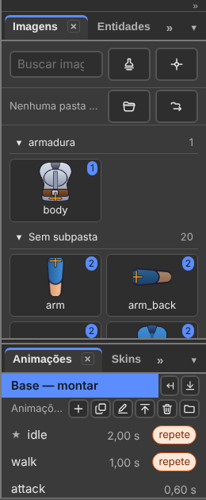

The numbered dot on an image says **how many drawings use it**. An image nobody
uses has no dot.

**Drag an image onto the stage.** Where you drop it, a drawing is born:

- with the image's name;
- **at the root, always** — not on the selected bone. The drawing is free, like
  Spriter's parentless sprite. The bone comes later and picks up the drawings;
- it is **one** undo step.

*(Changed since 15/09: the drawing used to stick to the selected bone.)*

Don't want to drag? **"Imagens → Pôr imagem na cena…" (Images → Put image on
stage…)** picks from a list.

The search box filters as you type, and ignores accents and capitals: `MAO`
finds `mão_fechada`.

| Gesture in the tab | What it does |
|:---|:---|
| **double-click** an image | **"Definir pivô…" (Set pivot…)**, as in Spriter |
| right-click an image | the image menu: pivot, copy and paste pivot |
| right-click a subfolder | bring in as sequence |

The pivot is also in **Images → Set pivot…** and in the **"Pivôs" (Pivots)**
tab.

---

## Step 2 — Create the bones

The **"Criar osso" (Create bone)** tool (`B`). *(It was `N` until 17/09.)*

| Gesture | What it does |
|:---|:---|
| click | puts the bone's root at that point |
| drag and release | length and angle come from the drag |
| drag **with drawings selected** | the new bone **picks up** the drawings, without moving them, and takes the first one's name |
| **`Ctrl`** + drag | creates the bone **without** picking up the selected drawings |
| **`Alt`** + drag over a bone | **redraws** that bone, without moving its children |

**Changed since 15/09:** `Ctrl` used to do the opposite. Today picking up the
drawings is the normal gesture, and `Ctrl` is the exception.

**With the tool in hand, the status bar says the gestures.**

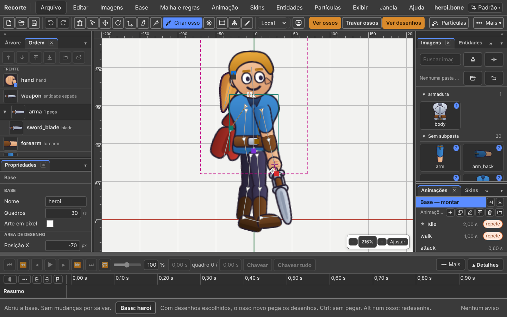


*Where you start the drag is the bone's root; where you release is the
tip.*

The new bone is born **as a child of the bone you selected**. With no bone
selected, it is born loose, hanging from the root. Clicking an image on the
stage does **not** select its bone: the new bone does not hook onto something
nobody selected.

The most common building gesture, in a single move: brought in the image,
selected it, dragged the bone. One `Ctrl+Z` undoes it all.

`Alt` + drag fixes a crooked bone **without erasing what was already animated
with it**: the keys stay, and the children don't move.

With an animation open, the new bone **goes to the base** and applies to all
animations. The status bar says *"(foi para a base)"* ("went to the base").

### Rename

Double-click the name, type, `Enter`. Or `F2`. The new name is replaced in
**every** place that pointed to the old one: drawings, rules, keys.

To replace part of the name in twenty bones at once: **"Editar → Substituir
nomes…" (Edit → Replace names…)**. The window **shows first** how many will
change, which ones, and what will be skipped, with the reason. Careful with
short pieces: `_b` also catches `arm_back`.

---

## The Tree: where everything lives

**Tree** tab, at the top of the left column.

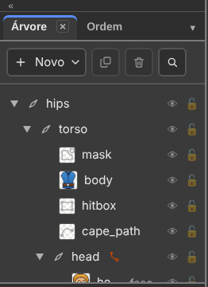

| In the Tree | What it is |
|:---|:---|
| the first line | the **root** |
| each bone | first **its drawings**, then its **child bones** |
| the triangle `▶` `▼` | folds and unfolds the bone |
| the orange mark next to a bone | a rule controls it |
| *"por chave" (by key)*, next to the name | with an animation open: this frame's parent is a different one |
| the group at the end | the **events** and the **parameters** |

Each drawing line shows the **thumbnail** of what it shows now. Each line has
an **eye** (hides) and a **padlock** (locks).

In the header:

| Button | What it does |
|:---|:---|
| **"Novo ▾" (New ▾)** | bone, rule, event, skin, parameter or particle emitter |
| **"Duplicar" (Duplicate)** (`Ctrl+D`) | the bone comes with its children and drawings, 20 px to the right |
| **"Apagar" (Delete)** (`Delete`) | the bone takes those below it and their drawings, and **asks first** |
| **"Buscar na Árvore" (Search the Tree)** (`Ctrl+F`) | filters by name, ignoring accents and case. `Esc` closes |

Right-click a bone line: **"Novo osso filho" (New child bone)**, **Duplicate**,
**Replace names…**, **"Renomear" (Rename)**, **Delete**. On a drawing line,
also **"Copiar" (Copy)** and **"Colar posição no osso" (Paste position on
bone)**, and **"Trocar a imagem em todas as skins…" (Swap the image in all
skins…)**.

With the focus on the Tree, the arrows move:

| Key | Does |
|:---:|:---|
| `↑` `↓` | the line above, the line below |
| `←` | folds the bone, or goes to the parent |
| `→` | unfolds a folded bone |

**Every drawing has a thumbnail, and none is empty:**

| The drawing is | The thumbnail shows |
|:---|:---|
| an image | the image |
| a **sequence** of images | the rest frame, with a small corner saying **how many frames** |
| a **mesh** | its image |
| a **child skeleton** (a sword, a helmet) | the skeleton, **drawn** |
| a point, a box, a path, a mask | the **type icon**; the type name is in the tooltip |

---

## Step 3 — Attach each drawing to its bone

The fastest way is Step 2's: select the drawings and **create the bone on top
of them**.

For a drawing that already exists: click it. In the **"Propriedades"
(Properties)** panel, **"Desenho" (Drawing)** group, the **"Osso" (Bone)** field
is a list with all the bones. Pick the right one.

Done: that drawing now moves with that bone.

### Changing the parent later

| Where | How |
|:---|:---|
| **On the stage, holding `P`** | select **one** bone — it is the parent —, **hold** `P` and click each bone and each drawing that will become its child. Release `P` to finish |
| **From the menu** | **"Base → Virar filho de…" (Base → Become child of…)**: the same gesture, without holding the key. Click the children until `Esc` |
| **In the Tree** | drag the name onto the name of the future parent |
| **In the Tree, to detach** | drag to the empty end of the list: it becomes loose, with no bone |
| **In the Bone field** | Properties, **Drawing** group |

**Gone since 15/09:** the Spine gesture (select several, press `P`, click the
parent) and the "Virar filho de qual osso?" ("Become child of which bone?")
window. Today `P` is a single gesture: **the parent first**. With any other
selection, `P` only says in the status bar what to do.

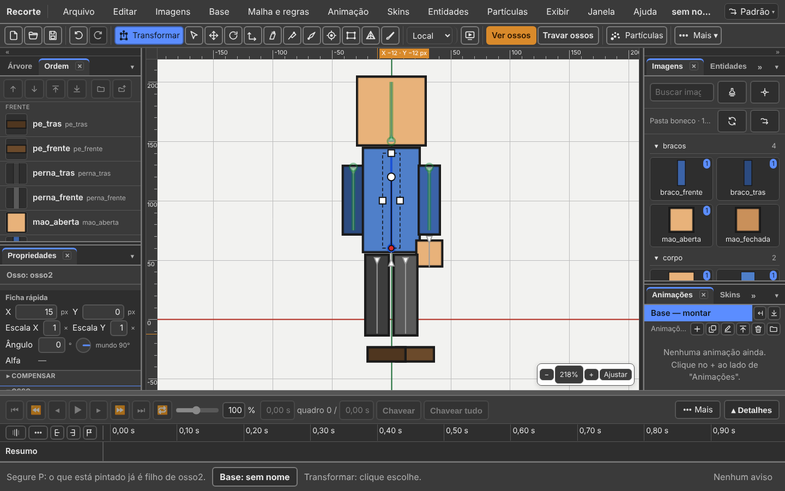

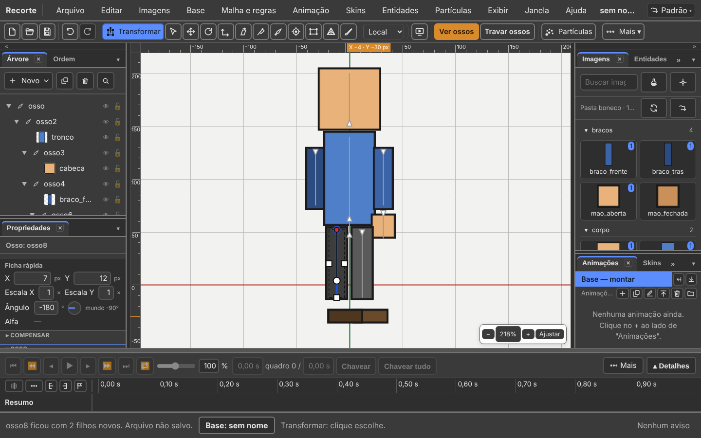


*Hold `P` and the status bar starts saying whose children your clicks are
creating. The cursor changes too.*

Holding `P`:

| A click on… | What it does |
|:---|:---|
| any bone or drawing | attaches it as a child |
| the same one again | releases it: it goes back to the parent it had |
| one that **was already a child** before the gesture | comes out from under the parent and becomes loose |
| an **ancestor** of the parent | the two **swap places**, and the chain stays standing |

The bone's existing children are **marked on the stage** while `P` is held:
you see what is already attached before clicking.

Each click is one **"Desfazer" (Undo)** step, with the child's name.

The root bone does not change parent. If something cannot go, the status bar
says which one and why.

**Changing the parent moves nothing.** The bone and the drawing stay exactly
where they were on screen. The numbers in Properties change — they are measured
from the new parent —, and that is what keeps the drawing still.

**With an animation open**, changing the parent **becomes a key**: the weapon
leaves the hand and goes to the back in the middle of the animation. The Tree
shows the parent **of that frame**. The status bar says where it recorded:
*"body virou filho de head (chave de pai em 0,00 s)"* ("body became child of
head (parent key at 0.00 s)").

### Swapping a drawing's image

A drawing shows **one** image at a time: the open hand or the closed hand,
never both.

| Where | How |
|:---|:---|
| **on the stage** | right-click the drawing: the grid, with the images. Click the new one |
| **from the menu** | **"Imagens → Opções do desenho…" (Images → Drawing options…)** |
| **Properties** | **Drawing** group, **"Mostra" (Shows)** field: a list. Open it and pick |

**"Nenhuma" (None)** in the Shows field leaves the drawing empty.

The new image is bigger than the old one? **"Imagens → Caber no lugar da
antiga" (Images → Fit in place of the old one).**

**In an animation this becomes a key.** Swapping the image records a key at the
playhead's time, and the base stays intact.

---

## Hierarchy: who moves whom

Rotating a parent bone moves all its children along.

This is the layout almost every human character uses:

```
root
└── quadril
    ├── tronco
    │   ├── cabeca
    │   ├── braco_esq
    │   │   └── antebraco_esq
    │   └── braco_dir
    │       └── antebraco_dir
    ├── perna_esq
    │   └── canela_esq
    └── perna_dir
        └── canela_dir
```

*(`quadril` = hips, `tronco` = torso, `cabeca` = head, `braco` = arm,
`antebraco` = forearm, `perna` = leg, `canela` = shin, `esq`/`dir` =
left/right.)*

The `root` stays still, on the ground, at point zero — the engine uses it as
the character's position in the world. The `quadril` (hips) is what you move
to make the character walk.

### Inheritance, item by item

In the Properties panel, **"Herança do osso pai" (Inheritance from the parent
bone)** group:

| Box | Turned off means |
|:---|:---|
| "Herda rotação" (Inherits rotation) | the bone keeps the same angle on screen when the parent rotates |
| "Herda escala" (Inherits scale) | the bone keeps its own size when the parent changes |
| "Herda espelhamento" (Inherits mirroring) | the bone does not flip over when the parent flips |

Use sparingly. A good example: a backpack that always stays upright, even with
the torso leaning — turn off **Inherits rotation**.

---

## Properties and the quick sheet

**Properties** tab, below the Tree.

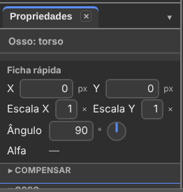

*At the top, always the same six lines: X, Y, Scale X, Scale Y, Angle and
Alpha. Below, everything else that bone or drawing has.*

| Quick sheet line | How to change it |
|:---|:---|
| **X** and **Y** | type the number, in px |
| **"Escala X" (Scale X)** and **"Escala Y" (Scale Y)** | type the number. `1` is the build size; negative mirrors |
| **"Ângulo" (Angle)** | type the degrees, **or drag the dial** beside it, **or drag the label** |
| **"Alfa" (Alpha)** | type from 0 to 100, **or drag the bar** |

The field accepts arithmetic: `90+15` becomes `105`.

The dial turns the way angles turn: right is 0°, up is 90°, left is 180°, down
is −90°. Dragging the dial is one undo step.

| Case | The quick sheet |
|:---|:---|
| on a **bone** | the Alpha line is empty: alpha belongs to the drawing, not the bone |
| a **sheared** bone | gets the **"Inclinação X" (Shear X)** and **Y** lines, only when they are not zero |
| a **mesh** | loses X, Y, scale and angle: what moves the mesh is the bone, or the vertices |

Rest the mouse on a line: the tooltip says the **unit** and the range.

**Arrows in number fields.** With the cursor in a number field, `↑` goes up one
step and `↓` goes down one.

| Key | Step |
|:---:|:---|
| `↑` or `↓` | one step: 1 in X, Y and Angle; 0.01 in scale; 1 in Alpha |
| `Shift` + arrow | ten steps |
| `Alt` + arrow | a tenth of a step |

Holding the key is **a single undo step**. Inside the field the arrow belongs
to the field: it does not move along the timeline. *(I did not recheck the
`Shift` and `Alt` steps in this revision.)*

### The drawing's fields

| Group | Field | What it does |
|:---|:---|:---|
| Drawing | "Nome" (Name) | the drawing's name |
| Drawing | Bone | which bone it moves with |
| Drawing | Shows | which image is visible now |
| Drawing | "Visível" (Visible) | uncheck to hide it |
| "Cor" (Colour) | Colour | tints the drawing. White is no tint. Opacity goes in % |
| Colour | "Cor escura" (Dark colour) | tints the shadows. Black changes nothing |
| Colour | "Mistura" (Blend) | normal, additive, multiply or screen |

### The bone's fields

| Group | Fields |
|:---|:---|
| Bone | Name · "Comprimento" (Length) |
| "Marcação no editor" (Editor marking) | "Cor do osso" (Bone colour) · "Ícone (só no editor)" (Icon (editor only)) |
| "Posição e forma" (Position and shape) | Position X and Y · Rotation · Scale X and Y · Shear X and Y |
| Inheritance from the parent bone | the three boxes above |
| Skins | which skin the bone belongs to |

---

## Draw order

**"Ordem" (Order)** tab, next to the Tree.

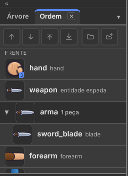

*One drawing per line, with the thumbnail. **The one at the top of the list is
in FRONT**, as in every layer program.*

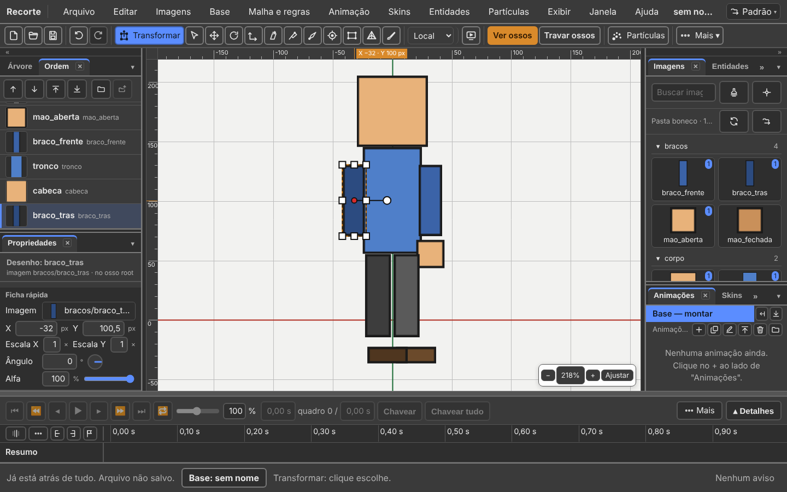

**The six buttons at the top of the tab:**

| Button | What it does | Key |
|:---|:---|:---|
| **"Trazer para a frente" (Bring forward)** | moves up one place | `Ctrl+↑` |
| **"Mandar para trás" (Send backward)** | moves down one place | `Ctrl+↓` |
| **"Frente de tudo" (Bring to front)** | goes to the top | `Ctrl+→` (or `Ctrl+Shift+↑`) |
| **"Fundo de tudo" (Send to back)** | goes to the bottom | `Ctrl+←` (or `Ctrl+Shift+↓`) |
| **"Nova pasta" (New folder)** | groups the selected ones in a folder | — |
| **"Tirar da pasta" (Remove from folder)** | removes the folder | — |

The keys work with the focus on the Order tab **or on the stage**, with a
drawing selected. *(Changed since 15/09: Bring to front and Send to back gained
`Ctrl+→` and `Ctrl+←`.)*

**In an animation, changing the order becomes a key.** To make the current
order apply to the whole animation: **"Base → Copiar a ordem na animação"
(Base → Copy the order across the animation)**.

They go grey when nothing is selected. **A piece in a folder takes the whole
folder** with the two "to front/to back" buttons.

Two more ways, each one undo step:

| How | What it does |
|:---|:---|
| **drag** a line onto the **top** or **bottom** third of another | goes in **between** the two. A thin line shows where |
| drag onto the **middle** of another line | the usual: the two swap places |
| **Base → Bring forward / Send backward** (`+` and `−`) | the same, from the menu |

*(Changed since 15/09: dropping between two lines now works.)*

An example for a character in profile:

| Line | Drawing | Sits |
|:---:|:---|:---|
| 1 | `braco_da_frente` (front arm) | in front of everything |
| 2 | `perna_da_frente` (front leg) | |
| 3 | `cabeca` (head) | |
| 4 | `corpo` (body) | |
| 5 | `perna_de_tras` (back leg) | |
| 6 | `braco_de_tras` (back arm) | behind everything |

If an arm shows on top of the head and shouldn't, this is where you fix it.

### Only drawings go in this tab

Collision boxes, points, paths and masks **do not appear here**: they have a
position and a name, but they draw nothing. They stay in the Tree.

A drawing that exists only in **another skin** stays in the list, with its name
faded: it has an order, it is just not the one showing now.

### Folders

A character with thirty pieces becomes a list of thirty lines. Group the ones
that move together:

| Gesture | What it does |
|:---|:---|
| select the pieces, **right-click → "Pôr numa pasta…" (Put in a folder…)** | asks for the name. The window **says first** how many change place |
| click the folder's name | folds and unfolds. Folded, it is **one line** |
| **drag the folder**, or `Ctrl+↑` and `Ctrl+↓` on it | moves **all the pieces at once** |
| **double-click the name** | renames, in all its pieces |
| **right-click → Remove from folder** | removes the folder. The order does **not** change |

A folder is only a grouping: **the draw order is still the list's order**. If an
outside piece falls in the middle of a folder, the tab shows the folder **in
pieces**, with a **"Juntar" (Join)** button.

Whoever imports a PSD arrives with the folders ready: they are Photoshop's
groups.

**"Base → Limpar desenhos vazios" (Base → Clean up empty drawings)** deletes the
drawings that show nothing in any skin.

---

## Transform: move, rotate and scale without changing tool

The program opens with the **"Transformar" (Transform)** tool (`T`) in hand.
It is Spriter's way: the selection gets a **box**, with small squares, the
**pivot** and a **stalk** with a dot at the end.

| Selected | Small squares | The rotate dot |
|:---|:---:|:---|
| a **drawing** | eight: corners and side midpoints | at the end of the stalk |
| a **bone** | three: the two sides and the top | at 3/4 of the bone, near the tip, far from the pivot |

The box rotates along with the drawing.

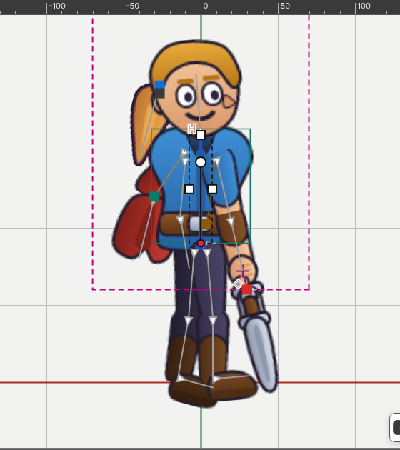


| Where you drag | What happens |
|:---|:---|
| **inside** the box | moves |
| the **dot** | rotates around the pivot. `Shift`: 15° steps |
| a **corner** | scales on both axes. `Shift`: keeps the proportion |
| the **middle of a side** | scales on one axis only |
| **`Alt`** + the **middle of a side**, with a **bone** selected | **shears** on that axis. Without a bone, `Alt` does nothing |
| on something **not selected** | selects it and moves it right away |
| **outside** the box, on empty space | the selection rectangle |

The cursor changes to say what the drag will do, and the status bar says the
gesture and the number. Each drag is **one** undo step.

Parent and child selected together: only the parent gets the calculation.

**"Mover" (Move)** (`W`), **"Girar" (Rotate)** (`E`), **"Escalar" (Scale)**
(`R`) and **"Inclinar" (Shear)** (`Z`) are still on the bar, for those who
prefer one at a time. **"Eixos" (Axes)** and **"Compensar" (Compensate)** work
the same.

---

## Select, lock and hide

| Gesture | What it does |
|:---|:---|
| click | selects the bone or drawing under the pointer |
| `Shift` + click, or `Ctrl` + click | adds to the selection, or removes |
| `Alt` + click again in the same place | goes to the one underneath, when several things are stacked |
| drag on empty space | draws a rectangle. Everything it touches gets selected |
| `Shift` + drag | the rectangle adds |
| `Ctrl` + drag on empty space | the rectangle removes |
| `Ctrl` + drag **on the selection**, with **Move** or **Transform** | **clones** and drags the clone. The original does not move |
| `Esc` | deselects everything |
| arrows `← → ↑ ↓`, with the focus on the stage | move **one pixel**; `Shift` moves ten |

Clicks pass through the image's **transparent** parts: only the drawn part
takes the click.

The **selection rectangle** has no button. With **"Selecionar" (Select)** (`Q`)
or **Transform** (`T`), drag on empty space:

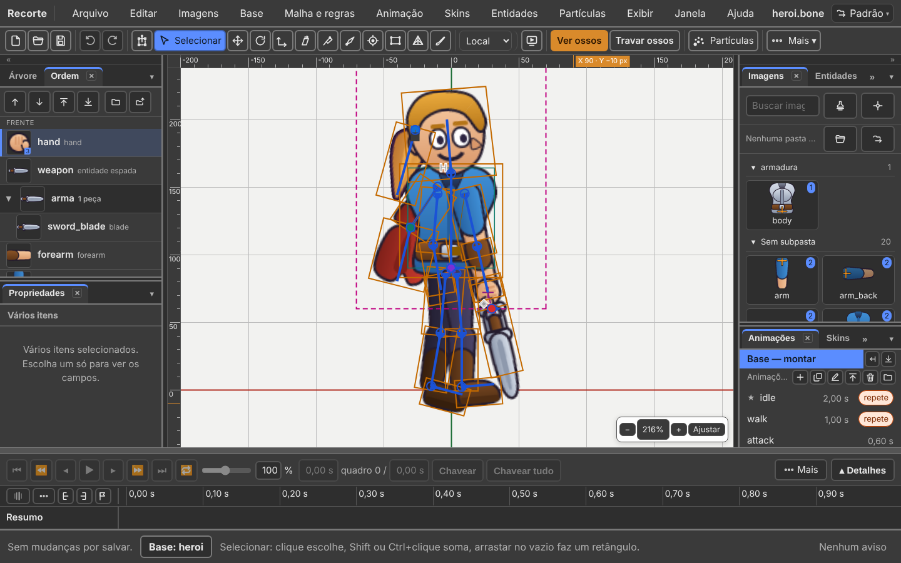


*Everything the rectangle touches gets selected. The Properties panel then says
**"Vários itens" (Several items)**.*

**Locked** and **hidden** are different things:

| | Visible? | Takes clicks? |
|:---|:---:|:---:|
| **Locked** | yes, lighter | no |
| **Hidden** | no | no |

Locking is so you don't bump into it. Hiding is to get it out of the way.

| Key | Does | Menu |
|:---:|:---|:---|
| `H` | hides what is selected | "Exibir" (View) |
| `Shift+H` | hides **everything else** | View |
| `Ctrl+Alt+3` | shows everything again | View |
| `Ctrl+Shift+H` | **"Ver só o resultado" (See only the result)** | View |
| `Ctrl+2` | **"Travar o escolhido" (Lock selected)** | "Exibir → Travar" (View → Lock) |
| `Ctrl+Shift+2` | **"Travar o resto" (Lock the rest)** | View → Lock |
| `Ctrl+Alt+2` | **"Destravar tudo" (Unlock all)** | View → Lock |
| `Ctrl+Shift+I` | **"Inverter a seleção" (Invert selection)** | "Editar" (Edit) |
| `]` | **"Os filhos" (The children)**: the bone, its descendants and their drawings | "Editar → Escolher" (Edit → Pick) |
| `[` | **"Os pais" (The parents)**: the bone and the chain of parents up to the root | Edit → Pick |

With the **"Pesos" (Weights)** tool in hand, `[` and `]` change the brush
radius.

**See only the result** turns off bones, names, points, boxes, masks, meshes,
edges, weights, grid and axes at once. It is the character as the player will
see it. Pressing it again **puts everything back as it was**.

In the Tree, each line's **eye** and **padlock** do this for a single item.

---

## Guides

A guide is a thin cyan line that crosses the stage: the floor both feet stand
on, the shoulder height that repeats in every pose.

| Gesture | What it does |
|:---|:---|
| drag from the **top ruler** | a **horizontal** guide is born |
| drag from the **left ruler** | a **vertical** guide is born |
| drop it back on the ruler | gives up |

With the **Move** tool (`W`), the bone and the drawing **snap** to the guide when
they come within 6 pixels of it. With `Shift` the axis is locked, and the snap
does not act.

| **"Exibir → A cena" (View → The stage)** menu | Does |
|:---|:---|
| **"Guias" (Guides)** | shows or hides. Hidden, they don't snap |
| **"Travar guias" (Lock guides)** | the guide can't be dragged, only deleted |
| **"Limpar guias" (Clear guides)** | deletes all of them at once |

Guides travel inside the file, in `RECORTE_editor_state` — the part of the
`.bone` that only the editor reads. **The game never sees a guide.**

---

## The Display panel

**"Exibição" (Display)** tab, in the right column.

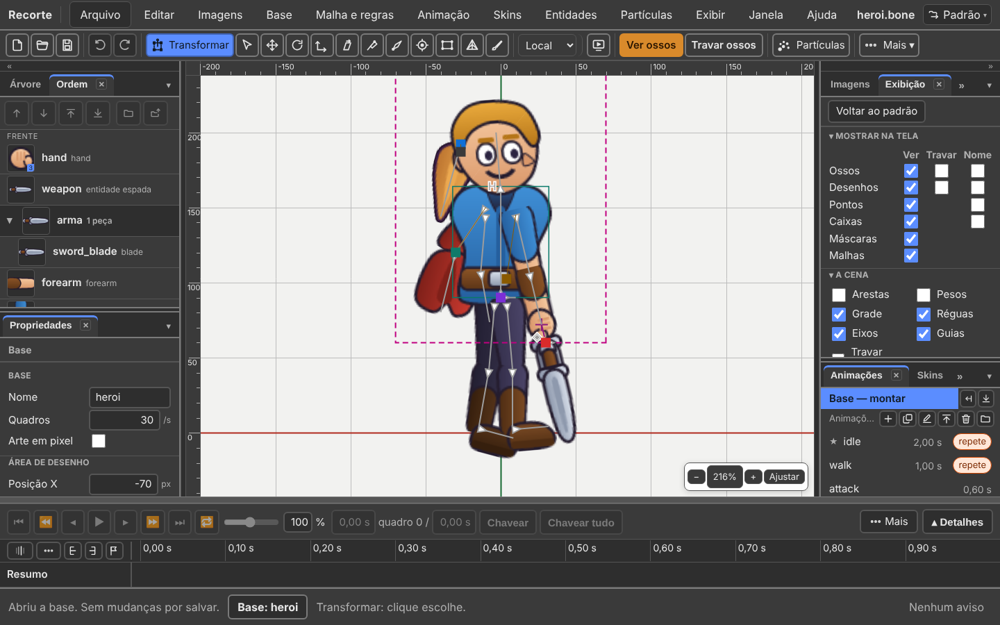

| Group | What it has |
|:---|:---|
| **"Mostrar na tela" (Show on screen)** | one line per type: Bones · Drawings · Points · Boxes · Masks · Meshes. Three columns: **"Ver" (See)** · **"Travar" (Lock)** · **"Nome" (Name)** |
| **"A cena" (The stage)** | Edges · Weights · Grid · Rulers · Axes · Guides · Lock guides · **"Cor do fundo" (Background colour)** |
| **Skins** | the skin stack, one check per skin |

- **See** shows or hides that type on the stage.
- **Lock** keeps the type visible, but clicks pass through it. It only exists
  for bones and drawings.
- **Name** writes the name on the stage, next to the thing.

Where the box doesn't exist, the cell is **empty**.

**"Nome ao passar o mouse" (Name on hover)** lives in **View → The stage**:
resting the pointer on a bone or a drawing shows its name.

---

## Moving the drawing without moving the bone

The image came in two pixels off. The sword is crooked. The hair needs to come
down.

**Click the drawing on the stage** (or its line in the Tree), **with no bone
alongside**. The **Transform**, **Move**, **Rotate** and **Scale** tools then
work on the drawing. A **cross** marks the anchor: the point it rotates and
grows around.

With a **bone** selected, they go back to moving the bone. That is the rule.

| Where | What happens |
|:---|:---|
| **on the base** | the drawing changes place inside the bone, for all animations |
| **in an animation** | **it becomes a key**, as in Spriter. The program gives the drawing a **bone of its own**, hidden, and the key belongs to that bone |

*(Changed since 15/09: moving the drawing never used to become a key.)*

### Aligning five drawings at once

The anchor is five numbers — `x`, `y`, rotation and the two scales — that you
set by eye and then need to be **the same** on the five hands of a skin.

1. Select the drawing that is already right. **Right-click → "Copiar posição no
   osso" (Copy position on bone)** (or **"Editar → Copiar posição no osso"
   (Edit → Copy position on bone)**).
2. Select the others. **Paste position on bone**.

All with the same pose inside the bone, in a single undo step. The **image size
does not go along**, on purpose: matching it would distort the drawing.

---

## Fixing the rig without redoing the pose

The shoulder pivot ended up two fingers off. If you move the shoulder, the whole
arm moves along — and you redo the arm's pose. No need.

**Axes: "Local" (Local) · "Pai" (Parent) · "Mundo" (World)**, on the action bar
(or **"Base → Eixos das alças" (Base → Handle axes)**). It says which axes the
handles work in.

| Choice | When to use it |
|:---|:---|
| **Local** | the handles point where the bone itself points. It is the default |
| **Parent** | the handles follow the parent bone's axes |
| **World** | the handles follow the screen: right is right, always |

What is **saved** in the file is still the position, rotation and scale relative
to the parent. The axis changes how you move things, not what is stored.

**Compensate** is three boxes, at the top of the Properties panel. They appear
with **Transform**, **Move**, **Rotate** or **Scale** in hand. Also in **"Base →
Compensar" (Base → Compensate)**.

| Box | What it does |
|:---|:---|
| **"Não mexer nos filhos" (Don't move the children)** | the bone goes to its new place and the children stay still on screen |
| **"Não mexer nos desenhos" (Don't move the drawings)** | the same for the drawings attached to the bone |
| **"Não mexer nas caixas" (Don't move the boxes)** | the same for the collision boxes |

The last two only apply **on the base**.

---

## Point, box and mask: what the game reads and nobody sees

### Point — the `O` tool

A named position, and a direction. Used for: the muzzle of the gun, where the
spark comes out, the target the camera follows. The game asks "where is the
`cano` (barrel)?" and gets the position in the world, already rotated with the
bone.

1. Select the **bone** that will carry the point.
2. The **"Ponto" (Point)** tool (`O`), or **"Base → Novo → Ponto" (Base → New →
   Point)**.
3. **Hold `Alt` and drag**. Where you started is the place; where you dragged to
   is the direction.

Afterwards: dragging moves, `Shift` + drag rotates, and Properties takes the
numbers.

### Collision box — the `X` tool

An outline for the game to ask "did this touch that?". Used for: the punch
area, the body that takes damage, the trap's trigger.

Same path: select the bone, take the **"Caixa" (Box)** tool (`X`), **`Alt` +
drag** from one corner to the other. It is born with four corners; to change the
outline, use the **"Malha" (Mesh)** tool, which is the one that moves vertices.

Its colour is **editor only**. The box draws nothing in the game.

Dragging **without** `Alt` creates nothing. The status bar says so as soon as
you take the tool.

### Point and box inside an existing drawing

The steps above create **a new drawing** for each point or box. Sometimes what
you want is the opposite: the punch box **inside the hand drawing**, swapping by
key like the open hand swaps with the closed one.

1. Select the **drawing** (in the Tree, its line — with no bone alongside).
2. **"Base → Novo → Ponto neste desenho" (Base → New → Point in this drawing)**, or
   **"Caixa neste desenho" (Box in this drawing)**.
3. **Hold `Alt` and drag**, as always.

The attachment is born **in the pencil's skin**, and does not become what the
drawing shows. To use it, swap it through the **Shows** field in Properties, or
record a key on the timeline.

With no drawing selected — or with a bone alongside —, Point and Box do the
usual: a new drawing.

### Mask

An outline that clips: whatever is outside it, in the drawings it reaches, does
not show. Used for: hair inside the cap, the eye inside the eyelid. **No drawing
is erased.**

**"Base → Novo → Máscara" (Base → New → Mask).** It is born on the selected
bone. The status bar tells you to set **"Recorta até" (Clips up to)** in
Properties.

| Field | What it does |
|:---|:---|
| **Clips up to** | from its own drawing up to this one, inclusive |
| **"Só estes" (Only these)** | a list of drawings, with boxes. If you check any, it **overrides** "Clips up to" |
| **"Inverter: recorta o que está dentro" (Invert: clips what is inside)** | the opposite of normal |
| **"Cantos" (Corners)** | how many corners the outline has |

In the mask's Properties panel, the **"Usar a silhueta de…" (Use the silhouette
of…)** block: pick a drawing and click **"Copiar a silhueta" (Copy the
silhouette)**. That drawing's outline becomes the mask's polygon, in one undo
step.

---

## Drawing over a reference

The **image** button on the action bar, or **"Exibir → Imagem de referência…"
(View → Reference image…)**

| Field | What it is |
|:---|:---|
| "Arquivo" (File) | type `escolher` (choose) to open the picker, or `tirar` (remove) to remove it |
| X and Y | where the image sits, in the world |
| "Escala" (Scale) | 1 = one image pixel per unit |
| "Opacidade" (Opacity) | from 0 to 1. `0,5` keeps the guide well in the background |

**"Aplicar" (Apply)** button. After the first time, leave the file field
**empty** to change only the numbers.

**The image is stored in this browser, not inside the `.bone`.** The `.bone`
only carries its position.

---

## Good rigging rules

### Bone names

| Rule | Right | Wrong |
|:---|:---|:---|
| lowercase and underscore only | `braco_esq` | `Braço Esquerdo` |
| no accents and no spaces | `cabeca` | `cabeça` |
| side at the end, always the same | `perna_esq`, `perna_dir` | `esq_perna`, `perna_direita` |
| the mirrored pair written the same way | `mao_esq` / `mao_dir` | `mao_e` / `mao_direita` |

A name with accents works, but it causes headaches later, in the engine and in
mirroring.

### Where to put the pivot

The **pivot** is the bone's root: the point it rotates around. The rule is one
sentence: **the pivot goes on the joint.**

| Bone | Pivot at |
|:---|:---|
| `braco` (arm) | the shoulder |
| `antebraco` (forearm) | the elbow |
| `mao` (hand) | the wrist |
| `perna` (leg) | the hip |
| `canela` (shin) | the knee |
| `cabeca` (head) | the base of the neck |

A pivot off the joint makes the limb "slide" when rotating. It is the most
common mistake, and annoying to fix later.

### Bone length

Set the length up to the next joint. It is not decoration: the IK rule and the
path rule use that number.

### One extra bone at the hips

Leave a `quadril` (hips) between the `root` and the rest. That way the `root`
always stays on the ground and you move the whole character through the
`quadril`.

---

## Check before moving on

```
npm run validar meu-personagem.bone
```

A good answer:

```
OK    meu-personagem.bone   (esqueleto)

1 válido(s), 0 com erro.
```

*(The tool answers in Portuguese: "1 valid, 0 with errors".)*

If there is an error, it says which one, in Portuguese, with the path to where
the problem is.

In the editor: **"Ajuda → Problemas do arquivo…" (Help → File problems…)**
shows what the program did not understand when reading the file, with the fix
where there is one.

---

## The seal — what this chapter confirms

House rule: every function gets a seal — **exists** · **exists differently** ·
**missing** · **changes with the bases** — and whoever did not find it in the
code writes **not confirmed**. Checked on 07/10/2026, on v36.5, **by reading the
code** (I did not use the program with the mouse).

| Function | Seal | Where in the code, or what changes |
|:---|:---:|:---|
| All building is done on the base; the status bar says **Base: …** | exists | `ui/where-model.ts:53-72`, `ui/menus.ts:703-707` |
| Open folder: images in the Images tab, nothing on the stage by itself | exists | `ui/menus.ts:264-269`, `ui/shell-drop.ts:330-349` |
| Import → Images… | removed | `ui/menus.ts:292-294` |
| Repack atlas | removed | `ui/menus.ts:838-839`: the atlas is made on Save |
| Opening the folder is an undo step | missing | `O QUE NAO TEM PORTA 2026-10-05.md`: `ImportImagesCommand` has no door |
| PSD: a group becomes a folder, a hidden layer becomes a hidden drawing | exists | `io/import-psd.ts:358-364` |
| A dropped image is born at the root, never on the selected bone | exists | `panels/palette-model.ts:217-233` |
| Double-clicking the image opens the pivot | exists | `panels/palette.ts:1162-1169`. Corrected: the old seal said only right-click opened it |
| Number of drawings that use the image | exists | `panels/palette.ts:1121-1122` |
| Create bone: `B`; picks up the selected drawings; `Ctrl` creates without picking up; `Alt` redraws | exists | `ui/keys.ts:129-133`, `ui/toolbar-model.ts:94-95,221-222` |
| A new bone is born on the selected bone, or loose | exists | `viewport/tools/create-bone.ts:4-7` |
| A bone created in an animation goes to the base | exists | `viewport/tools/create-bone.ts:48` |
| The Tree is a single tree: bone, its drawings, then the children | exists | `panels/tree.ts:4-8`, `panels/tree-rows.ts:4-6` |
| Buttons New ▾, Duplicate, Delete, Search; eye and padlock per line | exists | `panels/tree.ts:58-65,344-354,436,451,1028-1031` |
| The arrows move in the Tree | exists | `ui/keys.ts:259-269` |
| The ● ○ dot to swap the attachment in the Tree | removed | the attachment lines became dead code: `O QUE NAO TEM PORTA`, `attachmentRows` |
| `P` held + click: the parent first | exists | `viewport/parent-gesture.ts:9-37` |
| `P` with several selected, click the parent (the Spine gesture) | removed | `viewport/parent-gesture.ts:9-13` (batch 63a) |
| `P` + click on an ancestor swaps the two; a click on an existing child releases it | exists | `viewport/parent-gesture.ts:46-53` |
| Base → Become child of…: the same gesture, until `Esc` | exists | `ui/menus.ts:753-758` |
| Changing the parent in an animation becomes a key; the Tree shows the frame's parent | exists | `panels/tree-rows.ts:105-119`; doc `102`, line 6 |
| The drawing's **Shows** field | exists | `panels/properties-model.ts:1012-1017` |
| Fit in place of the old one | exists | `ui/menus.ts:893-897` |
| Inheritance: rotation, scale, mirroring | exists | `panels/properties-model.ts:969-977` |
| Quick sheet: X, Y, Scale, Angle with dial, Alpha with bar; arithmetic in the field | exists | `panels/quick-model.ts:127-195,211-213` |
| Shear in the quick sheet only when not zero; mesh without X/Y/rotation | exists | `panels/quick-model.ts:121-145,185-191` |
| The `Shift` and `Alt` steps on the field arrows | not confirmed | I did not reread the code in this revision |
| Order: the six buttons; `Ctrl+→` and `Ctrl+←` for "to front/to back" | exists | `panels/draw-order-model.ts:298-320`, `ui/keys.ts:174-185,244-250` |
| Order: dropping between two lines | exists | `panels/draw-order-model.ts:383-395`. Removed from the list of what doesn't work |
| Order in an animation becomes a key; Copy the order across the animation | exists | `ui/menus.ts:772-777`; `ESTADO.md`, Order line |
| Folders: Put in a folder…, Remove from folder, Join | exists | `panels/draw-order.ts:490,669-711` |
| Transform: eight small squares on a drawing, three on a bone | exists | `viewport/transform-box.ts:3-8,59-60` |
| `Alt` + middle of a side shears, only with a bone | exists | `viewport/tools/transform-tool.ts:254` |
| `Ctrl` + click adds; `Ctrl` + drag on empty space removes | exists | `viewport/tools/select.ts:560-569` |
| `Ctrl` + dragging the selection clones | exists | `ui/toolbar-model.ts:100`, `viewport/tools/transform-tool.ts:19,281` |
| Hide, lock, See only the result, The children and The parents | exists | `ui/menus.ts:483-500,624-646` |
| Guides: ruler, snap at 6 px, lock, clear | exists | `viewport/guides-model.ts:8,24`, `ui/menus.ts:618-620` |
| Display panel: Show on screen, The stage, Skins | exists | `panels/view-panel.ts:141-156,343-438` |
| Moving the drawing in an animation becomes a key (own bone) | exists | `doc/own-bone.ts:1-21`; decisions `02`, section 8 |
| Copy and paste position on bone | exists | `ui/menus.ts:508-519`, `panels/tree.ts:768-774` |
| Axes Local · Parent · World | exists | `ui/menus.ts:828-837` |
| Compensate appears with Transform, Move, Rotate, Scale; drawings and boxes only on the base | exists | `panels/properties-model.ts:230`, `viewport/tools/compensate.ts:253` |
| Point and Box: `Alt` + drag | exists | `ui/toolbar-model.ts:104-105,231-233` |
| Point in this slot / Box in this slot | exists | `ui/menus.ts:736-748` |
| Mask: Clips up to, Only these, Invert, Corners, Copy the silhouette | exists | `panels/properties-model.ts:1559-1580`, `panels/properties.ts:671-707` |
| A mask is born at the front of the draw order | not confirmed | the old text said so; I did not find the line in this revision |
| Reference image: the four fields, stored in the browser | exists | `viewport/viewport-draw.ts:397-425` |
| Mesh and weights tied to the base, even in an animation | changes with the bases | today the shape and the weights go to the base, and only dragging a vertex records a key (`ESTADO.md`, Mesh line). See [chapter 6](06-mesh-and-weights.md) |
| `npm run validar` | exists | `package.json:11` |

---

## What does not work yet

| What | Requirement | Workaround |
|:---|:---|:---|
| The PSD layer mask is not imported: the drawing comes in whole. | R3, I1 | Apply the mask in Photoshop before saving. |
| Through the usual **Import → PSD…**, every drawing is born attached to the root. | — | Draw the bones in an `ossos` layer and use **PSD with bones…**. Or create the bones on top of the selected drawings. |
| IK rules do not come from the PSD. | — | Create the rule afterwards, in **"Malha e regras → Nova regra…" (Mesh and rules → New rule…)**. |
| A bone under a path or physics rule does not stay still with "Don't move the children". | R7 | The rule decides the position afterwards. Adjust the rule, not the bone. |
| A child with inheritance turned off is left as it is by compensation. | R7 | On purpose: better still than moved wrongly. |
| Opening the image folder does not go into Undo. | — | To remove an image from the tab, remove it from the folder and use **Images → Reload the folder**. |

---

Next: [2. Bases and animations](02-bases-and-animations.md)
