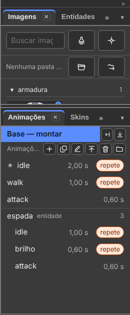

# 2. Bases and animations

Also in Portuguese: [Português](../02-corpos-e-animacoes.md)

Updated on 07/10/2026, on v36.5. What used to be called "corpo" (body) in the
program is now called **base** (decision of 04/10: *"body" becomes base*).

> **About the labels.** The interface exists only in Portuguese. The first time
> a label appears in this chapter, it is written as on screen, in quotes,
> followed by the translation. After that, the translation alone.

## What you will be able to do by the end

1. Build the character on the **base** and see the change apply to every animation.
2. Have **several bases**, and make a new base from an animation frame.
3. Make the man **turn into a werewolf** in the middle of the animation.

---

## This is the most important chapter of the manual

Whoever understands this chapter understands the rest of the program.

The test is one sentence from Humberto: *"I want to be able to create and
generate a mesh in the middle of the animation"*. The
[werewolf](#the-turn-a-hard-cut), further down, is the proof that we
understood.

---

## The base is an animation with a single frame

His words:

> *"the build mode will probably cease to exist (...) each base is a pose —
> man, werewolf. I imagine that on the base the timeline bar will be showing,
> but it will only have keyframe 0."*

**The base is not a mode, not a screen.** It is a line in the Animation window.
Opening the base shows the usual stage and timeline, with a single frame.

| Question | How it is today |
|:---|:---|
| Where the base lives | in the **"Animações" (Animations)** window, on the **"Base — montar" (Base — build)** line |
| How I open the base | click **Base — build**, or **"Base → Abrir a base" (Base → Open the base)** |
| How I know I am on the base | the **Base — build** line is lit; the status bar says where you are |
| Changing the base | applies to **all** animations, except where an animation has its own key |
| How many build poses | **one per base**. Man is one, werewolf is another |
| The player | **never disappears**. On the base: clock at `0,00 s`, one diamond, grey buttons with the tooltip *"a base tem um quadro só"* ("the base has a single frame") |
| Keying on the base (`K`) | records no key: the status bar says *"Com a base aberta, a pose de repouso já é esta"* ("With the base open, the rest pose is already this one") |

---

## The Animations window: each base has its own animations

> *"in the animations tab the fire base will appear with its animations in a
> list, like the mecha's. **A menu similar to Spriter's entity menu.**"*

**"Janela → Animações" (Window → Animations).** From top to bottom:



```
Animações (Animations)
├── Bases            Base — montar · homem   2
│                    Base — montar · lobisomem   1
├── Animações        those of the base in focus
├── the entities     each with its own animations, indented
└── De fora          referenced animation files (only appears if there are any)
```

*(`homem` = man, `lobisomem` = werewolf, "De fora" = From outside.)*

| With… | The window shows |
|:---|:---|
| **a single base** | one line, **Base — build**, with the two buttons beside it |
| **more than one** | the **"Bases"** strip, one line per base: *Base — montar · name* and the animation count |

| Gesture | What it does |
|:---|:---|
| Click a base | it becomes the base in focus, and its base opens |
| Click an animation | opens that base's animation on the timeline |
| Double-click an animation | renames it right there. `Enter` saves, `Esc` gives up |
| Right-click an animation | "Renomear" (Rename) · "Duplicar" (Duplicate) · "Mandar para o topo" (Move to top) · "Exportar animação…" (Export animation…) · "Apagar" (Delete) |
| The star ★ | marks the first in the list: it is the one the game opens |
| The word *"repete" (loops)* | the animation goes back to the start. Turned on in the player (`L`) |

**The icons of the Animations strip** (the name is in the tooltip):

| Icon | Does | Also in |
|:---|:---|:---|
| + | "Nova animação" (New animation) | "Animação → Nova animação" (Animation → New animation) |
| copy | Duplicate | "Animação → Animações → Duplicar animação" (Animation → Animations → Duplicate animation) |
| pencil | Rename | "Animação → Animações → Renomear animação" (Animation → Animations → Rename animation) |
| top | Move to top | "Animação → Animações → Mandar para o topo" (Animation → Animations → Move to top) |
| bin | Delete | "Animação → Animações → Apagar animação" (Animation → Animations → Delete animation) |
| folder | "Biblioteca de animações" (Animation library) | "Animação → Animações → Biblioteca de animações…" (Animation → Animations → Animation library…) |

**The base's two buttons** (on the Bases strip, or next to *Base — build*):

| Button | Does | Also in |
|:---|:---|:---|
| "Salvar como base nova" (Save as new base) | the current frame becomes a new base, with the name you give it. The animation does not change | "Base → Salvar como base nova…" (Base → Save as new base…) |
| "Rebaixar a entidade" (Demote to entity) | the chosen base leaves the Bases list and goes to the Entities panel. The base in focus cannot be demoted | "Entidades → Rebaixar a entidade" (Entities → Demote to entity) |

**None of this blocks editing.** New bone, new mesh, new image: everything works
in the middle of an animation. What cannot be animated goes to the base, and the
status bar says: *"(foi para a base)"* ("went to the base").

| Function | Seal | Gesture |
|:---|:---:|:---|
| The Bases list, and the Animations switching with it | exists | Window → Animations; click the base |
| Open the base | exists | click **Base — build** · Base → Open the base |
| Make a new base from an animation frame | exists | Base → Save as new base… · button on the Bases strip |
| Bring another base from outside into the project | exists | "Base → Trazer uma base de fora…" (Base → Bring in an outside base…) |
| The player never disappears | exists | with the base open, it stays at `0,00 s`, grey, with the tooltip |
| Clone a base **with** its animations (decision 2 of the Base mode) | missing | I found no door in the menu or in the window. Other path not confirmed |

---

## A piece removed from the base: the keys are kept

Decision 5 of the Base mode: *"like two saves: one does not erase the other"*.

| Step | What happens |
|:---:|:---|
| 1 | Delete from the base a bone that has keys in the animations (`Delete`) |
| 2 | The status bar says how many keys it stored: *"20 chaves de 2 peças guardadas em 3 animações"* ("20 keys of 2 pieces stored in 3 animations") |
| 3 | The animations play without errors. The saved file opens without warnings |
| 4 | Create a piece again **with the same name and the same type**: the keys come back |
| 5 | Another type with the same name: they don't come back, and the status bar warns |

**"Base → Chaves guardadas…" (Base → Stored keys…)** shows how many, and whose.
There you have **"Jogar fora todas" (Throw all away)** and **"Guardar" (Keep)**.
`Ctrl+Z` brings them back.

| Function | Seal | Gesture |
|:---|:---:|:---|
| Keep the keys of the removed piece | exists | `Delete` on the base |
| See and throw away the stored keys | exists | Base → Stored keys… |

---

## Why it is not Spriter's entity

Him: *"Spriter started this idea, but it was not efficient at doing it. That is
why ours cannot be based 100% on theirs."*

The list looks like Spriter's. The difference is in the **key**.

| | Spriter (entity) | Recorte (base) |
|:---|:---|:---|
| The list | each entity with its animations | the same — each base with its own |
| Does an animation leave its base? | **never** | **yes**, by pasting another base in the middle |
| Transforming midway | duplicate the animation in another entity | the same animation, with a key, swaps base and carries on |

### The ruler

> **What is law is Spriter's FLUIDITY — not its implementation where it
> failed.**

Where Spriter is fast, we copy the gesture ([chapters 1](01-build-a-body.md)
and [4](04-animate.md)). Where it got stuck, Recorte does it differently.

---

## The turn: a hard cut

Him: *"on the previous keyframe he was human, on the next one he is a
werewolf."*

| Step | What to do |
|:---:|:---|
| 1 | The project needs **two bases** or more (Base → Save as new base…, or Base → Bring in an outside base…) |
| 2 | Open the animation and put the playhead on the frame of the turn |
| 3 | **"Animação → Troca de base → Colar outra base aqui" (Animation → Base swap → Paste another base here)** |
| 4 | With several bases, the window asks which one. It also offers **"A base do arquivo" (The file's base)**: that is the way back |
| 5 | The timeline opens the Details and shows the new key |

To undo: playhead on the key, **"Animação → Troca de base → Tirar a troca daqui"
(Animation → Base swap → Remove the swap here)**. Or `Ctrl+Z`.

With a single base, the item warns: *"Este projeto tem uma base só: não há
outra base para colar"* ("This project has a single base: there is no other
base to paste"). On the base, it warns: *"Abra uma animação primeiro"* ("Open an
animation first").

| Question | Answer |
|:---|:---|
| Does the turn have a transition? | **no: a hard cut** (a `stepped` key, like the parent-change one) |
| Do the keys before it change? | **no.** What the animation said stays said. What it did not say comes from the new base |
| Does the werewolf's tail exist before the turn? | **no: it is born at the turn.** Each base is built once; the turn swaps which one is alive (spec §9.13) |
| Do the worn skins carry over to the new base? | the animator decides. Playhead on the turn key → **"Propriedades" (Properties)**: the **"A pilha de skins passa" (The skin stack carries over)** box |
| What does a reader that doesn't know the turn see? | the file's base the whole time. Nothing breaks (spec §9.13, level C) |

---

## The complete werewolf case, in his words

> *"I created a 'transform' animation: it starts with the mecha base; halfway
> through he crouches; I paste the werewolf base, I put him crouching too; and
> the other half of the animation is the werewolf getting up (...) I could have
> put a 3 ms explosion entity on the timeline, between the mecha and the
> werewolf, above them in the draw order."*

| Part of the `transformar` (transform) animation | What is there | Gesture |
|:---|:---|:---|
| first half | the **mecha** base, crouching — animated by hand | the usual keys |
| the frame of the turn | the **werewolf** base, also crouching | Animation → Base swap → Paste another base here |
| second half | the werewolf getting up — animated by hand | the usual keys |
| on top of everything | the **explosion**: an entity, only directed | see [chapter 5](05-entities.md) |

**From then on everything talks about the werewolf**: the stage, the
**"Árvore" (Tree)**, the **"Ordem" (Order)** and Properties read the base that
is valid at that instant. A new bone created after the turn goes to the
werewolf's base, and the status bar says: *"(foi para a base de lobisomem)"*
("went to the werewolf base").

| Function | Seal | Gesture |
|:---|:---:|:---|
| Paste another base in the middle of the animation | exists | Animation → Base swap → Paste another base here |
| Remove the turn | exists | Animation → Base swap → Remove the swap here · `Ctrl+Z` |
| Stage, Tree, Order and Properties following the base of the instant | exists | move the playhead past the turn |
| The skin stack carries over, or not | exists | Properties, with the playhead on the turn key |
| An entity in the same slot follows to the new base; a missing slot warns | exists | it is a format rule (spec §9.13). **Not confirmed** the warning on the editor's screen |
| The explosion above both bases, in the draw order | exists differently | the entity goes into a slot and takes its place in the order. See [chapter 5](05-entities.md) |

---

## What already was this, and we didn't know to call it that

| Today | Seal | In the model |
|:---|:---:|:---|
| The `.bone`'s **rest pose** | exists | it is the base |
| *"what the animation does not say comes from the rest pose"* | exists | it is the rule: changing the base changes every animation, except where there is an own key |
| The **`parent`** key — the weapon that goes to the back | exists | swaps a piece of the rig in the middle of the animation. [Chapter 1](01-build-a-body.md) |
| The **skins** | exists | swap images and can bring bones. The base swaps everything. [Chapter 3](03-skins.md) |

---

## The project is the box

> *"Mecha is not a body, it is a project. (Box)"*

```
Project: "mecha"
├── Bases        mecha · lobisomem
├── Entities     fogo · espada · motosserra
└── Animations   those of each base
```

*(`lobisomem` = werewolf, `fogo` = fire, `espada` = sword, `motosserra` =
chainsaw.)*

**There is no "main base".** What names the whole is the project.

| | How it is today | Gesture |
|:---|:---|:---|
| **Starting** | the program **asks for the folder** first, like Spriter | "Arquivo → Novo projeto…" (File → New project…) (`Ctrl+N`) |
| **Saving** | writes the whole folder: one `.bone` per base and per entity, and the `manifest.json` | "Arquivo → Salvar" (File → Save) (`Ctrl+S`) |
| **A single file** | one `.bonez` with everything inside | "Arquivo → Exportar → Salvar como pacote…" (File → Export → Save as package…) |
| **Delivering to the game** | only the base the game needs, with its images | "Arquivo → Exportar → Entregar uma base…" (File → Export → Deliver a base…) |
| **Format** | zero new fields for the box: it is the `.bonez`'s `manifest.json` (§2.9) | — |

---

## What does not work yet

| What | How to get around it today |
|:---|:---|
| Clone a base **with** its animations | **"Base → Salvar como base nova…" (Save as new base…)** makes the base; bring the animations one by one through **"Arquivo → Importar → Animações, de outra base…" (File → Import → Animations, from another base…)** |

---

## The seal — what this chapter confirms

| Function | Seal | Gesture or where |
|:---|:---:|:---|
| The base as a line in the Animations window | exists | Window → Animations · **Base — build** |
| Open the base | exists | click the base · Base → Open the base |
| Several bases, each with its own animations | exists | **Bases** strip, in the Animations window |
| New base from a frame | exists | Base → Save as new base… |
| Bring in an outside base | exists | Base → Bring in an outside base… |
| Demote a base to an entity | exists | Entities → Demote to entity · button on the Bases strip |
| Clone a base with its animations | missing | I found no door |
| The player never disappears | exists | timeline, with the base open |
| Stored keys of the removed piece | exists | Base → Stored keys… |
| The turn (pasting another base in the middle) | exists | Animation → Base swap → Paste another base here |
| Remove the turn | exists | Animation → Base swap → Remove the swap here |
| The skin stack carries over at the turn, or not | exists | Properties, **The skin stack carries over** box |
| Everything following the base of the instant | exists | stage, Tree, Order, Properties |
| `parent` key | exists | [chapter 1](01-build-a-body.md) |
| Skins | exists | [chapter 3](03-skins.md) |
| The project as a box, which asks for the folder | exists | File → New project… |
| Save the whole folder (bases, entities, manifest) | exists | File → Save |
| Deliver only one base to the game | exists | File → Export → Deliver a base… |

---

Next: [3. Skins](03-skins.md)
