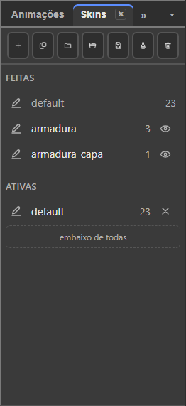

# 3. Skins

Also in Portuguese: [Português](../03-peles.md)

Updated on 07/10/2026, on v36.5. The "pele" (skin) is now called **skin**, in
the menu and in the tab (decision of 04/10).

> **About the labels.** The interface exists only in Portuguese. The first time
> a label appears in this chapter, it is written as on screen, in quotes,
> followed by the translation. After that, the translation alone. "Skins" is the
> same word in both languages.

## What you will be able to do by the end

1. Dress the same base in another outfit, without redoing the rig or the animations.
2. Stack two skins at the same time — armour **and** cape.
3. Hide or ignore an image in a skin, and delete a bone in that skin only.
4. Change the outfit inside the game, with one line of code.

---

## What a skin is

A **skin** is a saved alternative version of the character. It is Spriter's
*Character Map*, with one thing more: **bones**.

The bones are the same. The animations are the same. **Only the drawing
changes** — and, if you want, one bone more or one fewer.

The tab's sentence: *"Skin é uma roupa: o desenho troca"* ("A skin is an
outfit: the drawing changes").

It is used for:

- clothes and armour;
- the same character with a different head;
- teams with different colours;
- the common enemy and the boss, with the same movement;
- the eagle: deletes the arms, creates the wings. The base does not change.

**A skin is not a slot.** A skin dresses the character. A slot fits another
piece into it ([chapter 5](05-entities.md)).

---

## The Skins tab

**"Janela → Skins" (Window → Skins).** Right column, together with
**"Animações" (Animations)** and **"Regras" (Rules)**.



From top to bottom:

| Part | What it is |
|:---|:---|
| **The bar** | seven icons (the name is in the tooltip) |
| **"Feitas" (Made)** | all the skins of this base |
| **"Ativas" (Active)** | the stack: what is worn now. **The top one wins** |
| **"Nesta skin: nome" (In this skin: name)** | what the pencil's skin swaps, hides and deletes. It only appears with the pencil on a skin that is not `default` |

**The bar:**

| Icon | Does | Also in |
|:---|:---|:---|
| + | "Nova skin" (New skin). Asks for the name right away | "Skins → Nova skin" (Skins → New skin) |
| copy | "Clonar skin" (Clone skin): a copy of the pencil's skin, **with the same bones** | "Skins → Clonar skin" (Skins → Clone skin) |
| folder | "Fazer a skin de uma pasta…" (Make the skin from a folder…) | "Skins → Fazer a skin de uma pasta…" (Skins → Make the skin from a folder…) |
| open | "Importar skin…" (Import skin…) (from a skin `.bone`) | "Arquivo → Importar → Skin, de outro boneco…" (File → Import → Skin, from another puppet…) |
| save | "Exportar skin…" (Export skin…) (the pencil's skin in a `.bone` of its own) | "Arquivo → Exportar → Skin, para outro boneco…" (File → Export → Skin, for another puppet…) |
| stamp | "Promover skin a base…" (Promote skin to base…) | "Skins → Promover skin a base…" (Skins → Promote skin to base…) |
| bin | "Apagar skin" (Delete skin). Asks first. `Ctrl+Z` brings it back | "Skins → Apagar skin" (Skins → Delete skin) |

**A skin line:**

| What | Gesture | What it does |
|:---|:---|:---|
| **pencil** | click | this is where what you create is born: images, **bones and rules**. Turns the skin on too |
| **name** | double-click | renames. The new name goes into the timeline rows that mention the skin |
| **number** | — | how many slots the skin dresses |
| **eye** (only in Made, skin turned off) | click | turns on: the skin goes to the **top** of the stack |
| **×** (only in Active) | click | turns off: the skin leaves the stack |

**The pencil and the stack are different things:**

| | Question it answers |
|:---|:---|
| **Active** | *what am I seeing now?* |
| **pencil** | *where will what I create now end up?* |

You edit **one skin at a time**. You see **several** stacked.

---

## The stack: Made and Active

| Gesture | What it does |
|:---|:---|
| Drag from Made to Active | turns the skin on |
| Drop on the empty space of the Active column | turns on, at the top |
| Drop on **"embaixo de todas" (below all)** | turns on, at the bottom: it loses to all of them |
| Drag inside Active | changes the order |
| Drag from Active to Made | turns off |

**The top one wins** where two dress the same place.

`heroi.bone` shows how this is used:

| Skin | What it brings | Slots |
|:---|:---|:---:|
| `default` | the whole body | 23 |
| `armadura` (armour) | chest, shoulder and helmet | 3 |
| `armadura_capa` (armour cape) | only the cape. Goes with the armour | 1 |

`default` + `armadura` = the armoured hero. Add `armadura_capa` and he gets the
cape. **Three skins, four looks**, without one extra animation.

The right design: **one skin per piece of clothing**, not one skin per
combination.

---

## The `default` skin

`default` is the base. It **cannot be deleted**: the program says *"A skin
"default" não se apaga: ela é a base. Para escondê-la, tire-a de Ativas"* ("The
"default" skin cannot be deleted: it is the base. To hide it, remove it from
Active").

**Changed since 15/09: `default` can leave the stack.** Removing it removes its
art from the stage — it is the werewolf that swaps almost everything. With no
skin turned on, the Active column says: *"Nenhuma skin ligada: a base está sem
arte"* ("No skin turned on: the base has no art").

---

## Creating a skin, in practice

You are going to put a helmet on the hero.

| Step | What to do |
|:---:|:---|
| 1 | **Skins** tab → **+** (New skin). Name it `capacete` (helmet) and confirm |
| 2 | It is already born with the **pencil** on it, and turned on |
| 3 | **"Imagens" (Images)** tab: drag the helmet drawing onto the stage, on top of the head |
| 4 | Adjust the position with **"Mover" (Move)** (`W`), with **the drawing** selected — not the bone |
| 5 | Check: remove `capacete` from Active (×) and put it back (eye, in Made) |

Play any animation: the helmet follows the head, because the bone is in
charge.

### Swapping, hiding or ignoring an image in the skin

With the **pencil** on a skin that is not `default`, select a drawing.

| For the skin to… | Gesture |
|:---|:---|
| **swap** the image | right-click the drawing, on the stage → click the new image, in the grid |
| **hide** it (it is not drawn) | right-click → **"Esconder nesta skin" (Hide in this skin)** · "Skins → Esconder esta imagem" (Skins → Hide this image) |
| **ignore** it (the skin doesn't touch it; the base's comes back) | right-click → **"Ignorar nesta skin" (Ignore in this skin)** · "Skins → Ignorar esta imagem" (Skins → Ignore this image) |

The tab's **In this skin** section lists each change, with the **"Esconder"
(Hide)** and **"Ignorar" (Ignore)** buttons on the line. Clicking the name
selects the drawing.

### Making the skin from a folder

**Skins → Make the skin from a folder…** (or the folder icon). Pick the
subfolder. Each drawing looks in it for an image **with the same file name**.
The status bar says what it did not find.

### Clone

**Clone skin** copies the pencil's skin, with the **same** bones. It is how you
make a team's second colour: clone, and swap only the images.

### Swapping the image in all skins

You redrew the hand, and it appears in four skins.

| Step | What to do |
|:---:|:---|
| 1 | Select the drawing. **"Skins → Trocar imagem nas skins…" (Skins → Swap image in skins…)** Or, in the **"Árvore" (Tree)**, right-click the drawing → **"Trocar a imagem em todas as skins…" (Swap the image in all skins…)** |
| 2 | The **Images** panel opens with the search focused and a strip saying what will be swapped |
| 3 | Click the new image. `Esc`, or the strip's **✕**, cancels |

In the right-click grid, on the stage, there is also the **"Em todas as skins"
(In all skins)** switch: on, the clicked image is swapped in every skin that
uses the same one; off, only in the pencil's skin.

It swaps only where the skin uses **the same image in that slot**. One undo
step.

### Delete

**Delete skin** acts on the pencil's skin. It takes its timeline rows along.
That is why it asks first. `Ctrl+Z` brings it back.

---

## A bone that only exists in one skin

A tail only the cat has. An antenna only the robot has.

**Way 1 — create with the pencil.** Pencil on the cat's skin. Create the tail
bone. It is born in that skin only.

**Way 2 — mark it afterwards.** Select the bone. In **"Propriedades"
(Properties)**, **Skins** group, check **"Só com a skin" (Only with the skin)**.
Below it appears **"Skins que ativam" (Skins that activate)**: one box per skin.

| Step | What to do |
|:---:|:---|
| 1 | **Skins** tab: click the cat skin's **pencil** |
| 2 | Select the tail bone. In Properties, check **Only with the skin** |
| 3 | The bone went into the pencil's skin, and **Skins that activate** shows its box checked |

With no pencil on a skin, the status bar says *"Marque em que skin, em
Propriedades"* ("Mark which skin, in Properties"). `default` does not appear in
the list: it is always on the base.

The same box exists on **rules**: the tail's physics only runs with the tail
worn.

When the skin leaves the stack, its bone **disappears** from the stage and from
the Tree.

### Deleting a bone in one skin only

The eagle has no arm. Pencil on the `aguia` (eagle) skin, select the arm,
`Delete`.

| What happens | |
|:---|:---|
| The bone leaves **only that skin** | on the base and in the other skins it stays |
| Its children and drawings leave with it | the status bar says how many: *"… da skin "aguia" 2 ossos (…) e 3 imagens. Na base e nas outras skins continuam"* ("… from the "aguia" skin 2 bones (…) and 3 images. On the base and in the other skins they remain") |
| The **In this skin** section shows the deleted bone | with the **"Devolver o osso" (Give the bone back)** button |
| `Ctrl+Z` | undoes, one step |

---

## Skin, drawing swap and sequence: which to use

| Way | How it is | When to use it |
|:---|:---|:---|
| **Skin** | a set of attachments, turned on from outside | the player got armour; a team in another colour |
| **Drawing swap** | two attachments in the same slot, and a key choosing | the hand closes in the middle of the blow |
| **Sequence** | a single attachment, with a list of frames | a flickering flame |

In `heroi.bone` all three are there: the three skins; the `hand` slot, with
`hand` and `hand_fist`; and the `hand` attachment, a three-frame sequence.

- **changes with the game** → skin;
- **changes with the animation** → drawing swap;
- **changes by itself, always the same** → sequence.

---

## Testing without touching the file

**"Janela → Prévia → Tela cheia" (Window → Preview → Full screen)** (`F11`;
`Esc` goes back). Beside it, the **Skins** list: click to put on and take off.
The sentence says: *"Aqui é teste: pôr e tirar skin não mexe no arquivo"*
("This is a test: putting on and taking off skins does not touch the file").

An entity's skin, in test: on its card, in the **"Entidades" (Entities)** tab,
**"skins ▾"** ([chapter 5](05-entities.md)).

---

## Making the skin a base

**Skins → Promote skin to base…** The active stack becomes the base of a new
base. It goes into the **"Bases"** list, with its own animations
([chapter 2](02-bases-and-animations.md)).

---

## Taking the skin to another puppet

| To | Gesture |
|:---|:---|
| write the pencil's skin to a `.bone` of its own, with the bones it brings | File → Export → Skin, for another puppet… · the tab's save icon |
| bring a skin from a `.bone` | File → Import → Skin, from another puppet… · the tab's open icon |

The imported skin goes into Made **and already worn**, at the top of Active.

---

## Changing the skin in the game

One line:

```js
skeleton.setSkin('armadura');
```

Several, in the order they stack:

```js
skeleton.setSkin(['default', 'armadura', 'armadura_capa']);
```

`setSkin` always puts `default` underneath. For the pure stack, without
`default` (the werewolf), use `skeleton.setSkinStack([...])`.

**What you see in the editor is what the game shows.**

---

## Delivering a single skin

A game that only uses the armour does not need to load the rest.

From the editor: **"Arquivo → Exportar → Uma imagem por skin…" (File → Export →
One image per skin…)** The window slices the file. With the **"Pacote .bonez
com o atlas (um arquivo só)" (.bonez package with the atlas (a single file))**
box checked, a single file comes out: the sliced `.bone` and the atlas with only
the regions it uses.

> **Warning:** the item's name and its tooltip talk about an **image** ("A
> mesma exportação de imagem, uma vez para cada skin" — "The same image export,
> once for each skin"). But what the window does is **slice the `.bone`** — the
> warning at the end is called *"Arquivo fatiado"* ("File sliced"). The name is
> wrong in the program.

From the command line:

```
npm run fatiar heroi.bone saida -- --peles armadura
npm run fatiar heroi.bonez saida -- --peles armadura
```

With a `.bonez` as input, the output is also `.bonez`. `default` always goes
in. One file per skin at once: `--um-arquivo-por-pele`.

A bone is only removed when nobody that stayed reads it.
[Chapter 8](08-export-and-use-in-a-game.md) covers this in full.

---

## The seal — what this chapter confirms

| Function | Seal | Gesture |
|:---|:---:|:---|
| The Skins tab, with Made and Active | exists | Window → Skins |
| New skin, asking for the name | exists | + icon · Skins → New skin |
| Clone, with the same bones | exists | copy icon · Skins → Clone skin |
| Make the skin from a folder | exists | folder icon · Skins → Make the skin from a folder… |
| Delete skin | exists | bin icon · Skins → Delete skin |
| The pencil (where what you create is born) | exists | the line's pencil · "Skins → Editar esta skin…" (Skins → Edit this skin…) |
| Turn on, turn off, reorder the stack | exists | drag between Made and Active · eye · × |
| Remove `default` from the stack | exists | drag to Made, or × |
| Hide and ignore an image in the skin | exists | right-click on the stage · Skins → Hide / Ignore this image |
| The In this skin section | exists | Skins tab, with the pencil on a skin |
| Swap the image in all skins | exists | Skins → Swap image in skins… · Tree, right-click |
| Bone and rule only with the skin | exists | Properties → Skins → Only with the skin |
| Delete a bone in one skin only | exists | pencil on the skin · `Delete` |
| Test skins without touching the file | exists | Preview → Full screen → Skins |
| Promote skin to base | exists | stamp icon · Skins → Promote skin to base… |
| Export and import skin | exists | File → Export / Import → Skin… · the tab's icons |
| Change the skin in the game | exists | `setSkin` · `setSkinStack` |
| Deliver a single skin, sliced | exists differently | File → Export → One image per skin… — the name says image, the window slices |
| Slice from the command line | exists | `npm run fatiar` |

---

Next: [4. Animate](04-animate.md)
