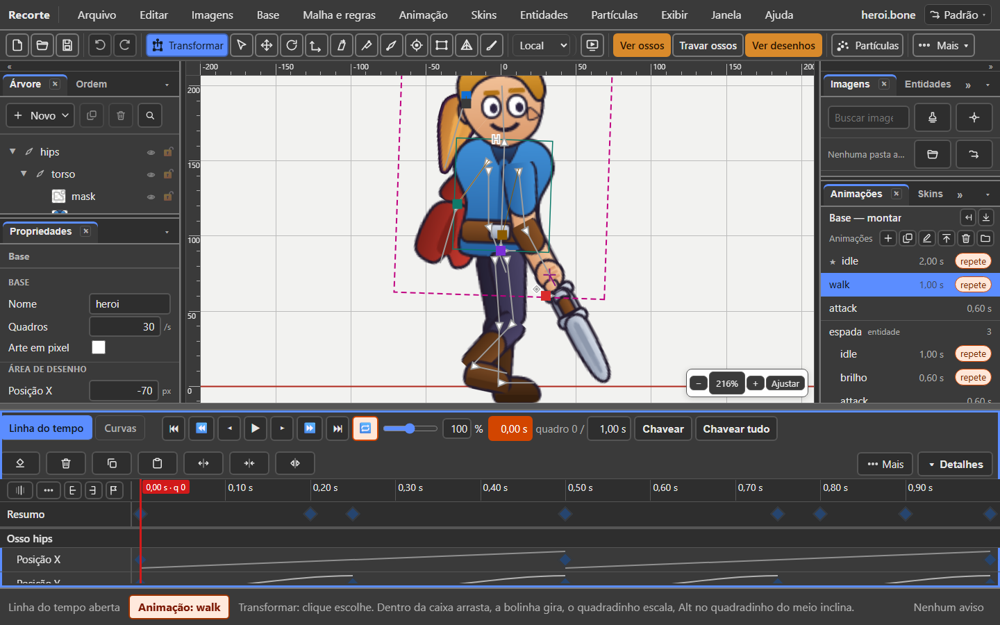
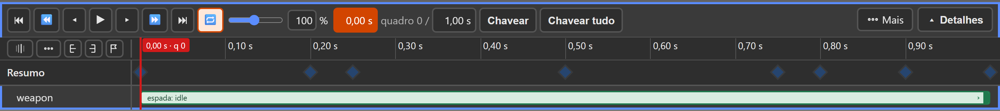
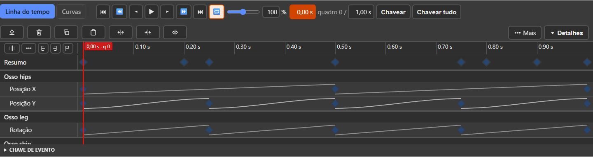
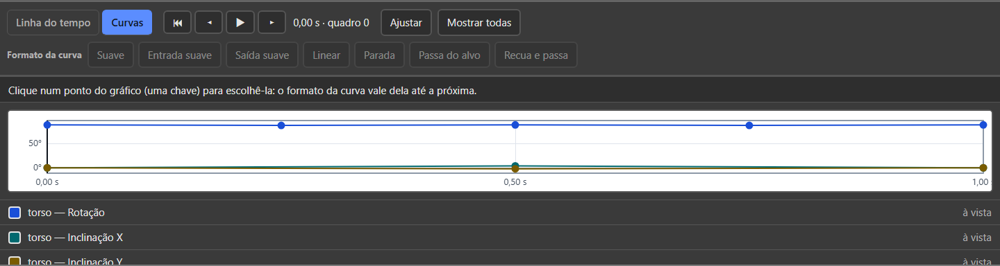
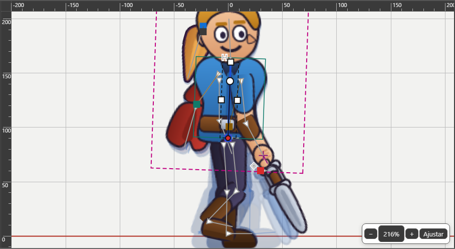

# 4. Animate

Also in Portuguese: [Português](../04-animar.md)

> **About the labels.** The interface exists only in Portuguese. The first time
> a label appears in this chapter, it is written as on screen, in quotes,
> followed by the translation. After that, the translation alone.

## What you will be able to do by the end

1. Make two poses and watch the program draw the twenty-eight in between.
2. Close a walk cycle that goes back to the start without a jolt.
3. Find the pose you want among sixty timeline rows.
4. Copy the front leg to the back leg, half a cycle later.

---

## Start with this rule

It is the one that confuses beginners most. Read it before anything else.

> **With an animation open, changing something records a key. Always.**
> The base does not change.

There is no mode switch any more. There is **what is open**: the base, or an
animation. The status bar says which.

| The status bar says | What is open | Moving a bone |
|:---|:---|:---|
| **"Base: heroi" (Base: heroi)** | the base | changes the **base**. Applies to every animation |
| **"Animação: walk" (Animation: walk)** | the `walk` animation | records a **key**, at the playhead's time |



| I want to | Do this |
|:---|:---|
| open an animation | **"Animações" (Animations)** panel, click its name |
| go back to the base | **Animations** panel, click the **"Base — montar" (Base — build)** line |
| go back to the base, from the menu | **"Base → Abrir a base" (Base → Open the base)** |

Rotated a bone thinking it was the base, but you were in an animation?
`Ctrl+Z`, open the base, redo it.

### The base

The base is the character standing still, as you built it. It is a one-frame
animation. **Every animation is born from it, and stores only the difference.**

That is why changing the base changes every animation at once. It is powerful
and it is dangerous. Do it before animating, not after.

With the base open, the player stays visible, but grey: the clock says
`0,00 s`, and each button's tooltip says why.

---

## Creating an animation

**Animations** panel. At the top, the base line; below, the **Animations**
list, with six icon buttons on the title strip:

| Button | Tooltip | What it does |
|:---|:---|:---|
| **＋** | *"Nova animação" (New animation)* | creates and opens. It is born as `animação`, with 1 s, and the name already open for you to type |
| **⧉** | *"Duplicar" (Duplicate)* | copies the selected one, with its keys |
| **✎** | *"Renomear" (Rename)* | changes the name. Double-clicking the name does the same |
| **⤒** | *"Mandar para o topo" (Move to top)* | takes the open one to first place |
| **🗑** | *"Apagar" (Delete)* | deletes the animation |
| folder | *"Biblioteca de animações" (Animation library)* | brings ready-made idle, walk, run and jump. The window says what your base lacks before bringing them |

The same are in the menu: **"Animação → Nova animação" (Animation → New
animation)**, and the rest in **"Animação → Animações ▸" (Animation →
Animations ▸)**.

Each line of the list shows the name, the duration and the word **"repete"
(loops)** when the animation loops. Right-clicking a line opens the menu of
what the icons do.

### More than one base

With a single body, the top line says **Base — build**. With more than one, the
**"Bases"** list appears, one line per body, with the number of animations.
Clicking a base opens its base, and the **Animations** list switches to its
own. See [chapter 2](02-bases-and-animations.md).

### The default animation

**The first one in the list is the one the game opens.** It has a small star
**★** in front of the name, and the tooltip says **"padrão" (default)**.

Want another? Open the animation and click **Move to top**. It is also in
**"Animação → Animações → Mandar para o topo" (Animation → Animations → Move to
top)**. `Ctrl+Z` brings it back.

There is no field in the file for this: the list's order is what counts.

### Switching animation while playing

**While playing, switching animation does not stop the player.** Click another
with `▶` lit. By default, the current one **finishes**, and the clicked one
comes in afterwards, from the start. Its line gets the **⏭** sign, and the
tooltip says "próxima" (next). Stopped, it switches at once.

You choose this in **"Arquivo → Configurações do projeto…" (File → Project
settings…)**:

| Field | What it does |
|:---|:---|
| **"Ao trocar de animação tocando" (When switching animation while playing)** | `"Terminar a atual antes"` (Finish the current one first) (default) or `"Trocar na hora"` (Switch at once). It belongs to the player, not to the character |
| **"Tempo de mistura, em segundos" (Mix time, in seconds)** | the switch **mixes** one animation into the other. `0` = hard switch. It goes into the file (`defaultMix`): the game reads the same number |

Names most games use: `idle`, `walk`, `run`, `jump`, `attack`, `hurt`, `die`.

---

## Keys

A **key** is the value of a property at an instant.

Between two keys Recorte calculates the in-between by itself. That is
*interpolating*: **you make two poses, the program makes the twenty-eight in
between.**

### The ways to create one

| Way | How |
|:---|:---|
| change something | drag, rotate, scale, or type a number in the quick sheet. The key is born at the playhead's time |
| by hand, only what is selected | the **"Chavear" (Key)** button (`K`) |
| by hand, every row | the **"Chavear tudo" (Key all)** button (`Ctrl+K`) |

Both Key buttons record the current pose **without changing anything**: they
are for protecting a pose. They are Spriter's *Key selected* and *Key all*.

**The start keeps itself.** The first key of a property at a time after zero
also records a key at `0,00 s`, with the base's value. That way the animation
moves, instead of starting already in the new pose.

The starting tool, **"Transformar" (Transform)** (`T`), does the gestures in a
single box: dragging inside moves, the dot rotates, a small square scales. See
[chapter 1](01-build-a-body.md).

**Moving an image** in an animation also records a key. Internally it gets a
bone of its own, hidden.

### Back to the base pose

`Ctrl+1` returns the selected bone to the base pose; `Ctrl+Shift+1` returns
all of them. Also in **"Base → Voltar à pose de repouso" (Base → Back to rest
pose)**.

With an animation open, this **records a key** with the base's value. It is not
deleting the key: deleting would leave the bone following the previous key.

### The inbetween

**"Editar → Pose → Meio-termo" (Edit → Pose → Inbetween)**: at the playhead, a
key is born halfway between the one before and the one after, on the selected
bones (none = the whole pose).

| Item | Where the new key sits |
|:---|:---|
| **Inbetween** | halfway |
| **"Meio-termo → anterior" (Inbetween → previous)** | at one third, near the key before |
| **"Meio-termo → seguinte" (Inbetween → next)** | at two thirds, near the key after |

### What can become a key

| Group | Examples |
|:---|:---|
| Bone | position, rotation, scale, shear, inheritance, **the parent** |
| Drawing | colour, dark colour, which image shows, visible, the drawing's bone, the sequence |
| Order | draw order, mesh shape, mesh weights |
| Rules | each rule's strength, the physics numbers |
| Particles | **"Emitindo" (Emitting)**: turns the emitter on and off |
| Base and entity | the base swap, the entity's animation |
| Others | event, parameter, variable, tag |

**Changing the parent becomes a key**: the weapon leaves the hand and goes to
the back in the middle of the animation. The **"Árvore" (Tree)** shows that
frame's parent. See [chapter 1](01-build-a-body.md).

---

## The timeline, closed

The bottom band **is born closed**, and closed it has three rows.



| Row | What it has |
|:---|:---|
| 1 | the player, and at the right end **"⋯ Mais" (⋯ More)** and **"Detalhes" (Details)** |
| 2 | the corner buttons, the ruler in seconds, and the playhead |
| 3 | the **"Resumo" (Summary)**: a diamond at every time that has a key |

With an entity in the animation, it gets a fourth row: the entity's strip.

**It never opens by itself.** There are three doors: the **Details** button, the
**handle** on the top edge, and **"Janela → Arrumar → Detalhes da linha do
tempo" (Window → Arrange → Timeline details)**.

### The player, from left to right

| Button | Tooltip | Key |
|:---:|:---|:---:|
| `⏮` | *"Início: vai para o começo" (Start: goes to the beginning)* | `Home` |
| `⏪` | *"Chave anterior" (Previous key)* | `↑` |
| `◂` | *"Quadro anterior: volta um quadro" (Previous frame: goes back one frame)* | `←` |
| `▶` | *"Tocar: toca e pausa" (Play: plays and pauses)* | `Space` |
| `▸` | *"Quadro seguinte: avança um quadro" (Next frame: goes forward one frame)* | `→` |
| `⏩` | *"Próxima chave" (Next key)* | `↓` |
| `⏭` | *"Fim" (End)* | `End` |
| `🔁` | *"Repetir: volta ao começo quando chega ao fim" (Loop: goes back to the start when it reaches the end). **It is saved in the file*** | `L` |
| bar | speed, from 10 % to 200 %, with the number beside it | — |
| field | **the time**, in seconds, and the frame beside it | — |
| field | **the duration** of the animation | — |
| **Key** | *"Chavear escolhidos" (Key selected)* | `K` |
| **Key all** | *"Chavear tudo" (Key all)* | `Ctrl+K` |

**`Space` plays and pauses anywhere — except on the stage.** On the stage,
holding `Space` drags the view.

**Play backwards**: `Shift+Space`, or **"Animação → Tocar para trás" (Animation
→ Play backwards)**.

### The playhead and the orange field

The playhead is the **red** line crossing the band. On the ruler, pinned to it,
is a small flag with the time and the frame:

```
0,50 s · q 15
```

*(`q` is for "quadro", frame. The program writes decimals with a comma.)*

The ruler counts in round steps: `0,00 s · 0,10 s · 0,20 s…`.

When the playhead stops **on top of a key**, the time field turns **orange**,
and the tooltip says *"Laranja: há chave neste tempo"* ("Orange: there is a key
at this time"). Changing something there records over it.

To put the playhead at an exact time: click the time field and type.

### The duration, and what to do with the keys

Typing in the duration field changes **only the number**: the keys stay where
they are.

To stretch the keys along — the same walk, slower —
**"Animação → Mudar duração…" (Animation → Change duration…)**, which asks
first:

| Answer | What happens |
|:---|:---|
| **"Esticar as chaves" (Stretch the keys)** | everything in the same order, slower. 1 s becomes 2 s |
| **"Só o número" (Only the number)** | the keys stay where they are |

When shortening without stretching, the keys that go past the end **are not
lost**: increase the duration again and they play again.

### The Summary row

A diamond at every time that has a key — on any row. It **never leaves view**.
It answers at a glance: **where are the poses?**

| Diamond | What it means |
|:---:|:---|
| dark | at that time there are only keys of one type |
| white | there is **more than one type**: a pose *and* an event |

Each one's tooltip tells: *"13 chaves em 0,25 s, de mais de um tipo"* ("13 keys
at 0.25 s, of more than one type").

| Gesture on the Summary | What it does |
|:---|:---|
| click | selects **all** keys at that time |
| `Ctrl` + click | **adds** another time |
| `Shift` + click | **removes** |
| drag | moves them all together, in a single undo step |
| right-click | the same menu as the diamond: curves and delete |

`Ctrl` adds and `Shift` removes **everywhere**: on the Summary, on the diamond
and in the box.

---

## The timeline, open

The **Details** button opens the rest.



Open, it gets the row of bulk buttons, and one row per bone and per drawing,
with groups that fold.

Dragging the top edge does the same. **Opening takes a real pull** — a bump
opens nothing. The editor **remembers** how you left it.

### The curve drawn on the sheet

Between one key and the next, the sheet draws **how** the movement passes:

| Drawing | Curve |
|:---|:---|
| straight, flat | **"Linear" (Linear)** |
| arc | **"Suave" (Smooth)**, **"Entrada suave" (Ease in)**, **"Saída suave" (Ease out)**, **"Curva à mão" (Hand-drawn curve)** |
| dotted | **"Parada" (Stepped)**: holds the value until the next one |

The dotted one is the most important: a **Stepped** key by mistake "freezes"
the walk.

### The diamond's tooltip

Hover over a diamond. The tooltip says the time, the value with its unit, and
the curve:

```
0,50 s · Rotação de leg = −110° · Suave
```

*("Rotação de leg" = Rotation of leg.)*

The last key of each row says *"a última: sem curva"* ("the last one: no
curve").

### The row of bulk buttons

| Button | Tooltip |
|:---|:---|
| **"Apagar chave" (Delete key)** | *deletes the key at the current time* |
| **"Apagar seleção" (Delete selection)** | *deletes the selected keys* |
| **"Copiar" (Copy)** | *copies the selected keys* |
| **"Colar" (Paste)** | *pastes the keys at the current time* |
| **"Esticar ×2" (Stretch ×2)** | *moves the selected keys away from the current time, doubling the interval* |
| **"Encolher ÷2" (Shrink ÷2)** | *brings the selected keys closer to the current time, by half* |
| **"Espelhar" (Mirror)** | *reverses the selected keys in time, around the current time* |

They are icons; the name appears beside them with **"Exibir → Mostrar nome das
ferramentas" (View → Show tool names)**.

### What you do with the mouse

| Gesture | What it does |
|:---|:---|
| drag the playhead | the drawing follows at once |
| click a diamond | selects that key **and takes the playhead to it**. The quick sheet shows its value |
| `Ctrl` + click | adds to the selection. The playhead does not move |
| `Shift` + click | removes from the selection |
| **right-click** a diamond | the key menu: curves and delete |
| **double-click** a diamond | deletes that key |
| drag a diamond | moves the selected ones, snapping to the frame. Next to the mouse the new time appears: *0,57 s · q 17 · +2 quadros* (+2 frames) |
| `Alt` + drag | moves **without** snapping to the frame |
| `Ctrl` + drag | **clones**: the originals stay, the copies move with the mouse |
| drag on empty space | selection box. `Ctrl` adds, `Shift` removes |
| click a row's name | marks the row |
| right-click the name of the **"Desenho" (Drawing)** row | the **"Chave de sequência" (Sequence key)**: which image of the sequence, and how long each one stays |

Every diamond's tooltip repeats the gestures: *"Arrastar move as escolhidas ·
Ctrl soma, Shift tira · Ctrl + arrastar clona · Botão direito: curva · Duplo
clique: apagar"* ("Drag moves the selected · Ctrl adds, Shift removes · Ctrl +
drag clones · Right-click: curve · Double-click: delete").

### From the keyboard (with the focus on the sheet)

| Key | Does |
|:---:|:---|
| `←` `→` | one frame back, one forward |
| `Shift+←` `Shift+→` | ten frames |
| `↑` `↓` | previous key, next key — on any row |
| `Shift+↑` `Shift+↓` | previous key, next — only on the marked rows |
| `Home` `End` | start and end |
| `Ctrl+↑` `Ctrl+↓` | previous mark, next mark |
| `M` | adds or removes a mark |
| `Ctrl+C` | copies the marked keys. **With none marked, copies the selected one's pose at the playhead** |
| `Ctrl+Shift+C` | copies the **whole pose** at that instant |
| `Ctrl+V` | pastes at the playhead |
| `Ctrl+Shift+V` | pastes on **all** keys of the row |
| `Ctrl+X` | cuts: copies and deletes |
| `Delete` or `Backspace` | deletes the selected keys. With none, deletes what is selected on the stage |
| `Shift+Delete` | deletes the selected one's **rows**, whole |
| `Ctrl+K` | Key all |
| `Ctrl+D` | with a key selected, does not duplicate: the status bar says how (copy, move the playhead, paste) |

Outside the sheet, **"Animação → Ir para ▸" (Animation → Go to ▸)** has the same
movement keys, and `Shift+↑` `Shift+↓` move through the keys **of the selected
one**.

---

## Copy and paste

All copying and pasting lives in the **"Editar" (Edit)** menu, as in Spriter.

| Item | Key | What it does |
|:---|:---:|:---|
| **Copy** | `Ctrl+C` | the marked keys; with none, the selected one's pose at the playhead |
| **Paste** | `Ctrl+V` | pastes at the playhead |
| **"Colar espelhado" (Paste mirrored)** | — | pastes swapping the side by name: the right arm becomes the left |
| **"Recortar chaves" (Cut keys)** | `Ctrl+X` | copies and deletes |
| **"Pose → Copiar a pose inteira" (Pose → Copy the whole pose)** | `Ctrl+Shift+C` | how the character **is** now, even between two keys |
| **"Pose → Copiar a pose do escolhido" (Pose → Copy the selected one's pose)** | — | the same, only the selected one and its children |
| **"Pose → Colar em todas as chaves" (Pose → Paste on all keys)** | `Ctrl+Shift+V` | the copied value on every key of the row |

**I grab the whole arm and paste.** Select the shoulder bone, on the stage or in
the Tree, without marking a key on the sheet, and press `Ctrl+C`. The pose of
the shoulder and all its children goes, **at the playhead's time**. The status
bar says: *"Pose de 0,50 s copiada: 4 valores do escolhido"* ("Pose at 0.50 s
copied: 4 values of the selected one"). Want the keys from several times? Mark
them on the sheet.

**The whole pose** can be pasted into **another animation**: that is how you
take a good pose from `walk` to `idle`.

### The paste that goes past the end

If the paste is going to go past the end of the animation, it **asks first**:

| Answer | What happens |
|:---|:---|
| **"Colar e esticar" (Paste and stretch)** | pastes everything, and the animation grows |
| **"Colar só o que cabe" (Paste only what fits)** | pastes up to the end; the rest is left out, and the status bar counts how many |
| **"Cancelar" (Cancel)** | nothing is pasted |

### Paste mirrored

It uses the same **"Pares de nome" (Name pairs)** rule as ⋯ More (`_e/_d` by
default).

**In a looping animation, it wraps around**: what would go past the end comes in
at the start, and the duration **does not change**. Without looping, the
animation grows, and the status bar says so.

The status bar tells everything: *"3 chaves: leg_b em 0,00 · 0,50 · 1,00 s. Deu
a volta no fim do laço: a duração não mudou."* ("3 keys: leg_b at 0.00 · 0.50 ·
1.00 s. Wrapped around at the end of the loop: the duration did not change.")
The curve goes along with each key.

---

## The Keys menu

**"Animação → Chaves ▸" (Animation → Keys ▸)**, for changing many keys at once:

| Item | What it needs | What it does |
|:---|:---|:---|
| **"Selecionar todas as chaves" (Select all keys)** | nothing | selects all of them |
| **"Esticar seleção…" (Stretch selection…)** | two keys or more | multiplies their time by the **"Fator" (Factor)** |
| **"Espelhar no tempo" (Mirror in time)** | marked keys | turns the order inside out |
| **"Fechar ciclo" (Close cycle)** | nothing, or marked keys | see **Loop**, below |
| **"Espelhar esquerda e direita…" (Mirror left and right…)** | the name pairs | swaps the rows between the bones with mirrored names |
| **"Empurrar as chaves…" (Push the keys…)** | marked keys | moves N frames, only the marked ones or **"estas e tudo o que vem depois" (these and everything after)** — makes room |
| **"Deslocar em laço…" (Shift in loop…)** | one key in each row | the whole row moves, and what goes past the end **comes back at the start**. The duration does not change |
| **"Limpar chaves repetidas" (Clean up repeated keys)** | nothing, or a marked row | removes the key that changes nothing. Never touches a **Stepped** one or a row that is not a number |

**Push** and **Shift** accept **frames or seconds** in the same box: `6` is six
frames; `0,2 s` is seconds. `0,2` with no unit is refused, and the window says
how to write it — without closing.

**Shift** already suggests **half a cycle**: it is what puts the back leg on the
opposite step in a finished walk.

**Push** says when the animation grows: *"A animação cresceu de 1,00 s para
1,20 s"* ("The animation grew from 1.00 s to 1.20 s").

With no row marked, **Clean up repeated keys** cleans the whole animation —
each row shrinks to **one** key, never to zero.

### Delete

| Item | What it does |
|:---|:---|
| **"Animação → Apagar chave" (Animation → Delete key)** | the selected keys |
| **"Animação → Apagar as linhas" (Animation → Delete the rows)** (`Shift+Delete`) | removes the property from the animation. The bone goes back to following the base there |
| **"Animação → Limpar a animação inteira…" (Animation → Clear the whole animation…)** | removes all keys. **Asks** first |

---

## The ⋯ More button

Its tooltip **lists what is inside**: *"No fim, esticar, espelhar, fechar
ciclo, pares de nome, mostrar só os escolhidos, tirar trecho de laço: o que se
usa de vez em quando."* ("At the end, stretch, mirror, close cycle, name pairs,
show only the selected, remove loop range: what you use now and then.")

| Field / button | What it does |
|:---|:---|
| **"No fim" (At the end)** | what the player does when it reaches the end. See below |
| **Factor** + **Stretch selection** | `2` makes the stretch twice as slow, with the first key in place |
| **Mirror in time** | reverses the order of the selected keys |
| **Close cycle** | see **Loop** |
| **Name pairs** + **Mirror left and right** | the sides rule, and the swap |
| **"Mostrar só os escolhidos" (Show only the selected)** | hides the other rows. The Summary stays whole |
| **"Tirar trecho de laço" (Remove loop range)** | removes the range marked on the ruler |

### Stretching by pulling the end

Select two keys or more. On the **Summary** two handles appear, one at each end.
The tooltips: *"Puxe para esticar, com o fim parado"* ("Pull to stretch, with
the end fixed") and *"Puxe para esticar, com o começo parado"* ("Pull to
stretch, with the start fixed"). Pull one: the stretch grows, with the other end
in place.

### The name pairs

Pairs separated by commas, the two sides by a slash. Default:
`_e/_d, _l/_r, _esq/_dir`. In the hero the back bones end in `_b`, so the rule
is `/_b`.

The pairs found appear **written below the field before any swap**:
`5 pares: leg ↔ leg_b   shin ↔ shin_b   …` ("5 pairs"). On click, a window asks:
**"Trocar os lados" (Swap the sides)** or **"Deixar como está" (Leave as it
is)**.

It only swaps **bone** rows.

### What to do at the end

Also in **"Animação → No fim ▸" (Animation → At the end ▸)**.

| Choice | What it does |
|:---|:---|
| **"Como o arquivo diz" (As the file says)** | obeys the animation's Loop. **It is what the game will do** |
| **"Parar no fim" (Stop at the end)** | reaches the end and stops |
| **"Repetir" (Loop)** | goes back to the start and continues |
| **"Vai e volta" (Ping-pong)** | at the end, plays backwards |
| **"Voltar ao início" (Back to start)** | reaches the end, goes back to the start and stops |

They are two different things:

| | What it is |
|:---|:---|
| the animation's **Loop** (`L`) | what the **game** will do. It goes into the file |
| the player's **At the end** | what **you** are looking at. It does not go into the file |

---

## The buttons in the ruler's corner

Five, at the left end of the second row:

| Button | Tooltip |
|:---|:---|
| onion skin | *"Casca de cebola desligada" (Onion skin off)* / *"ligada" (on)* |
| **⋯** | *"Opções da casca de cebola" (Onion skin options)* |
| `[` | *"Início do trecho de laço (Alt + clique na régua)" (Loop range start (Alt + click on the ruler))* |
| `]` | *"Fim do trecho de laço (Alt + botão direito na régua)" (Loop range end (Alt + right-click on the ruler))* |
| small flag | *"Pôr ou tirar marca aqui (M)" (Add or remove mark here (M))* |

### Loop range: looking at just one part

Mark the start and the end with the two brackets, or with `Alt` + click and
`Alt` + right-click on the ruler. A shaded band appears, and playing repeats
**only it**.

To remove it: **⋯ More → Remove loop range**, or **"Animação → Trecho de laço →
Tirar o trecho" (Animation → Loop range → Remove the range)**.

The range is saved in the part of the file that belongs to the editor. **The
game does not see it.**

### Marks: notes in time

A mark is a note for you: "here the foot hits the floor".

| Where | Does |
|:---|:---|
| the small flag button | adds or removes a mark at the current time |
| `M`, with the focus on the sheet | the same |
| `Ctrl+↑` `Ctrl+↓`, with the focus on the sheet | previous mark, next |
| **"Animação → Marcas ▸" (Animation → Marks ▸)** | all three, from the menu |

On the stage, `M` is the Mesh tool — that is why the button exists.

Double-clicking a mark **names** it. A single click takes the playhead to it.
The game does not see marks.

---

## Curves

**"Janela → Curvas" (Window → Curves)**, or **"Curva à mão…" (Hand-drawn
curve…)** in the key menu.



It is for one thing: **how the movement leaves one key and arrives at the
next.**

The tab has its own player (start, previous frame, play, next frame) and the
clock. It **opens on the key selected on the sheet**, and the key selected in it
goes to the sheet. The axis says the unit: `−60°` on top, `0,50 s` at the
bottom.

### The seven ready-made shapes

| Shape | Button tooltip | Good for |
|:---|:---|:---|
| **Smooth** | *"Começa devagar e termina devagar." (Starts slow and ends slow.)* | almost everything |
| **Ease in** | *"Começa devagar e termina rápido." (Starts slow and ends fast.)* | a blow gaining strength |
| **Ease out** | *"Começa rápido e termina devagar." (Starts fast and ends slow.)* | an arm braking |
| **Linear** | *"Reta entre as duas chaves." (Straight between the two keys.)* | machine, conveyor belt |
| **Stepped** | *"Segura o valor até a próxima chave. Sem meio-termo." (Holds the value until the next key. No in-between.)* | drawing swap, blinking |
| **"Passa do alvo" (Overshoot)** | *"Passa um pouco do valor da próxima chave e volta a ele, como um elástico." (Goes a little past the next key's value and comes back to it, like an elastic.)* | impact |
| **"Recua e passa" (Anticipate and overshoot)** | *"Recua um pouco antes de sair, passa do alvo e volta" (Pulls back a little before leaving, overshoots the target and comes back)* | blow, jump |

For fine tuning, drag a point's Bézier handles.

| Button | Does |
|:---|:---|
| **"Ajustar" (Fit)** | the height frames the selected key's line |
| **"Mostrar todas" (Show all)** | turns back on the lines hidden in the list below |

### From the right-click on the diamond

**Linear · Smooth · Ease in · Ease out · Stepped · Hand-drawn curve… · Delete
key**. The same names as the graph. It applies to **all selected keys**. The ✓
mark shows the current one. Also in **"Animação → Curva da chave ▸" (Animation
→ Key curve ▸)**.

The **last key of each row is skipped**: the curve is *from this key to the
next*.

---

## Loop

A loop is the animation that goes back to the start without a jump.

The rule is one sentence: **the last key has to be equal to the first.**

1. Put the starting keys at `0,00 s`.
2. Animate the cycle.
3. Go to the end.
4. Copy the keys from `0,00 s` and paste them there.

Turn on **Loop** (`L`) to check while playing. **Loop is saved in the file**: it
is the `.bone`'s `loop` field. There is one place to turn it on: the player (or
**"Animação → Repetir" (Animation → Loop)**). In the Animations panel the word
*loops* is read-only.

### Close cycle does this by itself

The tooltip: *"Copia a primeira chave para o fim e casa as tangentes, para o
laço não dar solavanco."* ("Copies the first key to the end and matches the
tangents, so the loop doesn't jolt.")

**Two equal keys at the ends still jolt if the curve arrives braking and leaves
accelerating.** Matching the tangents removes that.

With nothing selected, it closes every row. With keys selected, only their rows.
The status bar counts: *"23 linhas fechadas, 17 com as tangentes casadas"* ("23
rows closed, 17 with the tangents matched").

### A walk in a few gestures

| # | Gesture |
|:---:|:---|
| 1 | **Animation → New animation**, type `andar` (walk), `Enter`. It is born with 1 s, looping |
| 2 | select the `leg` bone; at `0`, `0,5` and `1 s` type the angle in the quick sheet |
| 3 | right-click the key at 0.5 s → **Smooth** |
| 4 | select the three keys, **Copy** |
| 5 | playhead at `0,5 s`, **"Editar → Colar espelhado" (Edit → Paste mirrored)**: `leg_b` gets the keys, wrapping around |
| 6 | to make room: mark the keys, **"Animação → Chaves → Empurrar as chaves…" (Animation → Keys → Push the keys…)** |

---

## Onion skin

It draws ghosts of the frames before and after, underneath the current drawing.



| Colour (by default) | When |
|:---|:---|
| red | frames before |
| blue | frames after |

It is in the **ruler's corner**: one click turns it on and off; the **⋯** beside
it opens the fields. Also in **"Exibir → A cena → Casca de cebola" (View → The
stage → Onion skin)** and **"Exibir → Casca de cebola: opções…" (View → Onion
skin: options…)**.

| Field | |
|:---|:---|
| **"Só nas chaves" (Only on keys)** | ghost only where there is a key |
| **"Desenhar como silhueta" (Draw as silhouette)** | a single-colour ghost |
| the numbers | how many before and after, the step, how much shows, the offset |
| **"Cor de antes" (Colour before)** · **"Cor de depois" (Colour after)** | the two colours |

### What it is really for

To find the **sliding foot**. In a walk, the foot on the ground has to stay
**still in the world**. Turn on the onion skin and look at the supporting foot:
if the foot's ghosts don't stack up, it slides. The window itself reminds you:
*"deslocar para o lado compara uma passada com a outra"* ("offsetting sideways
compares one stride with the other").

---

## Events

An **event** is a signal the animation sends to the game. On the frame where the
foot hits the floor, the animation fires `passo` (step); the game hears it and
plays the sound.

Each event carries: a **name**, a **whole number**, a **text** and an
**audio**, with volume and balance. Create one: **"Animação → Novo evento"
(Animation → New event)**.

`heroi.bone` has two: `step`, with sound, and `hit`, with damage 10 and the text
`sword`.

### Keying an event

The **"Chave de evento" (Event key)** block sits at the foot of the
**"Linha do tempo" (Timeline)** (**it is born closed**: click the title to open
it) and in the **"Propriedades" (Properties)** panel.

| Step | What to do |
|:---:|:---|
| 1 | put the playhead at the event's instant |
| 2 | pick the event in the **"Evento" (Event)** list |
| 3 | click **"Chavear evento em 0,40 s" (Key event at 0.40 s)** |
| 4 | fill in the fields you want to change **on this key** |

Next to each field it is written where the value comes from:

| Written beside it | What it means |
|:---|:---|
| **"nesta chave" (on this key)** | applies only to this key |
| **"da definição" (from the definition)** | the event's definition answers |
| **"vazio" (empty)** | nobody has a value |

Clear a field and it **leaves the key**: the definition answers again.

Two events can share the same instant. The **sound** does not change per key: it
always comes from the definition.

---

## Key effects

**"Animação → Efeitos de chave ▸" (Animation → Key effects ▸)**. Each one opens
a window of numbers with a preview, and records real keys.

| Item | What it records |
|:---|:---|
| **"Flash…" (Flash…)** | a peak of light on the selected drawing, and back (Dark colour keys) |
| **"Pulso…" (Pulse…)** | the bone's scale grows and comes back (scale keys, smooth) |
| **"Tremor…" (Shake…)** | pushes drawn by a seed: the same seed gives the same shake |

Fire, smoke, spark and dust do not live here: they are in the **"Partículas"
(Particles)** menu.

### Particles in the animation

| I want to | Do this |
|:---|:---|
| put fire, smoke, spark or dust on a bone | select the bone, **"Partículas → Fogo" (Particles → Fire)** (or "Fumaça" (Smoke), "Faísca" (Spark), "Poeira" (Dust)) |
| turn the emitter on and off over time | the **"Emitindo (se anima)" (Emitting (animatable))** box in the emitter's sheet: it becomes a key |

The emitter's other numbers (speed, direction…) **do not become keys yet**.

---

## Layers: walking with the legs and shooting with the arms

In the game, the character **walks** and, at the same time, **shoots**. Those
are two animations playing in **layers**. The **"Prévia" (Preview)** panel
(**"Animação → Abrir a Prévia" (Animation → Open the Preview)**) builds that mix
inside the editor.

| Step | What to do |
|:---:|:---|
| 1 | on **layer 0** ("camada 0"), pick `walk`. Empty, it follows the open animation |
| 2 | open **layer 1** (it is born folded) and pick `attack` |
| 3 | on layer 1, uncheck **"Todos os ossos" (All bones)** |
| 4 | check only the arm bones |
| 5 | **"Tocar" (Play)** |

There are up to four layers. Each one has:

| Field | What it does |
|:---|:---|
| **"Animação" (Animation)** | which one plays. `— nenhuma —` (— none —) turns the layer off |
| **"Repetir" (Loop)** | is born with the animation's Loop. Does not change the file |
| **"Velocidade" (Speed)** | in %. Does not change the file |
| **"Quanto aparece" (How much shows)** | the layer's weight, from 0 to 100 % |
| **"Mistura" (Mix)** | in s, from 0 to 5: how long the layer takes to come in |
| **All bones** | on, moves the whole body. Off, only the checked ones |
| **"Tempo" (Time)** | the layer's clock |

**"Tela cheia" (Full screen)** (`F11`, with the focus on the Preview) puts the
mix on the whole screen. `Esc` goes back.

**A layer's bone list does not go into the file.** It is a choice of the
preview and of the game. The preview plays on a **second skeleton**: nothing
touches the stage, the playhead or the file.

### Copying to the timeline

The **"Copiar para a linha do tempo" (Copy to the timeline)** button (in the
folded box of the same name) records the mix as a new animation, **one key per
frame**. It is one-way:

- it records only the **bones**: position, rotation, scale and shear;
- event, draw order, colour, mesh, sequence, parameters, variables and tags are
  left out;
- the curves become straight lines;
- changing the layers afterwards does not change the new animation.

---

## The seal — what this chapter confirms

House rule: every function gets a seal. Checked on 07/10/2026, v36.5, in the
code of `editor/src` and in docs `39`, `44`, `50`, `54`, `101` and `102`.

| Function | Seal | Where in the code |
|:---|:---:|:---|
| Changing an animation always records a key; no "Auto-key" and no `A` key | **exists** | `anim/pose-mode.ts:19-23`. It was "missing" on 15/09: delivered |
| The Setup/Animating switch and `Ctrl+Tab` are gone; the status bar says *Base:* / *Animation:* | **exists** | `ui/where-model.ts`, `ui/menus.ts:699` |
| Open the base: the **Base — build** line and **Base → Open the base** | **exists** | `panels/animations-model.ts:647`, `ui/menus.ts:703` |
| **Bases** list on top, Animations below | **exists** | `panels/animations.ts:193`. It was "changes with the bases": delivered |
| Six buttons in the list, with the Library | **exists** | `panels/animations.ts:163-170` |
| The start keeps itself (key at 0) | **exists** | `anim/keying.ts:1027-1041` |
| Moving the image records a key through its own bone | **exists** | `panels/image-key.ts` |
| Changing the parent becomes a key | **exists** | doc `102`, line 6 |
| Inbetween (three items) | **exists** | `ui/menus.ts:462-467` |
| Player: 13 controls, without the ● | **exists** | `panels/dopesheet-model.ts:153-263` |
| Play backwards (`Shift+Space`) | **exists** | `ui/menus.ts:1407` |
| Green/red traffic light on Key | **removed** | `panels/dopesheet-player.ts:499`. Taken out of the chapter |
| Orange time field on top of a key, with tooltip | **exists** | `panels/dopesheet.ts:1725-1732` |
| Closed band with the entity row | **exists** | `panels/dock-model.ts:146-156` |
| `Ctrl` adds, `Shift` removes, the same on the Summary and on the diamond | **exists** | `panels/dopesheet-model.ts:67`, `dopesheet-player.ts:1000` |
| Clicking the key takes the playhead | **exists** | `panels/dopesheet-pointer.ts:88-94` |
| Double-click deletes | **exists** | `panels/dopesheet-pointer.ts:72-78`; doc `54`, line 2 |
| Time next to the mouse while dragging | **exists** | `panels/dopesheet.ts:2287-2297` |
| `Alt` + drag without snapping | **exists** | `panels/dopesheet.ts:2279-2281` |
| The sheet draws the curve; the tooltip says value and curve | **exists** | `panels/dopesheet.ts:998`, `dopesheet-model.ts:618-656` |
| Sequence key (right-click on the **Drawing** name) | **exists** | `panels/dopesheet.ts:975-985` |
| `Ctrl+C` with no key: the selected one's pose **at the playhead** | **exists differently** | `panels/dopesheet-edit.ts:628-658`. On 15/09 it copied the keys of all times; it changed in round 50 |
| The paste that goes past the end asks (stretch · only what fits · cancel) | **exists** | `panels/dopesheet-edit.ts:663-713` |
| Paste mirrored in **Edit**, next to Paste; wraps around in the loop | **exists differently** | `ui/menus.ts:437`, `dopesheet-edit.ts:733-748`. On 15/09 it was in Animation |
| Copy the selected one's pose in **Edit → Pose** | **exists differently** | `ui/menus.ts:455`. On 15/09 it was in Animation |
| Shift in loop | **exists** | `ui/menus.ts:1615`, `dopesheet-edit.ts:772-826` |
| Push and Shift accept frames or seconds; wrong text does not close the window | **exists** | `dopesheet-edit.ts:807-810`; CHANGELOG line 507 |
| Clean up repeated keys | **exists** | `ui/menus.ts:1619` |
| Keys menu, At the end, Go to, Marks, Loop range | **exists** | `ui/menus.ts:1383-1621` |
| Curves: the same names in the menu and in the graph (Stepped, Hand-drawn curve…) | **exists** | `anim/curves.ts:353-403`, `ui/menus.ts:1477-1484` |
| Curves: Fit and Show all; opens on the sheet's key | **exists** | `panels/graph.ts:453-479` |
| The Event key block is born closed on the Timeline | **exists** | `panels/event-key-editor.ts:117-131` |
| Key effects: Flash, Pulse, Shake | **exists** | `ui/menus.ts:1565-1592` |
| Particles: Emitting becomes a key | **exists** | `anim/keying.ts:195`, `panels/properties-model.ts:1330` |
| Preview: empty layer 0 follows the open one; the others are born folded | **exists** | `panels/preview.ts:63-75, 502-504` |
| Layer speed in the Preview: the list's values | not confirmed | `SPEED_OPTIONS` in `panels/preview.ts:542`; I did not read the list |
| Onion skin: default colours red and blue | **exists** | `viewport/onion.ts:198-199` |
| Marks and range in `RECORTE_editor_state` | **exists** | `anim/markers.ts:1-20` |
| The rest of the arc: Smooth, Ease in and Ease out draw differently on the sheet | not confirmed | doc `44` saw them the same; batch 3 of doc `39` says it draws through the handles. I did not see the screen |

---

## What does not work yet

| What | Workaround |
|:---|:---|
| The Curves panel has no zoom or scrolling: it shows the whole animation | **Fit**, and hide lines in the legend |
| The emitter's numbers (speed, direction…) do not become keys | Only **Emitting** becomes a key |
| A Preview layer only chains one mix at a time | Wait for the mix to finish before switching again |
| Real bounce and elastic don't exist | **Overshoot** and **Anticipate and overshoot** are single-stretch. Bouncing takes several keys |
| At 1280×720 the open sheet shows little more than the Summary | Pull the handle up, or hide the columns (`Shift+Tab`: the timeline stays) |

---

Next: [5. Entities](05-entities.md)
