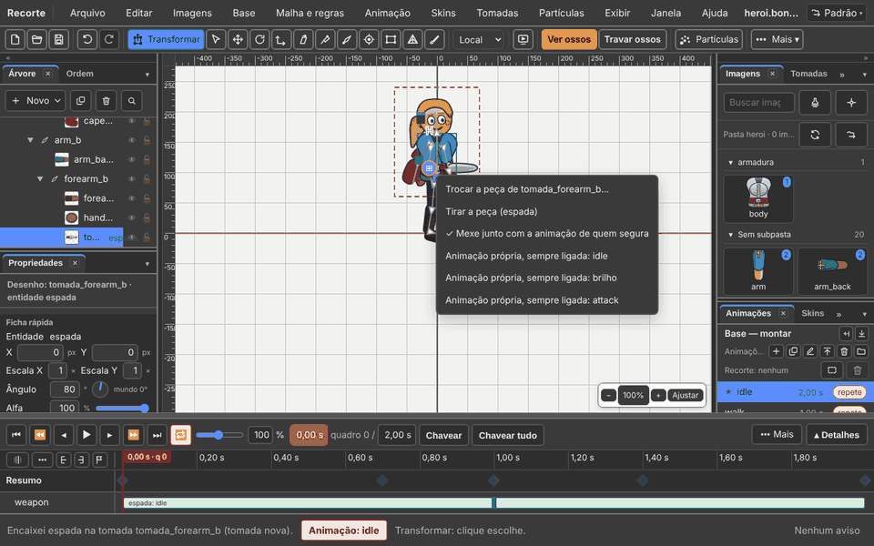
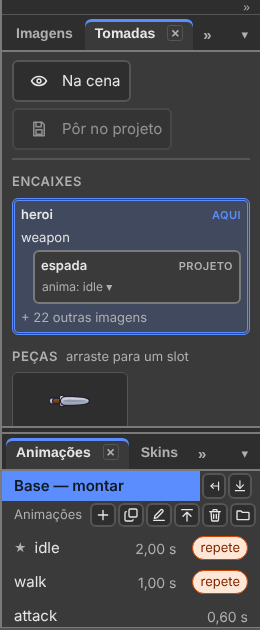

# 5. Sockets ("Tomadas"): one piece inside another

Also in Portuguese: [Português](../05-entidades.md)

Rewritten on 05/11/2026. The tab and the menu that were called **"Entidades"
(Entities)** are now called **"Tomadas" (Sockets)**. The whole walk-through,
with photos, is in [chapter 11](../11-a-espada-de-um-o-boneco-de-outro.md)
(in Portuguese).

## What you will be able to do by the end

1. Put a sword in the hero's hand, by plugging in the sword's project.
2. Put the hero inside the mecha, with the same gesture.
3. Choose the piece's animation, and test before saving.

---

## The words

| On screen | Means |
|:---|:---|
| **"Tomada" (Socket)** | a place on a bone where a piece goes in: the hand, the back, the cockpit |
| **"Peça" (Piece)** | another project (`.bone`) plugged into a socket. The sword. The hero |
| **"Encaixes" (Fittings)** | the top of the Sockets tab: who is inside whom |
| **"Peças" (Pieces)** | the bottom of the tab: what can be plugged in. Drag one to a socket |

**One gesture, both ways.** Holding the sword and getting into the mecha are
the same thing: a socket receives a project. Only the open project changes.

| I want | Open | Plug in |
|:---|:---|:---|
| the hero **holds** the sword | the hero | `espada.bone` in the hand socket |
| the hero **gets into** the mecha | the mecha | `heroi.bone` in the cockpit socket |

---

## Plugging in: three doors, one gesture

1. Select the bone: the hand, or the cockpit.
2. Right-click the bone, on the stage or in the Tree.
3. **"Encaixar um projeto…" (Plug in a project…)**
4. Choose the piece's `.bone` file.

The same through the menu: **"Tomadas → Encaixar um projeto…" (Sockets → Plug
in a project…)**, with the bone selected. Or drag the piece from the **Pieces**
list to the socket.

A bone with no socket? Plugging in creates the socket and plugs in, in one
step. To create only the empty place: **"Tomadas → Pôr uma tomada aqui…"
(Sockets → Put a socket here…)**.

**The two-pin icon** sits at the tip of a bone that has a socket. Click it: the
socket's menu opens — swap the piece, or **"Tomadas → Tirar a peça" (Sockets →
Remove the piece)**.

---

## The Sockets tab

**"Janela → Tomadas" (Window → Sockets).**

| Part | Shows |
|:---|:---|
| **Fittings** | the chain, from outside in: mecha › cockpit › hero › hand › sword |
| **Pieces** | the projects that can be plugged in. Drag one to the socket |

---

## The piece in the animation

The piece arrives already animated. On the socket's card (click the icon):

| Box | Does |
|:---|:---|
| **"Mexe junto com a animação de quem segura" (Moves with the holder's animation)** | the hero attacks, the sword attacks. Ticked by default |
| **"Animação própria, sempre ligada" (Own animation, always on)** | the piece runs one of its animations underneath everything: the mecha walks |

On the timeline, the piece is a **strip** with the animation's name.

| Gesture | Effect |
|:---|:---|
| drag the strip | changes when it starts |
| pull the end | slower or faster |
| right-click the strip | which animation plays, and the loop |

Through the menu, with the piece selected: **"Tomadas → Escolher a animação
dela…" (Choose its animation…)** and **"Tomadas → Em laço" (Looping)**.

---

## Test before saving

Want to see how it looks, without touching the file?

| Item in the Sockets menu | Does |
|:---|:---|
| **"Pôr em teste neste slot…" (Test in this slot…)** | the piece appears in place of the selected image, as a test only |
| **"Desligar o teste deste slot" (Turn off this slot's test)** | removes the test piece |
| **"Este boneco entra em…" (This character goes into…)** | the open character appears inside another project, as a test only |
| **"Tirar de volta" (Take back out)** | removes what is around |
| **"Pôr no projeto…" (Put in the project…)** | it looks good: saves the test piece into the file |
| **"O que a peça de teste toca…"** · **"Skins da peça de teste…"** | the test piece's animation and outfit |
| **"Teste em todas as iguais" (Test in all the same ones)** | the test piece in every identical place (the wheels) |

---

## The other items in the Sockets menu

| Item | Does |
|:---|:---|
| **"Trazer entidade de fora…" (Bring in an outside entity…)** | an outside `.bone` enters the Pieces list |
| **"Pôr entidade na cena…" (Put entity on the stage…)** | the piece goes in attached to the selected bone |
| **"Marcar como slot…"** · **"Desmarcar o slot"** | an image becomes a base with its own name and animations, and back |
| **"Este boneco…"** · **"Tirar o Este boneco"** | one part of the piece behind the whole character, another in front |
| **"Tirar a entidade" (Remove the entity)** | the previous image comes back |
| **"Promover a base"** · **"Rebaixar a entidade"** | a piece becomes a base of the project, and back |

Step by step is also in **"Ajuda → Quero fazer…" (Help → I want to…)**: type
`arma` (weapon) or `mecha`.

---

## What does not work yet

| What | How it is today |
|:---|:---|
| Dragging a `.bone` from disk straight onto the socket | use the right-click on the bone, or the Pieces list |
| Swapping through the grid in an animation applying **only from there on** | the grid saves into the base |
| The Preview showing the outer one **around** (the mecha) | the Preview shows only the pieces **on** the character |

---

## The seal — what this chapter confirms

| Function | Seal | How it was checked |
|:---|:---:|:---|
| Plug in a project by right-clicking the bone | exists | `npm run tomadas`, step a2 |
| The socket icon opens its menu | exists | step a3 |
| Drag from the Pieces list to the icon | exists | step a4 |
| Put a socket here… | exists | step b2 |
| The hero in the mecha's cockpit | exists | step b3 |
| Own animation, always on | exists | step b4 |
| The Sockets tab shows the chain | exists | step b5 |
| The game draws the hero in the cockpit | exists | step d: the validator and the runtime |

---

Next: [6. Mesh and weights](06-mesh-and-weights.md)
