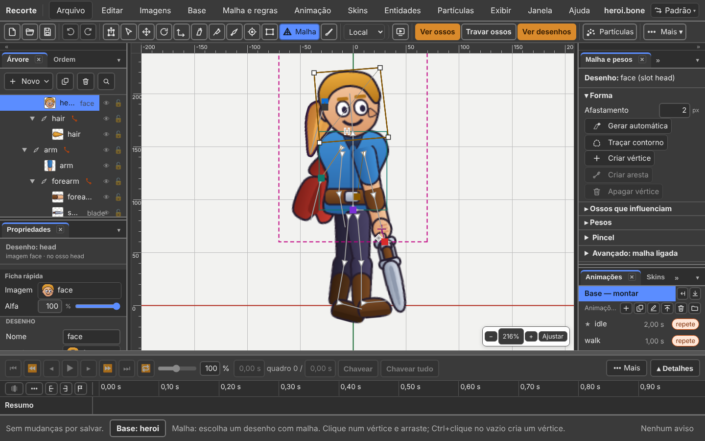
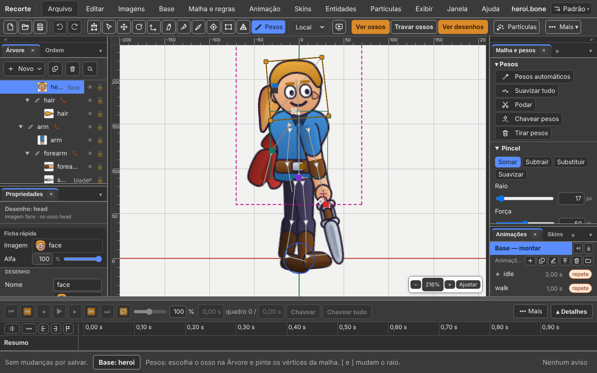

# 6. Mesh and weights

Also in Portuguese: [Português](../06-malha-e-pesos.md)

> The editor's interface is in Portuguese. Every button and menu is written
> here with its **exact Portuguese label** in quotes, and the English meaning in
> parentheses the first time it appears.

## What you will be able to do by the end

1. Make a cape ripple and a torso curve, instead of turning like wood.
2. Connect an image to two bones and let the program share out the weights.
3. Recognise the six common mistakes, by what you see on screen.

---

## The problem the mesh solves

An image attached to a bone is a rigid rectangle. It rotates and slides as one
piece.

That is enough for a wooden arm. **It is not enough for a cape in the wind, for a
torso that curves, for a mouth that opens.**

The **mesh** (malha) cuts the image into triangles. Then each point of the image
can go its own way, and the drawing bends from the inside.

The **weights** (pesos) say how much each bone pulls each point.

---

## When to use a mesh

| Piece | Use a mesh? | Why |
|:---|:---:|:---|
| cape, skirt, long hair | **yes** | it has to ripple |
| torso, belly | **yes** | it curves when walking and breathing |
| mouth, eye, eyebrow | **yes** | it changes shape |
| forearm, shin | maybe | only if it is flesh and has to stretch |
| hand, foot, sword, shield | **no** | rigid piece. Rotating is enough |
| a whole head, if it does not speak | **no** | rotating is enough |

The short rule: **mesh only where the shape changes.**

A mesh costs the game more to draw. Do not put one on everything "just in case".

---

## Where this lives

Three doors, which do the same thing:

| Door | Where |
|:---|:---|
| the tab | **"Malha e pesos"** (Mesh and weights), in the right column |
| the menu | **"Malha e regras → Malha ▸"** (Mesh and rules → Mesh) and **"Malha e regras → Pesos ▸"** (Mesh and rules → Weights) |
| the arranged screen | **"Janela → Arranjos → Pesos"** (Window → Arrangements → Weights): the large tab, with the Árvore (Tree) beside it |

Two tools in the scene:

| Tool | Key | For |
|:---|:---:|:---|
| **"Malha"** (Mesh) | `M` | moving vertices |
| **"Pesos"** (Weights) | `G` | painting weight |

The tab has six parts, in this order:

| Part | How it starts |
|:---|:---|
| **"Desenho"** (Drawing): the name | always open |
| **"Forma"** (Shape) | open with Malha (or another tool) in hand |
| **"Ossos que influenciam"** (Influencing bones) | open with Pesos in hand, or with "Ligar ossos" lit |
| **"Pesos"** (Weights) | open with Pesos in hand |
| **"Pincel"** (Brush) | folded; opens by itself with Pesos |
| **"Avançado: malha ligada"** (Advanced: linked mesh) | folded |

The **title** of each part is the button that folds and opens it. Whatever you
opened or closed stays that way until you change tools.

---

## It works in the base and in the animation

The mesh **does not throw you out** of the animation. Everything works with an
animation open.

What changes is **where** each gesture goes:

| Gesture | In the base | With an animation open |
|:---|:---|:---|
| Virar malha, Gerar, Traçar | changes the shape | changes the shape **of the base** |
| create and delete a vertex, an edge | changes the shape | changes the shape **of the base** |
| connect a bone, paint, Pesos automáticos | changes the weights | changes the weights **of the base** |
| **drag a vertex** | changes the shape | saves a **deform key** |
| **"Chavear pesos"** (Key weights) | does nothing, and says why | saves the current weights as a **key** |

With an animation open, the tab says so at the top, in one line:

> Forma e pesos gravam na base
> *(Shape and weights are saved in the base)*

The full sentence is in that line's tooltip.

And the footer says, at each gesture, that it went to the base: *"(went to the
base)"*. With the base switch open, it says which one: *"(went to the
lobisomem base)"*.

---

## Create and generate a mesh in the middle of an animation

It is the gesture you make most. Step by step, **with the animation open**:

| Step | Gesture | What you see |
|:---:|:---|:---|
| 1 | Click the drawing, in the Árvore or in the scene | the title says *Desenho: capa* |
| 2 | In the tab, part **Forma**, click **"Virar malha"** (Turn into mesh) | *"capa" turned into a mesh: 4 vertices (went to the base)*. The Malha tool switches on by itself |
| 3 | Click **"Gerar automática"** (Generate automatically) | *Mesh generated: 40 vertices, 60 triangles (went to the base)* |
| 4 | Drag a white square | the shape changes **only at this instant**: it is a key |

In step 4 the sheet gains a **Malha** row for that drawing.

> **Careful when generating again.** If the mesh already has deform keys, the
> footer warns: *"Warning: 3 deform keys of "andar" were saved on the old shape
> and now fall on other vertices"*. Generating replaces the vertices; the old
> keys do not know that.

Generating also **erases the weights** of the mesh. Connect the bones again
afterwards.

---

## The whole road, in five steps

### Step 1 — Pick the drawing

Click the drawing in the Árvore, or in the scene.

The top of the tab then says which one it is: **Desenho: face**. When the slot
has a different name, it comes in brackets; both names are in the tooltip.

Nothing selected? The tab says: *Escolha um desenho na árvore ou na tela.*
(Pick a drawing in the tree or on the screen.)

### Step 2 — Turn into mesh

While the drawing is a whole image, the **Forma** part has a single button:
**Virar malha**.

The image becomes a four-corner mesh. It does not bend anything yet: it is the
way in. The **Malha** tool (`M`) switches on by itself — only here, on the mesh
that was just born.

### Step 3 — Generate the shape

| Button | What it does |
|:---|:---|
| **Gerar automática** | outline and interior, from the image's silhouette |
| **"Traçar contorno"** (Trace outline) | only the outline, no vertex inside |
| **"Afastamento"** (Offset) (px) | how far the outline stays outside the art. Starts at **2**. From 0 to 30; 0 turns it off |

Use **Gerar automática** almost always. Generating **does not move** the drawing.

*The count of the shape (vertices, triangles, outline) is in the tooltip of the
**Forma** title.*

### Step 4 — Connect the bones

Part **Ossos que influenciam**, button **"Ligar ossos"** (Connect bones).

| Step | Gesture | What you see |
|:---:|:---|:---|
| 1 | Click **Ligar ossos** | the button lights up. Footer: *Click the bones that pull this mesh. Ligar ossos again finishes.* |
| 2 | Click the first bone, in the scene or in the Árvore | it comes in with weight 100 % |
| 3 | Click the second bone | it comes in with 0 % |
| 4 | Click **Ligar ossos** again (with Pesos in hand, `Esc` also closes) | the mode closes, and **the weights share themselves out** |

In step 4 the footer says: *"The 2 connected bones shared the weight by
themselves (Pesos automáticos on 9 vertices). Paint to adjust; Ctrl+Z goes
back"*.

It works with **any tool in hand**. The mesh does not drop out of the selection
halfway. Clicking a bone that is already connected **removes** it.

Each connected bone gets **a colour**. In the scene, each vertex becomes a
**pie**, one slice per bone, in its colour.

Another way, without the button: hold `P` and click the mesh. It connects the
selected bone to it.

### Step 5 — Adjust

Part **Pesos**:

| Button | What it does | When to use |
|:---|:---|:---|
| **"Pesos automáticos"** (Automatic weights) | each vertex follows the nearest bones. Only those on the list; with an empty list, every bone that has a length | to start, or to redo |
| **"Suavizar tudo"** (Smooth all) | blends the neighbours' weights | when the bend comes out angular |
| **"Podar"** (Prune) | removes weights below 2 % | when a far bone pulls a tiny bit |
| **Chavear pesos** | saves the current weights as a key in the open animation | when the weight needs to change over time |
| **"Tirar pesos"** (Remove weights) | the mesh goes back to following only the slot's bone | to start again from zero |

After each one, the **Pesos** tool comes into your hand, so the scene shows the
pies.

**Test:** rotate a connected bone and watch the mesh follow. `Ctrl+Z` goes back.

---

## Editing the mesh shape

**Malha** tool (`M`). The buttons of the **Forma** part repeat the keys:

| Gesture | What it does | Button |
|:---|:---|:---|
| drag a white square | moves the vertex | — |
| click a vertex | selects it | — |
| `Shift` + click | adds another vertex to the selection | — |
| drag on empty space | a **box** selects the vertices inside. `Shift` adds | — |
| `Ctrl` + click on empty space | creates a vertex | — |
| click on empty space, with the mode lit | creates a vertex | **"Criar vértice"** (Create vertex) (on and off; `Esc` closes) |
| `L`, with two vertices selected | creates the edge between them | **"Criar aresta"** (Create edge) |
| `K`, with two vertices selected | deletes the edge | the same button becomes **"Apagar aresta"** (Delete edge) |
| `Delete` | deletes the selected vertices | **"Apagar vértice"** (Delete vertex) |

`Delete` with no vertex selected **does not delete the drawing**. It tells you
how to do it: change tools, or **"Editar → Apagar"** (Edit → Delete).

Clicked away from a vertex, without the mode? The footer teaches you, once per
mesh: *No vertex here. Click a white square and drag; Ctrl+click creates a
vertex.*

In the menu: **"Malha e regras → Malha ▸ Criar ou apagar aresta"** (Create or
delete edge). Greyed out without two vertices, saying how to select them.

---

## Painting weight

**Pesos** tool (`G`). Or open the **Pincel** part: it puts the tool in your hand.

### Picking the bone you paint

| Gesture | Where |
|:---|:---|
| click the bone's **name** | in the **Ossos que influenciam** list |
| click the **bone** | in the scene, **outside** the mesh |

The selected bone **glows** in its colour, on top of the mesh.

With no bone selected, the brush warns: *Choose the bone you will paint: click
its name in Ossos que influenciam, or the bone in the scene, outside the mesh.*

### The list of bones

Each row has: the **colour dot**, the **name**, the **%**, the **lock box** and
the **bin** (removes the bone from the mesh).

What the % means is written above the list:

| Selected vertices | The % is |
|:---:|:---|
| none | the **average** weight over the whole mesh |
| one | the weight of **that** vertex. It becomes a box: type the number |
| several | their weight. An empty box with *vários* (several) = they differ from each other |

Typing a bone's %: **the rest goes to the others**, in the proportion they had.
A locked bone does not change.

### Selecting vertices to paint

With the Pesos tool: `Shift` + click a vertex selects or drops it. Once
selected, the brush **paints only on them**. `Esc` drops them all.

### The four brush modes

| Mode | What it does |
|:---|:---|
| **"Somar"** (Add) | gives more weight to the selected bone; the others lose the same amount |
| **"Subtrair"** (Subtract) | takes weight from it and gives it back to the others |
| **"Substituir"** (Replace) | takes its weight up to 100 %, at the step of the Força (Strength) |
| **"Suavizar"** (Smooth) | blends each vertex's weight with its neighbours' |

And two numbers:

| Number | Range | Shortcut |
|:---|:---|:---|
| **"Raio"** (Radius) (px) | 1 to 400. Starts at ¼ of the mesh's longest side | `[` smaller, `]` larger |
| **"Força"** (Strength) (%) | 0 to 100. At 100 one stroke paints everything | hold `Alt` to paint lighter |

The blue circle follows the mouse and changes size at once.

On release, the footer counts: *Weight of cape2 painted on 3 vertices.*

### Locking a bone

The box next to each bone. Locked, **the brush, Suavizar and Podar do not touch
its weight**. Useful for working only between two bones and leaving a third one
alone.

### Seeing the weights without the tool

**"Exibir → O boneco → Pesos"** (View → The character → Weights). Also
**"Malhas"** (Meshes) and **"Arestas"** (Edges), in the same place.

---

## How the sum works

The sum of a point's weights is always **100 %**.

That means: **giving more weight to one bone takes weight from the others at the
same point.**

| Bone | Weight |
|:---|---:|
| `tronco` | 70 % |
| `quadril` | 30 % |
| **sum** | **100 %** |

If you add 20 % to `tronco`, `quadril` drops to 10 %. There is no way for the
two to add up to 120 %.

There is no limit of four bones per point. There can be as many as you need.

---

## The six common mistakes, and how to spot them

### 1. An elbow that "crushes"

**What you see:** when the arm bends, the sleeve sinks and disappears at the
elbow.

**Why:** the points near the elbow are almost all on a single bone.

**How to fix it:** select the elbow vertices (`Shift` + click) and type 50 % on
the arm. Or run **Suavizar**.

### 2. A point that lags behind

**What you see:** a little piece of the drawing does not follow the rest and
stretches like chewing gum.

**Why:** that point ended up with no weight, or with weight on the wrong bone.

**How to spot it:** look at the pies. **A pie of another colour in the middle of
the area, or a vertex with no pie, is the culprit.** Click it: the list shows
its weight.

**How to fix it:** type the % in the list. Or the brush in **Substituir**, Força
100, one stroke.

### 3. A far bone pulling lightly

**What you see:** turning the head moves the hem of the cape a tiny bit.

**Why:** the automatic weights gave a minimal slice to a distant bone.

**How to fix it:** the **Podar** button. Or the bone's bin, in the list.

### 4. An outline with a hole inside

**What you see:** the drawing has a cut-out — a handle, a ring — and the mesh
goes over the hole.

**Why:** the trace follows only the outer outline.

**How to fix it:** for now, edit the vertices by hand with the Malha tool.

### 5. A mesh that is too coarse

**What you see:** the curve of the drawing turns into right angles when it bends.

**Why:** too few triangles.

**How to fix it:** **Criar vértice** (or `Ctrl` + click) where the curve is
largest.

### 6. A mesh that is too fine

**What you see:** the game slows down with many characters on screen.

**Why:** too many triangles.

**How to fix it:** generate again, or delete vertices where the shape is straight.

---

## Linked mesh: one shape, several drawings

A **linked mesh** uses the shape and the weights of another mesh.

Useful for: the same cape in three colours; the same face with different mouths.
You draw and weight **once**, and the others follow.

| Step | Gesture |
|:---:|:---|
| 1 | Select the slot, or the drawing, in the Árvore or in the scene |
| 2 | Open **Avançado: malha ligada**, at the end of the tab |
| 3 | In **"Malha de origem"** (Source mesh), choose which mesh the shape comes from |
| 4 | Click **"Usar forma"** (Use shape) (or **"Malha e regras → Malha → Usar a forma de outra malha"**, Use the shape of another mesh) |
| 5 | In **"Propriedades"** (Properties), change the new mesh's **"Imagem"** (Image) |

The footer says: *"… created, borrowing the shape of "capa". It starts with the
same image; change it in Propriedades, in the Imagem field."*

The list of sources brings the meshes **of the same slot**, in any skin. That is
what the format allows: the shape lives in the space of that slot's bone.

**Nothing is copied.** Move a vertex of the source and the linked one follows,
always. With the linked one selected, the tab says: *Linked mesh: uses the shape
of "capa". Shape and weights are changed there.*

A slot with no mesh at all? The tab says: *This slot has no mesh to serve as a
source. Turn a drawing into a mesh first.*

---

## What does not work yet

| What | How to work around it |
|:---|:---|
| The trace ignores holes inside | Edit the vertices by hand with the Malha tool |
| There is no handle to move the texture without moving the vertex (`keepUv` exists in the code, with no button) | Move the vertex in the base: the texture follows |
| Generating again does not reuse the weights | Connect the bones again, or **Pesos automáticos** |

---

## The seal — what this chapter confirms

House rule: every function carries a seal. Checked on 07/10/2026, in v36.5, in
the code.

| Function | Seal | Where in the code |
|:---|:---:|:---|
| Mesh and weights work with an animation open | **exists** | `mesh/mesh-doc.ts:397` (`MESH_REST_POSE_NOTICE`); `panels/mesh-panel.ts:280-285` |
| **Create and generate a mesh in the middle of an animation**: goes to the base of the body at that instant | **exists** | `panels/mesh-panel.ts:1012-1043` (Virar) and `1096-1107` (Gerar, `corpoDe`); `contract.ts:372` (`wentToBase`) |
| Warning about old deform keys when generating again | **exists** | `mesh/mesh-doc.ts:553-575` |
| Dragging a vertex with an animation open saves a deform key | **exists** | `mesh/mesh-doc.ts:641-655` |
| Virar malha switches on the Malha tool only on the new mesh | **exists** | `panels/mesh-panel-model.ts:269` |
| Gerar automática · Traçar contorno · Afastamento | **exists** | `panels/mesh-panel.ts:536-539`, `608-628` |
| Criar vértice (mode, plain click) and `Ctrl` + click | **exists** | `viewport/tools/mesh-tool.ts:217-242` |
| Box to select vertices; `Shift` adds | **exists** | `viewport/tools/mesh-tool.ts:220-224`, `253-272` |
| `L` / `K` / `Delete`, and the edge button that changes its name | **exists** | `viewport/tools/mesh-tool.ts:286-314`; `panels/mesh-panel.ts:559-579` |
| `Delete` with no vertex does not delete the drawing | **exists** | `viewport/tools/mesh-tool.ts:38-39`, `291-294` |
| Ligar ossos (mode, any tool, scene or Árvore) | **exists** | `panels/mesh-panel-model.ts:85-163` |
| `Esc` closes Ligar | **exists differently** | only with the Pesos tool in hand (`viewport/tools/weights-tool.ts:347`); the model's comment promises it with any tool |
| Closing Ligar shares out the weights by itself | **exists** | `panels/mesh-panel-model.ts:485-501`; `panels/mesh-panel.ts:905-917` |
| Holding `P` + clicking a mesh connects the bone | **exists** | `mesh/mesh-doc.ts:409-420` (`toggleMeshBone`); `ESTADO.md` |
| Pie per vertex, colour per bone | **exists** | `viewport/tools/weights-tool.ts:8-11`, `161-196`; `panels/mesh-panel-model.ts:193` |
| Pesos automáticos · Suavizar tudo · Podar (2 %) · Tirar pesos | **exists** | `panels/mesh-panel.ts:1110-1146` |
| Chavear pesos | **exists** | `mesh/mesh-doc.ts:593-618` |
| Exact weight typed on the selected vertices | **exists** | `panels/mesh-panel.ts:882-901` |
| Brush: 4 modes, Raio in px, Força in % | **exists** | `panels/mesh-panel-model.ts:337-360` |
| `[` and `]` change the Raio, only with Pesos in hand | **exists** | `ui/keys.ts:189-190`; `viewport/tools/weights-tool.ts:339-345` |
| `Alt` paints lighter (40 % of the Força) | **exists** | `viewport/tools/weights-tool.ts:369`. It is not in any tooltip |
| `Shift` + click selects a vertex to paint; `Esc` drops | **exists** | `viewport/tools/weights-tool.ts:270-281`, `349-353` |
| Clicking the bone outside the mesh selects the bone to paint | **exists** | `viewport/tools/weights-tool.ts:254-266` |
| Lock a bone | **exists** | `panels/mesh-panel.ts:853-860`; `panels/mesh-panel-model.ts:391` |
| The sections fold and open according to the tool | **exists** | `panels/mesh-panel-model.ts:53-64` |
| Linked mesh (Usar forma) | **exists** | `panels/mesh-panel.ts:453-521`; `mesh/linked-mesh.ts:96-101`, `238` |
| Doors in the Malha e regras menu | **exists** | `ui/menus.ts:931-1004` |
| The **Pesos** arrangement | **exists** | `ui/contexts.ts:71-80`; `ui/menus.ts:1711-1720` |
| Exibir → O boneco → Malhas, Arestas, Pesos | **exists** | `ui/menus.ts:600-602` |
| Tracing with holes inside | **missing** | `mesh/mesh-edit.ts:961`: it only follows the outer edge |
| Handle to move the texture (`keepUv`) | **missing** | `mesh/mesh-doc.ts:643`, `660`: exists in the code, with no button |
| `Esc` after painting drops the whole drawing | **not confirmed** | reported in doc `56` (defect 1). Today `Esc` first drops the selected vertices (`weights-tool.ts:349`); with no vertex, I did not check whether the drawing drops |

Taken out of the chapter, because it vanished from the program: the sentence
*"Escolha a ferramenta Malha (M) ou Pesos (G) para editar"* (the tab no longer
draws it), the blue and red colours (they became the pie) and *"moving a vertex
reloads the file"* (not found in the code nor in the `CHANGELOG`).

---

Next: [7. The five rules](07-the-five-rules.md)
