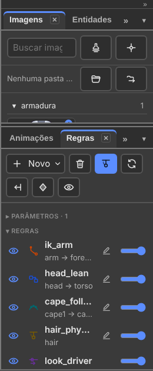
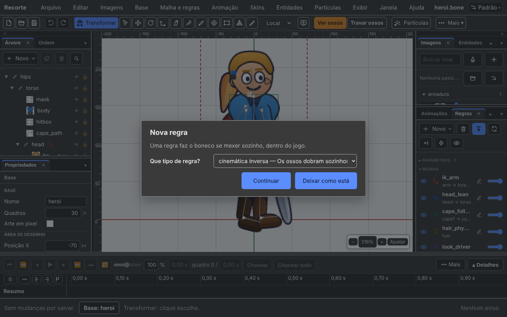

# 7. The five rules

Also in Portuguese: [Português](../07-as-cinco-regras.md)

> The editor's interface is in Portuguese. Every button and menu is written
> here with its **exact Portuguese label** in quotes, and the English meaning in
> parentheses the first time it appears.

## What you will be able to do by the end

1. Create any of the five rules through the window that asks.
2. Keep the foot from sliding and make the hair swing by itself.
3. Turn a rule on and off, and change its bones, without redoing it.

---

## What a rule is

A **rule** (regra) is an automatic calculation on top of the bones.

**You do not animate the result. You animate the cause**, and the rule does the
rest every frame — in the editor and inside the game, the same.

In the `.bone` file they are called *constraints*. In the editor they live in
the **"Regras"** (Rules) tab, and their fields are in **"Propriedades"**
(Properties).

| Rule | In one sentence | Classic example | In `heroi.bone` |
|:---|:---|:---|:---|
| **Inverse kinematics** ("Cinemática inversa") | you move the hand; the elbow bends by itself | a foot that does not slide on the ground | `ik_arm` |
| **Transform** ("Transformação") | a bone copies the rotation, position or size of another | a head that tilts with the torso | `head_lean` |
| **Path** ("Caminho") | bones slide along a drawn line | cape, chain, rail, snake | `cape_follow` |
| **Physics** ("Física") | the bone lags and swings by itself when the body moves | hair, earring, tail, loose clothing | `hair_physics` |
| **Driver** ("Comando") | one number controls several things at once | a "look" knob that moves the head | `look_driver` |

---

## Where this lives

| Door | What it has |
|:---|:---|
| **Regras** tab | the list, the button bar |
| **"Malha e regras"** (Mesh and rules) menu | "Nova regra…" (New rule…) · "Trocar os ossos da regra…" (Change the rule's bones…) · "Apagar regra" (Delete rule) · "Novo parâmetro" (New parameter) · "Chave do parâmetro aqui" (Parameter key here) · "Apagar parâmetro" (Delete parameter) · "Física ▸" (Physics) |
| **"Novo"** (New) in the Árvore (Tree) | "Regra…" (Rule…) and "Parâmetro" (Parameter) |
| **Propriedades** | every field of the selected rule |

---

## The Regras tab



### The top bar

Icons, with the name in the tooltip:

| Button | What it does |
|:---|:---|
| **"Novo ▾"** (New) | opens the list: "Regra…" · "Parâmetro" · "Variável" (Variable) · "Etiqueta" (Tag) |
| bin | deletes what is selected in the list: the rule, the parameter or the variable |
| **"Simular a física"** (Simulate physics) | turns the swinging on screen on and off |
| **"Reiniciar esta física"** (Reset this physics) | resets the swing of the selected physics rule |
| **"Reiniciar todas as físicas"** (Reset all physics) | resets all of them at once |
| **"Assar a física em chaves"** (Bake physics into keys) | replaces the simulation with ordinary keys |
| eye | shows or hides variables and tags |

### The list

Three parts, in this order. Each title folds and opens with a click.

| Part | What it is |
|:---|:---|
| **"Parâmetros"** (Parameters) | the numbers the game sends from outside. They come first: it is from them that the Driver reads |
| **"Regras"** (Rules) | one row per rule |
| **"Variáveis"** (Variables) and **"Etiquetas"** (Tags) | they do not move the drawing. They can be hidden with the eye |

### A rule row

| What | What it is |
|:---|:---|
| **eye** | on and off. Off means Strength zero, and **the value that was there comes back** when you turn it on again |
| **icon** | the type. Each of the five has its own drawing |
| **name** | and, below it, the chain and the target: `arm → forearm → hand_target` |
| **pencil** | Trocar os ossos da regra. It does not appear on the Driver |
| **bar** | the Strength, from 0 to 100 % |

A rule that names something that does not exist turns **red**, saying which
name is wrong.

In the Árvore, a bone that has a rule gets a mark next to its name, with the
tooltip *Este osso tem regra. Veja na aba Regras* (This bone has a rule. See the
Regras tab).

### When the rule holds the bone

Rotated a bone and it did not rotate? A rule is in charge of it. The footer says
which one:

> cape2 did not rotate: the rule cape_follow is in charge of it. Turn off its eye
> in the Regras tab.

---

## New rule: the window asks

Three doors, the same window:

| Door | Gesture |
|:---|:---|
| menu | **"Malha e regras → Nova regra…"** |
| Regras tab | **Novo ▾ → Regra…** |
| Árvore | **Novo → Regra…** |

The window comes in two parts.

**First the type.** *Que tipo de regra?* (What type of rule?) The list of the
five, each with a sentence saying what it does. Button **"Continuar"**
(Continue).

**Then the questions for that type, in words:**



*While something is missing, the **"Criar a regra"** (Create the rule) button
stays grey and the sentence below says what. The window does not close wrong.*

| Type | What it asks |
|:---|:---|
| **Inverse kinematics** | "Que ossos dobram?" (Which bones bend?) · "Que osso eles perseguem?" (Which bone do they chase?) · "Dobra para a frente?" (Does it bend forwards?) |
| **Transform** | "Quem copia?" (Who copies?) · "Copia de quem?" (Copies from whom?) |
| **Path** | "Que ossos deslizam?" (Which bones slide?) · "Por qual caminho?" (Along which path?) |
| **Physics** | "Que osso balança?" (Which bone swings?) |
| **Driver** | "Que parâmetro manda?" (Which parameter drives?) · "Em que osso ele manda?" (Which bone does it drive?) · "O que ele mexe nesse osso?" (What does it move on that bone?) |

Two things it does for you:

- the bones you had already selected in the scene **come in already ticked**;
- the **parent → child** order of the chain is set by itself, from the order of
  the skeleton.

And what it does **not** allow:

| You tried | The sentence |
|:---|:---|
| a target that is one of the bones that bend | *The target cannot be one of the bones that bend.* |
| IK with three bones or more | *An IK rule bends one or two bones. Choose up to two.* |
| the same bone twice | *The same bone is in the chain twice.* |

With a skin's pencil lit, the rule is born **inside** that skin.

### Changing the bones later

Three ways, the same window:

| Door | Gesture |
|:---|:---|
| Regras tab | the row's **pencil** |
| menu | **"Malha e regras → Trocar os ossos da regra…"** |
| Propriedades | the **"Ossos da cadeia"** (Chain bones) field, a list of boxes |

That is how a one-bone IK becomes a two-bone one **after** it was created. The
target stays the same.

---

## The field they all have: Strength

Every rule has a **"Força"** (Strength) field, from 0 to 100 %. It is the mix
between the animated pose and what the rule wants.

| Value | Effect |
|:---|:---|
| `0 %` | the rule does nothing |
| `50 %` | halfway |
| `100 %` | the rule is in charge |

**Strength can be animated.** That is how you turn a rule on and off in the
middle of an animation: the foot stays stuck to the ground at 100 % while the
character steps, and goes to 0 % when the foot lifts.

> **Where the key is saved.** With the animation open, change the **Força in
> Propriedades**: it becomes a key at the cursor. **The eye and the bar in the
> Regras tab do not save a key** — they change the rule in the base, in every
> animation.

The other shared field is **"Só com a skin"** (Only with the skin): the rule only
applies when the skin that declares it is on. See [chapter 3](03-skins.md).

---

## The handles in the scene

With the **"Posar"** (Pose) tool (`Y`), the rules have handles in the scene:

| Handle | Rule | What dragging does |
|:---|:---|:---|
| IK target | inverse kinematics | moves the target bone |
| Bend | two-bone IK | flips the side of the bend |
| Transform target | transform | moves the target bone |
| Position on the path | path | moves the first bone along the line |
| Wind | physics | changes the wind |
| Gravity | physics | changes the gravity |

With an animation open, every drag saves a key at the cursor.

---

## 1. Inverse kinematics

Normally you rotate the shoulder, then the elbow, then the wrist, and the hand
ends up wherever it ends up. That is laborious and imprecise.

Inverse kinematics does the opposite: **you put the hand where you want it, and
the shoulder and elbow sort themselves out.** "Inverse" because it goes from the
tip to the root.

### The example: the foot that does not slide

The character walks. The supporting foot has to stay **still on the ground**
while the body passes over it.

| Step | What to do |
|:---:|:---|
| 1 | Create a loose bone on the ground. Call it `alvo_pe_esq`. |
| 2 | **Malha e regras → Nova regra… → cinemática inversa.** In "Que ossos dobram?", tick `perna_esq` and `canela_esq`. |
| 3 | In "Que osso eles perseguem?", choose `alvo_pe_esq`. |
| 4 | Animate only `alvo_pe_esq` and `quadril`. The leg bends by itself. |

Without this, the foot slides. With it, the foot sticks.

In the hero, `ik_arm` does the same with the arm: `arm → forearm` chasing
`hand_target`.

### The fields, in Propriedades

| Field | What it does |
|:---|:---|
| **"Ossos da cadeia"** (Chain bones) | the bones that bend |
| **"Alvo"** (Target) | the bone that the tip of the chain chases |
| **"Dobra para o lado positivo"** (Bends to the positive side) | which side the elbow or knee bends to. Bent the wrong way? It is this box |
| **"Encolhe"** (Shrinks) | lets the bone shrink to reach a target that is too close. Only with one bone |
| **"Estica"** (Stretches) | lets the bone stretch to reach a target that is too far |
| **"Escala uniforme"** (Uniform scale) | when stretching or shrinking, scales in both directions |
| **"Suavidade"** (Softness) (px) | softens the motion just before the leg fully straightens. Removes the knee "snap". Typical: 0 to 20 px |

### Rules to respect

- One or two bones. With two, the second must be a child of the first.
- The target cannot be one of the bones of the chain.

### Pose is not IK

The **Posar** tool (`Y`) drags the tip of a two-bone chain and it bends by
itself, with the same maths the game uses.

> **Posar does not create a rule.** It bends the chain **now**, writing
> rotations into the pose, like any other tool. With the tool in hand, the
> footer says: *Posar bends the chain now, without creating a rule. For the game
> to bend it by itself, create an IK rule.*

It is the most expensive confusion there is here: whoever thinks they "posed an
IK leg" finds out in the game that it does not bend by itself.

---

## 2. Transform

A bone copies the rotation, position, size or shear of another. It is the
"follow that one" rule.

### The example: the head that follows the torso

The head should tilt a little when the torso tilts, but not as much as it does.

| Step | What to do |
|:---:|:---|
| 1 | **Nova regra… → transformação.** In "Quem copia?", `cabeca`. |
| 2 | In "Copia de quem?", `tronco`. |
| 3 | In Propriedades, **"Força de cada parte" (Strength of each part) → "Rotação" (Rotation)** at `5 %`. |

Now the head follows the torso by five per cent. That is what the hero does, in
the rule `head_lean`.

| Another situation | How |
|:---|:---|
| two wheels turn together | the target is the first wheel, Rotação `100 %` |
| a gear turns the other way | the target is the other one, and **Somar giro** compensates |
| a backpack always stays upright | the target is `root`, Rotação `100 %` |

### The fields, in Propriedades

| Field | What it does |
|:---|:---|
| **"Alvo"** (Target) | the bone that serves as the source |
| **"Espaço local"** (Local space) | on, compares the local poses. Off, the world poses |
| **"Relativo"** (Relative) | on, **adds** the target's value. Off, **moves towards** the target's value |
| **"Somar giro"** (Add rotation) (°) | degrees added to the target's rotation |
| **"Somar X"**, **"Somar Y"** (Add X, Add Y) (px) | added to the target's position |
| **"Somar escala X / Y"** (Add scale X / Y) (×) and **"Somar inclinação Y"** (Add shear Y) (°) | the same, for size and shear |

Group **Força de cada parte**, each from 0 to 100 %: **Rotação** · **X** · **Y** ·
**"Escala X"** (Scale X) · **"Escala Y"** (Scale Y) · **"Inclinação Y"** (Shear Y).

Each part has its own strength: you can copy only the rotation and ignore the
position.

---

## 3. Path

Several bones slide along a curved line you drew. The line is a drawing of the
path type, inside a slot.

### The example: the rippling cape

| Step | What to do |
|:---:|:---|
| 1 | Draw the cape's path in a slot. Call it `caminho_capa`. |
| 2 | Create the bones `capa1`, `capa2`, `capa3` in a chain. |
| 3 | **Nova regra… → caminho.** In "Que ossos deslizam?", all three. |
| 4 | In "Por qual caminho?", `caminho_capa`. |
| 5 | In Propriedades, **"Modo da rotação"** (Rotation mode) at `corrente` (chain). |

Now animate only the path: the three bones follow the curve. That is what the
hero does, in the rule `cape_follow`.

Other uses: bicycle chain, train on a track, snake, tentacle.

### The fields, in Propriedades

| Field | What it does |
|:---|:---|
| **"Slot do caminho"** (Path slot) | the slot that has the path drawing |
| **"Modo da posição"** (Position mode) | `porcentagem` (percent, 0 to 100 % of the path) or `fixa` (fixed, px) |
| **"Modo do espaço"** (Spacing mode) | `comprimento` (length) · `fixo` (fixed) · `porcentagem` (percent) · `proporcional` (proportional) |
| **Modo da rotação** | how each bone turns (table below) |
| **Somar giro** (°) | degrees added to the rotation the path gives |
| **"Posição"** (Position) | where the first bone sits on the path. **This is the one you animate** |
| **"Espaço"** (Spacing) | the distance between one bone and the next |

Group **Força de cada parte**: **Rotação** · **X** · **Y**, from 0 to 100 %.

| Rotation mode | The bone |
|:---|:---|
| `tangente` (tangent) | points in the direction of the curve at that point |
| `corrente` (chain) | points at the next bone |
| `corrente com escala` (chain with scale) | points at the next one and also stretches to touch it |

For a cape, use `corrente`. For a train on a track, `tangente`.

---

## 4. Physics

The bone **lags** and swings by itself when the body moves. It is "secondary
motion": the hair that keeps going when the head has already stopped.

**You do not animate any of this.** The physics runs in the game, every frame —
and in the editor too, while **Simular a física** is on.

### The example: the ponytail

| Step | What to do |
|:---:|:---|
| 1 | Create a bone `cabelo`, child of `cabeca`. |
| 2 | **Nova regra… → física.** In "Que osso balança?", `cabelo`. |
| 3 | In Propriedades, **"No giro"** (On rotation) at `100 %`. |
| 4 | **"Gravidade"** (Gravity) at `20`. |

Now the hair swings when the head moves, and falls when it stops. That is what
the hero does, in the rule `hair_physics`.

Use it also for: earring, cape, skirt, long ear, antenna, hanging chain.

### First, what goes into the simulation

Group **"Física"** (Physics). Each from 0 to 100 %.

| Field | Effect |
|:---|:---|
| **No giro** | the bone swings by rotating. The most used |
| **"Em X"** and **"Em Y"** (On X, On Y) | the bone swings by shifting |
| **"Na escala X"** (On scale X) | the bone stretches and shrinks |
| **"Na inclinação X"** (On shear X) | the bone bends sideways |

### Then, how it behaves

Group **"Comportamento"** (Behaviour).

| Field | Means | Raise it to |
|:---|:---|:---|
| **"Inércia"** (Inertia) (%) | how much of the body's motion becomes lag | more swing |
| **"Força"** (Strength) | the spring that pulls back into place. Typical: 100 | return faster |
| **"Amortecimento"** (Damping) (%) | the brake. `100 %` is no brake | stop more slowly |
| **"Massa"** (Mass) | the weight | be lazier |
| **"Vento"** (Wind) | a constant push to the side | wind in the scene |
| **"Gravidade"** (Gravity) | a constant pull downwards | fall more |
| **"Limite"** (Limit) (px/s) | motion above this does not enter the simulation | withstand bigger jolts |
| **"Passos"** (Steps) (/s) | how many calculations per second | finer, and more expensive |

### The physics gestures on screen

On the Regras tab's bar, or in **"Malha e regras → Física ▸"**:

| Gesture | What it does |
|:---|:---|
| **Simular a física** | turns the swing on screen on and off. It is your preference: **it does not go into the file**. Off, the rule's row says *simulação desligada na tela* (simulation off on screen) |
| **Reiniciar esta física** | resets the swing of the selected rule |
| **Reiniciar todas as físicas** | resets all of them |
| **"Assar a física em chaves…"** (Bake physics into keys…) | replaces the simulation with ordinary keys. After that the animation plays backwards the same |

### Teleporting, in the game

If the game moves the character suddenly, tell the physics: the runtime has
`physicsReset()`. Without it the hair whips.

---

## 5. Driver

A single number controls several things at once.

You create a **parameter** — for example `olhar_x`, from `−1` to `1`. Then you
create a driver rule that says: when `olhar_x` is `−1`, the head rotates `−12`
degrees; when it is `1`, it rotates `12`.

After that, the game moves a single number and the whole face responds.

### The example: looking sideways

| Step | What to do |
|:---:|:---|
| 1 | **"Malha e regras → Novo parâmetro"**. It is born from `−1` to `1`. Name it `olhar_x` in Propriedades. |
| 2 | **Nova regra… → comando.** "Que parâmetro manda?": `olhar_x`. |
| 3 | "Em que osso ele manda?": `cabeca`. "O que ele mexe nesse osso?": Rotação. |
| 4 | In Propriedades, in the group **"Alvo 1"** (Target 1): **"Com o parâmetro em −1"** (With the parameter at −1) = `−12`; **"Com o parâmetro em 1"** = `12`. |
| 5 | One more bone? The group's **+**: *"Mais um alvo"* (One more target). |

That is what the hero does, in the rule `look_driver`. In the game, a single
line:

```js
skeleton.setParameter('olhar_x', 0.7);
```

On the Regras tab, the parameter's row has a **bar** to test the value, and the
button **"Gravar a chave aqui"** (Save the key here) (also in **"Malha e regras →
Chave do parâmetro aqui"**).

### The two ways to use it

| Way | How it works | Good for |
|:---|:---|:---|
| **By targets** | the parameter writes straight into the bones | looking, tilting |
| **Continuous** | the parameter becomes the time inside a control animation | a knob that plays a whole pose |

| Field | Where | What it does |
|:---|:---|:---|
| **"Parâmetro"** (Parameter) | "Comando por parâmetro" (Driver by parameter) | which number drives |
| **"Animação inteira"** (Whole animation) | Comando por parâmetro | once chosen, turns on continuous mode |
| **"Osso"** (Bone) · **"Propriedade"** (Property) · **"Modo"** (Mode) | each Alvo | whom it drives, what, `substituir` (replace) or `somar` (add) |
| **Com o parâmetro em …** | each Alvo | the value at that point of the parameter |
| **"De"** and **"Até"** (From and To) (parameter) | "Modo contínuo" (Continuous mode) | the range of the parameter that is used |
| **"Tempo inicial"** and **"Tempo final"** (Start time and End time) | Modo contínuo | the stretch of the control animation |
| **Modo** | Modo contínuo | `substituir` or `somar` |

A driver with no target and no animation turns red: *this rule drives nothing:
the runtime ignores it while it has no target*.

---

## Order: who runs first

The rules run **in the order they are in the list**, top to bottom.

This matters. If the inverse kinematics bends the leg and the physics then
swings the hair, the hair has already seen the bent leg. If it were the other way
round, the hair would respond to a pose that was still going to change.

---

## Seeing all five working

Open `formato/exemplos/heroi.bone` and click each row of the Regras tab.

| Name | Type | What it does |
|:---|:---|:---|
| `ik_arm` | inverse kinematics | the arm chases the `hand_target` bone |
| `head_lean` | transform | the head follows the torso by 5 % |
| `cape_follow` | path | two cape bones follow the `cape_path` path |
| `hair_physics` | physics | the hair swings, with gravity 20 |
| `look_driver` | driver | the `lookX` parameter turns the head and opens the smile |

Turn off the eye of one of them and play the animation: you can see exactly what
each rule was doing.

---

## What does not work yet

| What | How to work around it |
|:---|:---|
| IK chains with **more than two bones**. Decided on 17/09: version 1.0 of the format stays with one or two; more than that becomes the `BONE_ik_chain` extension, later | Use chains of one or two bones |
| The dedicated pendulum (`BONE_pendulum`) stays an extension, not core (decision of 17/09) | Use the physics rule, which is in the core |
| Changing the order in which the rules run | Edit the file. The list cannot be dragged |
| In the Driver, a target that **is not a bone** (the hero's `smile` morph) | The hero already has it. In the editor, bone targets only |

---

## The seal — what this chapter confirms

House rule: every function carries a seal. Checked on 07/10/2026, in v36.5, in
the code.

| Function | Seal | Where in the code |
|:---|:---:|:---|
| Malha e regras → Nova regra…, and the two-part window | **exists** | `ui/menus.ts:1009-1014`; `panels/rules.ts:200-336` |
| The tab's Novo ▾ (Regra…, Parâmetro, Variável, Etiqueta) | **exists** | `panels/rules-model.ts:1072`; `panels/rules.ts:340-385` |
| Árvore's Novo → Regra… | **exists** | `panels/tree.ts:403` |
| The questions for each type | **exists** | `panels/rules.ts:222-273` |
| The window's refusals (target in the chain, IK with 3, repeated bone) | **exists** | `panels/rules-model.ts:273-318` |
| Change the bones (pencil, menu, Ossos da cadeia) | **exists** | `panels/rules.ts:1122-1192`; `panels/properties-model.ts:1749-1753` |
| The eye keeps the previous Strength | **exists** | `panels/rules-model.ts:576-601` |
| The tab's bar and eye save into the base, never a key | **exists differently** | `panels/rules-model.ts:604-623` writes straight into the file. The Strength key comes only through Propriedades (`panels/properties.ts:1767`; `anim/keying.ts:611-612`) |
| Strength in %, from 0 to 100 | **exists** | `panels/regua-numeros.ts:55` |
| Rule in red with the wrong name | **exists** | `panels/rules-model.ts:195-222` |
| Mark in the Árvore | **exists** | `panels/tree.ts:898-906` |
| "X did not rotate: the rule Y is in charge of it" | **exists** | `viewport/held-by-rule.ts` |
| Handles in the scene, with Posar (`Y`) | **exists** | `viewport/handles.ts:9-16`; `viewport/tools/pose-tool.ts`; `ui/keys.ts:132` |
| The Posar sentence in the footer | **exists** | `ui/toolbar-model.ts:199-201` |
| IK fields (with Escala uniforme; Suavidade in px) | **exists** | `panels/properties-model.ts:1755-1767`; `panels/regua-numeros.ts:58-61` |
| Transform fields (Somar…, Força de cada parte) | **exists** | `panels/properties-model.ts:1770-1795`; `panels/regua-numeros.ts:64-75` |
| Path fields (with Modo do espaço) | **exists** | `panels/properties-model.ts:1798-1820`; `820-836` |
| Physics fields, in % | **exists** | `panels/properties-model.ts:1823-1855`; `panels/regua-numeros.ts:84-96` |
| Simulate · Reset · Reset all · Bake | **exists** | `panels/rules.ts:115-121`; `ui/menus.ts:1042-1064`; `panels/rules-physics.ts:49-70` |
| New parameter is born from −1 to 1 | **exists** | `panels/rules.ts:1022-1030` |
| Driver: bone targets, + Mais um alvo, "Com o parâmetro em …" keys | **exists** | `panels/properties-model.ts:1892-1993` |
| Continuous driver (Animação inteira, De, Até, Times, Modo) | **exists** | `panels/properties-model.ts:1901-1925` |
| Save the parameter key | **exists** | `panels/rules.ts:894`; `ui/menus.ts:1031-1033` |
| Só com a skin | **exists** | `panels/properties-model.ts:860-864`, `1732` |
| Rule born inside the skin with the pencil lit | **exists** | `panels/rules.ts:296-305` |
| Driver with a morph target | **missing** | `panels/properties-model.ts:1945-1948`: the target only offers bones |
| Reorder the rules through the list | **missing** | no move-rule command in `editor/src` |
| IK with more than two bones | **missing** — decided | `formato/ESPECIFICACAO 2026-09-17.md:3959` |
| `BONE_pendulum` in the core | **missing** — decided | `formato/ESPECIFICACAO 2026-09-17.md:3958` |
| "`root` does not enter the chain" and "target that descends from the chain" | **not confirmed** | they were in the earlier text; the window refuses neither (`panels/rules-model.ts:273-318`). Taken out of "Rules to respect" |

Taken out of the chapter, because it changed in the program: the path
**Esqueleto → Novo → Regra ▸** (it became **Malha e regras → Nova regra…**), the
loose **Nova regra** and **Apagar regra** buttons on the tab (they became
**Novo ▾** and the bin), the `B` key for Posar (it became `Y`; `B` creates a
bone) and the name **Deslocar rotação** (it became **Somar giro**).

---

Next: [8. Export and use in a game](08-export-and-use-in-a-game.md)
