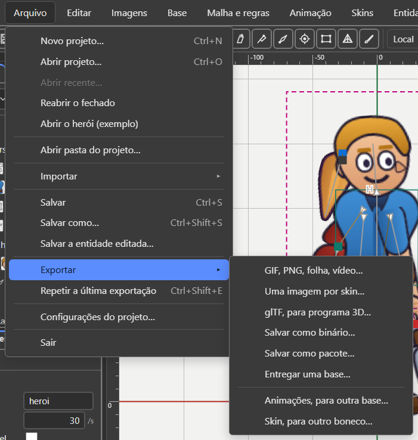
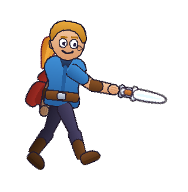

# 8. Export and use in a game

Also in Portuguese: [Português](../08-exportar-e-usar-no-jogo.md)

*Checked in the code on 07/10/2026, version v36.5.*

> The editor's interface is in Portuguese. Every button and menu is written
> here with its **exact Portuguese label** in quotes, and the English meaning in
> parentheses the first time it appears.

## What you will be able to do by the end

1. Choose between the three packagings of the file, knowing what each is for.
2. Check that the file is right before sending it to the game.
3. Get the character playing in the game: in Construct 3, in Godot, or with
   thirty lines of code.

---

## The idea that changes everything

**There is no "export" in Recorte.**

The editor's document **already is** the game's file. You save a `.bone` and
that is what the engine reads. There is no internal model that later turns into
something else.

That means: **nothing you made gets lost on the way.** If it fitted in the
editor, it fits in the file.

What this chapter calls "export" is something else: turning into images,
turning into glTF, slicing by skin. They are outputs that leave the format.

---

## The three packagings

The same content, in three wrappings.

| Extension | What it is | Good for |
|:---|:---|:---|
| `.bone` | JSON text. Opens in Notepad | working, versioning, reading, reviewing |
| `.boneb` | compact binary | the game loading fast |
| `.bonez` | a ZIP package with everything inside | delivering in a single file |

**The data model is the same in all three.** Nothing is lost in the conversion.

| File | Size | Reduction |
|:---|---:|---:|
| `heroi.bone` | about 28 KB | — |
| `heroi.boneb` | about 18 KB | about 37% |
| `heroi.bonez` | about 23 KB | about 19% |

The `.bonez` looks bigger than the `.boneb`, but it **also** carries the atlas
and the images. The `.boneb` alone does not.

*(The sizes are from 15/09. Not measured again.)*

---

## Opening and saving

| Item of the **"Arquivo"** (File) menu | What it does |
|:---|:---|
| **"Novo projeto…"** (New project…) (`Ctrl+N`) | asks for the project folder and starts in it, with an empty base |
| **"Abrir projeto…"** (Open project…) (`Ctrl+O`) | reads a `.bone`, `.boneb` or `.bonez` |
| **"Abrir recente…"** (Open recent…) | the last files opened or saved |
| **"Reabrir o fechado"** (Reopen the closed one) | brings back the work that was open when the tab closed |
| **"Abrir o herói (exemplo)"** (Open the hero (example)) | the example character, to look at from the inside |
| **"Abrir pasta do projeto…"** (Open project folder…) | the working folder: the images go to the **"Imagens"** (Images) tab |
| **"Salvar"** (Save) (`Ctrl+S`) | saves the whole folder: the `.bone`, the atlas and the images in use |
| **"Salvar como…"** (Save as…) (`Ctrl+Shift+S`) | a copy, in a new folder, or just the `.bone` |
| **"Salvar a entidade editada…"** (Save the edited entity…) | for a file that came from outside: a copy in this project, or over the source one |

**With more than one base, or with an entity**, Salvar saves **one `.bone` for
each** plus a `manifest.json`. Reopening the folder brings everything back.

### Unsaved work

The window title gains a dot: `heroi.bone •`.

Opening another file with unsaved work opens the window *"… tem mudanças não
salvas"* (… has unsaved changes):

| Button | What it does |
|:---|:---|
| **"Salvar e continuar"** (Save and continue) | saves like `Ctrl+S`, and carries on |
| **"Descartar as mudanças"** (Discard the changes) | carries on without saving |
| **"Cancelar"** (Cancel) | nothing changes: the file stays open, with the changes |

The footer **never** says "saved" without having saved.

### Reopen the closed one

The editor saves what is open by itself, every few seconds.

**Arquivo → Reabrir o fechado** asks first, with the time of the save. Then
**"Reabrir"** (Reopen).

**The images do not come in what was kept.** The footer says the remedy:
**Arquivo → Abrir pasta do projeto…**

---

## The Export menu

**"Arquivo → Exportar ▸"** (File → Export). Two blocks: on top what goes **to the
game**, below what goes **to another character**.



*(The picture is from 15/09. The submenu's names have changed: the table is what
counts.)*

| Item | What it saves |
|:---|:---|
| **"GIF, PNG, folha, vídeo…"** (GIF, PNG, sheet, video…) | the animation as images. See "Turning into images" |
| **"Uma imagem por skin…"** (One image per skin…) | opens the *Exportar por skin* (Export by skin) window: a sliced `.bone`. See "Slicing" |
| **"glTF, para programa 3D…"** (glTF, for a 3D program…) | a `.glb` with the bones and the animations |
| **"Salvar como binário…"** (Save as binary…) | a `.boneb` |
| **"Salvar como pacote…"** (Save as package…) | a `.bonez`: the bases, the entities, the atlas and the images |
| **"Entregar uma base…"** (Deliver one base…) | a single base, with a sliced atlas: only the images it uses |
| **"Animações, para outra base…"** (Animations, to another base…) | the ticked animations, in a `.bone` with the rig contract. See [chapter 5](05-entities.md) |
| **"Skin, para outro boneco…"** (Skin, to another character…) | the pencil's skin, in a `.bone` of its own. See [chapter 3](03-skins.md) |

Outside the submenu, in the same Arquivo menu:

| Item | What it does |
|:---|:---|
| **"Repetir a última exportação"** (Repeat the last export) (`Ctrl+Shift+E`) | repeats the last one, with the same options |
| **"Configurações do projeto…"** (Project settings…) | frames per second, background colour, grid, mix |

**Watch out for the name "Uma imagem por skin…".** The name says image; the
window that opens cuts the `.bone` by skin. No image comes out. The menu's name
is wrong, not the window.

### Deliver one base

**Arquivo → Exportar → Entregar uma base…**

1. With more than one base, the window asks *"Qual base vai para o jogo?"*
   (Which base goes to the game?).
2. Out come the `.bone` and the atlas, with **only the images THIS base uses**.
3. With no image from the folder to slice, only the `.bone` comes out, and the
   window says why.

### Repeat the last export

Exporting is a gesture you repeat ten times an afternoon: change something,
export, look in the game.

`Ctrl+Shift+E` repeats the last export with the same options, without asking
anything again. It works for images, glTF and the cut by skin.

- With nothing exported yet, it opens the normal window. **It never guesses.**
- The options are kept **in this browser**, not in the `.bone`.
- **Where to save is still the browser's question.**

### Project settings

| Field | Where it is kept |
|:---|:---|
| Frames per second | **in the file** — it is the frame step the game will use |
| Background colour | in the view options |
| Grid, in pixels | in the view options. Smaller = finer grid |
| When switching the playing animation | in the view options. See [chapter 4](04-animate.md) |
| Mix time, in seconds | **in the file**, in the animations' `defaultMix` |

The new fields only apply after **"Aplicar"** (Apply).

### Pixel art

The **"Arte em pixel"** (Pixel art) box is in **"Propriedades"** (Properties),
with nothing selected, in the **"Base"** group. It is saved **in the file**, and
the game reads the same flag.

**With Arte em pixel, the scene and the export do not smooth.** The enlarged
pixel stays square: in the scene, in the Prévia (Preview), in the thumbnails and
in every image export.

---

## Converting from the command line

Useful for batches, and for the game's build step. The direction is chosen by the
output's extension.

```
npm run converter heroi.bone heroi.boneb
npm run converter heroi.boneb heroi.bone
npm run converter heroi.bone heroi.bonez
```

The output is a table in columns:

```
  Entrada   heroi.bone                      28.467 bytes
  Saida     heroi.boneb                     17.804 bytes
  Reducao                                          37,5%
```

With `--validar` it rereads the output, compares it with the input and calls the
validator:

```
npm run converter heroi.bone heroi.bonez -- --validar
```

```
  Ida e volta: igual
  OK    conferir.bone   (esqueleto)
```

(*Ida e volta: igual* means "round trip: identical".)

The `--` before the options is required: it tells npm that the option belongs to
the program, not to npm.

**Going back from binary to text is exact.** `0.6` comes back as `0.6`, not as
`0.6000000238418579`.

---

## Slicing: sending only what the game uses

A game that only uses the armour does not need to load the rest.

```
npm run fatiar heroi.bone saida -- --peles armadura
npm run fatiar heroi.bone saida -- --animacoes walk,idle
npm run fatiar heroi.bone saida -- --pasta capa
npm run fatiar heroi.bone saida -- --um-arquivo-por-pele
npm run fatiar heroi.bonez saida -- --peles armadura
```

| Option | For |
|:---|:---|
| `--peles LISTA` | skins to keep, comma-separated |
| `--animacoes LISTA` | animations to keep |
| `--pasta LISTA` | slot folders to keep |
| `--um-arquivo-por-pele` | one `.bone` for each skin |
| `--sem-atlas` | does not save an atlas or a page |
| `--max N` | longest side of the new page. Default 2048 |
| `--padding N` | space between the images. Default 2 |

Only what moves nothing is removed: **a bone is only removed when nobody left
reads it.** The atlas is repacked with the regions that remained.

**Package in, package out.** With a `.bonez` as input, a `.bonez` comes out.

### In the editor

**Arquivo → Exportar → Uma imagem por skin…** opens the *Exportar por skin*
window.

| Part of the window | What it does |
|:---|:---|
| **"Skins"** | one box per skin. `default` always goes |
| **"Animações"** (Animations) | one box per animation |
| **"O que vai sair"** (What will come out) | bones, slots, skins, drawings, rules, events, animations, keys and bytes: *now / whole file*. It changes at every click |
| **"Pacote .bonez com o atlas (um arquivo só)"** (.bonez package with the atlas (a single file)) | starts ticked when an atlas is open. With no atlas, it is grey, and only the `.bone` comes out |
| **"Exportar"** (Export) · **"Fechar sem exportar"** (Close without exporting) | the two buttons |

At the end, the *Arquivo fatiado* (Sliced file) window lists what came out.

---

## The image packer

It takes a folder of PNGs and gives back a single page, plus the list of where
each image is inside it.

```
npm run empacotar imagens/ heroi
```

Two files come out: `heroi.atlas.json` and `heroi.png`.

In the editor you do not need it: **the atlas is born when you Save**.

### What it does by itself

- trims the transparent border of each image;
- rotates by 90 degrees whatever fits better lying down;
- merges identical images into a single region, with an alias;
- duplicates a few pixels at the edge, so no seam shows.

### The options

| Option | For |
|:---|:---|
| `--max N` | longest side of the page. Default 2048 |
| `--padding N` | space between the images. Default 2 |
| `--sangria N` | pixels of duplicated edge (bleed) |
| `--pot` | sides in powers of two |
| `--multiplo-de-4` | sides in multiples of four |
| `--quadrado` | square page |
| `--escala 1,0.5` | one atlas per resolution. Good for mobile |
| `--premultiplicado` | premultiplied alpha |
| `--sem-rotacao` | rotates nothing |
| `--sem-corte` | does not trim the transparent border |
| `--sem-apelidos` | does not merge identical images |
| `--grade` | all cells the same size |

---

## Validate before sending to the game

```
npm run validar heroi.bone
npm run validar heroi.atlas.json
npm run validar heroi.bonez
npm run validar -- --todos
npm run validar -- --json heroi.bone
```

| Ends in | The validator reads it as |
|:---|:---|
| `.bone` | skeleton |
| `.atlas.json` | atlas |
| `manifest.json` | project manifest |
| `.bonez` | package: the manifest, each skeleton and each atlas inside |

`--json` gives the report for machines. `--todos` validates `formato/exemplos/`.

A good answer:

```
OK    formato/exemplos/heroi.bone   (esqueleto)

1 válido(s), 0 com erro.
```

(*1 valid, 0 with errors.*)

**Put this in your build step.** It is cheap and catches errors before the
player does.

### In the editor

**"Ajuda → Problemas do arquivo…"** (Help → Problems in the file…) shows what the
program did not understand when reading the file, with the fix where there is
one.

### For people without Node: the web validator

```
npm run site
```

It opens `http://localhost:5174/site/`. On the validator page you **drag the
file** in and see the result at once.

| | |
|:---|:---|
| **What it accepts** | `.bone`, `.boneb`, `.bonez` and `.atlas.json`. It decides **by the bytes** |
| **What it shows** | the verdict; the problems with the **file line**, JSON pointer and specification section; and the **skeleton drawn**, with a play button |
| **Where the file goes** | **nowhere.** It is read inside the browser |

The page and the command line use **the same core** (`site/validador/nucleo.js`):
the rules live in a single place, and the two do not diverge.

---

## Using it in the game

### The ready-made readers

| Where | Folder | State on 07/10/2026 |
|:---|:---|:---|
| **Construct 3** (r449) | `leitor-construct/` | **exists**, since 05/10. 120 of 120 cases on the package. **Not yet seen inside Construct**: that is your hands' job |
| **Godot 4.7** | `leitor-godot/` | **exists**. 119 of 120 cases, until a fix is copied over from the Python one |
| **TypeScript** (browser, Node) | `runtime/` | the reference runtime. 120 of 120 |
| **Python** | `runtime-python/` | the second runtime, written only from the specification |

### A single way in

The runtime looks at the first bytes and works out which of the three packagings
it is. **The game does not need to know.**

| First bytes | Packaging |
|:---|:---|
| `PK` | `.bonez` |
| `\x89BONE` | `.boneb` |
| anything else | `.bone` |

### In Construct 3

The addon carries the whole runtime inside. Only the drawing is new.

**Seeing the hero walk, in five steps:**

| # | Do |
|:---:|:---|
| 1 | Open Construct 3 **r449** |
| 2 | Drag `leitor-construct/saida/Recorte.c3addon` onto the window. Confirm. Close and reopen Construct |
| 3 | Drag `leitor-construct/saida/heroi-andando.c3p` onto the window. The hero appears, still, in the layout |
| 4 | Press **Preview** (`F5`) |
| 5 | The hero walks |

**The example's keys:**

| Key | Does |
|:---:|:---|
| `Space` | attacks, and goes back to walking by itself |
| `W` | walks |
| `A` · `S` | puts on and takes off the armour |
| `F` | fire in the hand |
| `X` | mirrors |
| `E` | swaps the sword for the helmet, and back |
| `Q` | turns the pink aura around the hero on and off |
| `P` · `C` | pause · continue |

**The object's properties, in the layout** (the addon's labels are in
Portuguese):

| Property | What it does |
|:---|:---|
| "Arquivo .bone" (.bone file) | the character, in the Files folder. The atlas and the image sit next to it |
| "Animação inicial" (Initial animation) | the one that plays at the start. Empty: still |
| "Em laço" (Looping) | whether the initial one goes back to the start |
| "Escala" (Scale) | 1 is the editor's size |
| "Skins iniciais" (Initial skins) | the ones worn at the start, comma-separated. The last one wins |

**The words in the events:**

| Kind | Name |
|:---|:---|
| Actions | Tocar animação (Play animation) · Mudar a velocidade (Change the speed) · Pausar (Pause) · Continuar (Continue) · Vestir skin (Wear skin) · Tirar skin (Remove skin) · Espelhar (Mirror) |
| Connection actions | Encaixar (Fit) · Desencaixar (Unfit) · Encaixar todas (Fit all) · Animar a peça (Animate the piece) · Soltar a peça (Release the piece) |
| Conditions | Está tocando a animação (Is playing the animation) · Está vestindo a skin (Is wearing the skin) · Está espelhado (Is mirrored) · O slot mostra a peça (The slot shows the piece) |
| Triggers | Ao terminar a animação (On animation finished; only without loop) · Ao evento (On event) · Ao encaixar (On fit) |
| Expressions | AnimacaoTocando · Velocidade · Skins · EventoNome · EventoInteiro · EventoNumero · EventoTexto · Avisos |
| Connection expressions | Slots · Entidades · PecaDoSlot · SlotDoEncaixe · OssoX · OssoY · OssoAngulo · SlotX · SlotY · SlotAngulo |

**Encaixar** puts an entity (a `.bone` from the Files folder) into a slot. It
lands in the place of the image. Only that slot changes.

A piece, slot or animation that does not exist: **nothing changes, and it becomes
a warning**, in the text and in the console, with **[Recorte]**.

The full step by step, and the 18 questions only your hands can answer:
`leitor-construct/LEIA-ME.md`.

For programmers: `npm run leitor:construct` builds the package;
`npm run leitor:construct:conformidade` runs the cases on it.

### In Godot

The whole `leitor-godot/` folder is a Godot 4.7 project.

| # | Do |
|:---:|:---|
| 1 | Godot 4.7 › **Import** › `leitor-godot/project.godot` |
| 2 | Click the **Heroi** node: it appears, still, and the Inspector shows Arquivo, Animação inicial, Em laço, Escala, Skins iniciais |
| 3 | **F5**: the hero walks |

In your game, in GDScript:

```gdscript
$Heroi.tocar("walk")             # em laço
$Heroi.tocar("attack", false)    # uma vez
$Heroi.vestir("armadura")
$Heroi.evento.connect(func(nome, dados): print(nome))
```

(`tocar` = play, looping by default; `false` = once; `vestir` = wear; `evento` =
event.)

The rest of the calls, and the 15 hands-on questions: `leitor-godot/LEIA-ME.md`.

### In TypeScript or JavaScript

The runtime is TypeScript. Generate the JavaScript once:

```
npx tsc -p ferramentas/visualizador/tsconfig.json
```

This creates `ferramentas/visualizador/dist/`. It is generated code: do not edit
anything there.

Save this as `tocar.mjs`, at the project root, and run:

```
node tocar.mjs formato/exemplos/heroi.bone
```

```js
import { readFileSync } from 'node:fs';
import { inflateRawSync } from 'node:zlib';
import {
  loadSkeletonFile, Skeleton, applyAnimation, fireEvents,
} from './ferramentas/visualizador/dist/index.js';

// 1. Ler os bytes. Serve .bone, .boneb ou .bonez: o runtime descobre sozinho.
const bytes = new Uint8Array(readFileSync(process.argv[2]));
const { data, encoding } = loadSkeletonFile(bytes, {
  codec: { inflateRaw: (dados) => inflateRawSync(dados) },
});
console.log('embalagem:', encoding, '| ossos:', data.bones.length);

// 2. Montar o esqueleto e escolher a animação.
const skeleton = new Skeleton(data);
const andar = data.findAnimation('walk');
const pe = skeleton.findBone('foot');

// 3. A cada quadro do jogo.
let tempo = 0;
const dt = 1 / 60;
for (let quadro = 0; quadro < 4; quadro++) {
  const antes = tempo;
  tempo += dt;

  skeleton.setToSetupPose();
  applyAnimation(skeleton, andar, tempo % andar.duration);
  skeleton.advance(dt);          // relógio da física
  skeleton.updateWorldTransform();

  for (const e of fireEvents(andar, antes, tempo, true)) {
    console.log('  evento:', e.key.name);
  }
  console.log('quadro', quadro, '| pé em', pe.worldX.toFixed(1), pe.worldY.toFixed(1));
}
```

(The comments say: 1. read the bytes — `.bone`, `.boneb` or `.bonez`, the runtime
works it out; 2. build the skeleton and pick the animation; 3. on every game
frame. `relógio da física` = physics clock.)

What it prints (run on 07/10/2026):

```
embalagem: bone | ossos: 18
quadro 0 | pé em -15.7 11.5
quadro 1 | pé em -12.1 9.7
quadro 2 | pé em -8.4 8.0
quadro 3 | pé em -4.6 6.4
```

Swap the file for a `.boneb` or a `.bonez`: **the code does not change.**

### The five steps of a frame

This is the order. Do not change it.

| # | Call | What it does |
|:---:|:---|:---|
| 1 | `setToSetupPose()` | returns the skeleton to the setup pose |
| 2 | `applyAnimation(...)` | writes on top what the animation says at that instant |
| 3 | `advance(dt)` | moves the physics clock forward |
| 4 | `updateWorldTransform()` | works out the final position of each bone and runs the five rules |
| 5 | `fireEvents(...)` | says which events were crossed between the previous frame and this one |

### What else the runtime offers

| Call | For |
|:---|:---|
| `skeleton.findBone(nome)` | gets a bone, to read its world position |
| `skeleton.findSlot(nome)` | gets a slot, to read its colour |
| `skeleton.setSkin(nome)` | changes the skin. Accepts a list to combine skins |
| `skeleton.setParameter(nome, valor)` | moves a parameter. See the driver rule |
| `skeleton.getBounds()` | the box that wraps the character |
| `skeleton.physicsReset()` | tells the physics about a teleport |
| `loadAtlas(json)` | loads a separate atlas, when it did not come in a `.bonez` |
| `collectDrawables(skeleton)` | the list of what to draw, in order, with clipping applied |
| `CanvasRenderer` | a ready-made Canvas 2D drawer, for reference |

### Two animations at once

What the **Prévia** (Preview) panel shows in the editor, the runtime does in the
game with `AnimationState`: tracks, loop, speed, mix, queue.

The bone mask lives in the track, and **never in the file**: it is the game's
choice.

### Drawing in the browser

There is a complete example in `ferramentas/visualizador/`.

```
npx tsc -p ferramentas/visualizador/tsconfig.json
python -m http.server 8000
```

Then open `http://localhost:8000/ferramentas/visualizador/`.

It has to be through a server. Opening the file directly does not work.

---

## Turning into images

### In the editor

**Arquivo → Exportar → GIF, PNG, folha, vídeo…** opens the *Exportar imagem*
(Export image) window. The window sits at the top of the screen: changing the
format does not move the boxes.

| Field | What it does |
|:---|:---|
| **"Animação"** (Animation) | which one becomes images. With no animation: *A base (pose de repouso)* (The base (setup pose)) |
| **"Todas as animações"** (All animations) | one file per animation. De and Até turn grey |
| **"Só este quadro"** (Only this frame) | a single image: the pose at the playhead's second |
| **"De (s)"** · **"Até (s)"** (From · To) | the stretch, in seconds |
| **"Formato"** (Format) | Sequência de imagens PNG (PNG image sequence) · Folha de sprites, com o índice em JSON (Sprite sheet, with a JSON index) · GIF animado (Animated GIF) · Vídeo WebM (WebM video) |
| **"Velocidade (quadros/s)"** (Speed, frames/s) | from 1 to 120. 30 is the usual |
| **"Escala (×)"** (Scale) | from 0.05× to 8×. 1× is the scene's size |
| **"Fundo transparente"** (Transparent background) · **"Cor do fundo"** (Background colour) | no colour behind, or the chosen colour |
| **"Recorte"** (Crop) | Cortar a borda vazia (automático) (Trim the empty border, automatic) · A área desenhada nesta animação (The area drawn in this animation) · Não cortar (Do not trim) |
| **"Margem (px)"** (Margin) | the empty space around, from 0 to 64 |
| **"Desenhar os ossos"** (Draw the bones) | the bone lines on top of the art |
| **"Quadros por linha (n.º)"** (Frames per row) | sheet only |
| **"Um arquivo só (.zip)"** (A single file) | PNG only: the whole sequence in a `.zip` |
| **"Cores do GIF (n.º)"** (GIF colours) · **"Repetições do GIF (vezes)"** (GIF repeats) | GIF only. `0` = endless |
| **"Voltas no vídeo (vezes)"** (Loops in the video) | WebM only |

**Só este quadro switches the format to PNG.** Unticked, the previous format comes
back. The file comes out as `heroi.png`.

De greater than Até, or outside the animation: the window **refuses in writing**.

At the end, the report gives the files, the size of each frame and **the
folder**: the browser's downloads folder (`Ctrl+J` shows it).

### WebM video

A `.webm` comes out, recorded by the browser itself. Chrome, Edge and Firefox.

**The timing is the browser's clock.** If the computer stutters, a frame may be
skipped. For exact frames, use the PNG sequence.

A browser with no video recorder: the format is grey, and the tooltip says why.

Editor only. The command line does not record WebM.

### MP4 and AVI

**They do not come out of Recorte.** Join the PNG sequence with `ffmpeg`. The
command appears in the report of every PNG export:

```
ffmpeg -framerate 30 -i quadro_%04d.png -c:v libx264 -pix_fmt yuv420p saida.mp4
```

### From the command line: one frame

```
node ferramentas/render-png.mjs attack 0.3 golpe.png --largura 320 --sem-ossos
```



| Option | For |
|:---|:---|
| `--largura N` | width of the PNG |
| `--bone CAMINHO` | another `.bone` file. Default: the example |
| `--sem-ossos` | does not draw the bone lines |
| `--fundo RRGGBB` | opaque background colour |
| `--margem F` | slack around |

### From the command line: the whole animation

```
npm run exportar-imagem -- heroi.bone walk saida --formato gif --fps 30
npm run exportar-imagem -- heroi.bone walk saida --formato folha --colunas 8
npm run exportar-imagem -- heroi.bone --todas saida --formato gif
```

| Format | What comes out |
|:---|:---|
| `png` | one file per frame: `saida_0000.png`, `saida_0001.png`, … |
| `folha` (sheet) | `saida.png` with the grid, and `saida.json` saying where each frame is |
| `gif` | `saida.gif`, animated, looping |

| Option | For |
|:---|:---|
| `--fps N` | frames per second. Default 30 |
| `--escala N` | pixels per world unit. Default 1 |
| `--largura N` | width in pixels. Overrides `--escala` |
| `--margem F` | slack around. Default 0.12 |
| `--fundo RRGGBB` | opaque background colour |
| `--sem-recorte` | does not trim the empty border |
| `--todas` | every animation in the file |
| `--de N` · `--ate N` | only a stretch, in seconds |
| `--colunas N` | frames per row in the sheet |
| `--cores N` | GIF colours, at most 256 |
| `--laco N` | how many times the GIF repeats. `0` = forever |
| `--com-ossos` | also draws the bone lines |

**The crop is the same for every frame**, never one per frame. Otherwise the
sheet's grid does not line up, and the character shakes in place.

---

## Exporting glTF

**Arquivo → Exportar → glTF, para programa 3D…**

1. With more than one base, the window asks *"Qual base vai para o glTF?"* (Which
   base goes to the glTF?).
2. The file comes out.
3. The *glTF exportado* (glTF exported) window says what did not fit, one line
   per animation.

glTF has no rules, no draw order, no shear. **Nothing disappears silently.**

From the command line:

```
npm run exportar -- heroi.bone saida.glb
npm run exportar -- heroi.bonez saida.gltf --animacoes walk,attack
```

| Option | For |
|:---|:---|
| `--formato gltf\|glb` | forces the format. Default: by the extension |
| `--animacoes LISTA` | only these animations |
| `--peles LISTA` | skins active in the setup pose |
| `--sem-imagens` | does not put the images inside |
| `--passo-z N` | z distance between two drawings. Default 0.1 |
| `--quadros N` | samples per second when converting a curve |

---

## A checklist for delivery day

| # | Step |
|:---:|:---|
| 1 | `npm run validar meu.bone` — zero errors |
| 2 | `npm run validar meu.atlas.json` — zero errors |
| 3 | `npm run converter meu.bone meu.boneb -- --validar` — "Ida e volta: igual" |
| 4 | Or, in the editor: **Arquivo → Exportar → Entregar uma base…** |
| 5 | Open it in your game's reader and watch every animation play |
| 6 | Copy into the game: only the `.boneb` (or the `.bonez`) and the atlas pages |
| 7 | People without Node: send the file and the address of the web validator |

---

## The seal — what this chapter confirms

Seals: **exists** · **exists differently** · **missing** · **changes with the
bases**. Checked in the code on 07/10/2026.

| Function | Seal | Where |
|:---|:---:|:---|
| The three packagings, `.bone` `.boneb` `.bonez` | exists | `runtime/src/file.ts` |
| Open, Save, Save as, Open recent | exists | `ui/menus.ts`, `ui/shell-file.ts` |
| Save saves the folder, with `manifest.json` for several bases | exists | `ui/menus.ts` (Save's tooltip), `io/folder-save.ts` |
| The unsaved-changes window | exists | `ui/shell-drop.ts` |
| Reopen the closed one, with the images remedy | exists | `shell-file.ts` `reopenClosed` |
| Save as binary · as package | exists | `io/save-binary.ts`, `shell-file.ts` |
| Deliver one base | exists | `shell-file.ts` `deliverOneBody` |
| Cut by skin in the editor, with the `.bonez` package | exists differently | `io/export-skin.ts`. **The menu item is called "Uma imagem por skin…"**, and no image comes out |
| Repeat the last export (`Ctrl+Shift+E`) | exists | `io/last-export.ts` |
| Project settings | exists | `shell-file.ts` `projectSettings` |
| Pixel art, in the Base group | exists | `panels/properties-model.ts` |
| Image export: PNG, sheet, GIF, WebM, Only this frame, `.zip` | exists | `io/export-image.ts` |
| MP4 and AVI | missing | the report gives the `ffmpeg` command |
| glTF, in the editor and on the command line | exists | `io/export-gltf.ts`, `ferramentas/exportar.mjs` |
| `converter`, `fatiar`, `empacotar`, `validar`, `exportar-imagem` | exists | `ferramentas/`, `package.json` |
| Web validator | exists | `site/validador/` |
| Ajuda → Problemas do arquivo… | exists | `ui/menus.ts` |
| Construct 3 reader (r449) | exists | `leitor-construct/`. **Not seen inside Construct** |
| Godot 4.7 reader | exists | `leitor-godot/`. 119 of 120 cases |
| TypeScript and Python runtimes | exists | `runtime/`, `runtime-python/` |
| C, C++, C#, Unity or Unreal reader | missing | — |

---

## What does not work yet

| What | Requirement | How to work around it |
|:---|:---|:---|
| There is no reader for **C, C++, C#, Unity or Unreal**. Ready: TypeScript, Python, Construct 3 and Godot. | T1, T3 | Port it from the specification: the conformance suite exists for that. |
| **MP4 or AVI video does not come out of Recorte.** Video comes out as WebM, from the editor only. | E5 | `npm run exportar-imagem`, then `ffmpeg` on the sequence. |
| The Construct reader has **never been seen inside Construct**. | — | The step by step is in `leitor-construct/LEIA-ME.md`. Went wrong: a screenshot, and the console lines with **[Recorte]**. |
| The Godot reader stays at **119 of 120**. | — | The fix for case C-326, which the Python one already has, still has to be copied. |
| The item **"Uma imagem por skin…"** has an image name and does the `.bone` cut. | — | Use it knowing that. Image per skin, today: change the skin and export the image once for each. |
| Tint black (*cor escura*) does not come out in Construct or Godot. | — | Both readers warn. |

---

Next: [9. Coming from Spriter, Spine and DragonBones](09-coming-from-spriter-spine-and-dragonbones.md)
