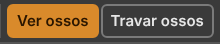

# 9. Coming from Spriter, Spine and DragonBones

Also in Portuguese: [Português](../09-vindo-do-spriter-spine-e-dragonbones.md)

*Checked in the code on 07/10/2026, version v36.5.*

> The editor's interface is in Portuguese. Every button and menu is written
> here with its **exact Portuguese label** in quotes, and the English meaning in
> parentheses the first time it appears.

## What you will be able to do by the end

1. Find, topic by topic, where in Recorte each thing you used in Spriter is.
2. Bring in a whole `.scml` project and carry on from where you stopped.
3. Know beforehand what does **not** come across, and what to do instead.

---

## The keys you already know

Start here: **these keys are the same in both programs.**

| Key | Does |
|:---:|:---|
| `7` | show bones |
| `8` | lock bones |
| `9` | show drawings (*sprites*) |
| `0` | lock drawings |
| `Ctrl+↑` `Ctrl+↓` | up and down in the draw order |
| `Ctrl+→` `Ctrl+←` | front of everything · back of everything |
| `Ctrl` + drag, with **"Mover"** (Move) | clones what is selected |
| middle button, or `Space` + drag | moves the view |
| mouse wheel | zoom |

The order keys work with **one drawing selected**, in the scene or in the
**"Ordem"** (Order) tab.

The first four are also in **"Exibir → O boneco"** (View → The character) and
**"Exibir → Travar"** (View → Lock), and in the **"Exibição"** (Display) tab.



*(The picture is from 15/09.)*

---

## Topic by topic

### Building

| Topic | In Spriter | In Recorte | Where it is |
|:---|:---|:---|:---|
| **Create bone** | `Alt` + drag, with *create bone* | the **"Criar osso"** (Create bone) tool (`B`), click and drag | toolbar; **"Base → Novo → Osso"** (Base → New → Bone) |
| **Attach sprite to bone** | hold `B` and click the sprite | **the same gesture, with `P`**: select the parent bone, hold **`P`**, click each drawing | scene and Árvore (Tree); **"Base → Virar filho de…"** (Base → Become child of…) |
| **Collision box** | `Alt` + drag, with *create box* | the **"Caixa"** (Box) tool (`X`), and `Alt` + drag | toolbar; **"Base → Novo → Caixa de colisão"** (Collision box) |
| **Action point** | `Alt` + drag, with *create point* | the **"Ponto"** (Point) tool (`O`), and `Alt` + drag | toolbar; **"Base → Novo → Ponto"** |
| **Choosing what `Alt` creates** | a selector at the top | **does not exist, and is not missed**: three tools with their own key | — |
| **Hierarchy** | its own panel | the **"Árvore"** (Tree) panel: the bone, its drawings, then its children | **"Janela → Árvore"** (Window → Tree) |
| **Object properties** | its own panel | the **"Propriedades"** (Properties) panel | **"Janela → Propriedades"** |
| **File palette** | its own panel | the **"Imagens"** (Images) tab, by subfolder | **"Janela → Imagens"** |
| **Starting from the image folder** | *File → New Project* | **"Arquivo → Novo projeto…"** (File → New project…) asks for the folder; **"Arquivo → Abrir pasta do projeto…"** (Open project folder…) | Arquivo menu |
| **Reload all images** | button in the file palette | **"Imagens → Recarregar a pasta"** (Images → Reload the folder) | Imagens menu |
| **swap a sprite's image** | right-click the image | **right-click the drawing**: opens the grid to swap | scene |

### The pivot

| | In Spriter | In Recorte |
|:---|:---|:---|
| where it lives | **one pivot per image** | **one pivot per image**, the same. Saved in the atlas |
| how it is set | double-click the image, box with nine icons | **"Imagens → Definir pivô…"** (Images → Set pivot…), or the **"Pivôs"** (Pivots) tab |
| copy and paste | *Copy/Paste Default Pivots* | **"Imagens → Copiar pivô"** (Copy pivot) and **"Colar pivô"** (Paste pivot), in the same proportion |
| for the whole folder | — | **"Imagens → Carimbar pivôs"** (Stamp pivots) |
| back to the bone | — | **"Imagens → Voltar o pivô para o osso"** (Return the pivot to the bone) |
| **animated** pivot | yes | **no**. See "What Spriter has and Recorte does not" |

There is also **"Editar → Copiar posição no osso"** (Edit → Copy position on the
bone) and **"Colar posição no osso"** (Paste position on the bone): it lines up
several drawings at once, in a single undo step.

[Chapter 1](01-build-a-body.md) covers the pivot in full.

### Draw order

| Topic | In Spriter | In Recorte | Where it is |
|:---|:---|:---|:---|
| **Z-order palette** | its own panel | the **Ordem** tab, with thumbnails | **"Janela → Ordem"** |
| **up and down** | `Ctrl+↑` `Ctrl+↓` | **the same keys** | scene and Ordem tab |
| **front / back of everything** | `Ctrl+→` `Ctrl+←` | **the same keys**; also `Ctrl+Shift+↑` `Ctrl+Shift+↓` | **"Base → Frente de tudo / Fundo de tudo"** (Front of everything / Back of everything) |
| **one step, from the menu** | — | `+` and `−` | **"Base → Trazer para a frente / Mandar para trás"** (Bring forward / Send backward) |
| **order that changes in the animation** | order key | **the same**: with an animation open, changing the order becomes a key | — |
| **Copy Z-order to all keyframes** | menu item | **"Base → Copiar a ordem na animação"** (Copy the order in the animation) | Base menu |
| **grouping pieces** | does not have it | **folders**: **"Base → Nova pasta…"** (New folder…) and **"Tirar da pasta"** (Take out of the folder) | Base menu, Ordem tab |

**The top of the list is in front**, in both programs.

### Animating

| Topic | In Spriter | In Recorte | Where it is |
|:---|:---|:---|:---|
| **Key selected** | button | **"Chavear"** (Key) (`K`) | **"Animação"** (Animation) menu |
| **Key all** | button | **"Chavear tudo"** (Key all) (`Ctrl+K`) | Animação menu |
| **previous / next keyframe** | `1` and `2` | `↑` and `↓` | timeline |
| **play** | `4` | `Space` | everywhere |
| **start and end** | `3` and `5` | `Home` and `End` | timeline |
| **stepping through time** | `Ctrl+1` `Ctrl+2`, 1 ms | `←` and `→` step **one frame**; `Shift` steps ten | timeline |
| **copy the whole frame** | `Ctrl+Shift+C` | **the same key** — *"Copiar a pose inteira"* (Copy the whole pose) | **"Editar → Pose"** (Edit → Pose) |
| **paste into every frame** | `Ctrl+Shift+V` | **the same key** — *"Colar em todas as chaves"* (Paste into every key) | **Editar → Pose** |
| **delete from every frame** | `Shift+Delete` | **the same key** — deletes the whole rows | timeline |
| **change parent in the middle of the animation** | yes | **yes**: with the animation open, *become child* becomes a parent key | scene and Árvore, with `P` |
| **open one row per object** | pull the top of the timeline | **"Detalhes"** (Details) button | player; **"Janela → Arrumar → Detalhes da linha do tempo"** (Window → Arrange → Timeline details) |
| **preview speed** | slider | the speed on the player | player |
| **change the length** | click the total time | **"Animação → Mudar duração…"** (Animation → Change length…) | Animação menu |
| **Onion skin** (Pro) | panel | **"Exibir → A cena → Casca de cebola"** (View → The scene → Onion skin); options in **"Exibir → Casca de cebola: opções…"** (Onion skin: options…) | Exibir menu, ruler corner |
| **advanced easing** (Pro) | curves | the **"Curvas"** (Curves) tab, and **"Animação → Curva da chave"** (Key curve) | **"Janela → Curvas"** |

### Swapping images and clothes

| Topic | In Spriter | In Recorte | Where it is |
|:---|:---|:---|:---|
| **Character maps** (Pro) | *available* and *active* columns | the **"Skins"** tab, with the **"Feitas"** (Made) and **"Ativas"** (Active) columns | **"Janela → Skins"** |
| **stacking character maps** | drag from one column to the other | **the same gesture**: drag from Feitas to Ativas. The `×` removes | Skins tab |
| **Merge active to new** | button | **"Skins → Clonar skin"** (Clone skin) | Skins menu |
| **Bake active to entity** | button | **"Skins → Promover skin a base…"** (Promote skin to base…): the active stack becomes a new base, with its own animations | Skins menu |
| **save the stack to a `.scms`** | its own file | does not exist: skins live inside the `.bone`. To take one to another character: **"Arquivo → Exportar → Skin, para outro boneco…"** (File → Export → Skin, to another character…) | Arquivo menu |
| **swap the image in all of them** | — | **"Skins → Trocar imagem nas skins…"** (Swap image in the skins…): swaps it in every skin that uses the same one | Skins menu |

Chapter [3. Skins](03-skins.md) covers this in full. The difference: **a
character map swaps images; a skin is a set of attachments, and can bring
drawings the body did not even have.**

### What the game reads

| Topic | In Spriter | In Recorte | Where it is |
|:---|:---|:---|:---|
| **Variables** (Pro) | *Edit MetaData* | **"Animação → Variáveis e etiquetas → Nova variável"** (Animation → Variables and tags → New variable); and the **parameters**, with the driver rule | Animação menu; **"Malha e regras → Novo parâmetro"** (Mesh and rules → New parameter) |
| **Tags** (Pro) | *active* and *available* | **"Animação → Variáveis e etiquetas → Nova etiqueta"** (New tag) | Animação menu |
| **Event triggers** (Pro) | point on the timeline | **"Animação → Novo evento"** (New event): name, integer, number, text and audio | Animação menu |
| **Sound on the timeline** (Pro) | its own object | the sound goes **inside the event** | the event's definition |
| **Action points** | point with a name and angle | **Ponto**, with a name and direction | tool `O` |
| **Collision rectangles** | rectangle with a name | **Caixa**, with as many corners as you like | tool `X` |

Whether the point and the box animate frame by frame as in Spriter is **not
confirmed**. They move with the bone; and creating a point and a box with an
animation open exists.

### What changes name

| In Spriter | In Recorte |
|:---|:---|
| *entity* | **base**. A project has several bases: Salvar (Save) saves one `.bone` per base and a `manifest.json` |
| *sub-entity* | **entity** (entidade): a `.bone` hanging from a slot of another. **"Tomadas"** (Sockets) menu, formerly Entidades. See [chapter 5](05-entities.md) |
| *character map* | **skin** |
| *sprite* | **slot** plus **attachment** (anexo) |
| *bone* | **bone** (osso) |
| *keyframe* | **key** (chave) |
| *timeline* | **timeline** (linha do tempo), and each of its rows is a property |

---

## What Spriter has and Recorte does not

| What | What to do here |
|:---|:---|
| **animated pivot per image** | put the bone at the joint. The importer uses the pivot of the first key, and warns |
| **Papagayo lip sync** | does not exist. Make the mouths as drawing swaps, key by key |
| **watermark on export** | does not exist |
| **cloning the project at another scale** | `--escala` in the packer makes one atlas per resolution |
| **palette swap in indexed colour** | does not exist. The slot's **"Cor"** (Colour) and **"Cor escura"** (Dark colour) tint the drawing |
| **`M` + drag**, moving the animation's 0,0 | does not exist. Move the `root` bone |
| **Load and Fix Corrupt File** | **"Ajuda → Problemas do arquivo…"** (Help → Problems in the file…) says what was not understood, with the fix where there is one |

### What was on this list and has now come in

| What | Where it is today |
|:---|:---|
| pivot per image | **Imagens → Definir pivô…** and the **Pivôs** tab |
| changing the parent in the middle of the animation | it becomes a **parent key**. The Árvore shows the parent at that frame |
| guides in the scene | pulled from the ruler. **"Exibir → A cena → Guias · Travar guias · Limpar guias"** (Guides · Lock guides · Clear guides) |
| `Z` and `Shift+Z`, select descendants and ancestors | **"Editar → Escolher → Os filhos"** (Edit → Select → The children) (`]`) and **"Os pais"** (The parents) (`[`) |
| `Ctrl` + drag to clone | **the same gesture**, with the **Mover** tool |
| `Ctrl+←` `Ctrl+→`, back and front of everything | **the same keys** |

---

## What Recorte has and Spriter does not

| What | Where |
|:---|:---|
| **Mesh and weights** — bending the drawing from the inside | [chapter 6](06-mesh-and-weights.md). **Spriter's format has no mesh** |
| **Five rules**: IK, transform, path, physics and driver | [chapter 7](07-the-five-rules.md) |
| **Real physics**, running in the game | **"Malha e regras → Física"** (Mesh and rules → Physics) |
| **Clipping mask** that cuts without erasing | **"Base → Novo → Máscara"** (Base → New → Mask) |
| **Shear** (`Z`) | toolbar |
| **Particles** | the **"Partículas"** (Particles) menu: Fogo (Fire), Fumaça (Smoke), Faísca (Spark), Poeira (Dust) |
| **Animation layers**, walking and shooting at once | the **"Prévia"** (Preview) panel, and `AnimationState` in the game |
| **Library of ready-made animations** | **"Animação → Animações → Biblioteca de animações…"** (Animation → Animations → Animation library…) |
| **An open format**, with a specification, validator and conformance suite | [chapter 8](08-export-and-use-in-a-game.md) |
| **Ready-made readers** for Construct 3 and Godot | [chapter 8](08-export-and-use-in-a-game.md) |
| **Free runtime**, Apache 2.0 | — |

**`.bone` is a written standard.** Spriter is the format of a program. If the
program stops — and DragonBones stopped in 2020 — the work is trapped.

---

## Bringing the project in

### From the editor

**"Arquivo → Importar → De outro programa…"** (File → Import → From another
program…)

1. The program asks for **the folder** of the Spriter, Spine or DragonBones
   project.
2. The folder has more than one project: the window *"Qual projeto abrir?"*
   (Which project to open?) asks.
3. **The source program is detected from the content**, not from the extension.
4. The images from the subfolders go to the **Imagens** tab. The ones the
   character uses appear in the scene. The footer counts: *Reading the images…
   12 of 21*.
5. The *Importado do …* (Imported from …) window lists what did not come across
   the same. When nothing was lost, it says so in so many words.

**From the editor only the first *entity* comes in.** The window says which ones
exist. For the whole project, use the command line.

Before importing, if there is unsaved work, the program asks.

### From the command line

```
npm run importar -- boneco.scml saida/boneco.bone --relatorio avisos.txt
```

| Option | For |
|:---|:---|
| `--atlas <arquivo>` | the source atlas (Spine's `.atlas`, DragonBones' `_tex.json`) |
| `--formato <nome>` | forces it: `spine`, `dragonbones` or `spriter` |
| `--parte <nome>` | only one *entity* (Spriter) or *armature* (DragonBones) |
| `--relatorio <arquivo>` | also saves the warnings to a text file |
| `--sem-validar` | does not call the validator at the end |
| `--assar` | Spriter: a single parent per bone, as before. No parent key |

**A `.scml` with several *entities*, without `--parte`, becomes a project:** one
`.bone` per *entity* in the output folder, and the `manifest.json`. Then, in the
editor: **Arquivo → Abrir pasta do projeto…** brings in all the bases.

In DragonBones, without `--parte`, the first one comes out, and it **says which
ones exist**.

**The two dashes after `importar` are required.** Or call it directly:
`node ferramentas/importar.mjs boneco.scml boneco.bone`.

At the end it validates the output by itself.

### The warnings Spriter usually gives

| Warning | What to do |
|:---|:---|
| *The bone "x" changes parent in the middle of the animation…* | nothing. The other keys become a parent row |
| *The drawing "x" changes bone in the middle of the animation…* | nothing. It becomes a `slot/bone` row |
| *The sprite "x" has a per-key pivot…* | the pivot of the first key applies. Between keys the drawing may slide |
| *"quartic"/"quintic" curve … approximated by a cubic Bézier* | nothing. Small error between the keys |
| *The object "x" is a sub-entity…* | convert that *entity* separately, and hang it as an entity |
| *Spriter does not store mesh, weights or IK…* | nothing. It does not exist in the source |

### After importing: the checklist

| # | Step |
|:---:|:---|
| 1 | Read the whole list of warnings. Do not skip it |
| 2 | Open each animation and play it from start to end |
| 3 | Check the draw order: arm in front, arm behind |
| 4 | Check the skins, one by one |
| 5 | Run `npm run validar meu.bone` |

---

## Coming from Spine

Spine is the one that converts best: almost everything comes across whole.

| Thing | In Spine | In Recorte |
|:---|:---|:---|
| coordinates | Y up, degrees counter-clockwise | **the same.** No conversion |
| bone inheritance | an `inherit` field with five names | three boxes: rotation, scale, mirroring |
| order of the rules | an `order` number on each | the position in the list |
| mix names | `mixRotate`, `rotation`, `x`, `y` | `mixRotation`, `offsetRotation`, `offsetX`, `offsetY` |
| colour | hexadecimal text | four numbers from 0 to 1 |
| sliders (4.3) | its own feature | parameter plus driver rule. **Whether the importer converts them: not confirmed** |
| runtime | needs an editor licence | **free, Apache 2.0** |
| hide panels | `F9` | **`Tab`** (**"Janela → Arrumar → Esconder painéis"**, Window → Arrange → Hide panels) |

**Always bring the text `.atlas` along whenever you have it.** Without it, the
pivot and the rotated regions cannot be set right.

---

## Coming from DragonBones

| Thing | In DragonBones | In Recorte |
|:---|:---|:---|
| files | `_ske.json` and `_tex.json` | a `.bone` and a `.atlas.json` |
| several characters | several *armatures* in one file | several **bases** in one project. The importer brings one at a time (`--parte`) |
| deformed mesh | `ffd` | mesh shape key |
| easing by number | `tweenEasing` | Bézier curve |
| editor | stopped since 2020 | alive |

| Common warning | What to do |
|:---|:---|
| `Mesh "x" tem pesos mas não tem "bonePose". Pesos descartados.` (Mesh has weights but no bonePose. Weights discarded.) | redo them with **"Malha e regras → Pesos → Pesos automáticos"** (Mesh and rules → Weights → Automatic weights) |
| `Display "x" do tipo "y" não existe no formato. Descartado.` (Display of type y does not exist in the format. Discarded.) | a feature that only exists there. Redo it another way |
| `Display "x" tem pivô fora do centro, mas o atlas não veio junto.` (Display has an off-centre pivot, but the atlas did not come along.) | import again, with the `_tex.json` |

---

## The warnings that apply to all three

| Warning | Means | What to do |
|:---|:---|:---|
| `Osso "x" aponta para o pai "y", que não existe. Virou filho da raiz.` (Bone x points to parent y, which does not exist. It became a child of the root.) | broken reference in the source | fix the parent in the Árvore |
| `Slot "x" está no osso "y", que não existe. Ligado ao primeiro osso.` (Slot x is on bone y, which does not exist. Connected to the first bone.) | the same | choose the right bone |
| `Animação "a" mexe no osso "x", que não existe. Timeline descartada.` (Animation a moves bone x, which does not exist. Timeline discarded.) | keys for a deleted bone | nothing. They were orphan keys |
| `Animação "a" dispara o evento "e", que não está declarado.` (Animation a fires event e, which is not declared.) | the event had no definition | nothing. It was created with default values |
| `Slot "x" com mistura "y", que o formato não tem. Usando "normal".` (Slot x with blend y, which the format does not have. Using normal.) | rare blend mode | check whether the look changed |
| `IK "x" pede cadeia de 2 ossos, mas "y" não tem pai. Virou IK de 1 osso.` (IK x asks for a 2-bone chain, but y has no parent. It became a 1-bone IK.) | the chain was incomplete | check the hierarchy |
| `Mesh "x" usa região girada, mas o atlas não veio junto. UVs não ajustados.` (Mesh x uses a rotated region, but the atlas did not come along. UVs not adjusted.) | the atlas was missing | import again with the atlas |

If the same warning happens several times, it appears only once, with the count
at the end: `(7 vezes)` (7 times).

**Nothing is discarded silently.**

---

## And Live2D and Creature?

| Program | Situation |
|:---|:---|
| **Live2D Cubism** | the specification lists extensions designed for it (parameter grid, pendulum, alpha mask). The importer does not exist |
| **Creature** | not implemented yet |

---

## The seal — what this chapter confirms

Seals: **exists** · **exists differently** · **missing** · **changes with the
bases**. Checked in the code on 07/10/2026.

| Function | Seal | Where |
|:---|:---:|:---|
| `7` `8` `9` `0`, show and lock | exists | `ui/keys.ts` |
| `Ctrl` + arrows for the order, as in Spriter | exists | `ui/keys.ts` |
| Create bone (`B`), Point (`O`), Box (`X`) | exists | `ui/keys.ts`, `viewport/tools/` |
| Attach to the bone with `P` | exists differently | Spriter uses `B`; here it is `P` |
| Pivot per image, copy, paste, stamp | exists | Imagens menu, Pivôs tab |
| Animated pivot | missing | the importer warns |
| Order that becomes a key in the animation | exists | ESTADO, "Ordem" |
| Copy the order in the animation | exists | **Base → Copiar a ordem na animação** |
| Change parent in the middle of the animation | exists | parent key; importer without `--assar` |
| Guides pulled from the ruler | exists | **Exibir → A cena** |
| Select children and parents (`]` `[`) | exists | **Editar → Escolher** |
| `Ctrl` + drag to clone | exists | `doc/duplicate.ts` |
| Skins in Feitas and Ativas, drag | exists | `panels/skins-model.ts` |
| Variables, tags, events with audio | exists | Animação menu |
| Several bases in one project (*entities*) | exists | Salvar with `manifest.json` |
| Sub-entity (entity in a slot) | exists | Tomadas (Sockets) menu, [chapter 5](05-entities.md) |
| Import by folder, in the editor | exists | **Arquivo → Importar → De outro programa…** |
| Import the whole `.scml` as a project | exists differently | only on the command line; the editor brings the first *entity* |
| Lip sync, watermark, indexed palette, `M` + drag | missing | — |
| Spine 4.3 sliders | not confirmed | — |
| Live2D, Creature, After Effects importer | missing | — |
| PSD importer | exists | its own door: **"Arquivo → Importar → PSD…"** (File → Import → PSD…) ([chapter 1](01-build-a-body.md)) |

---

## What does not work yet

| What | Requirement | How to work around it |
|:---|:---|:---|
| This importer does not read PSD or PSB. | R3, I1 | PSD has its own door: **Arquivo → Importar → PSD…** or **"PSD com ossos…"** (PSD with bones…) |
| From the editor, a `.scml` with several *entities* brings only the first. | — | `npm run importar -- boneco.scml saida/boneco.bone`, then **Abrir pasta do projeto…** |
| Without `--atlas`, a Spine project imports, but the regions come out **uncropped**. | — | Pass Spine's text `.atlas`. The program warns when it is missing. |
| Spriter's animated pivot becomes a single pivot. | — | Put the bone at the joint. |
| There is no Live2D or After Effects importer. | — | — |

---

Back to the [index](README.md)
