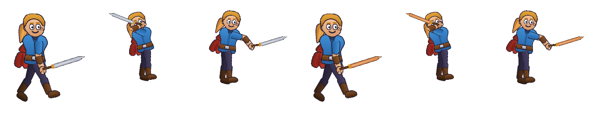

# A espada de um, o boneco de outro — relatório

05/11/2026. Executor `EXECUTANDO · a espada de um, o boneco de outro`
(endereço `recorte-54`), ramo `obra/entidades`. Para o Diretor.

## Em cinco linhas

| # | |
|:---:|:---|
| 1 | **Funciona de ponta a ponta, pela tela.** 18 de 18 passos: `node ferramentas/provas/espada-e-boneco.mjs` |
| 2 | Pessoa A: projeto novo, 3 imagens, 2 ossos, `idle` e `attack`, `Ctrl+S`. Pessoa B: herói sem espada, traz `espada.bone`, põe na mão, acerta, **a de quem recebe**, anima o golpe, `Ctrl+S` |
| 3 | O validador aceita; o runtime põe a espada no pino da mão no `walk` e no `attack`, e ela toca o `attack` dela (cabo a 50° em 0,15 s) |
| 4 | A pessoa A muda a cor e salva por cima; a B reabre: espada nova, encaixe intacto |
| 5 | **Cinco tropeços consertados**, cada um com o teste visto vermelho antes. Dois achados fora da minha parte, só anotados |

## Os tropeços — consertados

| # | Forma do erro | Onde | Teste |
|:---:|:---|:---|:---|
| 1 | **A imagem da entidade morava só no documento dela.** O herói desenhava a espada com as páginas DELE. A espada de exemplo usa o atlas do herói, e por isso ninguém viu | `doc/document.ts` (`imageFor` pergunta ao projeto), `doc/projeto.ts` (`pageImage`, pela identidade da página) | `pasta-do-projeto`, "a espada de um", 2 testes |
| 2 | **Trazer só o `.bone` deixava o atlas para trás, e o aviso não dizia o que fazer.** O navegador não lê o vizinho de um arquivo escolhido | `io/open-save.ts` (`atlasesNotPicked`, `openEntityFromOutside`), `ui/shell-file.ts` (a pergunta: *"Escolher a pasta de espada.bone…"*) | idem |
| 3 | **O Salvar levava o `.bone` da entidade e não o atlas dela** | `io/open-save.ts` (`entityAtlasesForFolder`, dentro de `levarAtlasParaAPasta`) | idem |
| 4 | **"a de quem recebe" só existia no cartão de teste.** A peça arrastada para a cena (projeto) não tinha como ligar `inheritAnimation` | `panels/entities-cards-model.ts` (`SetInheritAnimation`, `projectInheritGesture`), `panels/palette-entities.ts` | `pasta-do-projeto`, rodada 39b, 1 teste novo e 1 ajustado |
| 5 | **A página de ontem era tomada por arte**, e cada salvar noutra sessão criava `espada-atlas2.png`, `3`, … | `io/folder-save.ts` (`ownPagesOnDisk`) | `pasta-do-projeto`, "a espada de um" |

O teste antigo *"anima ▾ na peça do projeto… com a base aberta, diz por quê"* mudou de propósito: com a base aberta o menu agora abre, só com **a de quem recebe**; as outras escolhas continuam dizendo a mesma frase.

## Fora da minha parte — anotado, não mexido

| Parte | O quê | Prova |
|:---|:---|:---|
| Imagens e pasta (`panels/palette-model.ts`, `usageOf`) | a bolinha da aba Imagens diz **2** para uma imagem num slot só: conta `slot.attachment` e o anexo da pele do mesmo slot. A dica diz *"2 slots usam esta imagem"* — falso (regra 21) | foto `03` da prova; qualquer projeto novo |
| Manual (`documentos/manual/imagens/00-*.png`) | 10 imagens `00-*` não são citadas por capítulo nenhum: `ajuda.test.ts`, *"toda imagem no disco é citada"*, **já vermelho antes desta obra** | `npx vitest run editor/testes/ajuda.test.ts` |

O consertado no 5 (`io/folder-save.ts`) é da parte Imagens e pasta. Entrou porque estava no caminho do salvar da espada, e é pequeno (uma função nova e duas linhas). Avise o dono.

## A decisão que tomei (sem perguntar: ninguém vivo no `ListAgents`)

**A entidade é cópia na pasta do projeto, não link para a pasta da pessoa A.** O navegador não deixa reler a pasta de outra pessoa sem pedir de novo. Então a atualização chega assim: a pessoa A manda os três arquivos (`espada.bone`, `espada.atlas.json`, `espada-atlas.png`), a B os põe na pasta dela, por cima, e reabre. **Nada se refaz.** A prova faz essa entrega fora do navegador, como um explorador de arquivos faria. Se o Humberto quiser a espada chegando sozinha: é guardar o handle de origem (IndexedDB) e pedir permissão ao reabrir — trabalho de uma rodada, escrito no capítulo 11, "O que ainda não funciona".

## A prova, como rodar

```
node ferramentas/provas/vite-quieto.mjs --port 5196      (noutra janela)
node ferramentas/provas/espada-e-boneco.mjs --fotos PASTA
```

Precisa do Playwright (`require('playwright')`). As fotos de agora: `fotos-entidades/`.



## O fecho — 05/11/2026, 00:27 a 00:39 (UTC), casa vazia (ninguém no `ListAgents`)

| Medida | Antes (commit de partida) | Agora |
|:---|:---|:---|
| `npx vitest run` | 5.806 testes, 5.774 passam, 31 pulados, 1 vermelho | **5.812** testes, **5.780** passam, 31 pulados, **o mesmo 1 vermelho** |
| o vermelho | `ajuda.test.ts`, *"toda imagem no disco é citada"*: as dez `00-*.png`. Dono: o manual. Não é desta obra | idem |
| `tsc --noEmit -p editor/tsconfig.json` | limpo | limpo |
| `node ferramentas/conformidade.mjs` | — | **120 de 120** |
| `npm run roteiro` | — | **14 de 14**, console limpo |
| `npm run medir` | 90/90 de lado, **82**/90 de altura | 90/90, **82**/90 — igual. O 83 do `ESTADO.md` foi medido no Windows; neste Linux as fontes são outras |
| `npm run espada` | não existia | **18 de 18** |

**Cuidado que custou uma volta (regra 27, pela forma):** *criei um `backup/` dentro do clone para cumprir a regra 1, e a existência da pasta liga cinco testes que só rodam no PC do Humberto.* Deu cinco vermelhos que não eram defeito. O backup foi para fora da pasta medida. No clone do GitHub, a regra 1 é cumprida pelo git.

**Não feito aqui, de propósito:**

| O quê | Por quê |
|:---|:---|
| `python ferramentas/versao.py N.N` | o `backup/` e o `INDICE.md` não vêm no clone: o número livre não se sabe daqui. O CHANGELOG diz "sem número ainda" |
| `python ferramentas/montar-programa.py` | montado aqui, ele apagava dezenas de imagens do `programa/assets` (o build deste Linux difere do de lá). Desfeito. Montar na máquina do Humberto |
