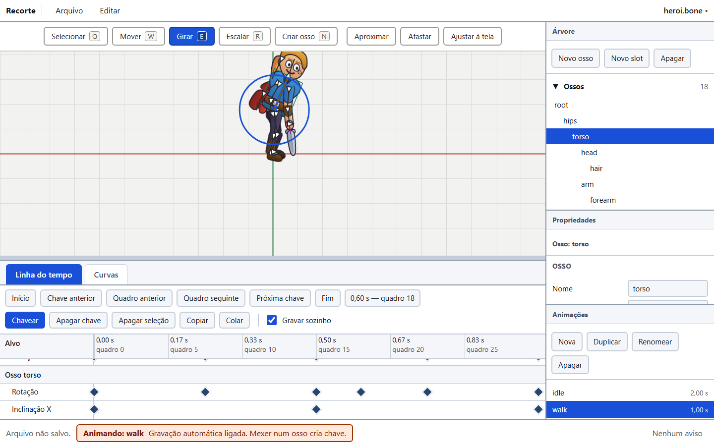
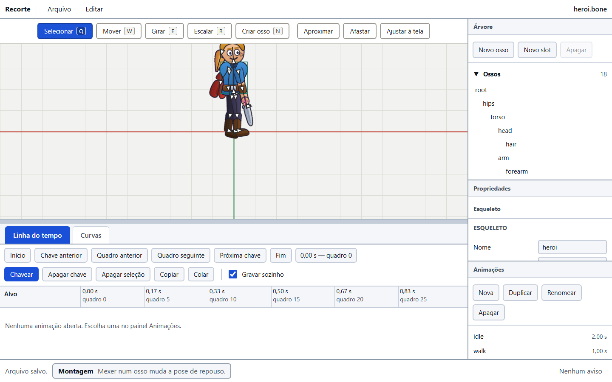
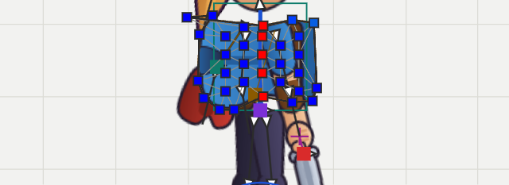
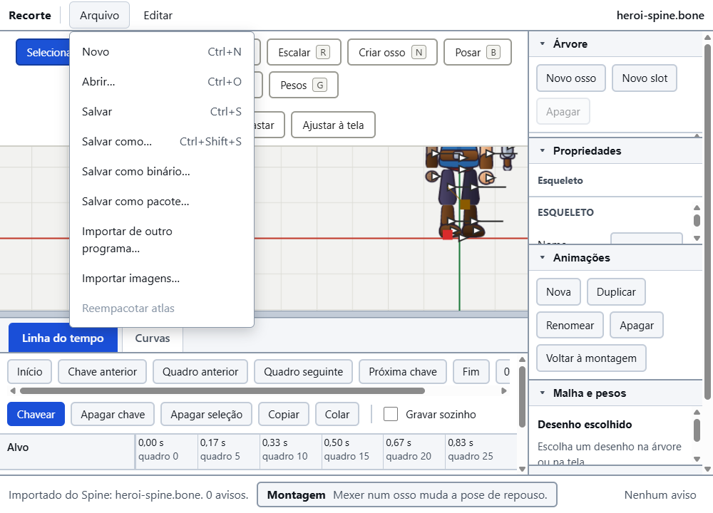

# Editor Recorte

Programa de animação 2D por ossos. Abre no navegador.



Acima: uma animação aberta, o osso `torso` girado, a chave nova na linha do
tempo e a barra de estado avisando **Animando: walk**. Abaixo, a mesma tela em
modo de montagem, como ela abre.



E a malha do tronco com os pesos pintados, azul onde o osso não puxa e vermelho
onde puxa inteiro:



## Como abrir

Na pasta do projeto:

```
npm run editor
```

Depois abra `http://localhost:5173` no navegador.

Ao abrir, o editor já carrega o exemplo `formato/exemplos/heroi.bone`.

Para gerar a versão de produção: `npm run editor:build`. Os arquivos saem em
`backup/editor-build/`.

## A ideia central

**O documento do editor É o arquivo `.bone`.**

Não existe um modelo interno que depois vira arquivo na exportação. Cada
comando muda o próprio JSON da especificação. Salvar é gravar esse JSON. Por
isso o editor nunca consegue criar uma coisa que o formato não saiba guardar.

## O que já funciona

**Tela**
- Barra de menus: Arquivo (Novo, Abrir, Salvar, Salvar como, Salvar como
  binário, Salvar como pacote, **Exportar glTF**, Importar de outro programa,
  **Importar PSD**, Importar imagens, Reempacotar atlas), Editar (Desfazer,
  Refazer) e **Ajuda** (Manual), com os atalhos escritos ao lado.
- Área de desenho no centro, seis painéis à direita (Árvore, Propriedades,
  Animações, Malha e pesos, Exibição, Prévia), faixa de baixo com abas (Linha
  do tempo e Curvas), barra de estado embaixo.
- A altura da faixa de baixo se arrasta com o mouse, na barra cinza acima dela.
  Também anda com as setas do teclado quando ela está em foco.
- Numa tela de 900 px de altura a coluna da direita cabe inteira, e cada painel
  rola por conta própria. O título de cada painel é um botão: clicar dobra o
  painel e devolve a altura dele para os outros. **Malha e pesos**, **Exibição**
  e **Prévia** nascem dobrados, para a Árvore e as Propriedades — os dois de
  todo dia — terem altura de trabalho.
- **A janela nunca rola.** O que rola é o painel. Sem isso, um clique num campo
  lá embaixo levava a barra de menus para fora da tela, e quem tem dislexia
  perde o lugar e não o recupera.
- Atalhos: `Ctrl+Z`, `Ctrl+Y`, `Ctrl+S`, `Ctrl+O`, `Ctrl+N`, `F1` (manual).

**Dois modos, e a barra de estado diz qual está valendo**
- **Montagem** (nenhuma animação aberta): mexer num osso muda a pose de
  repouso, que é o que sempre aconteceu.
- **Animando: nome** (uma animação aberta): mexer num osso **não toca na pose de
  repouso**. Cria ou atualiza uma chave no tempo do cursor. Vale para as
  ferramentas Mover, Girar e Escalar e para os campos do painel Propriedades.
- A gravação automática vem ligada. Desligada, o editor **recusa** a edição em
  vez de cair na pose de repouso, e manda usar o botão Chavear.

**Área de desenho**
- Desenha o esqueleto com o mesmo renderizador que um jogo usaria.
- Grade, eixos, ossos, nomes dos ossos, seleção, caixas de colisão e pontos —
  cada um com sua caixa no painel Exibição, mais a cor do fundo.
- Casca de cebola: fantasmas dos quadros de antes e de depois, por baixo do
  desenho, em vermelho para o passado e azul para o futuro.
- Alças das regras em qualquer ferramenta: alvo de IK, dobra do cotovelo, alvo
  de transformar, posição no caminho, vento e gravidade.
- Mover a vista com o botão do meio ou com espaço + arrastar.
- Zoom na roda do mouse, no ponto onde está o cursor.
- Botões Aproximar, Afastar e Ajustar à tela.

**Ferramentas** (com atalho de uma tecla)
- Selecionar `Q` — clique escolhe o desenho, a caixa ou o osso mais perto.
  `Shift` soma à seleção, `Alt` passa pelos itens empilhados.
- Mover `W`, Girar `E`, Escalar `R` — arrastam o osso na tela.
- Criar osso `N` — clique põe a raiz, arrastar dá comprimento e ângulo.
- Posar `B` — arrasta a ponta de uma cadeia de dois ossos e ela dobra sozinha,
  com a mesma conta do `IkConstraint` do runtime. Escreve só rotação local.
  As alças das regras também se arrastam com ela (o alvo de IK, por exemplo).
- Malha `M` — arrasta vértice, `Ctrl` + clique acrescenta, `Delete` tira,
  `L` liga dois vértices e `K` desliga.
- Pesos `G` — pincel que pinta o peso do osso escolhido.

Em montagem escrevem a pose de repouso; com uma animação aberta escrevem uma
chave. Um arrasto inteiro vira **um** passo de desfazer nos dois casos.

**Eixos e compensação, na barra do viewport** (requisito R7)

| Botão / caixa | O que faz |
|:---|:---|
| **Eixos: Local · Pai · Mundo** | Em quais eixos as setas de Mover, o anel de Girar e as alças de Escalar trabalham, e a qual eixo o `Shift` prende. Os três nomes ficam escritos na tela, sempre; não é um menu que esconde o estado. O padrão é **Local**, que é o que as ferramentas já faziam. O que é **gravado** continua sendo o `x`, `y`, giro e escala em relação ao pai, porque é só isso que o arquivo tem. |
| **Compensar: Não mexer nos filhos** | Move, gira ou escala o osso **sem tirar os filhos do lugar na tela**. É como se conserta um rig sem refazer a pose: cada filho recebe de volta a pose local que devolve exatamente a matriz de mundo que ele tinha. |
| **Compensar: Não mexer nos desenhos** | O mesmo para os desenhos presos ao osso: região, ponto, vértices de malha, de caixa e de recorte. Só vale em **Montagem** — um desenho não tem linha de tempo que carregue a posição dele. |
| **Compensar: Não mexer nas caixas** | O mesmo para as caixas de colisão. Também só em Montagem. |

Um osso cuja posição de mundo é decidida por uma **regra** (caminho, física) não
pode ser segurado: a regra roda depois e reescreve a pose. Na prática isso são a
capa e o cabelo do exemplo — o resto do corpo fica parado.

**Painel Árvore**
- Ossos com recuo por nível, slots na ordem de desenho, peles e regras.
- Clique seleciona. Arrastar osso sobre osso troca o pai.
- Duplo clique renomeia, e o nome é trocado em todas as referências.
- Botões Novo osso, Novo slot e Apagar.

**Painel Propriedades**
- Duas colunas alinhadas: rótulo à esquerda, campo à direita.
- Campos do osso, do slot, do anexo, das cinco regras e do esqueleto.
- Campo numérico aceita arrasto lateral e conta simples (`100/2`, vírgula).
- Qualquer mudança aparece na hora no desenho.
- Grupo **Marcação no editor** (requisito R2): **Cor do osso** (cor e
  transparência) e **Ícone** (12 opções, cada uma com a palavra escrita ao lado
  do desenho). Os dois já existiam no formato (§4.2), então nada foi inventado
  em `extras`: pintar um osso é uma mudança do documento como outra qualquer e
  viaja junto com o arquivo. A tela desenha o osso na cor dele e põe o ícone à
  esquerda da raiz. Um osso **selecionado** vai azul de qualquer jeito — a
  seleção tem de ganhar, ou um osso pintado de azul ficaria igual a um escolhido.

**Painel Animações**
- Lista com a duração de cada uma. Clique abre.
- Nova, Duplicar, Renomear, Apagar, **Voltar à montagem** (fecha a animação e
  devolve a pose de repouso para edição).
- Tocar/Parar, laço, velocidade, campo de tempo e barra de progresso.

**Aba Linha do tempo** (embaixo, na largura toda)
- Uma linha por propriedade animada, agrupada por osso, slot ou regra.
- Régua em segundos **e** em quadros, com o fps do esqueleto.
- Cursor de tempo arrastável; o desenho acompanha na hora.
- Losango por chave: clique escolhe, arrastar move no tempo com encaixe no
  quadro (`Alt` solta o encaixe), arrastar no vazio faz laço de seleção.
- Botões Chavear, Apagar chave, Apagar seleção, Copiar, Colar, e a caixa
  "Gravar sozinho".
- Teclado: `Delete`, `Ctrl+C`, `Ctrl+V`, setas para quadro e para chave,
  `Home` e `End`.

**Segunda barra da Linha do tempo** (requisitos A1 e A6)

| Campo / botão | O que faz |
|:---|:---|
| **Fator** + **Esticar seleção** | Multiplica o tempo das chaves escolhidas por esse número, segurando a primeira delas no lugar. Fator 2 dobra a duração do trecho; 0,5 encolhe pela metade. |
| **Espelhar no tempo** | Inverte a ordem das chaves escolhidas em volta do meio da própria seleção. O bloco não sai do lugar: só a ordem vira do avesso. |
| **Fechar ciclo** | Copia a primeira chave de cada linha para o fim da animação e **casa as tangentes**, pondo `P2 = P3 − T`, onde `T` é a tangente que sai da primeira chave. A velocidade que chega no fim passa a ser a mesma que sai do começo, e o laço não dá solavanco. Sem seleção, fecha todas as linhas. Diz no rodapé quantas fechou e em quantas casou as tangentes. |
| **Pares de nome** + **Espelhar esquerda e direita** | Troca as linhas de tempo entre os ossos de nome espelhado. A regra vai no campo, pares separados por vírgula e os dois lados por barra: `_e/_d, _l/_r, _esq/_dir`, ou `/_b` para o herói de exemplo. **Os pares achados aparecem escritos embaixo do campo antes de qualquer troca**, e o botão ainda abre uma janela com a lista e dois botões que dizem o que fazem: *Trocar os lados* e *Deixar como está*. Só troca linhas de **osso**. |

**Aba Curvas**
- Tempo na horizontal, valor na vertical, uma linha por componente, com cor por
  propriedade e o nome escrito na legenda.
- Chaves como pontos; alças de Bézier arrastáveis, inclusive num trecho reto.
- Sete formatos prontos com o nome escrito: Suave, Entrada suave, Saída suave,
  Linear, Degrau, Passa do alvo, Recua e passa.
- Botões Ajustar e Mostrar todas, e leitura de tempo e valor sob o cursor.

**Painel Malha e pesos**
- Diz qual desenho está escolhido e a forma dele (vértices, triângulos, contorno).
- **Virar malha** transforma uma imagem inteira numa malha de quatro cantos.
- **Gerar automática** lê os pixels da imagem, traça a silhueta pelo alfa e
  triangula por dentro. **Traçar contorno** faz só a borda. A imagem é
  desvirada quando o atlas a gravou deitada (`rotation: 90`).
- **Pesos automáticos** dá peso a cada vértice pela distância ao osso, com queda
  suave; a soma por vértice é exatamente 1. Também há Suavizar, Podar e Tirar
  pesos.
- Pincel com modo (Somar, Subtrair, Substituir, Suavizar), raio e força.
- Lista dos ossos que influenciam, com a porcentagem média e uma trava por osso.
  Clicar no nome escolhe qual osso o pincel pinta e quais cores a tela mostra.

**Painel Exibição**
- Nove caixas do que mostrar na tela, a cor do fundo e o bloco inteiro da casca
  de cebola (ligar, só nas chaves, silhueta, quadros antes e depois, passo,
  quanto aparece, deslocamento e as duas cores).
- Lista de peles com "Mostrar" e "Editar aqui": várias peles podem ficar
  visíveis ao mesmo tempo (spec 7.1) e a primeira é onde um anexo novo nasce.
- O que você escolhe fica guardado dentro do arquivo, na extensão
  `RECORTE_editor_state`, e uma cópia no navegador serve de padrão para um
  arquivo novo.

**Painel Prévia** (requisitos A5 e A7)
- Até quatro camadas de animação misturadas ao vivo. Camada 0 é a de baixo; as
  de cima escrevem por cima dela.
- Por camada: a animação, repetir, velocidade, quanto aparece (o peso da
  camada), a mistura em segundos e quais ossos ela pode mover — a lista com
  caixas é o "atirar só nos braços".
- Botões Tocar, Parar e Reiniciar, e o relógio de cada camada escrito ao lado
  dela ("0,42 s de 1,00 s · misturando 50%").
- Toca num **segundo esqueleto**, com a `AnimationState` do runtime. Nada disso
  encosta na tela de desenho, na linha do tempo nem no arquivo.
- "Copiar para a linha do tempo" grava o resultado da mistura como uma animação
  nova, com 30 chaves por segundo. O que se perde na cópia está escrito na tela,
  em lista, ao lado do botão — e não atrás de um "saiba mais".

**Arquivo**
- Abrir e salvar com a File System Access API quando o navegador tem; nos
  outros, `<input type="file">` e download.
- Antes de salvar, o arquivo passa pelo carregador do runtime. Se algo fosse
  dar problema para quem lê, o editor avisa.
- **Salvar** grava também o `.atlas.json` e as páginas, quando as imagens foram
  importadas aqui dentro. Sem isso o `.bone` apontaria para um atlas que não
  existe.

**Trazer e levar (menu Arquivo)**



Acima: o personagem veio de um projeto de Spine, o nome do arquivo já é
`heroi-spine.bone` e a barra de baixo diz **Importado do Spine: 0 avisos**.

| Item do menu | O que faz |
|:---|:---|
| **Importar de outro programa…** | Lê um projeto de Spine, DragonBones ou Spriter e abre como documento. Escolha o projeto, o atlas e as imagens de uma vez; o programa de origem é descoberto pelo conteúdo do arquivo, não pela extensão. |
| **Importar PSD…** | Lê um `.psd` ou `.psb` **em camadas**, do Photoshop. Cada camada vira um slot com um desenho `region`, **na posição exata em que ela estava na tela do Photoshop** e na ordem de desenho do arquivo. Grupo do Photoshop vira pasta no nome do slot (`corpo/braco`). Camada com o olho desligado entra com o slot desligado. Um passo só de desfazer. Requisito R3 / I1. |
| **Importar imagens…** | Escolha vários PNG. Eles são empacotados num atlas e cada um vira um slot com o seu desenho, em fila, para nada nascer escondido atrás de nada. Um passo só de desfazer. |
| **Reempacotar atlas** | Refaz a página com outras opções, sem pedir os arquivos de novo. Fica apagado até haver imagens importadas — o PSD conta. |
| **Salvar como binário…** | Grava um `.boneb`: o mesmo esqueleto, no formato compacto da seção 11. Cerca de 38% menor (medido no `heroi.bone`: 28.467 → 17.804 bytes). |
| **Salvar como pacote…** | Grava um `.bonez`: o esqueleto, o atlas e as imagens das páginas dentro de um arquivo só. |
| **Exportar glTF…** | Grava um `.glb` (um arquivo só) ou um `.gltf` (JSON, com os números dentro dele mesmo). É o formato que Blender, three.js, Babylon, Godot e Unity já leem. O nome que você escolher decide qual dos dois sai. |

**Abrir aceita as três embalagens.** Escolha um `.bone`, um `.boneb` ou um
`.bonez`; o tipo é descoberto pelos bytes, não pelo nome. Um `.bonez` já traz o
atlas, as imagens e os esqueletos aninhados dentro, então nada mais precisa ser
escolhido junto.

**A janela do PSD.** Quando o documento já tem um esqueleto, o editor pergunta
antes de mexer nele, e cada botão diz o que vai acontecer: **Substituir o que já
existe** (apaga ossos, slots e animações e monta tudo de novo pelo PSD) ou
**Acrescentar ao que já existe** (guarda o que existe e põe as camadas por
cima). `Esc` e um clique fora cancelam. No fim, o que o `.bone` não tem lugar
para guardar — uma mistura que o formato não conhece, uma máscara de camada, uma
camada sem pixels — aparece numa lista de avisos em português.

**Um atlas por documento.** As camadas do PSD entram no **mesmo** acervo de
imagens que o "Importar imagens", então tudo é empacotado numa página só,
"Reempacotar atlas" passa a valer para as camadas, e **Salvar** grava o
`.atlas.json` e o `.png` com elas dentro. Uma camada cujo nome já pertence a um
desenho do documento é renomeada, com aviso — nunca apaga o desenho que estava lá.

**Fora do editor:** `npm run importar-psd -- personagem.psd saida` faz o mesmo na
linha de comando e grava `saida.bone`, `saida.atlas.json` e `saida.png`, com o
resumo em colunas alinhadas e o validador rodado no fim.

**A janela do glTF.** Depois de exportar, o editor mostra numa janela tudo que
glTF não tem lugar para guardar: constraints, ordem de desenho, cisalhamento,
recorte, esqueleto aninhado, sequência de imagens. Uma linha por item, em
português, com um botão **Fechar**.

**Menu Ajuda**

| Item do menu | O que faz |
|:---|:---|
| **Manual** (`F1`) | Abre o manual inteiro numa aba nova: os oito capítulos e o índice numa página só, montados a partir de `documentos/manual/`. Se o navegador estiver barrando janelas novas, o editor avisa e diz o que fazer. |

**A janela de avisos**

Ao importar, o que não veio igual aparece numa janela simples: título em
palavras, uma frase de abertura, um aviso por linha e um botão **Fechar**. Ela
também fecha com `Esc` ou clicando fora. Quando nada se perdeu, ela diz isso
com todas as letras.

**Desfazer**
- Exato: desfazer devolve o arquivo byte a byte ao que era antes.

**Velocidade**
- Escrever uma chave **não recarrega mais o arquivo inteiro**. O documento lê de
  novo só as timelines da animação aberta (`doc.rebuildAnimations`, apoiado no
  `loadAnimationsFor` do runtime), reaproveitando os mesmos ossos, slots, peles e
  anexos já carregados — e o `Skeleton` que está na tela continua vivo. Um
  arrasto que escreve uma chave por movimento do mouse deixou de custar um
  carregamento completo por quadro.

**Malha e pesos na prática**
- Em **montagem**, mover um vértice muda a malha de repouso e o desenho deforma
  na hora.
- Com uma **animação aberta**, o mesmo arrasto escreve uma chave de `deform` no
  tempo do cursor e **não toca na malha de repouso**. A linha aparece na linha
  do tempo como *Malha slot / anexo*.
- Girar um osso arrasta a malha junto, pelos pesos, com o
  `computeWorldVertices` do próprio runtime.

## O que ainda não funciona

- **Não dá para arrastar um slot para o espaço entre duas linhas**; só soltar
  em cima de outra linha, que troca de lugar.
- **A altura de cada painel da direita não se arrasta.** Dá para dobrar um
  painel clicando no título, e a coluna rola numa tela baixa, mas o tamanho
  exato de cada um continua no CSS.
- **Não há alça para editar o UV separado da posição.** Mover um vértice em
  montagem recalcula o UV junto (o `keepUv` existe no código, sem botão).
- **O traçado de silhueta segue só o contorno de fora**: um buraco no desenho
  fica dentro da malha.
- **Não há eventos nem áudio na tela.** As chaves de evento aparecem na linha do
  tempo, mas não há campo para escolher qual evento dispara.
- **O painel Curvas não tem zoom nem deslocamento**: mostra sempre a animação
  inteira, e um eixo vertical só para todas as linhas visíveis. Escala e rotação
  no mesmo gráfico se achatam; esconda uma delas na legenda.
- **Arrastar uma chave não estica a animação**: o tempo fica preso dentro da
  duração. Esticar a **seleção** por um fator já existe, por botão; esticar
  arrastando a **borda** da seleção, não.
- **A compensação não segura um osso que uma regra manda.** Um osso sob regra de
  caminho ou de física tem a posição decidida depois, pela regra, e volta a se
  mexer. No exemplo isso é a capa e o cabelo.
- **A compensação não vale para herança fora do normal.** Um filho com
  `inheritRotation`, `inheritScale` ou `inheritReflection` desligado é deixado
  como está, em vez de ser movido errado: a volta da §5.4 não vale para os
  outros quatro modos.
- **Compensar um desenho `region` ou `point` sob escala desigual é aproximado.**
  A conta pede um cisalhamento e o formato não tem campo de cisalhamento para
  anexo. Vértices (malha, caixa, recorte) e ossos filhos são exatos sempre.
- **Espelhar esquerda e direita troca só linhas de osso.** Slot, `deform` e
  sequência ficam de fora: o nome do anexo do lado esquerdo não existe no slot
  direito, e trocar só o alvo apontaria para o vazio.
- **A Prévia mistura, mas não copia tudo.** "Copiar para a linha do tempo" grava
  só os ossos (sete propriedades). Evento, ordem de desenho, cor de slot,
  `deform`, sequência, parâmetro, morph, variável e tag não são gravados — a
  lista está escrita na tela, ao lado do botão.
- **Uma camada da Prévia só encadeia uma mistura por vez.** Trocar a animação no
  meio de uma transição descarta a de saída em vez de encadear três.
- **O leitor de PSD não traz tudo.** Máscara de camada não é importada (o
  desenho vem inteiro, com aviso). Camada de texto, de ajuste e de forma vetorial
  só entram como pixels quando o PSD carrega os pixels rasterizados. Profundidade
  de 1 e de 32 bits por canal não é lida; 8 e 16 bits sim, e 16 é reduzido para
  8. Modo de cor CMYK, Lab e indexado avisa que a cor pode sair trocada.
- **Todo slot vindo do PSD nasce preso ao osso raiz.** Criar os ossos por cima
  das camadas continua trabalho do artista, no editor.
- **Mudar a forma da malha ainda recarrega o arquivo inteiro.** As chaves já
  não fazem isso (ver abaixo), mas mover um vértice em montagem sim.

## Onde fica cada coisa

| Pasta | O que tem |
|:---|:---|
| `src/contract.ts` | O contrato: documento, comandos, ferramentas, painéis. Ninguém muda sem combinar. |
| `src/doc/` | Documento, comandos, pilha de desfazer, esqueleto vivo. |
| `src/ui/` | Casca: colunas, barra de estado, teclado (`shell.ts`); o que cada menu oferece, como lista pura (`menus.ts`); a janela de avisos e a de pergunta (`dialog.ts` — `tellUser` e `askUser`; o editor não usa `window.alert` nem `window.confirm`, que escrevem "OK" e "Cancelar" e não dizem o que vai acontecer). |
| `src/io/` | Abrir e salvar (`open-save.ts`), importar imagens e empacotar (`import-images.ts`), importar PSD e PSB (`import-psd.ts`), importar de outro programa (`import-foreign.ts`), gravar `.boneb` e `.bonez` (`save-binary.ts`), exportar glTF (`export-gltf.ts`), montar o manual (`manual.ts`). |
| `src/viewport/` | Tela de desenho, câmera, seleção por clique, ferramentas. |
| `src/anim/` | Chaves, curvas e a regra dos dois modos (`pose-mode.ts`). |
| `src/panels/` | Árvore, Propriedades, Animações, Malha e pesos, Exibição, **Prévia** (`preview.ts` desenha, `preview-model.ts` decide e é o que os testes cobrem), Linha do tempo, Curvas. |
| `src/mesh/` | Malha, pesos e a ponte com o documento (`mesh-doc.ts`). |
| `testes/` | 500 testes só do editor; 1.176 no projeto inteiro. |

`PEDIDOS-CONTRATO.md` e `PEDIDOS-FASE3B.md` guardam o que falta no contrato e
como cada dono contornou enquanto isso. Os dois saíram desta pasta e estão em
`documentos/notas-de-desenvolvimento/`.
